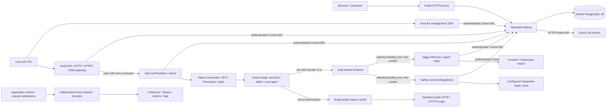

# Focus 01: Architecture and Data Flow

Scope answer, verbatim: "Repository only (Recommended)".

This is fresh source discovery for the repository reset. Paths below are relative
to `sut_path`; line numbers refer to the inspected reset worktree. The provenance
commit is the pre-deletion baseline and should be reconciled to the deletion
commit when the orchestrator imports this artifact. The old Antithesis harness
was not used as an architectural template. Statements marked **contract** describe
claims to test, rather than a passing execution or an established guarantee.
The companion guest/native interface artifact supplements this focus.

## Authoritative system map

Overalls is considerably larger than a two-service provisioner. Production source
contains eight independent Elixir application/release roots: Marshall, Lilly,
Audi, Brady, Enrico, Galileo, Porsche and Ziggy. Their Mix manifests depend on the
shared protocol and diagnostics packages; services that measure request
admission also depend on `elixir/request_accounting`. Marshall's Lilly/Porsche/Audi
dependencies are test-only with `runtime: false`, not release coupling
(`marshall/mix.exs:50`). Native Rust programs own privileged host/guest effects,
terminal PTYs, editor process ownership, SSH/trust/workspace helpers and durable
observation recording. Nix defines release closures, guest images, NixOS
deployment, host configuration and machine tests.

The diagram is a logical dataflow. Private TLS, kernel interception, Unix peer
credentials, ZFS/Firecracker and systemd effects have host-local deployment
constraints; splitting their nodes into arbitrary Compose containers does not
preserve those mechanisms automatically.

| Component | Actual source responsibility | Authority / persistence boundary | Principal source evidence |
| --- | --- | --- | --- |
| Marshall | Browser/API/control ingress; durable admission, desired state, identity/access, accounting, jobs and orchestration | Ash domains and PostgreSQL; encrypted values via Vault; Cedar authorization; Oban jobs | `marshall/lib/marshall/application.ex:44`, `marshall/lib/marshall/compute/admission.ex:44`, `marshall/lib/marshall/authorization/cedar.ex:26` |
| Lilly | Authenticated host sessions/reports, durable placement intent, VM actors, native reconciliation, local ingress/private attribution, transfer/clone/Inception workers | Host-bound Store, per-placement journals and independent OS locks; local execution view; separate VMM supervision | `lilly/lib/lilly/application.ex:14`, `lilly/lib/lilly/control/runtime.ex:149`, `lilly/lib/lilly/control/store.ex:11` |
| Audi | Independent gateway, DNS and private frontend roles; public SSH/web/editor routing and local guest connection | Marshall grants access/leases; local Lilly connector verifies current physical execution; no PostgreSQL authority in Audi | `audi/lib/audi/application.ex:74`, `audi/lib/audi/private/front.ex:32`, `lilly/lib/lilly/ingress/backend.ex:11` |
| Porsche | Management SSH with browser key approval and Marshall-owned command/session authority | Shared Control client; retained HTTPS bootstrap readiness/host certificate; no direct database or Oban mutation | `marshall/lib/marshall/control/services/porsche.ex:1`, `porsche/lib/porsche/application.ex` |
| Ziggy | Inference frontend, SSH bootstrap relay, guest agent relay and pulled agent model work | Marshall authority; bounded local durable metadata spool; fixed provider origins; immutable completion accounting | `ziggy/lib/ziggy/application.ex:17`, `ziggy/lib/ziggy/http.ex:57`, `ziggy/lib/ziggy/spool.ex:87`, `ziggy/lib/ziggy/reporter.ex:35` |
| Galileo | Named integration proxy with fresh binding validation and renewable authorization | Marshall authorizes configuration/current execution; Audi-only Unix frontend; configured upstream effect | `galileo/lib/galileo/application.ex:20`, `galileo/lib/galileo/http.ex:19`, `marshall/lib/marshall/control/services/galileo.ex:30` |
| Brady | Intercepted public egress; Host/SNI/original-destination validation before bounded cache or upstream | Kernel destination and Lilly attribution are trust inputs; cache cannot create request authority | `brady/lib/brady/proxy.ex:5`, `brady/lib/brady/proxy.ex:84`, `lilly/lib/lilly/application.ex:93` |
| Enrico | GitHub mirror refresh, bounded reads/search and mirror removal | Marshall owns durable request/audit intent; Enrico owns native Git child and filesystem writes; attempt receipts are local and capped | `enrico/lib/enrico/application.ex:16`, `enrico/lib/enrico/http.ex:11`, `enrico/lib/enrico/manager.ex:58`, `enrico/lib/enrico/git.ex:47` |
| Protocol | Closed codecs, sizes, identity/placement/execution documents, views/cadence and Control/WebSocket transport | No application domain authority; deserialize before use and retain version boundaries | `protocol/lib/overalls_protocol/control/envelope.ex:68`, `marshall/lib/marshall/compute/provisioner_requests.ex:70` |
| Diagnostics / request accounting | Reviewed event schema, bounded routine traces, explicit custody, request producer and recorder RPC | Observation confers no execution/access authority; independent process/disk custody has distinct acknowledgements | `elixir/diagnostics/lib/overalls/diagnostics/processor.ex:68`, `elixir/diagnostics/lib/overalls/diagnostics/custody.ex:8`, `nix/modules/otel-guest/receiver/src/request_recorder.rs:208` |

## Domain ownership and entrypoints

There are fourteen Marshall Ash domains, plus Lilly's Lifecycle domain. This is
a source inventory (`rg 'use Ash.Domain' marshall/lib/marshall lilly/lib/lilly`),
not a count of independent services or databases:

| Domain | Representative owned state / behavior | Source |
| --- | --- | --- |
| Accounts | User, permanent GuestAccount, passkeys/challenges, tokens, verification, deletion and admin identity | `marshall/lib/marshall/accounts.ex:8` |
| Access | Grant and audited access changes | `marshall/lib/marshall/access.ex:9` |
| Teams | Team/member/ownership transfer | `marshall/lib/marshall/teams.ex:9` |
| Compute | Host/session/credential, storage pool, placement/reservation/address, VM/operation/physical outcome, clone/resize/relocation/evacuation | `marshall/lib/marshall/compute.ex:9` |
| Fleet | Host inventory and credentials distinct from placement execution | `marshall/lib/marshall/fleet.ex:9` |
| Ingress | Gateway/DNS service identity, endpoint/route/publication, web streams/login, wildcard certificates and Inception environments | `marshall/lib/marshall/ingress.ex:9` |
| Terminal | Session/opening/viewer/grant/ticket/location and event receipts | `marshall/lib/marshall/terminal.ex:9` |
| Editor | Single-use login, browser credential and renewable personal editor lease | `marshall/lib/marshall/editor.ex:9` |
| SSH | Gateway authority, key registration, approval/session/request, host certificates and retention | `marshall/lib/marshall/ssh.ex:9` |
| Inference | Host credential, request completion accounting and daily aggregates | `marshall/lib/marshall/inference.ex:9` |
| Agents | VM-bound thread/turn, executor lease, command/model call, CLI session, audit/search state | `marshall/lib/marshall/agents.ex:9` |
| Galileo | Credential, integration/header/attachment and peer token | `marshall/lib/marshall/galileo.ex:9` |
| Enrico | Registered repository and audit state | `marshall/lib/marshall/enrico.ex` |
| Administration | Durable job snapshot/event/audit and retention | `marshall/lib/marshall/administration.ex:5` |
| Lilly Lifecycle | Host-local lifecycle resources including execution/transfer/clone state; not a second control-plane database | `lilly/lib/lilly/lifecycle.ex:3`, `lilly/lib/lilly/lifecycle/resource.ex:42` |

Marshall serving mode starts the Repo, Vault, Cedar, Oban, PubSub, hint relay,
supervised control requests, terminal directory/relay/opening workers, browser
endpoint, agent loop and explicit independent fleet listeners. Operator mode
starts only persistence/encryption/authorization and Oban insertion with all
consumption disabled. **Contract:** neither mode performs implicit migrations
(`marshall/lib/marshall/application.ex:12`). Harness bootstrap must explicitly
migrate before serving activation.

Public browser routing includes artifact/docs delivery, the small
`/api/agents/v1` CLI surface, browser authorization handoffs and authenticated
LiveViews for machines, terminals, threads, access, teams, integrations, usage
and administration (`marshall/lib/marshall_web/router.ex:40`, `:65`, `:81`). The
browser pipeline establishes session/CSRF/security-header/authentication context
(`:7`). This route presence alone does not demonstrate authorization coverage;
fresh domain decisions and the authenticated mount hooks remain test targets.

The independent `FleetEndpoint` has a closed Plug chain for health, Control,
provisioner, terminal peer, SSH and ingress APIs, followed by uncached 404. It
does not call the browser router or establish browser sessions
(`marshall/lib/marshall_web/fleet_endpoint.ex:10`). Antithesis should exercise
both listeners, including browser paths submitted to the machine listener.

## Control protocol and uncertain effects

The five shared Control identities are Audi, Galileo, Lilly, Porsche and Ziggy.
Enrico remains a separate HTTPS fleet API. Control upgrades only
`GET /api/control/v1` over HTTPS, with exact `overalls-control` version and
`overalls-service`, a bounded bearer value and service credential authentication
before the socket exists (`marshall/lib/marshall_web/control_api.ex:19`). Missing
or different version gets 426; unknown service/failed credential gets 401;
incomplete/crashed authentication can get 503. These are different observation
classes and should not be collapsed into proof of absence or permanent refusal.

Each connection binds a service-specific hello before serving requests/hints.
Lilly/Ziggy bind the exact credential host, Audi binds role/host, and
Galileo/Porsche use empty binds with credential-derived identity. Most service
handlers re-enter their existing domain functions, so per-request credential
rotation/session/epoch checks are not replaced by upgrade authentication. Galileo
currently binds no push subscriptions; renewal remains its revocation mechanism
(`marshall/lib/marshall/control/services/galileo.ex:25`).

The envelope is JSON text with closed `hello/welcome/req/res/hint/resync/ping/pong`
variants, exact map fields, bounded names and IDs, and map bodies. It keeps op,
hint/error names as strings and maps through closed service tables without
creating new atoms (`protocol/lib/overalls_protocol/control/envelope.ex:1`, `:68`).
Inner Lilly requests decode through closed Execution/Inception/Clone/EgressOwners
and relocation codecs before invoking the domain exchange
(`marshall/lib/marshall/compute/provisioner_requests.ex:14`, `:70`). Execution wire
v4 is distinct from the persistent Lilly Store format v3; do not use a global
"protocol version" oracle for both (`lilly/lib/lilly/control/runtime.ex:154`,
`:1066`; `lilly/lib/lilly/control/store.ex:9`).

Requests execute in `Task.Supervisor.async_nolink`, not in the socket process
(`marshall/lib/marshall/control/socket.ex:118`). A socket loss may lose a response
while a task commits. **Contract:** the client never queues while disconnected or
silently resends; an unanswered request becomes unproven and caller idempotent
cadence re-establishes state (`protocol/lib/overalls_protocol/control/client.ex:52`).
This is the central harness failure boundary: a dropped response is not proof
that the action failed. The source comment saying a transaction "always
completes" applies to socket loss; it does not establish progress through a
Marshall VM/node death or PostgreSQL outage.

Heartbeats are 5 seconds, server idle bound 15 seconds; client reconnect backoff
is 1 to 4 seconds. Pending client requests and server tasks use advertised bounded
in-flight limits. Exact per-service sizes differ: Audi DNS snapshots can reach
8 MiB; Ziggy agent results can reach approximately 1 MiB; Lilly has its protocol
body bound. Reconnect sends the owner `connected`; owners reread durable state.
Hints are latency reductions, and notifier recovery sends resync
(`protocol/lib/overalls_protocol/control/client.ex:13`, `:21`, `:124`;
`marshall/lib/marshall/control/socket.ex:17`, `:70`, `:159`). Harness faults should
drop hints and connections independently, including losing the response after
an actual commit.

## Main request-to-effect paths

### Provision and lifecycle

1. Browser/SSH domain admission resolves actor, image, profile and requested
   size/source. The admission transaction locks an owner/idempotency key using
   a PostgreSQL advisory transaction lock before looking up current or archived
   request history (`marshall/lib/marshall/compute/admission.ex:46`).
2. **Contract:** new admission commits VM, placement, reservation, profile address,
   operation, audit and dispatch job together, while replay returns the original
   VM and changed shape conflicts (`:34`). Candidate selection requires current
   image/host/pool readiness and capacity reports, not host reachability alone
   (`:143`, `:190`).
3. Oban/Dispatch sends a `host_commands` hint while the operation remains pending;
   periodic exchange rediscovers it (`marshall/lib/marshall/compute/dispatch.ex:13`).
4. Lilly's authenticating host exchange receives placement/epoch/generation-bound
   intent. Runtime accepts and rereads durable Store before recording receipt;
   an actor asynchronously reconciles desired state against physical observation
   (`lilly/lib/lilly/control/runtime.ex:865`, `lilly/lib/lilly/control/store.ex:29`).
5. Native executor performs disk/network/VMM effects, actor journals recoverable
   state and physical outcomes, and subsequent Control exchange reconciles
   acknowledgement/outcome in Marshall. Desired state, durable host intent,
   actual physical state and recorded physical outcome are separate oracle views.

Runtime startup acquires global host ownership and state-directory locks, binds
Store host/version, performs narrow stored-format migrations and reconstructs
actors paused until authenticated session/pool identity confirmation
(`lilly/lib/lilly/control/runtime.ex:149`, `:231`, `:1066`, `:1082`). **Contract:**
fencing stops actors/streams/worker authority while preserving independently
supervised VMMs (`:948`). Killing Runtime therefore should not be modeled as
instant guest death. Snapshot/journal loss must not be interpreted as successful
deletion or physical absence.

### Stopped-only relocation and clone

Current accepted ADR-0155 replaced pre-copy. The flow is destination preparation,
fresh connectivity probe before stopping a running source, recorded physical
stop, one owned full snapshot/stream, fenced staging/import, handoff of placement
and epoch, destination activation/readiness and only then source cleanup. The
current source separates admission/coordinator, probe, source permits, receipt,
import, readiness, revocation, key retirement and cleanup actions
(`marshall/lib/marshall/compute/relocation_coordinator.ex:121`, `:298`,
`marshall/lib/marshall/compute/provisioner_requests.ex:24`). The declared SSH
grammar is `lilly-export-v4 <relocation>` / `lilly-resume-v4 ...`, and the transfer
listener is distinct from administrative SSH. The old harness's pre-copy models
would be stale. ADR-0155 remains **partial** and identifies remaining native
clone/Audi relocation/evacuation gaps (`docs/architecture/decisions/0155-stopped-only-relocation.md:143`).

Software-emulated storage can exercise coordinator/journal sequencing and
full-stream byte integrity. It cannot demonstrate native ZFS lineage, zvol sparse
allocation, native owner exclusivity, real jailed process teardown or readiness
of a real transferred guest. These scopes must remain separately named.

### Terminal and personal editor

Terminal admission checks fresh access and VM capability, allocates the actor's
permanent guest account, persists a stable opening identity, requests creation
over the current host stream and reconciles its durable registry receipt
(`marshall/lib/marshall/terminal/authority.ex:8`, `:93`). Browser viewer tickets,
host terminal stream and cross-Marshall peer relay are separate channels. The
relay registry monitors local streams; it uses a durable directory to locate
remote owners when peer URI configuration exists (`marshall/lib/marshall/terminal/relay.ex:118`,
`:127`). The native guest PTY boundary is downstream of this protocol and cannot
be covered merely by exchanging synthetic terminal frames.

Editor launch constructs an origin from full VM/GuestAccount UUIDs, runs a
single-use browser login code/state exchange and issues an execution-bound lease
with permanent UID/username and image protocol/commit/release. Renewal rechecks
current stored login/access/account/execution and cannot migrate the lease
(`marshall/lib/marshall/editor/authority.ex:35`, `:80`, `:160`, `:201`). Audi checks
canonical Origin before authority/guest connection, then uses the shared bounded
HTTP/WebSocket relay (`audi/lib/audi/http/editor.ex:8`). Native broker and editor
child ownership require additional evidence beyond the domain lease tests.

Guest accounts are permanent User UUID-to-GuestAccount UUID/UID bindings, not
email-derived identities. Allocation locks the complete sorted User batch before
GuestAccount locks and uses the non-reused PostgreSQL UID sequence in
200000..999999 (`marshall/lib/marshall/accounts/guest_accounts.ex:10`, `:21`, `:79`).
Reuse of the retired old harness's email-based identity assumptions would be
incorrect; ADR-0158 is the relevant decision.

### Public and private guest ingress

Public Audi authority is Marshall-owned. The local Lilly ingress guardian matches
current actor authority before asking that actor's executor to connect; a request
cannot pick the executor/backend (`lilly/lib/lilly/ingress/backend.ex:5`). Private
guest traffic instead enters the namespace-only TLS frontend at named internal
hosts. Host and SNI must match; the real pre-NAT peer is submitted to Lilly's
private connector, rather than trusting a guest header/cookie/body
(`audi/lib/audi/private/front.ex:15`). The connector authenticates Audi's Linux
peer UID, validates one bounded request, resolves the local execution view,
subscribes and re-resolves before granting, and revokes on changes/deadline
(`lilly/lib/lilly/private/server.ex:83`, `:183`, `:210`).

Audi then replaces identity headers with one encoded binding and forwards only
to fixed private Unix sockets: Ziggy for `llm.internal` and SSH bootstrap;
Galileo for exact integration labels; bounded OTLP routes to a dedicated receiver
(`audi/lib/audi/private/front.ex:127`, `:145`, `:178`). The customer 10.10/16
profile has no inference/integration access except SSH bootstrap. A Compose
fixture that supplies `x-overalls-binding` directly tests the relay/domain input
validation but omits pre-NAT attribution, SNI/frontend and UID custody.

### Inference and agents

Ziggy validates the Audi binding, asks Marshall for current authority, reserves
durable bounded completion capacity before provider effect, streams exactly one
provider attempt and retries only immutable accounting (`ziggy/lib/ziggy/http.ex:57`,
`ziggy/lib/ziggy/spool.ex:87`, `ziggy/lib/ziggy/reporter.ex:35`). It finalizes
incomplete recovered admissions as uncertain events rather than provider replay.
Provider refusal, provider side-effect count and local/Marshall receipt settlement
need independent oracles; final HTTP status alone cannot establish no duplicate
provider invocation.

The Agents domain owns VM-bound durable thread/turn/command/model state. Browser
or approved CLI prompts enter Marshall; Ziggy pulls host-specific model work.
Guest Lyra executor registration/heartbeat/claim/transition calls are relayed over
private binding. Ziggy refuses guest-supplied binding fields before forwarding
(`ziggy/lib/ziggy/http.ex:236`). Guest tool process execution remains a distinct
downstream effect with execution lease fencing, addressed by the companion
artifact. A local deterministic provider and counted integration origin can be
faulted without live external accounts.

### Integrations, mirrors and public egress

Galileo's Audi-only Unix frontend validates binding and name, then obtains a
Marshall authorization and renewable lease before a configured upstream effect.
**Contract:** no retry of authorized HTTP effect, and cancellation closes both
front and upstream owners (`galileo/lib/galileo/http.ex:19`, `:94`). HTTP/2 is
disabled deliberately to use the reviewed HTTP/1 transport cancellation seam
(`galileo/lib/galileo/application.ex:14`).

Enrico's independent TLS/token API accepts closed mirror refresh/read/search/
delete operations. Git constructs a credential-free fixed GitHub HTTPS URL from
validated owner/repo labels; it uses a native child owner. Manager caps active
repositories at eight and local completed attempts at 1024; service restart or
receipt eviction ends local replay retention while Marshall retains durable audit
and retry intent (`enrico/lib/enrico/http.ex:11`, `enrico/lib/enrico/git.ex:47`,
`:387`, `enrico/lib/enrico/manager.ex:58`). Distinguish this bounded local
idempotency from permanent deduplication of external fetch effects.

Brady receives kernel original destination and Lilly attribution, validates
authority before any cache lookup, then hits a bounded cache or uses the same
admitted upstream path (`brady/lib/brady/proxy.ex:5`, `:84`). Request bodies do
not reuse cached GETs. Attribution determines request-accounting eligibility;
unresolved attribution is not automatically established guest provenance. Native
interception/original destination and TLS issuer trust are distinct from cache
policy/parser tests.

## Guest and native interface findings

The companion `focus-01-guest-interfaces.md` supplies the detailed inspected
paths and citations. Its key contributions to the topology are:

- Real Lyra agent RPC uses generic Rustls native roots and guest DNS for fixed
  `llm.internal`; SSH/telemetry private clients instead load their explicit CA
  bundle and resolve the exact name to `169.254.254.1:443`. Harness TLS/DNS must
  reproduce both, rather than only setting `OVERALLS_SSH_CA_BUNDLE`
  (`lyra/src/agent.rs:260`, `lyra/src/http.rs:63`,
  `lyra/src/private_http.rs:35`, `:58`).
- Dedicated host-CID2 vsock channels have different boot-bound effects:
  readiness1024, Inception SMTP1025, flush1026, Inception publication1028,
  trust1030, workspace1031 and terminal1075. Guest source acceptance is separate
  from completed Git checkout, and best-effort flush is separate from authority
  to stop/activate (`lilly/lib/lilly/vm/workspace_source.ex:12`,
  `lilly/lib/lilly/vm/flush.ex:7`, `lyra/src/workspace_receiver.rs:576`).
- Native launch persists claim, intent, boot and launch-attempt before systemd
  start; an uncertain reply window is observable separately from launched VMM
  state (`lilly/lib/lilly/vm/driver.ex:378`). The editor broker binds exact guest
  address/device and profile gateway, reconciles the permanent account and
  checks worker Unix peer UID; a lease-only oracle omits these effects
  (`nix/packages/vscode-web-broker/src/main.rs:484`, `:645`, `:747`).
- Real unprivileged Linux files/processes/pipes/AF_UNIX can exercise substantial
  native helper ownership, child death, stream/descriptor custody and byte-copy
  behavior. KVM/Firecracker, ZFS lineage/mounts, guest CID/UID and nested Inception
  remain independent native machine claims. Some Rust native tests skip when
  vsock/cgroups are unavailable, so a pass aggregate needs reachability/skips
  recorded (`nix/packages/terminald/src/vsock.rs:118`,
  `lilly/native/vm-watch/src/tests.rs:96`).
- Inception contains its own verified-TLS PostgreSQL/Marshall and nested
  Lilly/KVM/ZFS topology, separate identities and publication authority. Modeling
  it as a standard guest loses a recursive control-plane failure boundary
  (`nix/packages/guest/inception/default.nix:33`, `:100`).

## Observation and operations are separate failure boundaries

Reviewed diagnostic events are schema-validated and emitted through each finite
catalog. Routine tracing admits into a 256-slot ETS queue, exports bounded batches
and may drop; this success is not durable custody
(`elixir/diagnostics/lib/overalls/diagnostics/processor.ex:68`). Explicit custody
events require reviewed catalog delivery/type metadata and return success only
through independent spool acknowledgement (`elixir/diagnostics/lib/overalls/diagnostics/custody.ex:8`).
The Rust spool uses a retained immutable SQLite archive with WAL/FULL synchronous
mode and separate pending-delivery rows; ACK follows commit, not downstream
collector ingestion (`elixir/diagnostics/native/spool/src/lib.rs:334`, `:483`, `:605`).
Collector outage and spool exhaustion must be faultable without removing the
source transaction/actor oracle.

Request accounting has a source-local producer RPC and independent Rust recorder.
Recorder identity comes from Unix UID/cgroup plus PID/start ticks/boot ID; dead
producer proof and unknown liveness are distinct. Durable state transition
fsyncs/replaces before ACK and uncertain durability poisons later acknowledgement
(`nix/modules/otel-guest/receiver/src/request_recorder.rs:208`, `:527`,
`nix/modules/otel-guest/receiver/src/durable_slo.rs:517`). Simulating source restart
alone cannot prove recorder death attribution or kernel identity checks.

Backup capture has a serialized recovery journal and host manifest referring to
component snapshots/archives. Completion is behind verified owned cleanup;
host snapshot cleanup checks native dataset/snapshot GUID and nonce before
destroying anything (`nix/modules/backups/runtime.py:80`, `:200`,
`nix/modules/backups/journal.py:158`, `nix/modules/backups/host.py:108`). Backup,
secret custody, auto-update activation/health rollback, runtime credentials,
firewall placement and observation services belong to repository scope even
though they are not Elixir domains. Native machine checks should retain authority
over filesystem/ZFS/systemd claims; deterministic command/filesystem fixtures
can supplement control-flow/error-path exploration.

## Deployment topology facts and recommended harness boundaries

The architecture/native fleet test's three-Marshall/two-Lilly layout is a useful
distributed target, not the source-declared current physical fleet. Overalls
explicitly sets `replicaCount = 1`, a local verified TLS database, public proxy and
Porsche, and hosts Enrico and central observation
(`fleet/hosts/overalls/services.nix:124`, `:186`, `:223`). Dungarees asserts no
Marshall/PostgreSQL/public proxy/Porsche, but owns Lilly, local private services,
Brady, Ziggy/Galileo, Audi gateway/DNS and worker observation
(`fleet/hosts/dungarees/configuration.nix:26`, `:43`, `:129`). Both communicate over
the fleet tunnel and use distinct enrolled identities. Historical comments or
ADR deployment receipts do not establish that this worktree has been executed
or deployed.

The native fleet fixture declares three Marshall replicas, a separate PostgreSQL
18 instance using TLS/SCRAM and two independent host/gateway planes. It separates
browser and fleet proxy backends (`nix/tests/machines/fleet/default.nix:604`,
`:1295`, `:1340`; `nix/tests/support/fleet-database.nix:22`). No PostgreSQL HA/
replication was found in this inspected fixture/deployment source; do not claim
database failover or synchronous replica guarantees. The harness should retain
one explicit database fault boundary and can exercise multi-Marshall retry and
terminal peer ownership independently of database availability.

Recommended scope split, pending setup feasibility and skill validation:

| Layer | Preserve real implementation | Adapt or fixture | Explicit limit |
| --- | --- | --- | --- |
| Hosted distributed core | Marshall domains/Repo/Vault/Cedar/Oban; real protocol codecs/Control client; Lilly Runtime/Store/actors/journals/cadence/views | PostgreSQL service, deterministic identities/images/capacity and counted software guest effects | Does not establish host kernel isolation merely by producing running outcomes |
| Hosted service paths | Audi/Porsche/Ziggy/Galileo/Enrico/Brady real listeners/authority/client/spool/cache/child ownership where feasible | Local provider/integration/Git/ACME/SMTP/SSH/browser fixtures; actual files/UDS/TLS | Annotate any skipped pre-NAT/network-namespace/native owner mechanism |
| Software guest coverage | Guest binaries/protocols, disk byte models, tool/terminal/editor ownership where user-space execution works | Counted launch/copy/ingress/guest endpoint adapter with persistent observations | Software-emulated Firecracker/ZFS state cannot prove native equivalence |
| Native evidence | NixOS Firecracker/jailer/ZFS/cgroups/vsock/nftables/UID/systemd/backups/recorder/custody tests | Existing machine fixtures and targeted extensions | Test presence and historical passing receipts are not this revision's passing execution |

Runtime currently has no production-selected host backend: it hardcodes
`Ownership.acquire`, `Ownership.verify_units`, collection/native I/O and
`{Lilly.VM.Executor, config}` (`lilly/lib/lilly/control/runtime.ex:1066`, `:1087`,
`:1118`). Actor accepts an executor behavior, and local ingress derives it from
that actor. For a container-compatible emulation, prefer a narrow compile-only
harness backend preserving actual Runtime/Store/actor/journal/control exchange
and native lock semantics wherever available. Replacing Runtime with a parallel
fake coordinator would lose critical sequencing and fencing under test. Do not
add a runtime production bypass of host ownership or synthesize completed
receipts before durable reread. Transfer/clone/Inception effects need distinct
adapters or explicit native-only coverage; an actor launch adapter alone does
not cover them.

## Assumptions and concrete open questions for synthesis

1. Hosted Antithesis VM/container capabilities were not probed by this focus.
   Which actual kernel features are supported: KVM, nested systemd/cgroups, ZFS,
   vsock, network namespaces/interception and peer credentials? Until measured,
   reserve native claims for NixOS evidence and label emulated scopes explicitly.
2. Can real Unix private-service paths preserve reviewed UID/socket custody in
   split containers, or should each host's local service bundle share a host
   namespace/UID plan? Directly attaching binding headers omits attribution.
3. What exact contract should a software host adapter report for inventory,
   pool identity, capacity and physical observation so it does not bypass
   admission/readiness? Derive documents from a persistent independent effect
   model rather than echoing the command as successful.
4. Which transfer/clone/Inception effects can run with real userspace protocols
   and software disk models, and which remain native-only? Retain stopped-only
   relocation and permanent GuestAccount semantics in every fixture.
5. Separate faultable storage for PostgreSQL, Lilly intent/journals, effect-model
   observations, Ziggy spool, diagnostics custody and request recorder state.
   A single shared volume or a driver-written oracle could mask independent loss.
6. Service startup validates configuration but several apps start no listeners
   when their config environment variable is absent. Readiness must demonstrate
   real bound listeners/authenticated paths; a running release process alone is
   insufficient (`Lilly.Application`, `Audi.Application`, `Galileo.Application`,
   `Ziggy.Application`, `Enrico.Application`).
7. Hosted property observations should distinguish committed intent, receipt,
   physical outcome, provider/guest external effect, registry/lease and exported
   telemetry. These are different acknowledgements and may be temporarily
   inconsistent during recovery.

## What was examined and what was executed

Examined architecture overview/index and the relevant durable actor, networking,
capacity, Control, views, independent observation, stopped relocation and durable
guest identity ADRs; all eight application roots and Mix dependency manifests;
Marshall browser/fleet routing and five Control service handlers; protocol
Control client/envelope; admission/dispatch/relocation coordinator; Lilly Runtime,
Store and local private/ingress boundaries; Audi role/private/editor frontends;
Ziggy HTTP/spool/reporter; Galileo HTTP/listener; Brady exchange; Enrico
HTTP/manager/native Git boundary; terminal/editor/GuestAccount authority;
observation producer/spool/recorder/durable state and backup ownership code;
physical fleet configuration and native fleet topology.

No external issue tracker, provider account or web reference was consulted.
This focus does not claim a hosted baseline, native isolation pass or exhaustive
runtime validation. The separate deletion companion change preserves the old
five durable actor/fake-executor property declarations under Lilly test support;
its targeted format and property execution completed with **5 passed** on the
pinned runtime. That result supports extraction behavior only, not these
architecture guarantees. Root owns deletion, full repository gates and all
Antithesis submission/research synthesis.
