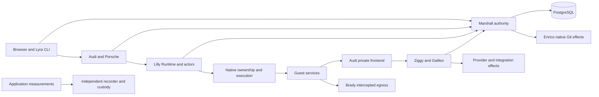

# System under test: fresh whole-repository analysis

## Scope, provenance and evidence

This synthesis combines all twelve independent discovery focuses and the guest
interface supplement in [discovery](discovery/focus-01-architecture.md). The user
selected "Repository only (Recommended)". Official Antithesis documentation
grounds SDK and platform mechanics; external incident trackers and other system
repositories are outside the system-research scope. The retired harness,
property catalog and mutant patches were not research inputs.

The discovery began at the recorded baseline with removal companions present;
`c835eb1017d2` commits that removal and preserves ordinary Lilly property tests.
The original worktree remains separate. Source observations describe inspected
mechanisms. An accepted ADR or a source contract is a claim to test. Test presence,
historical execution, current local execution and hosted execution are distinct
evidence classes. No fresh hosted baseline or native campaign has run yet.

Current removal-phase execution passed Lilly's 559 cases and Marshall's 1,459
cases, their forced Dialyzer gates, source governance checks and the Nix HLDD
check. These results establish the removal companions' ordinary validation;
they do not establish a replacement harness or any native isolation guarantee.

## Architecture and real deployment

Overalls has eight independent Elixir releases, shared protocol, diagnostics and
request-accounting libraries, Rust native owners/recorders/terminal/editor/guest
programs, browser JavaScript, Python operational drivers and Nix deployment.
Marshall's Lilly/Porsche/Audi dependencies are test-only (`marshall/mix.exs:50`).
Harness integration must preserve production release independence.

| Component | Responsibility and authoritative boundary |
| --- | --- |
| Marshall | Fourteen Ash domains own accounts/access/teams, durable Compute intent, fleet identity, ingress, terminals/editors/SSH, inference/agents/integrations/repositories and administration. PostgreSQL commits authorize work; they do not prove physical completion. |
| Lilly | Host-bound Store, Lifecycle domain, Runtime, actors, journals, physical observation and native workers. OS ownership and independently supervised VMMs outlive ordinary BEAM processes. |
| Audi | SSH/web/editor/DNS gateways and private frontend. Marshall authorizes access; Lilly independently verifies current physical execution over a peer-UID Unix connector. DNS visibility grants no access. |
| Porsche | Management SSH and browser approval. Marshall owns durable session and command authority; Porsche has no direct database authority. |
| Ziggy | Inference and agent relay. Durable metadata admission precedes provider effects; completion reporting retries immutable accounting, never the inference effect. |
| Galileo | Named integration proxy. Marshall grants current integration/execution authority; renewal fences upstream effects. Its Control binding currently has no pushed subscriptions. |
| Brady | Kernel-intercepted public egress cache. Original destination, request identity and local attribution precede reusable cache admission. Cache state cannot create authority. |
| Enrico | Git mirror refresh and bounded reading/search. Native Git owners retain writer/descendant custody; local attempt receipts are volatile and bounded. Marshall retains durable retry/audit intent. |

Source anchors: each application's `application.ex`; `marshall/lib/marshall/compute/admission.ex:44`;
`lilly/lib/lilly/control/runtime.ex:149`; `audi/lib/audi/private/front.ex:32`;
`ziggy/lib/ziggy/spool.ex:87`; `galileo/lib/galileo/http.ex:19`;
`brady/lib/brady/proxy.ex:84`; `enrico/lib/enrico/manager.ex:58`.
Full domain/resource and flow evidence is in focus01; state authority in focus02.

The deployed Overalls host declares one Marshall instance and one local
PostgreSQL 18 primary (`fleet/hosts/overalls/services.nix:130`,
`fleet/hosts/overalls/configuration.nix:123`). The native fleet fixture's three
Marshall instances do not describe deployed replication. No inspected deployment
establishes a PostgreSQL standby or physical database HA. A harness may use two
Marshall instances to exercise application concurrency over one real database;
that cannot establish database quorum or independent physical failover.

This is a logical flow, not permission to replace Unix peer credentials, kernel
interception, native storage or process identity with arbitrary container links.

## Persistence and the uncertain-effect boundary

Marshall admission locks owner/idempotency identity before a VM exists, then
commits VM, placement, reservation, address, operation, audit and job together
(`compute/admission.ex:46`). Host and placement locks serialize capacity and
execution intent. Oban and Control hints accelerate retained intent rather than
constituting it (`compute/dispatch.ex:3`, `control/hints.ex:5`). Serving versus
operator startup has explicit authority and listener boundaries; migrations are
explicit (`marshall/lib/marshall/application.ex:12`).

Control requests run in supervised tasks separately from the socket
(`marshall/lib/marshall/control/socket.ex:118`). A task can commit after its
response channel disappears. Client disconnect settles unanswered requests as
unproven and does not silently replay them (`protocol/lib/overalls_protocol/control/client.ex:52`).
The workload must retain attempted and acknowledged operations and reconcile
durable identities. A timeout is neither rejection nor absence. Outer-transaction
outcome events occur after commit (`compute/ledger.ex:21`).

Lilly Store format v3 and Execution wire v4 are distinct versions. Store validates
host identity, immutable placement identity and ordered execution epoch/generation
(`lilly/lib/lilly/control/store.ex:11`, `:29`). Runtime acknowledges delivery only
after rereading matching or newer durable intent (`control/runtime.ex:863`). Actor
journals retain attempts, stable physical outcome identity/sequence and exact
acknowledgement (`vm/journal.ex:95`, `:145`). Private publication syncs content and
directory; an uncertain write cannot establish either old or new state
(`host/private_files.ex:36`). Accepted deletion intent cannot release capacity
until matching physical cleanup proof exists.

Ziggy reserves durable completion space before an external inference effect and
recovery marks unfinished work interrupted/unknown (`ziggy/lib/ziggy/spool.ex:87`,
`:201`). Marshall completion deduplication and aggregate updates are one
transaction (`marshall/lib/marshall/inference/requests.ex:121`, `totals.ex:23`).
Enrico receipts end on restart/eviction while mirrors persist; the correct oracle
checks published Git content and retained Marshall intent, not unlimited replay
retention in Enrico (`enrico/lib/enrico/manager.ex:58`, `git.ex:47`). Brady is
disposable cache state: completeness and authorized reuse matter even when
power-loss retention is not promised (`brady/lib/brady/cache/store.ex:245`, `:592`).

Diagnostics and measurement retain their own acknowledgements and custody.
Request recorder checkpoints and SQLite trace archives are separate from
business authority (`request_recorder.rs:305`; diagnostics `native/spool/src/lib.rs:333`).
ADR-0149 removes diagnostic delivery from lifecycle progress gates. Missing logs
cannot prove an operation failed, and delivered logs cannot prove a guest died.
Focus02/04/08/12 trace these separate publication and effect boundaries.

## Concurrency, supervision and ownership

Three authorities serialize different things: PostgreSQL domain decisions, BEAM
actor state, and native kernel/process custody. The oracle must identify which
linearization point it observes. A database commit, task reply, direct child exit
and complete descendant retirement are different events (focus03/06/12).

Lilly uses `rest_for_one`, placing execution views before Runtime and connectors
(`lilly/lib/lilly/application.ex:48`). Restarting an isolated View while retaining
all subscribers can invent a topology that production tears down. Test the actual
application supervision order. Individual View rows are atomic, but composed
execution lookup reads multiple keys (`lilly/lib/lilly/execution.ex:126`); the
subsequent stream and native fences must be included before alleging stale use.

Each actor persists attempt before starting asynchronous reconciliation and
permits one executor task (`vm/actor.ex:275`). A result remains bound to the
command used by that task. Native owners retain flock and inherited child custody
through caller/helper loss (`host/lock.ex:41`; `lilly/native/host-lock/src/lib.rs`).
Launch guard waits for the shared intent lock before validating authority
(`lilly/native/launch-guard/src/lib.rs:169`). Escape from a process group does not
establish escape from the required subreaper/cgroup custody model.

Pool mutation and observation share one storage lock, but observations use zero
wait and cadence permits one sample in flight (`host/storage.ex:12`,
`control/runtime.ex:252`). Contention is unavailable evidence, not proof of loss.
Exercise creation/deletion/clone/refill while sampling and independently check
neighbor progress and capacity holds. Whole-pool preparation and standby sweep
history motivate these schedules; historical tests do not establish current
production fairness (focus03/05/06).

Audi, Ziggy and Galileo use separate lease/renewal/owner mechanisms so blocked
transport need not extend authority (`audi/lib/audi/authority/stream_guard.ex:125`,
`ziggy/lib/ziggy/lease.ex:45`, `galileo/lib/galileo/upstream.ex:411`). Retained
backpressure, queued renewals, owner death and suspended guardians need combined
histories. Enrico's BEAM and inherited native admission limits must bound physical
Git overlap across restarts. Terminald's atomic backing budgets, PTY mutexes and
viewer queues require actual allocation/retirement observations rather than
counter arithmetic alone (focus03/06/11).

## Protocol, access and user journeys

Control upgrades require exact version/service and current credential before a
socket exists (`marshall/lib/marshall_web/control_api.ex:19`). Closed envelopes
validate shape, size and identities without creating atoms
(`protocol/lib/overalls_protocol/control/envelope.ex:68`). Permanent version
refusal, credential refusal, transient outage and an unproven effect are distinct
classes. Current client reconnect is full jitter starting at a one-second ceiling,
bounded by four seconds; do not assert a one-second minimum. Hint loss must be
recovered by rereading authority, not replaying arbitrary cached mutations.

Accepted stream TTLs are class-specific: web/SSH/editor can use 30 seconds,
nested/catalog/DNS authority uses five seconds under ADR-0142/0153. Audi's generic
five-second source note is stale. The separate IngressCatalog decoder currently
accepts 5,001–30,000 ms despite its five-second contract; a narrow current-source
probe reproduced that receiver-policy mismatch. Marshall currently publishes
5,000 ms. This is not evidence that current routes already outlive issued grants.
See [reconciliation](authority-ttl-reconciliation.md).

Sensitive journeys require identity, current access, authenticated transport,
current execution, physical connection and owned guest account. Immutable
GuestAccount UUID/UID and `u<uid>` home identity replace email-derived ownership
under ADR-0158. Foreign/stale/expired authority must be refused at the effect
boundary, not merely in a UI. Personal editor origins do not isolate malicious
co-tenants inside an already shared VM (focus04/10/12).

Repository launch combines canonical URL/visit identity, stable provision replay,
guest source acceptance and separately published checkout/done markers. Crash
after admission but before browser completion must reconcile the same request;
branch movement is distinct from immutable source identity. Current accepted
relocation is stopped-only full-copy under ADR-0155, not former pre-copy. Clone,
Inception, transfer import/GUID/readiness and source restoration have their own
proofs. Documented full-copy downtime and current native acceptance gaps must
remain visible (focus01/08/10/12).

User priorities cover sign-in/usable authority, create/retry/readiness, terminal
continuity and neighbor progress, personal editor/account continuity, repository
checkout, resize/clone/relocation/delete, inference/integrations and recovery.
Public API acknowledgements should be paired with independent guest bytes,
native process identities, database receipts or upstream effect witnesses, as
appropriate. Focus10 supplies the detailed journey and impact map.

## Operational and cross-layer hypotheses

Backups capture guests, PostgreSQL and host metadata sequentially. A complete
manifest is a recovery graph, not a simultaneous global snapshot
(`nix/modules/backups/runtime.py:122`). Historical restore must fence old nodes
and reconcile restored authority, pool identities and permanent UID reservations.
Local owner locks cannot prove another cloned/restored node is dead. Current
ADR-0158 explicitly records historical sequence/identity reconciliation limits.
Backup cleanup uncertainty can withhold pool observations while guests remain
alive; test independent cleanup progress (focus02/08/12).

Updater correctness depends on runtime secret material, actual surviving
migrators, sockets and process ownership, not only the declared software hash.
Native test fixture inspection found stale resource revision receipts, a missing
Galileo service-role fixture binding, stale control-pool I/O assumptions and
incomplete Enrico/Galileo release probes. These are verification prerequisites;
they do not establish production failure (focus06/07; native/build inventories).

Unproven high-value hypotheses include Galileo initial authorization aging while
synchronous measurement admission waits, followed by a timer anchored too late;
Lyra synchronous tools exceeding its 30-second execution lease without renewal;
persisted wall-clock deadlines crossing clock discontinuities; concurrent health
verdict updates; PTY input holding a mutex needed for kill; browser async toolbar
updates applying old state; and freshness versus actual outcome-batch fairness.
Source-only or isolated modeled witnesses must remain labeled until a composed
reproduction discriminates SUT, workload and environment causes. Focus11/12
contain precise hypotheses and negative findings. They are leads for properties,
not permission to weaken accepted contracts.

## Antithesis environments and independent oracles

| Environment | Meaningful real mechanisms | Evidence limit |
| --- | --- | --- |
| Hosted real services | Actual BEAM releases, PostgreSQL, Control/HTTP/SSH/Unix transports, files, native owner helpers, recorder/spool, local upstream fixtures, browser workload | No nested hardware virtualization; external delivery and physical HA remain unproven. |
| Hosted software-emulated guest | Real pinned guest kernel/rootfs/apps through QEMU TCG and vhost-user-vsock, persistent overlays, genuine readiness/trust/workspace/terminal/editor responses | Explicit executor adapter cannot establish Firecracker jail/cgroup/KVM isolation. |
| Hosted software-emulated storage/router | Real Linux/ZFS/nftables/Brady in a bounded TCG VM with owned disk overlays and measured guest state | Can test ZFS protocol/content/lineage in this VM; cannot inherit native fleet placement or independent physical failure-domain claims. |
| Native machine campaign | Existing NixOS/Ubuntu, Firecracker, ZFS, systemd, cgroups, native network/guest/helper suites | Current execution must be recorded; fixture presence and historical passes are insufficient. Single outer VM multi-pool tests are not independent hosts. |

Hosted Lilly must preserve its real Runtime, client, Store, actor and journal.
The needed lower seams are ownership acquire/verification, Collector/ZFSIO sample
and executor selection (`control/runtime.ex:285`, `:312`, `:1068`, `:1087`, `:1118`).
They must be compile-time harness-only; production has no runtime-selectable
ownership bypass. Real locks, durable attempt/effect identity and independent
oracle histories remain required. Transfer/clone/Inception require additional
lower-boundary or native evidence rather than fake executor success.

BEAM documented SDK fallback can emit assertions and lifecycle JSONL; BEAM branch
coverage is not established. Rust images require real coverage instrumentation,
retained debug/build identity and `/symbols`. Python/Hegel needs the actual
test-location ABI and workload randomness; merely setting the output environment
does not install reporting. Exact implementation and local probes are in
[BEAM](beam-sdk-feasibility.md), [Hegel](hegel-sdk-feasibility.md) and
[image](image-build-feasibility.md) feasibility notes.

Automatic outer faults and explicit guest/QMP/quota/native fault actions must be
labeled separately. Node, clock and custom Antithesis fault enablement is not
assumed from tenant login. Baselines use frozen source/config/closure/image
identities. Aggregate test-suite success cannot substitute for a per-property
oracle or counterexample-specific mutant marker.

## Open questions and next discovery

Determine each property's real precondition, effect boundary, independent witness,
value menu and feasible environment. Resolve remaining source questions in
per-property evidence and retain the investigation log. Outstanding platform
questions include tenant fault enablement, hosted append atomicity acceptance,
TCG boot/network/pressure feasibility and exact uninstrumented guest coverage.
Remaining product-policy questions include backup RPO/restore consistency and
deadlines not established by source; use explicit preconditions instead of
inventing unconditional progress bounds.

The next step is eleven independent property-discovery focuses, deduplication,
open-question investigation, a minimal focused topology and four evaluation
lenses. Every property must have a canonical slug, correct assertion semantics,
priority, source evidence and honest environment-specific coverage status.
Freeze the safety count from the completed catalog and actual assertion scan
before applying the authorized total remote ceiling of `5N`.
