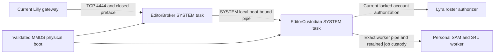

# Windows editor job custodian review

Date: 2026-10-18. Scope: replace the Windows editor candidate's broker-owned
job lifetime with an independently supervised SYSTEM custodian. The user has
authorized completing this implementation. This review starts at `648793477`;
source integration and acceptance results must name their later checkpoints.

## Decision and impact

[ADR-0207](../decisions/0207-windows-editor-job-custodian.md) replaces
[ADR-0200](../decisions/0200-windows-browser-editor-candidate.md) in full. It
preserves the official Code OSS source/import boundary, SAM/S4U identity,
bounded cancellation, exact v7/v4 candidate and target-registry contracts, and
the separate image-bound promotion requirement. It changes worker ownership,
privileged local IPC, process creation and the number of supervised tasks.
Those are substantive failure and authorization boundaries, rather than an
installer-only repair. Both accepted design and implementation remain distinct:
the inherited candidate codecs and new custodian source exist; same-boot
custodian recovery and the new native acceptance remain incomplete.

No Marshall Ash resource ownership, database authority, Audi/Lilly execution
fence, public port, protocol capability row or production image selection is
changed. A new internal IPC protocol does not replace current gateway, account,
release or personal-origin authorization. ADR-0201 localization and ADR-0161
presentation requirements continue to apply to user-visible surfaces.

## Observed old-design failure

The stock fixture previously completed its first native browser stage:
workbench, extension command, saved-file oracle and real PowerShell PTY. Broker
recovery then failed. After exit-status normalization, new browser connections
were refused before navigation with the broker's closed `custody` reason.
Neither result is full browser, automatic-recovery, worker-loss or immutable
candidate acceptance.

Two bounded SYSTEM diagnostics distinguish the kernel-object failure from a
general process-exit assumption. Both JSON artifacts are diagnostic wrappers,
not readiness or new implementation acceptance records:

| Artifact | Observed fact | What it establishes |
| --- | --- | --- |
| `/tmp/windows-editor-job-custody-result.json` | Read-only reopening of the exact retained real worker job returned no handle and error 2. | The old receipt's named job was unavailable at that observation; no foreign cleanup was performed. |
| `/tmp/windows-editor-job-lifetime-result.json` | Disposable job and child were created/assigned; creation identity matched; job open and child live before final handle close; afterward job open was false/error 2 while the child remained live; cleanup completed. | A running assigned child does not preserve a reopenable named job when its final handle closes in this tested old configuration. |

The lifetime experiment directly disproves the old launcher's assumption that
it can close broker-owned handles and later recover custody solely from a
private receipt and the job name. It does not prove that every prior refusal
had that sole cause, or that the new kill-on-close design works. The exact
immutable Windows candidate under Lilly qualification contains the old broker;
it remains outside production selection.

## Findings and required resolution

| Severity | Finding and evidence | Consequence and resolution |
| --- | --- | --- |
| High | The old [launcher](../../../nix/domains/artifacts/vscode-web-broker/src/windows.rs) creates jobs without kill-on-close and expects retained jobs to reopen after handle loss. The native lifetime experiment contradicts that assumption. | Broker death can leave a live personal process without the named custody object required for safe reuse or cleanup. Keep handles in an independent custodian and test broker/custodian failures separately. |
| High | The old [broker](../../../nix/domains/artifacts/vscode-web-broker/src/windows_main.rs) owns launch, receipt and process work in the same failure boundary as network admission. | A handle keeper alone would leave launch/receipt ownership gaps. Move the complete transaction, readiness and worker-pipe opening into the custodian; create suspended processes atomically in their job. |
| High | A second privileged task and local pipe add an admission boundary. SYSTEM-only ACLs and a supplied PID do not independently bind the exact live executable. | Both pipe peers verify kernel PID, process creation identity, SYSTEM token and pinned executable. The custodian independently validates MMDS/release/account identity; no job handle is transferred. Scoped native endpoint/same-process handshake/forged-time tests pass; complete independent-task peer refusal evidence remains pending. |
| High | Root exit, descendants and failed job accounting cannot release a runtime entry by inference. | Keep at most 64 reserved/live/quarantined slots, per-account single-flight and complete receipts. Drain exact owned descendants to zero before replacement/retirement; quarantine failed accounting. Native fault execution is required. |

These findings reconsider ADR-0200's lifetime decision while preserving its
identity and promotion rationale. They do not justify weakening a custody
refusal, adopting an ambiguous process or deleting personal files.

## Source reconciliation

The mutable source checkpoint now implements the
[custodian-owned transaction](../../../nix/domains/artifacts/vscode-web-broker/src/windows_main.rs),
[atomic launcher](../../../nix/domains/artifacts/vscode-web-broker/src/windows.rs),
[mutual local peer checks](../../../nix/domains/artifacts/vscode-web-broker/src/windows_ipc.rs)
and [two-task installer](../../../nix/domains/artifacts/guest/windows/install-editor.ps1).
The launch is suspended and atomically assigned with
`PROC_THREAD_ATTRIBUTE_JOB_LIST`; no child handles are inherited. Its job has
kill-on-close and remains custodian-owned. Receipt publication precedes resume
and live map commitment. A failed pre-return launch retains its quarantined
job/slot when exact descendant drainage fails. Full worker identity, including
the SAM SID, contributes to the persisted receipt key.

The map retains at most 64 stable account slots for the custodian lifetime,
including empty reservations after refused or failed starts. It does not evict
quarantined or empty entries to recover capacity. Worker/root recovery inside a
retained custodian terminates only the exact owned job, accounts zero descendants
and then removes that receipt before replacement. Failed drainage quarantines.
Only a verified-dead held root permits this drain. A live root's failed readiness
or pipe-custody probe, and any process-observation error, propagate refusal without
termination. Current roster/SAM validation is inside the reserved UID lock.

Independent review found that an initial fresh-custodian path would retire an
old receipt using only root-process exit; that did not prove descendant
quiescence. The source now refuses **every** existing same-boot receipt when it
has no retained worker/job handle. It neither adopts nor deletes that receipt,
even when the root is gone. A new physical boot uses a new namespace. This is
a conservative safety fix, not completion of ADR-0207 clause 11: same-boot
custodian crash recovery to a new worker remains unimplemented until stronger
quiescence proof and native tests exist.

The local endpoint reserves its successor before handing an accepted pipe to a
connection thread, preserving first-instance ownership. Independent review also
found a fatal listener-capacity edge; current source retries reservation-capacity
exhaustion while retaining its endpoint and worker handles. Kernel instances use
`PIPE_UNLIMITED_INSTANCES` beneath the process-wide 128 live/retired pipe-slot
budget, so a 65-instance kernel cap cannot terminate the custodian at its separate
64-connection admission boundary. Source inspection resolves the reported path;
native exhaustion and cancellation execution remain pending.

## Accepted process and authority boundaries

The network broker owns gateway-only admission and its streams. It independently
validates the existing preface and exact release/boot tuple, then proxies through
the fixed local endpoint. The custodian owns native launch, private receipts,
resume, runtime slots, readiness and exact worker-pipe access. A broker restart
repeats admission and peer checks while the custodian keeps the worker and job
handles. The accepted custodian-crash behavior is kill-on-close termination and
a validated new worker preserving personal files. Current source requests that
termination but refuses prior same-boot receipts after restart; it does not yet
provide the accepted recovery. Native tests must establish descendant termination
and the eventual restart bound independently.

`EditorBroker` retains the fixed `start.ps1`/`broker.json` action.
`EditorCustodian` uses `start-custodian.ps1` and the same pinned executable's
`--custodian custodian.json` role. The two closed configurations agree on the
descriptor and worker tuple and use separate copied trust bundles. Each task
has the private task DACL, boot trigger, unlimited execution, `IgnoreNew` and
999 one-minute failure restarts; only the broker receives the existing TCP
firewall rule. Local IPC is derived from the MMDS physical boot state key, not
an arbitrary request endpoint. The new `custodian-v1` receipt namespace does not
reinterpret old broker-only receipts as custodian ownership.

| Failure | Required behavior | Acceptance at this checkpoint |
| --- | --- | --- |
| Broker dies | Its streams end; custodian retains exact personal workers/jobs; new broker revalidates before proxying. | Pending new native execution. |
| Worker root dies | Stop only its proven owned job; observe zero descendants before retiring/replacing its entry. | Pending native root-plus-descendant test. |
| Launch or receipt publication fails | RAII retains cleanup ownership; no incomplete runtime entry; failed drain quarantines capacity. | Portable registry and disposable suspended-root atomic/kill-on-close tests pass; full personal launch/receipt fault execution remains pending. |
| Custodian dies | Last custodian handles close; all owned descendants terminate within a tested bound; restart creates new workers preserving files. | Kill-on-close source exists; same-boot receipt refusal conservatively blocks replacement. Safe automatic replacement remains unimplemented, and native termination/recovery execution is pending. |
| Peer/account/boot/release is foreign or ambiguous | Refuse without forwarding, adopting, killing foreign processes or deleting personal files. | Existing refusal boundaries retained; new local-peer cases pending. |

## Verification and remaining work

The two scoped native observations above concern the old architecture.
Installer evaluation and PowerShell parsing passed in
`/tmp/windows-custodian-install-evaluation.log`; the native harness build passed
in `/tmp/windows-custodian-native-harness-build.log`, including its strict
TypeScript, Python Ruff/ty, refusal fixtures and PowerShell parsing. These are
static/build results for the new two-role fixture, not native task, account,
browser, termination or recovery execution. The global code-contract structure
check passed at its installer checkpoint; this does not establish its semantic
obligations. Core Rust, source integration and governance gates must be reconciled
against the final diff before claims advance.

At the subsequent core checkpoint, **30 portable library tests passed** in
`/tmp/windows-custodian-portable-final.log`, including retained owner lifetime,
single-flight concurrent initialization, generated 64-slot refusal/no-eviction
and the production-used live-root-probe refusal decision. Windows all-target
Clippy passed in `/tmp/windows-custodian-clippy-final2.log`. The portable results
establish those finite model decisions; the Windows static check establishes
target compilation/lint only. Native tests and linked executables are distinct
from execution, and no new Win32 launch/peer/custodian failure acceptance follows.

Final pinned cross-link builds passed in
`/tmp/windows-custodian-runtime-build-final.log` and
`/tmp/windows-custodian-test-build-final.log`. The Windows runtime at
`/nix/store/j7l85qk0qd3ny298kg7ddw83pqm5wxwg-overalls-vscode-web-broker-windows-0.1.0`
is 907,264 bytes, SHA-256
`9b34afda1e06a82952e476d5b410c707d374a3cc4e4ce0b18dc8eb2101e2021a`.
The native test library at
`/nix/store/arp2sznb2lp96rfs5b5q3aj0f9syc4lg-overalls-vscode-web-custodian-windows-tests-0.1.0`
contains 38 compiled tests. Neither artifact changes image capability or
qualifies the old immutable image.

Both tested derivations use the exact immutable source
`/nix/store/xb9mrvm0aqxaglg9hlc356cn9l7qhbjn-vscode-web-broker`, NAR hash
`sha256-4a/BtA8vCGFC8Bpz+8O82puJMyHQw4MAA2gkUeKr/NI=`. This pins the
tested worktree payload after base `4b736968c`; it is separate from any later
comment-only rebuild or final integration commit. The runtime derivation is
`wac60fgm26h6mcl4nsf0ycqra68sdnjh-overalls-vscode-web-broker-windows-0.1.0.drv`,
and the test derivation is
`pmjmdd2x5vym7v4jd3inhfw81846dih5-overalls-vscode-web-custodian-windows-tests-0.1.0.drv`.
The subsequent source comparison found only a `new_job` documentation comment
correction: it now describes the configured final-handle kill behavior. That
comparison establishes unchanged program logic, separately from any later
rebuild or final artifact identity.

The exact test executable, SHA-256
`85b37f2c63d3f2b9d88aa965ffb77e9745147a2729c771f5414296b19f00fc17`,
subsequently ran natively as SYSTEM: **38 tests passed, 0 failed, 0 ignored**.
`/tmp/windows-custodian-native-result.json` records `hash_verified: true`,
`system: true`, `exit_code: 0` and `scratch_cleaned: true`; the verified rerun log
is `/tmp/windows-custodian-native-run-exit.log`. The wrapper reads the pinned
process handle with `GetExitCodeProcess`, correcting the first diagnostic's
missing wrapper exit result. Installed role services were not replaced by this
isolated library execution.

The four added native tests have bounded scope:

| Native test | Established behavior | Remaining boundary |
| --- | --- | --- |
| `native_atomic_job_assignment_closes_suspended_orphan_window` | A disposable SYSTEM `cmd.exe` root is created suspended with the atomic job-list attribute and verified membership; final job close makes that held root exit within the five-second wait. | No personal S4U/Code OSS launch, resumed root/descendants, launch-stage fault matrix or custodian crash timing. |
| `native_local_endpoint_is_exclusive_and_system_only` | The test endpoint passes SYSTEM ACL inspection and a second first-instance listener refuses. | No non-SYSTEM/remote connection attempt or independently scheduled role process. |
| `native_peer_handshake_refuses_forged_creation_time` | The native pipe rejects the kernel peer's deliberately changed creation claim. | No PID-reuse, wrong executable, foreign-boot or complete role/task failure matrix. |
| `native_peers_complete_exact_identity_handshake_before_stream_bytes` | Two threads in the same SYSTEM test process complete mutual native kernel-identity checks before a bounded frame. | No cross-process installed broker/custodian execution, browser stream or current account/release lifecycle. |

The executed library also includes its portable model and earlier pipe/ACL cases.
This result advances native library evidence only. It does not complete the
accepted descendant, custodian restart, task, personal worker or image/browser
journey, and it does not repair same-boot cold-receipt replacement.

Required evidence includes atomic job-list creation with no inherited handles,
incomplete launch/receipt cleanup, 64-slot accounting and quarantine,
single-flight account admission, mutual local-peer refusals, independent task
restart, broker survival, root/descendant drainage, custodian death/restart,
two-account browser separation, file preservation and current-login/write
revocation for the newly bound candidate image. Portable/BEAM checks do not
establish native Job Object, pipe, Task Scheduler or physical isolation behavior.

The HLDD interactive, recovery, verification, security, domain and deployment
chapters now describe both role boundaries, the conservative receipt refusal,
64 lifetime account slots and separate per-process 128-pipe budgets. Its scenario
ledger keeps the candidate partial and records the bounded native library result. The
generated coverage, ownership/placement views and option reference checks pass
at this documentation checkpoint; those are structural/currency checks, not
native acceptance.

The final frozen handbook was reconciled through the existing documentation
extractor and pinned Gettext/Expo APIs: 3,819 generated messages plus two runtime
titles give 3,821 identities in the POT and each of 25 PO catalogs. The official
extractor `--check` and structural catalog checker passed after official POT
ordering was restored. Each locale preserves 3,779 exact previous identities,
their translations and translator comments; 42 identities were added and 21
removed. One Arabic translation was retained across a reviewed trailing-newline
change, with no fuzzy matching. The source-equal review file is byte-identical
and has no stale records. All catalog rows have zero fuzzy or invalid entries.
The strict checker still fails because untranslated and unreviewed source-equal
entries remain; the new identities do not establish linguistic acceptance.

At the final governance checkpoint, all seven source-group receipts and handbook
references are current. The ordinary `checks.x86_64-linux.hldd` Nix gate passes
against the complete tracked working tree. Standalone checks also pass for 204
ADRs (structure/links only), conflict markers, code-contract structure, generated
coverage, option references, ownership/deployment views and diff whitespace.
These results establish documentation consistency at this checkpoint, not a
current full Marshall runtime gate, native task/browser recovery or production
image acceptance.
