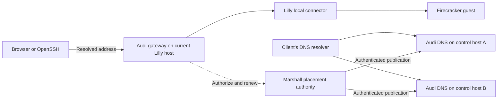

# Audi access flows

This describes the access flows in [ADR-0047](../architecture/decisions/0047-audi-ingress-and-authoritative-dns.md)
and the public wildcard certificate custody in
[ADR-0105](../architecture/decisions/0105-public-audi-wildcard-custody.md). Nested
Inception applications use the separate child wildcard in
[ADR-0106](../architecture/decisions/0106-inception-child-audi-wildcard.md).
Audi implements authoritative DNS, an SSH gateway, browser sign-in exchanges,
and leased HTTP/WebSocket forwarding. Marshall's Ash resources hold identity,
access, placement and publication authority. Audi's local Lilly connector checks
both OS peer identities and binds guest connections to a current placement and
fresh execution observations. The default backend denies guest access.

The application suites include property tests and real HTTPS/Ash integration.
Nix configuration and kernel network checks pass. The earlier per-VM certificate
fleet test passed with real nested Firecracker guests, browser HTTP/WebSockets,
native SSH and live revocation. The new wildcard fleet test has passed issuance,
installation on two gateways, real guest HTTPS, DNS answers, live web revocation,
private browser HTTP/WebSockets, independent-key SSH, isolation, failover,
gateway restart after the CA stopped, and gateway/DNS package-update recovery.
The remaining scope and limitations are recorded in the
[wildcard review](../architecture/reviews/2026-09-23-audi-wildcard-custody.md).

An extended physical run also passes a Lilly main-process crash with live SSH
and HTTPS streams: both streams close, the guest process survives, and fresh
authenticated access succeeds after Lilly restarts. The same run passes
Customer owner-only SSH restrictions and network isolation. Acceptance covers
these specific failure scenarios rather than arbitrary failure tolerance.

The additional cross-host relocation scenario now passes with a real guest:
physical transfer and source cleanup complete, both DNS replicas publish the
destination, the unchanged strict SSH profile verifies retained guest data,
HTTPS serves the original name, and the stale source address rejects access.
The prior merged `audi-relocation-fleet` script passed in 1520.47 seconds,
including bounded transfer-lock retries, Lilly crash, legacy certificate-storage
permission loss and package-update recovery checks. Earlier failed runs and
the IPv4 fixture correction are retained in the
[implementation review](../architecture/reviews/2026-09-17-audi-ingress.md).

An earlier legacy certificate-storage permission-loss scenario passed, but that
full run timed out during relocation source cleanup. With the cleanup retry
and diagnostic refinements, the complete script then passed in 1668.42 seconds,
including source cleanup and post-move access. Physical integration of newer
main networking changes also passes in the final run; the review retains both
the earlier failure and the successful refinement runs.

These are bounded test results, not a production deployment or a capacity
claim. The user removed scale investigation from implementation scope on
2026-09-18. ADR-0047's earlier ingress acceptance predates ADR-0105 and does
not establish complete wildcard migration.

Web-only sharing is represented by the “Web apps only” role in Marshall. It
permits the distinct Cedar web action without VM management, terminal or SSH
access. Existing VM roles also permit web access on profiles that allow it.
Customer workspaces are owner-only: they permit authenticated owner SSH and
serial access, but reject sharing, web exposure and guest-initiated network
connections under [ADR-0064](../architecture/decisions/0064-customer-workspace-isolation.md).
The web flows below apply to profiles with web access enabled.

## DNS and service placement

Delegate the application zone once to Audi DNS on two independent control-plane
hosts. Each Lilly host runs an Audi gateway. A VM's stable hostname resolves to
its current gateway's public address, with its A-record TTL capped by the
remaining route lifetime and the configured 20-second maximum. Lilly hosts
do not need to register individually as DNS servers, and Marshall does not create
DNS provider records for VMs.



DNS supplies an address, not permission. A stale answer must never cause Audi to
forward to another host. Relocation changes publication after source fencing and
destination readiness; clients reconnect after existing connections break.

The physical fleet applies this design under
[ADR-0090](../architecture/decisions/0090-second-audi-dns-replica-on-worker.md) and
[ADR-0091](../architecture/decisions/0091-fleet-perimeter-public-listeners.md):
Overalls and Dungarees each run the gateway and DNS roles on reserved explicit
addresses for the delegated `apps.ghuntley.dev` subzone, publicly reachable
through the reviewed fleet-perimeter listener registry. Enrollment uses the
`audi-dns-rotate` / `audi-gateway-rotate` / verify / revoke operator CLI actions.
The [fleet network guide](../operations/fleet-network.md) carries the operator rollout
runbook, including external delegation, credential custody and validation
steps. The checked-in host declarations now select the Let's Encrypt wildcard
issuer in Marshall and public browser origins on both Audi gateways. Physical
wildcard issuance and cross-host route failover still require rollout checks.

## What the authenticated user sees

Marshall shows the VM's stable HTTPS address, Overalls installation command and
SSH command. Per-machine SSH configuration downloads are no longer available.
For private web applications, Audi redirects an unauthenticated browser through
Marshall login and a one-time exchange. Audi then uses a protected host-only
cookie. Public access applies only to a VM's explicitly public primary web app;
alternate application hostnames remain private.

For SSH, the user uses their normal OpenSSH client and registered public key.
Audi checks platform permission separately from the guest's SSH login. The user
uses the immutable UID-derived guest account authorized by current Marshall SSH keys and
Cedar write permission.

```mermaid
sequenceDiagram
  participant User as OpenSSH client
  participant Marshall as Marshall control plane
  participant Audi as Audi on current Lilly host
  participant Lilly as Local Lilly connector
  participant Guest as Guest sshd on port 22
  User->>Marshall: HTTPS lookup of registered gateway host key
  Marshall-->>User: Current published host key
  User->>Audi: Outer SSH connection and proof of registered key
  Audi->>Marshall: Authorize user, VM and current placement
  Marshall-->>Audi: Short-lived authority bound to placement and epoch
  Audi->>Lilly: Open permitted local guest SSH connection
  Lilly->>Guest: TCP connection to port 22
  User->>Guest: Inner SSH handshake through the byte stream
  Guest-->>User: Guest host key and guest login challenge
  Note over User,Guest: Inner SSH authenticates the guest and encrypts guest traffic end to end
  loop While connected
    Audi->>Marshall: Renew current access authority
    Marshall-->>Audi: Renew or deny
  end
  Note over Audi,Lilly: Denial or expiry closes the stream; delayed replies cannot restart the deadline
```

The outer SSH command selects a stable VM identity. It cannot select an arbitrary
IP address or TCP port. Audi exposes no host shell or general TCP forwarding.
Strict outer host-key checking uses the Rust Overalls client with verified HTTPS;
the inner connection retains normal guest host-key checking.
Marshall participates in setup and authorization renewal, not guest byte transfer.

Authority lasts at most five seconds from the start of the renewal request.
This bound applies to already-open SSH, HTTP streaming and WebSocket connections.
The DNS TTL is independent of this authorization deadline.

## Gateway startup

Both Nix service roles expose a private mode-0600 readiness socket:
`/run/audi/status.sock` and `/run/audi-dns/status.sock`. The automatic updater
requires each enabled role to report its exact role, version 1 and `ready: true`
before marking a candidate healthy. An active service without current
control-plane authority is not ready. Checks expire after five seconds; the
sockets accept no commands and return no credentials or route data. The fleet
test verifies real updates of both roles, rejection of unhealthy candidates,
preservation of the last healthy revision and corrective-update recovery while
preserving the guest process. Recovery uses a new corrective revision; it does
not automatically roll back code or schema migrations.

The exported `nixosModules.audi` module provides `services.audi`. Configure the
local Lilly `hostId`, verified HTTPS `controlPlane`, private `credentialFile`, and
restricted local `connectorPath`/`connectorUid`. Audi runs as its own user. The
credential is supplied through systemd credentials, and its SSH host key persists
in `/var/lib/audi/keys`. Port 22 requires administrative OpenSSH on 2222; Audi,
Porsche and administrative SSH must use distinct ports. Opening the firewall is
explicit. Enable `services.lilly.ingress.enable` on the same host to configure
Lilly's connector and SSH network exception. Host identities and the root connector
UID must match. The module resolves Audi's deployed UID, creates a root-owned
Audi-group socket directory, and uses a persistent OS lock and private path claim
for recovery after crashes. Audi derives its host identity from the private Ed25519 key and publishes it to
Marshall over verified HTTPS. Registration is immutable within a service credential
generation; rotate that credential before replacing the host key. Public
current-route key lookup supports Lyra's installer-configured SSH connections.
The machine detail page supplies installation and connection commands. Configure Marshall with
`MARSHALL_INGRESS_ZONE` for lookup responses. Until validated certificate
installation produces readiness reports, the endpoint returns no key.

For direct release startup, `AUDI_CONFIG_FILE` names the bounded JSON configuration
with `version: 1`, `role: "gateway"`, `host_id`, `control_plane`, `credential_file`,
`host_key_dir`, `connector_path` and numeric `connector_uid`. Optional `bind`,
`port` and `cacertfile` select listener/CA settings. Credentials and the Ed25519
private key must be single-link service-owned regular files with mode 0400 or
0600 beneath trusted directories. Invalid configured startup fails closed.

The DNS role uses `version: 1`, `role: "dns"`, `control_plane`, a private
`credential_file`, `zone`, `nameservers` (two to eight distinct names), and
`mailbox` in DNS name form. Optional `bind` and `port` default to `0.0.0.0` and 53;
`cacertfile` selects a trusted CA bundle. Its DNS credential must be separately
enrolled through Marshall's operator-only `Ingress.configure_service` action
with role `:dns`. Marshall's `MARSHALL_INGRESS_ZONE` must match the delegated zone.

NixOS `services.audiDns` requires `controlPlane`, `credentialFile`, `zone`,
`nameservers` and `mailbox`. Optional `caFile` defaults to the system CA bundle,
and `secretUnits` declares credential preparation services. The module uses
systemd credentials and a service-owned private runtime token copy; no secret
enters the Nix store. `openFirewall` opens UDP and TCP. DNS runs independently
without a Lilly connector or gateway key.

Startup creates an empty directory and starts the listener and refresh worker.
The worker retrieves complete, ordered snapshots over verified HTTPS, then waits
one second before refreshing. Missing or expired snapshots return SERVFAIL.
Fresh snapshots can authoritatively answer NXDOMAIN for absent names. Route and
proof deadlines remain independent and no longer than five seconds from the
request start; address answer TTL is capped by the remaining route lifetime and
never exceeds the configured 20 seconds. Snapshot refresh does not
grant application access. Useful application records still require a current
execution-bound certificate readiness report. The packaged fleet checks exercise
startup, route publication, control-outage expiry and independent DNS failover.

Enable `services.audi.tls.enable` to start the fleet certificate worker and
HTTP/HTTPS listeners. Configure the delegated `zone`, public Marshall
`browserOrigin`, and `certificateRootsFile` used to validate the delivered chain.
The browser origin is separate from Audi's private `controlPlane` API. The
common listener address must be an IPv4 address assigned to the local host (or
wildcard); readiness probes the configured local listener. Audi validates the
certificate and key, holds them in memory, completes a local SNI probe, and
acknowledges the generation before it can publish routes. It writes no public
certificate or ACME account directory.
If the gateway service credential rotates while the same wildcard remains
active, the new service generation must acknowledge that exact fingerprint
again before route readiness returns. Marshall preserves one installation row
and its audit history; an old credential or conflicting certificate cannot
replace the current acknowledgement.

Set `services.marshall.ingress.wildcardAcme` with one local `issuerInstance`,
the HTTPS ACME `directory`, trusted `issuerCaFile` and `certificateRootsFile`,
and two to eight authoritative Audi DNS `nameservers` with literal address and
port values. `acceptTerms = true` explicitly authorizes account registration;
false permits only recovery of an existing account. Marshall orders only
`*.<zone>` through DNS-01, encrypts the account key and certificate material
with Cloak in PostgreSQL, and schedules renewal with Oban. Route publication
requires an active generation and an exact installation receipt from the
serving gateway. Back up the PostgreSQL ciphertext and the separate Marshall
Cloak keyring as described in [backup recovery](../operations/backups.md).

This TLS configuration now wires browser authentication, HTTP streaming and
WebSocket relay through Lilly. Application and physical fleet acceptance of these
paths pass; production deployment and measured fleet capacity remain separate.

Marshall's operator-only `Ingress.configure_service` action accepts `addresses`
for a gateway: a complete list of up to eight canonical IPv4 literals,
defaulting to empty. Changing the set advances the service generation and clears
its registered SSH key; reordering does not. DNS service identities cannot carry
gateway addresses. Enrollment alone does not publish these addresses: certificate
and execution readiness must still be established by the route-publication work.

The [Lyra proxy](../../lyra/src/proxy.rs) obtains the current Audi gateway key
through bounded, verified HTTPS and uses strict outer host verification without
persistent outer host-key files or connection multiplexing. The inner connection
retains ordinary guest known-hosts verification. The installation script at
`/bin/install.sh` installs Overalls and configures the local wildcard SSH profile;
Marshall no longer generates downloadable per-machine profiles.

Direct SSH without the Overalls proxy configuration displays setup guidance and
exits nonzero. Audi acknowledges a PTY solely for this diagnostic screen; it
never opens a guest terminal or shell in that state. Unknown keys are directed
to Porsche's existing browser approval flow or Settings → SSH keys. Verification
outages receive retry guidance rather than an incorrect unknown-key claim.
Proxy errors use stderr exclusively, preserving the guest SSH byte stream.
`services.audi.publicOrigin` supplies the public management origin, defaulting to
`tls.browserOrigin` when TLS is enabled; it never falls back to the private
control origin. Deploy Marshall's additive `ssh-key-status` endpoint before
Audi. See [ADR-0120](../architecture/decisions/0120-ssh-onboarding-guidance.md).

Porsche `show <VM-name> --json` exposes `ssh_host` for the stable guest name and
`host` for the physical provisioner. After running `overalls config-ssh`, use
`ssh <ssh_host>` to connect. The managed wildcard profile chooses the
authenticated user's durable `u<uid>` remote username, while keeping normal guest
host-key verification. Its home is `/home/u<uid>`. Same-user email changes preserve
the account UUID, UID, login and home; fresh same-email registration after
retirement receives another identity. The breaking development cutover requires
refreshing setup on old clients and compatible fresh guest images; it does not
convert existing writable disks. See [ADR-0158](../architecture/decisions/0158-durable-guest-identities.md).
For an agent-only key, `~/.ssh/overalls-identity.pub` is the exact registered
public key used to select its signer in the agent; it contains no private key.
Lyra evaluates the Porsche connection's OpenSSH `IdentityAgent` setting for
each gateway connection. Direct socket paths, `SSH_AUTH_SOCK`, `$VARIABLE`,
`${VARIABLE}`, home and percent-token expansion, relative paths and `none`
follow the effective OpenSSH configuration, including `Host` and `Match` rules.
The socket path is passed only to the isolated SSH child process.

Set `services.marshall.ingress.zone` to the same delegated zone used by Audi.
`services.marshall.ingress.httpsPort` must match the public gateway HTTPS port
(default 443) for browser callbacks. Marshall's private Audi API and Ash domain
expose no per-VM issuance or proof actions. Historical issuance and PaperTrail
rows remain readable for audit, while complete DNS snapshots ignore their
proofs. A child Inception Marshall
also selects its own apps-zone wildcard when public settings are configured.
The wildcard has one active generation across the public zone, rather than a
new order for each VM.

## Interrupted wildcard orders

Marshall records an attempt before sending `newOrder`. If the outcome is lost,
that generation remains quarantined for one hour and then fails; the next due
check can allocate a later generation. The administrator certificate audit view
shows the affected generation and earliest failure time while the order response
is uncertain, alongside the generation history.

## Emergency wildcard rotation

A gateway that holds the wildcard private key can impersonate every public
application name in that zone. If a gateway is compromised, fence it and
revoke its service credential, then rotate the shared wildcard generation.
Treat all names in the zone as exposed until every serving gateway has installed
the replacement and the compromised gateway can no longer serve traffic.

A current elevated administrator can open **Administrator audit → Certificates**
and select **Request wildcard rotation**. The request allocates one new
generation under the same database lock as scheduled renewal, and fails while
another generation is pending. The administrator event and certificate history
record the actor and requested generation. After issuance, the page shows each
gateway's installation receipt; check those receipts before declaring recovery.
Activation retires the previous generation before every gateway has installed
the replacement, so a lagging gateway does not publish routes until it
acknowledges the new certificate.

## Publication capacity measurement

The opt-in database measurement uses 10,000 publishable route rows across 100
gateway identities. It calls the real Marshall publication action, checks complete
route/label/address counts and retains the production query deadlines. Run it in
the pinned shell against an isolated test database partition:

```sh
cd marshall
MIX_TEST_PARTITION=_audi_capacity mix test test/marshall/ingress/publications_test.exs --only capacity --include capacity
```

The command emits a JSON timing record. The initial ten samples took 142–253 ms
per complete publication. Rows are synthetic and rolled back; setup and simulated
freshness updates are outside the measured interval. This measures publication
construction, not readiness-write throughput, HTTP/DNS transport, guest capacity
or a sustained 100-host deployment. Normal test runs exclude the capacity tag;
run it explicitly when reviewing capacity-related changes.


The capacity selection also runs a per-gateway readiness baseline: it installs a
valid gateway credential and refreshes 100 distinct VM routes through the actual
authenticated Ash action while the database contains 10,000 VMs. Three sequential
rounds took 780–861 ms, and all 100 routes were still fresh after each round. This
excludes local certificate validation, TLS/HTTP transport and concurrent gateways;
it must not be extrapolated into a sustained fleet-throughput claim.


The reusable `marshall/scripts/audi_capacity.exs` harness measures 100 concurrent
gateway clients, each refreshing 100 routes sequentially against committed data.
Its default transport uses the real Audi HTTPS client and Marshall ingress API
with disposable loopback TLS fixtures. Run from the pinned shell in a fresh,
exclusively owned database, and retain the exit status while cleaning up:

```sh
cd marshall
export MIX_ENV=test
export MIX_TEST_PARTITION="_audi_capacity_run_$(openssl rand -hex 8)"
export ERL_FLAGS='+S 16:16'
mix ecto.create && mix ecto.migrate && mix run scripts/audi_capacity.exs
capacity_status=$?
mix ecto.drop --force
(exit "$capacity_status")
```

The database name guard rejects ordinary test or production database names. Use
only a newly created partition; never reuse another run's database. The harness
also rejects existing hosts. `AUDI_CAPACITY_TRANSPORT=action` selects the Ash-only
diagnostic; `AUDI_CAPACITY_ROUNDS` accepts 1–120 rounds (default three). Synthetic
host observations are refreshed separately and excluded from measurement.

The harness also samples route freshness over a separate database connection,
waiting 100 ms between queries. From round two onward, any sample with fewer
than 10,000 fresh routes fails the round, even if routes recover before its end.
Round one bootstraps publication, so its intermediate counts are diagnostic.
Each round reports sample count, minimum fresh-route count and maximum observed
sample gap. Sampling adds database load and cannot prove availability between
samples; compare these results separately from the earlier unsampled runs.

The first HTTPS run, with 16 BEAM schedulers and 32 database connections, failed:
rounds took 5.20–5.43 seconds and only 9,373–9,642 routes remained fresh, despite
all 10,000 updates succeeding. The five-second bound is unchanged. These results
and the earlier Ash-only diagnostic are retained in the
[measurement artifact](../architecture/measurements/2026-09-18-audi-readiness.json).
This does not establish sustained fleet capacity or include local certificate
validation, DNS, guest traffic or a multi-node control plane.

The artifact also retains a later twelve-round HTTPS run after reducing redundant
route and execution-history reads. Every round kept all 10,000 routes fresh and
took 4.671–4.998 seconds. The slowest round had only 1.537 ms of margin against
the unchanged five-second bound. That single loopback run provides little
operational margin and does not establish stable fleet capacity.
