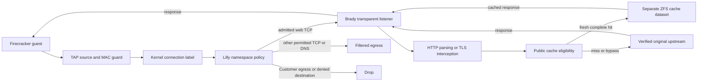

# Brady networking and cache design

[ADR-0069](../architecture/decisions/0069-brady-egress-cache.md) is the decision
record. This note explains the implementation and the Squid comparison requested
for its design. The [acceptance ledger](../history/ledgers/brady-implementation.md) distinguishes
component checks from complete Firecracker acceptance.

## Request path

[Lilly policy](../../lilly/lib/lilly/network/policy.ex) intercepts configured web
ports before NAT using TPROXY and a dedicated policy-routing mark. The guest
keeps its original destination address. Brady validates the HTTP authority or
TLS name against that destination and pins the upstream socket to it. Upstream
TLS has independent CA and hostname verification. The guest trusts the supplied
interception CA; its creation and distribution are outside this change.

The proxy's marked upstream sockets have their own restricted path. They do not
re-enter interception or gain access to protected destinations. Customer egress
remains denied; admitted local private services and established ingress replies
retain their existing dedicated rules. IPv6 remains denied. The forward chain
blocks direct web traffic when Brady is unavailable. Non-web TCP retains the
existing filtered policy. UDP is restricted to configured DNS resolvers, so
QUIC clients must fall back to TCP; QUIC-only clients fail. HTTP responses lose
`Alt-Svc` advertisements. Explicit exact TLS exceptions tunnel uncached.

Attribution is separate from packet forwarding. A root Lilly endpoint looks up
the exact kernel TCP tuple and its immutable execution label, then joins it to
a connected runtime and fresh running actor proof. Brady authenticates the local
root peer and freezes the returned identity before consuming request bytes.
Missing or stale proof produces `unresolved`, including during recovery; it must
never guess from a currently allocated source address. Structured request logs
contain closed identifiers and counters, excluding names, URLs, queries, headers,
bodies, credentials and arbitrary error terms.

## Squid comparison

Squid's documented v7 UFS disk store distributes objects through configurable first-
and second-level directories (`L1` and `L2`, with documented defaults 16 and 256).
AUFS and diskd retain that layout with different I/O mechanisms. Rock instead
uses fixed-size slots in a database-style file. These are distinct storage
choices, rather than one universal Squid filesystem layout. See the
[official cache_dir reference](https://www.squid-cache.org/Doc/config/cache_dir/).

Brady uses directory fan-out but implements its own format, not Squid-compatible
swap files. [Store](../../brady/lib/brady/cache/store.ex) keeps each complete object
at `objects/<first-two-key-hex-digits>/<full-key-hash>/{body,metadata.json}`.
The SHA-256 key binds request identity and admitted `Vary` fields; it is not a
body-content digest. Pending writes stay separate until bounded body completion,
file synchronization and atomic directory publication. Recovery removes partial
objects and reconstructs a bounded in-memory index. One store process serializes
reservations and publication; active readers pin objects against eviction.

Squid's `refresh_pattern` supports heuristic freshness and options that override
origin restrictions, including private/no-store directives. Its documentation
warns about incorrect caching when heuristic minimum freshness is increased.
Brady deliberately requires explicit fresh public responses and has no such
override controls. See the
[official refresh_pattern reference](https://www.squid-cache.org/Doc/config/refresh_pattern/).

Squid distinguishes TLS interception from splicing a tunnel. Brady likewise
separates inspected traffic from explicit uncached exceptions, but does not
implement Squid's configurable multi-step bump rules. See the
[official ssl_bump reference](https://www.squid-cache.org/Doc/config/ssl_bump/).

## Storage and monitoring

Only anonymous complete GET responses with explicit public freshness are
eligible. Authorization, cookies, query-bearing URLs, unknown request headers,
Set-Cookie, private/no-store responses and unsupported variation bypass storage.
Cache failure keeps admitted requests streaming through the proxy. Proxy failure
cannot become a direct-network bypass.

The cache is a disposable sibling ZFS dataset outside the enrolled guest parent,
with no reservations, snapshots or replication. Its quota and per-object limits
are bounded by pool capacity. Pending writes count against the budget. Native
pool and guest-parent headroom observations control writes and eviction; stale
observations close cache admission. Tests exercise real quota changes, pressure,
eviction and resumed caching rather than treating successful deletes as proof
that the pool has reclaimed space.

Brady's private aggregate snapshot feeds `overalls-fleet-monitor`, Marshall's fleet
actor, durable metric buckets and administration dashboards. Metrics use fixed
names and producer incarnations, not request/user labels. Missing or stale data
remains unknown; counter rates do not bridge producer restarts. The request log
contains authoritative VM/owner IDs separately from these aggregate metrics.
