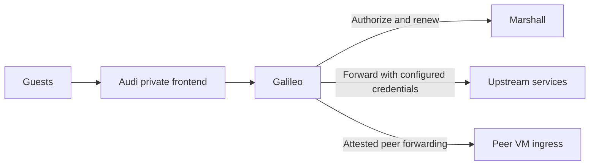

# Galileo

Galileo is Overalls' Elixir gateway for named guest integrations. It forwards
authorized requests to configured upstreams or peer VMs, injecting credentials
without exposing them to guests and retaining Marshall authorization through
renewable leases.

See the [Galileo guide](../docs/services/galileo.md) and
[integration decision](../docs/architecture/decisions/0080-named-edge-integrations.md).
