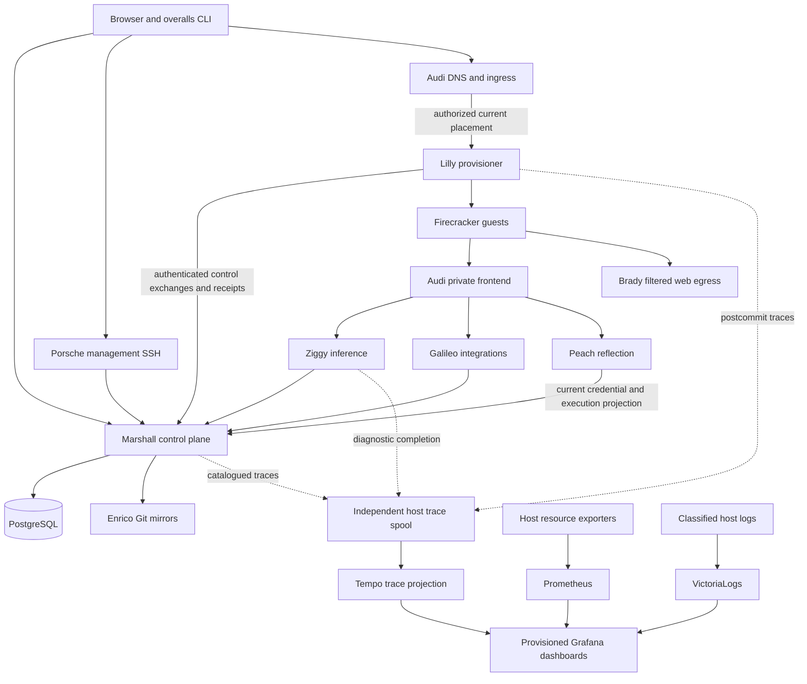

# System overview

The personal browser editor is built from pinned official Microsoft Code OSS
source with a maintained patch stack. Marshall grants current account write
authority; Audi serves the account origin, Lilly fences a dedicated connector,
and the guest broker runs the native editor under that account's UID. Both image
builders embed its immutable release capability. The complete authenticated
NixOS Firecracker journey passed; Ubuntu provisioned and reached the correct
editor origin but failed initial workbench visibility. These records precede the
merged independent-observability revision; current acceptance stays separately
scoped. See [interactive access](#interactive),
[guest images](#guests) and [scenario coverage](#coverage) for rollout and native gaps.

Overalls provides persistent development machines backed by Firecracker microVMs.
Marshall owns durable intent and access. Lilly owns physical execution on each
provisioner. A machine keeps its identity across stop, start, and relocation.

The diagram shows logical boundaries, not independent physical failure domains.
Several services may share one NixOS host. A PostgreSQL replica on the same
physical host does not protect against that host's loss.

See [Ash business domains](#domains) for resource ownership and authority paths,
and [deployment topology](#topology) for evaluated host and service placement.

| Component | Responsibility | Durable state |
| --- | --- | --- |
| Marshall | Accounts, policy, machines, scheduling, operations, agents, web UI | Shared PostgreSQL; encrypted sensitive fields |
| Lilly | Host inventory, VM actors, native storage, networks, physical receipts | Private host journals and ZFS datasets |
| Protocol | Validated wire schemas, command grammar, pure state primitives and named outbound control WebSocket transport modules | None |
| Audi | Authoritative DNS, public ingress, SSH gateway, private frontend | Local service keys; publication authority remains in Marshall |
| Porsche / Lyra | Management SSH server / `overalls` client | Gateway keys / local client setup |
| Brady | Transparent guest web proxy and cache | Disposable bounded cache; host-specific signer |
| Ziggy | Provider inference and durable usage delivery | Bounded local receipt spool |
| Galileo | Named integrations and peer forwarding | Authority and encrypted configuration in Marshall |
| Peach | Secret-free guest reflection behind the private frontend | Dedicated host credential digest and projection authority in Marshall; no guest snapshot state |
| Enrico | Private GitHub mirrors | Quota-bound Git cache |
| Underclass | Independent subscription pool on each host | Host-local SQLite and provider credentials |

A **VM** is the durable user machine. A **placement** binds it to one host and
storage allocation. A **generation** fences superseded commands. An **epoch**
fences ownership or session changes. A **receipt** records a specific effect;
receipt delivery is distinct from the effect itself. A **profile** selects guest
capabilities and isolation policy. An **image** is an immutable boot specification.

Read the operational procedures before changing host identity, storage, credentials,
or authority. Configuration examples use synthetic names and private-file paths.
Replace them with reviewed inputs. Source links point to repository `main`; the
handbook text ships with the Marshall release serving this page.

Evidence: [flake interfaces](repo:flake.nix), [Marshall domains](repo:marshall/lib/marshall/application.ex),
[Lilly supervision](repo:lilly/lib/lilly/application.ex), [architecture decisions](repo:docs/architecture/decisions/README.md).

SSH host identity uses one dedicated CA held by Marshall. Native certificates
cover management, gateway and guest peers; account keys and Cedar retain their
separate login authority. See [developer SSH](#interactive) and
[security boundaries](#security).

Observability is an independent deployment boundary under ADR-0149. Control
receipts carry readiness and accounting facts required for authority; they carry
no diagnostic lifecycle outbox, progress stream or resource history. Marshall
preserves transactional security/business audits and durable service-level totals.
The host trace spool, Collector and searchable backends cannot authorize effects,
release reservations or delay local state publication. Grafana dashboards and
datasources are provisioned by NixOS. Historical database and private journal
archives retain their original evidence scope; they do not prove current health.
