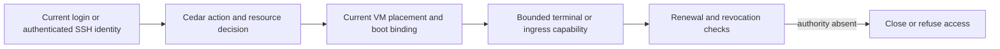

# Accounts and access control

## Privileged administrator step-up

[ADR-0160](repo:docs/architecture/decisions/0160-privileged-administrator-step-up.md)
accepts a fixed fifteen-minute administrator elevation and inline retry of the
exact pending action for enrolled administrators. No-key administrators complete
setup on the Security page and explicitly retry. This section states that design;
the historical baseline used five-minute elevation and redirected all verification.
Scoped final packaged browser acceptance is recorded in [scenario coverage](#coverage).

A current signed-in user reads the Control room's bounded, redacted projections
without administrator elevation. An administrator mutation requires current
persisted membership, a live stored login, an unexpired session-bound passkey
receipt and its current Cedar action. The fifteen-minute receipt uses database
time and never renews through activity. The continuation is socket-local;
navigation or reconnect discards it and requires a new explicit submission.
Final merged packaged browser checks passed ordinary/remembered reads, no-key
Security return and explicit retry, the enrolled-key modal and colocated
cross-replica revocation. Native timed expiry, machine-page recovery and complete
stale-action acceptance remain separate gaps. Expiry
removes privileged authority; ordinary reads continue while the login remains
valid.

When verification is needed, the inline ceremony retains one exact actor/login,
resource, action and canonical argument set in a five-minute one-use continuation.
Successful verification retries that action only after current authority and
resource state are rechecked. Cancellation, expiry, replay, changed arguments,
another tab, role loss, revoked login or stale resource state refuse without a
privileged mutation or target-action audit row. Successful passkey verification
retains its separate security audit even if the target later refuses.
The pending action is not a permission grant.

An administrator with no passkey visits Security settings with an allowlisted
return path. First-key setup uses email authentication completed within five
minutes; missing freshness requires a new email sign-in. The administrator then
returns to the original page and explicitly retries the action. No administrative
arguments survive setup navigation and enrollment alone does not elevate the
login. Further passkey changes require an existing key verified within fifteen
minutes; a key cannot prove its own
incomplete enrollment. Removal of the proving key ends elevation immediately,
and an administrator cannot remove the last key. Current Cedar ownership,
sharing and profile checks still govern machine access: even elevated
administrators are refused foreign Customer resources. See
[security boundaries](#security) and [workflow continuation](#workflows).

**Open VS Code** requires the current completed stored login and current machine
write authority. Viewer and web access do not grant editor access. Customer
requires the exact machine owner, including against administrators. A personal
origin binds the full machine UUID and permanent GuestAccount UUID; a retired
identity loses authority before roster reconciliation. Every same-User email
change preserves the guest account, origin and current lease. Login approval is
single-use, fixed to the personal origin, and cannot be transferred to another
account. Current grants, login and execution are checked again on each renewable
lease. See [interactive access](#interactive) and [security boundaries](#security).

An administrator using a non-Customer machine through an override returns to
Fleet workloads when verification ends. A terminal/detail page explains the
expiry before returning; selecting that machine starts a fresh privileged
opening. Resize hides its mutation controls but keeps the draft in its URL and
offers the same recovery link. Owner and sharing rights continue without
elevation, and foreign Customer refusal never offers verification as recovery.

Browser login uses the persisted account and login token. Ordinary signed-in
workspace and Control room reads do not require a passkey; passkey verification
starts at the privileged mutation or passkey-change boundary. LiveViews
recheck the stored login before mount and on navigation, events, and refresh;
keeping a page open does not preserve revoked authority.

Repository launch capture is public input storage, not a login or provision grant.
The configured extension transmits only after an explicit toolbar click. A URL
withheld by browser permissions leaves the action available for that click's
activeTab grant, then provider validation decides whether to open capture; unknown
state alone sends nothing and grants no Overalls identity or machine authority.
The extension removes source queries/fragments before opening capture. Direct
capture removes them before browser storage or the CSRF POST and refuses URL user
information; raw authority/path still undergoes strict backend validation.
`POST /launch/pending` requires CSRF and stores canonical source, 128-bit visit and
server expiry for thirty minutes in the existing signed session cookie. A valid
pending launch returns through ordinary sign-in to fixed `/launch`, including
a magic link opened in another tab of the same browser. Expired or malformed input
creates nothing. Connected admission uses the current completed stored login and
ordinary provision authority. Its signed completion receipt is cleared only by a
CSRF HTTP POST with current owner/read authority and matching pending source/visit;
a newer capture survives the old clear. A singleton cookie does not queue concurrent
tab intents. See [guest workspaces](#guests) and [security boundaries](#security).

Registration accepts bounded ASCII mailboxes on any valid domain. Requests,
invitations and verified-token sign-ins validate mailbox syntax independently of
Linux naming: valid plus aliases, numeric-leading local parts and `root` mailboxes
are eligible. Malformed domains and header injection refuse; there is no
organization allowlist. Complete case-insensitive email addresses identify
distinct Users, each with a separate reserved guest UUID/UID. All email edits of
the same User preserve its guest identity. No profile username, public email-edit
action or onboarding step is added. Native plus-alias/numeric-leading mailbox
sign-in and SMTP inbox delivery remain separate gaps in [scenario coverage](#coverage).

Opening a magic link in a JavaScript-enabled browser submits the token through
the CSRF-protected sign-in POST without another click and remembers the browser.
The initial GET does not consume the link. A browser without JavaScript can use
the fallback button. A successful sign-in returns to the requested destination
or Overview. Pending first-key setup does not block ordinary reads; Security is
opened by an explicit credential action or by the privileged step-up setup flow.
Invalid, expired and replayed links leave no login or remembered credential.
JavaScript-capable automated link visitors may consume a valid single-use link;
GET-only scanners cannot. The updated three-replica native MFA browser journey
passed automatic navigation and remembered-cookie checks in one NixOS VM; see
the [automatic sign-in review](repo:docs/architecture/reviews/2026-10-02-automatic-magic-link.md).

A remembered browser credential creates a new ordinary login. Passkey verification
is requested when the user starts a privileged mutation or passkey change; a
remembered login alone does not provide that step-up or fresh-email authority for
first enrollment. **Sign out everywhere** revokes both ordinary and remembered
browser credentials. Exchange and revocation serialize on the account row,
including across replicas. Fresh email sign-in and separate SSH/service
credentials remain independent. Ordinary sign-out revokes the supplied browser
and remembered cookies even if the browser login has expired.

A fresh magic-link sign-in mints its authoritative browser login inside the
sign-in transaction, which serializes against revocation through the
installation latch and the account row lock. A sign-in committed before an MFA
reset, retirement or **Sign out everywhere** revocation is always revoked with
the account's other credentials; MFA reset and retirement also revoke the link
itself, so a sign-in ordered after them is refused. Ordinary **Sign out
everywhere** is not a credential ban: a magic-link sign-in ordered after it
remains an intentional fresh email sign-in. The strategy's own post-commit
issuance is never the returned credential and is revoked before the action
returns, and a login revoked between issuance and the final server callback is
refused with a generic message, never an error page. The
[login race review](repo:docs/architecture/reviews/2026-09-26-login-races.md)
records both orders across three independent control planes and the native
expired-ceremony refusal with a cross-replica fresh retry.

Magic-link requests queue an encrypted outbox record and a private delivery
job. The mail action locks and rechecks the row before submission; a delivered
or expired record cannot start another submission. Each retry uses the same
Message-ID and token payload. Message-ID now uses the delivery UUID in a fixed
`overalls.invalid` identifier namespace; the configured sender still supplies
From, and sender rotation cannot change the corrected implementation's retry
identity. The namespace is not a delivery destination or DNS/TLS endpoint.
The older implementation derived this identifier from the live sender domain;
an uncertain delivery spanning that format transition may have a different first
upgraded ID because the old emitted identifier was not stored. That transition,
provider deduplication and body stability across endpoint rotation remain gaps.
An actual post-ACK transaction-loss history preserves independently committed
pending ciphertext until retry commits. A sender-rotation history reproduced the
old identity mismatch and passed its repaired selection. Combined mail execution
passed19checks (9properties,10tests),seed0,266.0seconds. Forced test-environment
Dialyzer passed with zero errors/skips on the mail worktree. Integrated Marshall
precommit on the b6496b73 merge passed1479checks (245properties,1234tests),
2excluded,seed755639,1598.9seconds, with zero-error/skips forced test Dialyzer.
Newer-main integration and native/inbox acceptance remain separate in the
[mail review](repo:docs/architecture/reviews/2026-10-05-auth-mail-post-ack-runtime.md).
SMTP acceptance with a lost result can still
produce a duplicate submission, so the link remains single-use and receipt
is not proof of inbox placement. A generated local
[retry property](repo:marshall/test/marshall/accounts/auth_emails_test.exs)
checks the stable identity and terminal recheck through an adapter that loses
the result after acceptance. Generated implicit-TLS and STARTTLS
[post-DATA histories](repo:marshall/test/marshall/mailer/smtp_test.exs) additionally
check the real ten-second owner deadline, client socket closure, unchanged pending
ciphertext, stable decoded token payload and terminal no-connection replay.
The postmerge focused file passed eight checks in 114.6 seconds, as recorded in the
[SMTP review](repo:docs/architecture/reviews/2026-10-03-mail-smtp-timeout-histories.md).
The [committed worker histories](repo:marshall/test/marshall/accounts/auth_email_distributed_property_test.exs)
add three independent Marshall peers, real row-lock blocking, post-DATA abrupt
peer death and replacement-peer terminal reads. The final focused file passed both
properties in63.7seconds; forced Dialyzer passed in74.84seconds and full precommit passed1,432checks,seed612345,1525.2seconds with forced Dialyzer50.9seconds as recorded in
their [review](repo:docs/architecture/reviews/2026-10-03-mail-committed-worker-histories.md).
The [waiting-token properties](repo:marshall/test/marshall/accounts/auth_email_waiting_authority_property_test.exs)
remove or expire the captured stored token through a third committed peer while
a second worker is blocked on the outbox lock. After the first attempt receives
an explicit SMTP rejection, the waiter must erase and expire the outbox without
a second connection. The combined four-property run passed in 80.8 seconds,
seed63342, as recorded in the
[authority review](repo:docs/architecture/reviews/2026-10-03-mail-waiting-token-authority.md).
Stored-row removal does not establish complete sign-in consumption or session issuance.
Oban duplicate-job scheduling, exact natural expiry, token changes after validation, the post-acknowledgment
commit window, host relay composition and inbox placement remain separate gaps.

The [subsequent login verification](repo:docs/architecture/reviews/2026-09-25-mfa-login-verification.md)
tracks independent login histories, committed exchange/revocation races and a
three-replica native browser scenario. Execution status is recorded in
[scenario coverage](#coverage); all three native services are colocated in one VM.

Credentials are managed from the Security and SSH key settings pages. A first
passkey enrollment requires an email link completed within the previous five
minutes; every further registration, rename or removal requires a fresh passkey
verification. Accounts admit up to ten passkeys, up to ten retained
single-use sixty-second ceremony challenges, and up to one hundred SSH keys;
challenge history prunes on expiry. Renaming a passkey changes only its
displayed label: the credential identity and key material never change, and
labels are never visible to other accounts or administrative projections.
Removing a passkey other than the one the current elevation proved against
keeps MFA and elevation; removing exactly the proving credential ends the
session's elevation and completed MFA until another retained passkey verifies
in the same login. An ordinary account removing its last passkey disables MFA,
invalidates the credential generation and revokes every stored session,
including the one making the change. Administrators cannot remove their last
passkey. Passkey registration, verification, removal and administrative reset
enter the append-only account audit; the elevation-gated label rename changes
no authority and is deliberately not audited. Undersized or malformed ceremony
payloads consume their single-use challenge without credential or MFA changes,
and failed ceremonies never activate MFA.
The [credential management review](repo:docs/architecture/reviews/2026-09-26-credential-management-histories.md)
records generated real-ceremony histories against an independent raw-SQL
oracle, exact refusal bounds and session effects, and committed-inventory
restoration of unrelated fixtures.

All signed-in users may read the Control room's bounded, redacted projections.
The former fleet diagnostic log reader is retired from Marshall under ADR-0149;
Grafana has separate operator authentication and query-only store authority.
Administrative mutations require current administrator membership and passkey
elevation; ADR-0160 defines the new fifteen-minute receipt and inline retry above.
The historical results below exercise the prior five-minute flow.
Control-room visibility does not grant access to
another user's VM, terminal, guest web service, or SSH account.

The [Control room verification](repo:docs/architecture/reviews/2026-09-25-control-room-verification.md)
adds generated role/elevation/session histories and a packaged browser journey.
The native journey uses verified TLS and a virtual WebAuthn authenticator; it
checks reads, one audited role-change path, demotion, revocation and expiry.
Execution status is recorded in [scenario coverage](#coverage). One replica does
not establish cross-replica revocation propagation or physical authenticator behavior.

Accounts rename and remove their own passkeys in **Security** settings; both
require a passkey verified within the last fifteen minutes and a live stored login.
A missing, blank, or over-80-character name is refused closed without touching
stored state. Removing a credential that is not proving the current elevation
keeps MFA, every session and that elevation. Removing the proving credential ends
the elevation immediately; the login survives and a remaining passkey can
re-verify. An ordinary account may remove its last passkey, which disables MFA
and revokes every browser credential; an administrator can never remove their
last passkey. Accounts enroll at most ten passkeys: registration refuses at the
limit without consuming the challenge, which stays usable after the inventory
drops back below ten, and failed ceremonies consume their challenge without
enabling MFA. **SSH keys** settings are owner-scoped; accounts hold at most one
hundred keys and removal is permanent. The
[credential self-service review](repo:docs/architecture/reviews/2026-09-26-credential-self-service.md)
records generated inventory histories, the label-crash repair and the packaged
browser journey; execution status is recorded in [scenario coverage](#coverage).

Account role changes, global browser revocation, MFA reset, invitation and
retirement retain current actor authority through their audit commit. Actor and
target User rows are acquired in sorted order after the installation latch;
retirement first holds the target's exclusive account-admission fence. Actor-only
rows exclude authority mutations while allowing unrelated foreign-key references;
targets retain their strong row lock before team work and identity changes. Completed
revocation refuses later mutations, including an existing retirement receipt.
Previously committed durable cleanup remains valid after actor demotion.
The [account authority review](repo:docs/architecture/reviews/2026-09-25-admin-account-authority-verification.md)
records five generated histories, 27 three-process schedules and passing native
stale-page/reset acceptance with verified TLS and virtual WebAuthn. Full component
acceptance and the native run retain their captured revision; hardware authenticators,
physical hosts and rollout remain separate. Prior Control room and retirement
results retain their exact scopes.

| Authority | Purpose |
| --- | --- |
| VM ownership and Cedar grants | Machine-specific read, execution, management, terminal and ingress actions |
| Thread grants | Task read/write/manage and the corresponding current bound-machine authority; independent VM/team grants remain additive |
| Team membership | Shared ownership and permissions through current membership |
| Administrator membership | Eligibility for administrative changes |
| Fresh passkey elevation | Short-lived admission to sensitive administrative changes |
| Host/service credentials | Separate machine-to-control-plane authority |
| Fleet Unix users | Administrative host access and recovery recipients; separate from Marshall accounts |

Use the machine's **Access** page to grant or revoke sharing. It lists the owner
and every current grant with the role and what it allows, and one form grants,
replaces or removes a registered account's role (web apps only, viewer, operator,
manager). Grant the narrowest role that permits the intended action. The **Teams**
page switches between your teams, lists each team's members with their role and
what it allows, and holds the member form (admins and the owner) and the
ownership offer, acceptance, decline and cancel controls. Teams manage shared
resources and ownership transfers; a transfer is a durable workflow, not a label
change. Revocation must
reach new requests and renewable capabilities already in use.

[ADR-0175](repo:docs/architecture/decisions/0175-thread-sharing-and-bound-machine-authority.md)
adds canonical sharing on the durable thread. A viewer reads the task and retained
transcript and receives existing machine-read actions. An operator may prompt a
ready task and use existing machine-write actions, including prompt-triggered
agent wake; ordinary machine lifecycle still requires management authority.
A manager may manage thread sharing/lifecycle and use existing machine-management
actions. No web-only thread role exists, and the creator's ownership and billing
remain protected. Managers resolve current registered recipients by complete
case-insensitive email only after authorization.

Thread grants contribute directly through the current machine binding; they are
not copied into VM ACL rows. They survive pending, archived and reopened states,
then apply to the new bound machine. Retired bindings do not inherit them. A
VM-only grant does not reveal the task or transcript. Independent VM grants and
team membership still grant their own permissions, so removing a thread share
removes only that source. A thread manager can intentionally create independent
machine grants through the existing manager role. Personal guest accounts,
terminal ownership, editor leases, current login and profile refusals still
apply. See [thread sharing security](#security) and the
[sharing review](repo:docs/architecture/reviews/2026-10-16-thread-sharing.md)
for implementation and native verification scope.

A team has exactly one owner. Only that owner can appoint or remove admins;
admins can manage ordinary members. Membership edits cannot replace or remove
the owner, including an edit issued by an admin. Ownership changes through a
consent offer to an existing member: acceptance demotes the old owner to admin
and promotes the target in one transaction. Decline and cancellation preserve
ownership; terminal offers cannot be reused. Membership and transfer mutations
read current membership, so an open page cannot retain its former owner or member
authority after transfer or removal.
Members may read and use team machines through guest SSH, personal terminals,
private guest HTTP/WebSockets and profile-permitted agent operations, including
their existing prompt-triggered wake. Team web use creates no per-machine grant;
direct web-only sharing still grants neither machine metadata nor terminal/SSH use. Owners and admins may also manage the machines. Ordinary start/stop/delete,
resize, clone, relocation and per-machine sharing require management authority.
Team members do not acquire Customer access: only the immutable Customer owner
may use that machine. Removing membership removes subsequent shared-resource
authority; re-adding it requires a fresh decision.

Team-owned integrations are automatically available to eligible machines whose
owners currently belong to the team, including personally owned machines without
a team tag. Removal refuses subsequent private HTTP authorization; no explicit
attachment is created by this automatic path. Customer private-service restrictions
still apply. Only the team owner/admin may configure the integration.

Personal integration ownership grants management authority only. Every source
VM, including the owner's VM, needs an explicit attachment. Detach removes
admission and renewal authority; existing configurations receive no automatic
attachments or compatibility exemption. Personal-owner retirement and owning-team
archival refuse access despite retained rows. See [services](#services) for lease
cancellation and the distinction between current and historical acceptance.

The [resource verification](repo:docs/architecture/reviews/2026-09-25-team-resource-verification.md)
records corrected member use and distinguishes generated control-plane histories,
three-node committed retirement overlap and separately recorded native execution.
Retirement refuses a current team owner. An accepted ownership transfer ordered
first therefore prevents target retirement; retirement ordered first archives its
membership and cancels the offer. Membership admission cannot commit after the
account retirement cleanup boundary.
The native resource check requires explicit command refusals and recognized-key
SSH denial with fresh unauthorized control evidence; a transport failure cannot
establish revoked authority. It checks fresh connections, not termination of an
already open SSH session. The recorded native run passes shared guest use,
member/admin/foreign and Customer refusals, retained home after stop/start, and
integration removal/re-addition. It uses public HTTPS CA policy, current gateway
identity and strict certificates. It waits for actual successful SSH after boot
or roster changes; a running VMM alone does not prove SSH ready. The review keeps
the earlier failed restart attempt and its scope.
The fixture selects its registered image explicitly for shared OSS, personal OSS
and team-tagged Customer creation; a missing configured default must still refuse
an omitted image. An HTTP admission receipt does not establish a usable guest.

Porsche status polls (`request show`, listings) are read-only. They validate the
session, key and user but do not queue on the account's command lock, so polling
never waits behind that account's in-flight mutations (ADR-0140). A transport
error, 503, 429 or other non-2xx poll keeps waiting until the deadline. Only a
denial, an invalid receipt or the deadline ends a wait.

Team creation reserves an active name and creates one owner membership. Reusing
a name succeeds only for the original creator while they still own that team.
Another account, a former owner, or a different current owner receives a creation
error without a new membership. Choose an available name to create a separate
team. Archived names may acquire a new team identity; retained history is preserved.
SSH retries with the same request ID return their pinned result, including after
name reuse; the team domain's key alone is not a durable request receipt.
The [creation verification](repo:docs/architecture/reviews/2026-09-25-team-creation-verification.md)
records generated histories, committed three-node collisions and native browser
refusals with ordinary accounts.

Teams SSH commands report a name or transfer-state conflict with exit 2; choose
an available name or a valid current transition before issuing a new request.
Malformed names and missing references also exit 2. Names contain 1–63 lowercase
ASCII letters, digits or internal hyphens, start with a letter and end with a
letter or digit. Missing membership or foreign authority exits 3. These permanent
refusals leave team, audit and request rows unchanged. Unexpected storage or
application failures remain opaque and retryable (exit 5).
The same accepted request ID keeps its historical result after ownership transfer,
removal or name reuse; it does not grant current access. A changed semantic input
with that ID conflicts. The [SSH verification](repo:docs/architecture/reviews/2026-09-25-team-ssh-verification.md)
distinguishes generated HTTP checks and packaged CLI metadata execution; the
resource review above records the subsequent native shared-resource journey.

Standard guest SSH uses the authenticated account's immutable `u<uid>` Unix
name, `/home/u<uid>` home and durable UID allocation. Audi obtains current Cedar authorization and
key decisions. The guest reconciles the boot-bound roster. A Windows guest
(ADR-0171) cannot ask per connection, so its roster agent also pulls the
writers' registered keys (`GET /ssh/v1/authorized-keys`) into per-account key
files; see [guests](#guests). Root-key injection is
not the current user access model. Retained disks from older images may require a
compatible new image/recreation; publishing a new image does not rewrite them.
The development cutover converts database names without converting guest disks.

An elevated administrator can send an invitation from **Users**. The
recipient becomes an ordinary account only after explicitly consuming a valid
email link. Delivery uses an encrypted outbox; requesting an invitation does not
prove that a mailbox received it.

Account retirement requires current administrator membership, recent passkey
verification and typed email confirmation. Self-retirement and retiring a current
team owner are refused. Transfer team ownership before retrying. Accepted retirement
immediately disables the old UUID and its browser/remembered authority, revokes
access to its owned workloads, and queues physical cleanup. The receipt stays
bound to the old UUID even if the requester later loses administrative authority.
Busy resize or unavailable hosts leave cleanup pending and storage holds intact.
An administrator gains no Customer guest-content access through retirement.

A new verified registration may reuse the released email while cleanup is pending.
It receives a fresh UUID and inherits no administrator role, passkeys, SSH keys,
sharing grants, team membership or machines. Earlier email links remain refused.
Machines merely shared with the retired account survive. Use **Users**
for invitation and typed retirement.

Manual SSH key registration and browser key approval serialize with retirement
through the account admission fence. A registration committed first is included
in old-UUID cleanup. If retirement wins, registration is refused without adding
key or approval records. Completed cleanup leaves no active key for that retired
UUID. A fresh identity must explicitly register the released fingerprint and gets
a new registration ID; existing sessions stay bound to the old ID.
Generated same-email histories and three independent Marshall processes verify
both registration orders and exact committed inventories. This is database
workflow evidence; native concurrent browser/SSH delivery remains separate.
See the [credential review](repo:docs/architecture/reviews/2026-09-25-credential-lifecycle-verification.md).

A retired GuestAccount UUID and UID stay permanently reserved. A fresh same-email
User receives a new guest UUID, UID, `u<uid>` login and `/home/u<uid>` home. The
same User's email changes preserve all four fields. Original homes are not
automatically transferred. Authorized shared writers still have passwordless sudo;
separate homes do not isolate their data from other authorized writers.
Repeated requests reuse the current identity, including after UID exhaustion.
The allocator refuses new allocations atomically when the noncycling UID range
200000 through 999999 is exhausted; complete batches remain bounded at 512 Users.
Failure preserves all prior identity rows. Never reset this sequence or delete
historical reservations to recover an allocation failure.

Authenticated SSH account discovery can create this durable allocation before
the user owns a VM. It returns the stored name and repeats do not create another
identity. Installer configuration and browser personal terminals share that
identity. The prior email-derived fresh-NixOS journey passed SSH/browser identity,
shared-home preservation and managed Lyra SSH; it remains historical evidence in
the [fresh identity review](repo:docs/architecture/reviews/2026-09-25-fresh-guest-identity-verification.md).
On base `63a1443c` plus the durable feature, before stopped-only relocation
integration, the complete NixOS SSH journey and the completed Ubuntu email-change
subtest preserve canonical login/home, numeric ownership, running boot and client
configuration. Current database/property and migration checks also passed.
The complete NixOS and Ubuntu generated-identity retirement journeys passed old-home
reservation, fresh same-email isolation, physical cleanup and explicit fresh
sharing. Current merged component/native validation, complete Ubuntu SSH and
retained-disk/restore acceptance remain
separate in the
[durable identity review](repo:docs/architecture/reviews/2026-10-10-durable-guest-identities.md).
The
[account lifecycle review](repo:docs/architecture/reviews/2026-09-25-account-lifecycle-verification.md)
separates generated identity histories from native cleanup execution and the
remaining transfer/retirement race and external delivery boundaries.

Evidence: [current read-access decision](repo:docs/architecture/decisions/0119-authenticated-control-room-reads.md),
[login hooks](repo:marshall/lib/marshall_web/live_user_auth.ex),
[Cedar policy](repo:marshall/priv/cedar/compute.cedar),
[guest account design](repo:docs/architecture/decisions/0158-durable-guest-identities.md).
