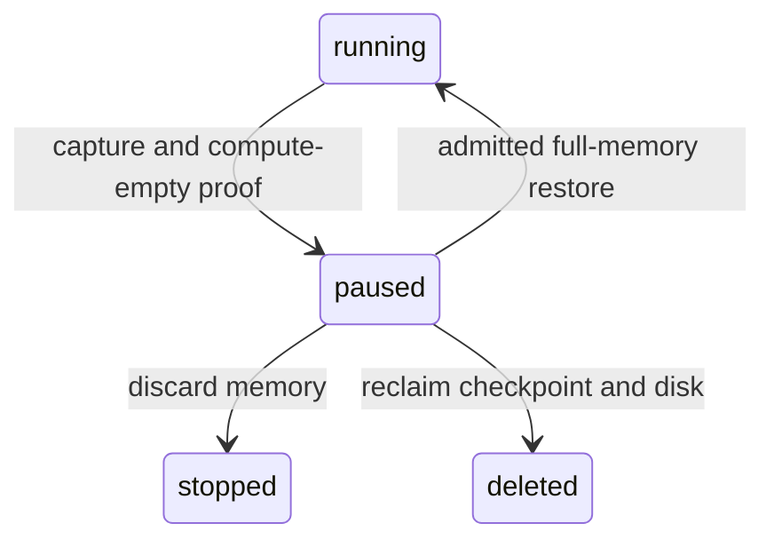
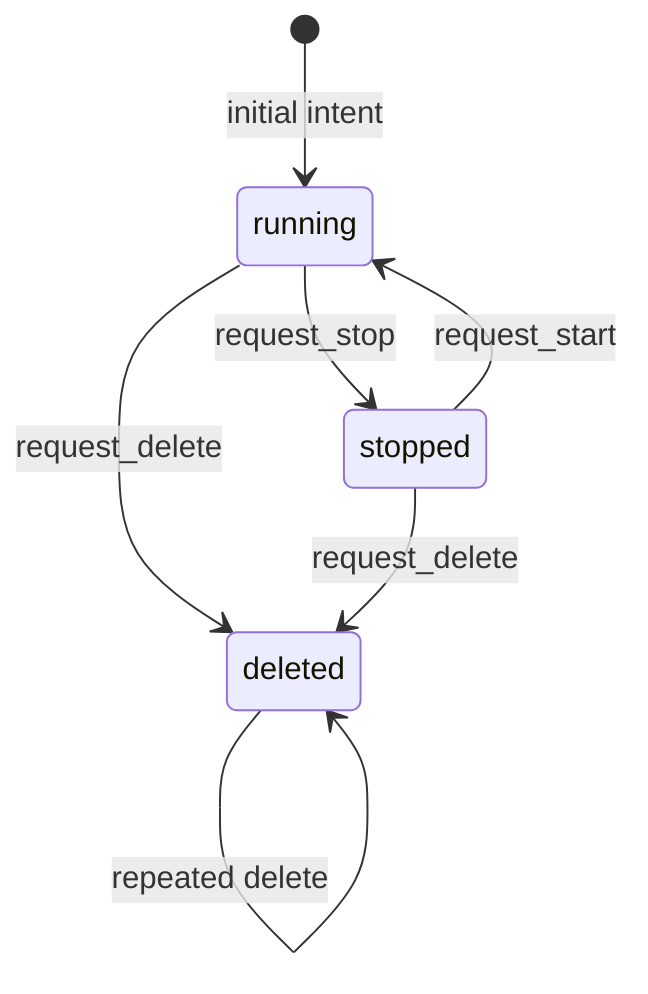
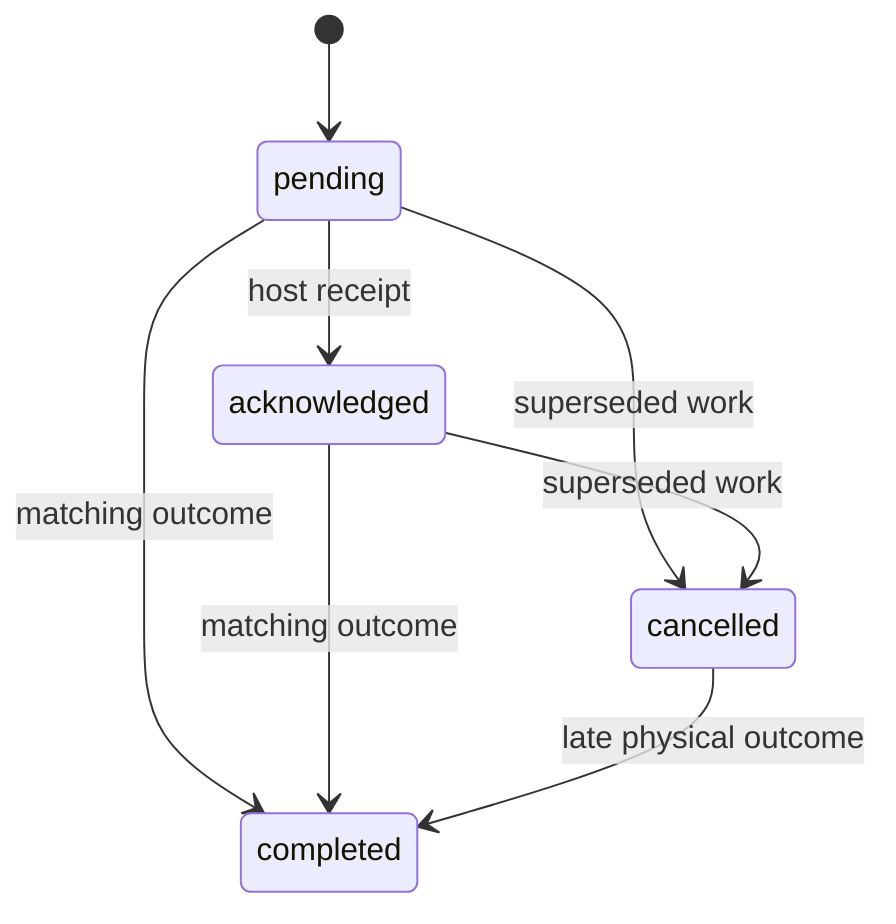
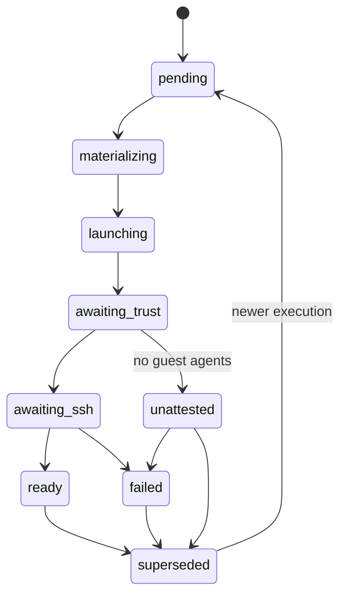

# Machine lifecycle

SCIM team retirement is coordinated by `Marshall.Scim.TeamRetirementWorker`.
Enabling SCIM marks every native team `:retiring` with the shared SCIM grace
deadline and schedules the worker in the same transaction. A SCIM Group
`DELETE` revokes the team's authority at once and retires it with an immediate
deadline. At the deadline the worker revokes memberships, transfers, VM grants,
integrations and terminal sessions (`Marshall.Scim.TeamCleanup`, whose failures
surface so Oban retries), deletes team machines through
`Marshall.Compute.Lifecycle.delete_for_team/3` under the retiring-team binding
with the SCIM service owner as audit actor, then archives the team once its
machines are archived. Re-runs and duplicate jobs are no-ops; teams already
retiring keep retiring if SCIM is later disabled.

## Memory-preserving suspension

[ADR-0199](repo:docs/architecture/decisions/0199-memory-suspension-and-demand-wake.md)
adds desired and observed `paused` states. Pause is a durable lifecycle operation;
its physical outcome requires a sealed full memory/device checkpoint and proven
VMM/cgroup absence. Only then can compute reservations be released. Resume is a
coalesced durable `WakeRequest`, rather than an acknowledgement of execution.
Its state machine waits for capacity, relocates if necessary, resumes, and reaches
ready only after current execution readiness. Failed or ambiguous restore never
falls back to cold boot. Stop explicitly discards suspended memory; delete also
requires checkpoint reclamation. Start cannot bypass a retained checkpoint.

New thread/Orb machines opt into suspension four hours after the last admitted
or completed tool call. Provisioning and successful wake initialize that window.
Active admitted tools/turns defer suspension. Existing machines remain opted out.
Prompts and authorized network access wake sleeping machines; requests to an
already running machine do not continually reset the tool clock. Only the owner's
pin prevents automatic suspension, and pinning a suspended machine requests wake.

The suspension fleet fixture now enrolls the same private Galileo/Audi issuer,
runtime credentials and trust as ordinary fleet guests before SSH host-certificate
readiness. Its 2026-10-19 rerun passed composed-driver type and lint checks and
completed private-service enrollment, then exited with status 137 while waiting
for the fleet wildcard certificate, before guest launch. This records neither
pause/resume nor relocation acceptance; the exit status does not identify why
the process was killed. Changed-source native continuation remains unverified.

Keep four facts separate: desired VM state, observed physical state, workflow
phase, and cleanup receipts. A successful state transition records intent; it
cannot prove that a process stopped or a disk disappeared.

These are **desired states**. The VM resource permits idempotent start/stop
requests. Deletion is terminal intent. Relocation has additional quiesced-source
handoff and restoration transitions guarded by its coordinator.

Deletion has one more admission check since
[ADR-0193](repo:docs/architecture/decisions/0193-per-user-machine-pins.md). With
the host and VM locked, after authorization and the clone, resize, relocation
and deleted-intent checks, a `delete` request is refused with `machine_pinned`
while the machine's owner holds a live pinned row. The check sits in the single
lifecycle coordinator, so it covers the browser Delete button, Fleet workloads,
SSH and Porsche `rm`, and thread archive/delete teardown alike; a refusal writes
no generation, operation, receipt or thread transition. Pins held by shared users
never fence deletion, and start/stop are never fenced. The owner's account
deletion is the one exception: `delete_for_account/2` archives the departing
owner's pins on the machine inside the delete transaction before the guard, so a
retired account cannot leave an undeletable machine. When the deleted outcome
finally archives the VM, both archive sites archive every remaining pin in the
same transaction, so no live pin outlives its machine. Relocation source cleanup
reclaims a copy, not the machine, and is not fenced. The generated
[guard history](repo:marshall/test/marshall/access/pins_property_test.exs) drives
pin, unpin and delete attempts through the domain action and the SSH `rm` path
against an owner/member model; it is local PostgreSQL evidence, not a native or
cross-node race result.

A repeated Start advances logical generation even when the confined VMM remains
running. Lilly adopts the boot journal into that generation only under placement
ownership, after proving the existing native process. The same placement and
execution epoch retain their boot challenge; missing, corrupt, foreign or
regressing journals refuse adoption. Current-generation trust and readiness
remain required before acknowledgement. The
[journal properties](repo:lilly/test/vm/boot_generation_adoption_property_test.exs)
passed isolated generated histories. The repaired clone fleet passed repeated
public Start with unchanged native process identity and guest inheritance. The
complete native clone matrix also passed. Native foreign/corrupt ownership
refusal remains outside this recorded scope.

Lilly keeps volatile execution proof separate from its durable outcome journal
and native exit observer. A negative physical observation withdraws boot/live
authority immediately. Its already bound watcher remains available to report
the actual exit or error; retaining that observer cannot republish proof. One
actor owns at most one watcher, and a superseding command, replacement target
or actor shutdown closes the previous observer.

Closing an observer tolerates its concurrent normal port exit; an already
closed port must not crash the VM actor. Lock-free execution reads independently
check that both the actor and runtime publishers are alive, rather than waiting
for the shared view to process their monitor messages. Stale table rows cannot
extend boot, ingress or live execution authority after either publisher dies.
The [publisher-liveness property](repo:lilly/test/lilly/execution_test.exs)
holds monitor cleanup pending while checking those refusals; this is BEAM
authority evidence, not physical VMM-death evidence.

The thirty-second backstop requires an armed watcher on the exact verified VMM
that supplied the published proof. Unarmed or unavailable target bindings retain
the two-second bound, including after delayed arming messages. A verified boot
target replacing a live target withdraws old live authority before publishing
roster-only proof. A same-target boot observation does not renew running proof.
The ordered [actor/port regressions](repo:lilly/test/vm/actor_watch_test.exs)
exercise these boundaries; native exit delivery remains separately recorded in
the [cutover review](repo:docs/architecture/reviews/2026-10-09-observability-decoupling.md).

Operation cancellation does not erase a physical effect. A late outcome still
requires reconciliation against the current identity and generation. The
[generated lifecycle history](repo:marshall/test/marshall/compute/lifecycle_history_test.exs)
checks one to four delayed physical receipts after confirmed archival. Their
immutable rows append while VM state and released reservations stay fixed; a
changed replay is refused. This uses synthetic outcomes in local PostgreSQL,
not native guest or cross-host evidence.

A Lilly delete with unconfirmed physical cleanup retains its durable fence and
retries with delays growing to thirty seconds. Pool-lock contention is not a
cleanup failure: it is retried on the next actor tick without that backoff.
The dataset precondition uses an identity observation (ADR-0143). It needs the
same identity, policy, snapshot and coherent accounting as a capacity sample,
but tolerates usage-counter drift, because pool-wide `available` moves with any
write. Earlier exact-usage checks produced 5–23 minute production deletes
under pool writes. Each unconfirmed attempt reports a fixed `stage`.
Stage `destroy` with `lilly.zfs_namespace_cleanup_unconfirmed` exposed the
remaining tail: Nix build sandboxes (user namespaces) held locked copies of a
guest dataset, which ordinary unmount cannot remove, so deletion waited for the
build. Lilly hosts therefore run `nix-daemon` in a private mount namespace
without pool mounts (ADR-0144). The same lock affected services with private
user namespaces (Prometheus, VictoriaLogs, rootless containers) on Overalls, so
`lilly-pool-propagation` makes every pool mount recursively private before Lilly
starts; guest mounts then propagate into no other namespace. Namespaces created
while a guest is mounted still copy it, and no machine test yet covers this
second path. Repeated cleanup failures never
establish deletion or retire the actor; a newer generation bypasses the old
retry deadline. A generated [actor retry property](repo:lilly/test/vm/actor_test.exs)
checks this local journal and scheduling path. Its controlled executor does not
establish native ZFS cleanup or Marshall allocation release.

The audit-retention sweep removes at most 1,000 expired lifecycle and PaperTrail
rows in one transaction and schedules a maintenance-queue continuation when a
batch is full. A [generated backlog test](repo:marshall/test/marshall/compute/lifecycle_audit_test.exs)
checks empty, partial and multiple full batches against remaining expired rows
and continuation counts while preserving the live VM. It drives the action
directly; Oban execution, cron recovery after job failure and elapsed expiry
lag remain untested.

Creation admits an immutable image and shape, reserves capacity and an address,
creates durable placement intent, and dispatches provisioning. Lilly validates
native storage, builds owned drives, installs isolated networking, and starts the
jailed VMM. Readiness requires current physical evidence; job completion alone is
insufficient. That evidence is the running unit, a single VMM in its cgroup with
the expected UID/GID, no capabilities, no-new-privileges and seccomp, the same
jail root, network namespace and executable, the configured CPU, memory and swap
limits, and a running API answer. When a check fails Lilly logs
`vm.observation_failed` with the placement and the first failing check's closed
atom (`unit_not_running`, `cgroup_unreadable`, `vmm_process_ambiguous`,
`identity_mismatch`, `limits_mismatch`, `api_unavailable` or
`unit_stopped_during_check`), once per change of failing check and never with
paths, PIDs or command output; the guest stays unconfirmed. Guest trust delivery
and its receipt recheck name the first unconfirmed step the same way: the
executor retries with a closed `trust_*` reason on `vm.execution_deferred`
(`trust_lock_unavailable`, `trust_claim_mismatch`, `trust_boot_unconfirmed`,
`trust_boot_changed`, `trust_vmm_unconfirmed`, `trust_provisioning_unconfirmed`,
`trust_journal_unreadable`, `trust_state_unwritten`, `trust_attempts_invalid` or
`trust_delivery_failed`). Every stage retries; only three failed deliveries for
one boot fail the execution. Like the other readiness steps, trust waits up to
two seconds in lilly-hostd's FIFO queue for the placement and journal leases, so
the actor's per-tick boot probe and outcome journal writes cannot starve it: a
single-attempt trust lock once left every guest adopted after a Lilly restart
deferred indefinitely.

Launches and restarts also require Lilly's private services. Private Audi
(`audi-private.service`) runs in Lilly's network namespace and is both required by
and wanted by `lilly.service`: any Lilly stop stops it, and any Lilly start,
including a stop/start or an enrollment rollback, starts it again. While it is
unavailable Lilly defers new launches and restarts and logs
`vm.execution_deferred` (VM, placement and reason atom, once per reason change);
already-running guests are adopted and unaffected. Private Audi also requires
Ziggy and Galileo. A crash with automatic restart, or `systemctl restart`, of
either restarts private Audi with it, and the auto-updater stops and then
explicitly starts all three around every switch, with private Audi as a health
unit. Only a manual `systemctl stop` followed by a separate `start` of Ziggy or
Galileo leaves private Audi down; use `restart`, or start `audi-private.service`
afterwards. Marshall's ingress
control API still answers any unexpected refusal with a uniform 503, but records
a closed reason class on `audi.control_unavailable`; `reason=unavailable` on
`fleet-certificate` before issuance is expected while ACME is pending.

Generated Marshall admission checks inject insert failures at twelve VM,
audit, agent, ingress, placement, reservation, address, operation and
dispatch-job stages. Each refusal leaves the complete committed public-table
inventory unchanged; a later admission creates one linked set of the checked
rows, and exact replay or changed-shape refusal adds no rows. These local
checks do not exercise optional source or Inception environment writes,
process death at commit ambiguity or native job execution.
Generated [archived replay histories](repo:marshall/test/marshall/compute/admission_test.exs)
return the original VM after one to four same-key retries, reject changed shape,
and preserve the local VM, placement, reservation, address, operation, audit
version and dispatch-job inventory after each prefix. Lost HTTP replies,
simultaneous callers and cross-node replay at an uncertain commit remain open.

Generated three-node capacity histories reject retained structured SQL deadlocks
and accept clone activation only as success or a documented atom refusal. A
rolled-back opaque activation error cannot count as a safe capacity refusal.
The focused race and wrapper properties passed seed202304 in60.2seconds. Full Marshall
precommit passed 1,423 checks (222 properties, 1,201 tests), two exclusions,
seed59328,1465.7seconds; forced Dialyzer44.48seconds, zero errors/skips/unnecessary
skips, exit0. Opaque errors in other step families and ungenerated lock
schedules remain gaps. Fixture cleanup retries provide no mutation evidence.

An additional controlled schedule runs opposite-source relocations and clone
activation on three independent peers. Before release, every tagged backend
blocking chain reaches a separate holder, with a direct transaction-ID wait.
Exact committed endpoints, durable activation, accounting and fixture restoration
passed the focused property (seed219491,51.6seconds,exit0). This does not establish
native transfer, hosted fault search or untested cross-resource lock cycles.

Every Lilly host keeps a separate host-local provisioning journal; the former
`provisioningReadiness` switch was removed (ADR-0159). Provision/start completion
requires an exact-boot guest readiness receipt after trust, network,
writable-root and configured SSH service readiness. A running boot without a
durable boot identity is refused rather than adopted. This does not prove that
an arbitrary external client can authenticate or reach the guest.

A guest whose boot bundle declares no agents (a firmware-booted image,
[ADR-0170](repo:docs/architecture/decisions/0170-lilly-firmware-guest-launch.md)) never exchanges
readiness: Lilly records trust as `skipped` for the exact boot instead of
delivering it, advances provisioning to the terminal `unattested` phase (a boot
challenge, never a boot UUID, no path to `ready`) and reports the VM running
without a `guest_ready` fact. Physical-only measurement describes retained
agentless executions and the historical Lilly-only launch fixture. Current
Marshall admission requires explicit Git identity support
([ADR-0198](repo:docs/architecture/decisions/0198-git-attribution-and-guest-identity.md),
[ADR-0204](repo:docs/architecture/decisions/0204-git-attribution-and-guest-identity.md));
an agentless image cannot advertise it and refuses new machine creation before
allocation. A Git-capable `windows-v1` image admits both physical and readiness
measurements. Whether a boot exchanges readiness and trust, and how
long readiness may take, is decided per agent set by the protocol's capability
table ([ADR-0171](repo:docs/architecture/decisions/0171-windows-guest-agents.md)):
Linux guests keep the 120 s budget (2400 s for Inception), `windows-v1` guests
get 600 s (matching Marshall's provision service level), and the budget is
recorded once at the first launch of a boot and never extended by a relaunch.
When a trust or completion transition reaches a boot whose journal has no
deadline yet, Lilly takes the budget from the validated placement-local
bundle's agent set, so a FreeBSD or illumos guest never falls back to the Linux
budget; an unreadable bundle keeps that legacy fallback.
The two completions are exclusive: the ready commit refuses an agent set
without readiness, and the `unattested` commit refuses an agent set that
proves readiness, so an agent guest is never reported running without its
ready line.

Failure and supersession can also terminate earlier phases. The execution and
dataset journals retain launch and cleanup authority. The deadline starts at
launch, allowing materialization its separate utility bounds. The original deadline
survives retries; a cached receipt is reusable only for the same execution and
boot challenge after physical confinement is rechecked. State and revision
publish atomically in lifecycle envelope version 2; duplicate polling changes
neither. After fsync, at most 128 reviewed UUID/state/time diagnostics per caller defer
until the exact native writer releases. Confirmed release admits them to the
bounded SDK queue and structured logs; spool handoff runs independently. Queue
refusal or uncertain lock release may drop diagnostics without undoing state.
Template diagnostics retain closed host/pool identity; these
observations never authorize a copy, physical seal or execution.

The matching provision/start physical outcome carries `guest_ready: true` only
following successful current-boot guest readiness. Marshall's immutable service
level measurements read that exact VM/placement/host/epoch/generation receipt at
its database arrival time. Old retained outcomes without the flag remain unknown
for readiness; historical remote transition events cannot fill the gap. Missing
readiness by the original deadline remains a finished measurement failure.

The browser and Porsche SSH creation entries select OSS when no profile is
chosen. Explicit Customer selection remains owner-only and blocks sharing,
agent registration and guest-initiated egress. Browser drafts retain the selected
profile and request identity across refresh and reload. SSH retries compare the
original explicit inputs before resolving defaults: changing an omitted profile
to an explicit profile conflicts, including explicit OSS. The
[default-profile verification review](repo:docs/architecture/reviews/2026-09-25-default-oss-verification.md)
records passing generated histories and the bounded native creation journey.
Both OSS guests reached the local DNS/HTTP origin; the explicitly selected
Customer refused sharing, foreign reads, agent admission and outbound HTTP.
The wider packet, tool-execution and guest-user SSH matrices remain separate.

Porsche reports Customer sharing as `forbidden`; the profile restriction cannot
be repaired by retrying a temporary outage. Rejected sharing records no grant,
change receipt or SSH request result. Owner Customer start, stop and deletion
enter only through the browser power controls or Porsche `stop`/`start`/`rm`:
a used request key replays the same operation and a changed kind conflicts
without new durable work. Member, stranger and administrator lifecycle commands
are refused at both entries and persist nothing; a persisted administrator flag
does not create CLI authority because SSH sessions carry no passkey elevation.
Deletion receipts remain readable to their issuing owner after archival and a
name-reused machine never inherits them. The
[customer controls review](repo:docs/architecture/reviews/2026-09-26-customer-controls.md)
records the generated profile/actor histories, the browser key-reuse pins, and
the native journey where the owner's CLI restart kills and recreates the real
guest process tree around its retained ZFS identity while the egress fence
remains closed.

Stopping preserves drives and machine identity. A later start requires admission
against current host capacity. Lilly's per-VM actors and independent launchers
allow guests to survive the main Lilly process restarting. Crash recovery is
bounded and suppressed during maintenance. A crash or resize restart that finds
the host's capacity report merely late keeps its compute hold, and the next
accepted report decides the restart. A late report is not a capacity shortfall
(ADR-0140). Repeated crashes should be diagnosed,
not hidden by unlimited restart loops.

A failed placement whose desired state is still `running` keeps its command,
but Lilly does not retry it on its own. Once a VM actor has durably recorded
(or re-observed unchanged) a failed outcome for the exact current command, it
settles: its one-second tick and unchanged reconcile requests start no further
work, so the failure fence, its locks and its cleanup run once rather than
every second. The durable journal still carries that failed outcome to Marshall
until acknowledged, exactly as before. Recovery stays with Marshall: a crash
within the restart budget, an owner start or retry, and a deletion each arrive
as a newer command, which the actor drives at once. A Lilly or actor restart
re-observes the failure once, so readiness still rests on an observation made
by the current runtime, then settles again without appending an outcome.
Journal contention, retryable results and unconfirmed cleanup (`unknown`) do
not settle and are retried on the tick as before. Lilly logs `vm.failed` (VM,
placement and the closed reason `execution_failed` or `crashed`) only after the
journal records a new failed outcome: once per generation and reason, again
after a recorded recovery or for a newer command's failure, and not again after
a Lilly restart over the same journaled failure. On 2026-10-17 a failed
placement was re-driven, and `vm.failed` emitted, every second until the VMs
were deleted. The
[actor failure-event property](repo:lilly/test/vm/actor_failure_event_test.exs)
checks generated failure, recovery, restart and newer-command histories, and
the [settled-failure property](repo:lilly/test/vm/actor_failure_settled_test.exs)
checks that ticks and unchanged reconcile requests start no work after a
recorded failure, that a replacement actor drives it exactly once, that a newer
command or deletion still drives, and that the actor's real timer starts no work
for two periods. Both use a controlled executor; no native machine test
exercises a settled failure.

A launch runs as six steps: begin (claim and running intent), disk, boot
records, jail, logging and network, and commit
([ADR-0176](repo:docs/architecture/decisions/0176-host-concurrency-single-writers-and-effects.md)
decision 2). Each step holds the placement lease only for its own duration and
waits for it in lilly-hostd's queue for at most two seconds, so a boot probe or
observation between steps no longer waits behind a whole create. Before acting,
every step after begin re-reads its fence: the exact intent begin set, no
deletion tombstone, a stopped unit and no launch attempt at or beyond that
revision. A changed fence stops the launch as preempted before that step's
effects. Commit checks the actor's commit grant, persists `launch-attempt.bin`
and starts the unit in one section, so a launch is attempted at most once per
revision. A launch that stops between steps starts again from begin; each step
is idempotent (an existing correctly bound disk is reused).

A source-bearing restart also requires its durable image's matching manifest4
identity and source2 capability, including when resize supplies its own command
snapshot. The stored VM source and retained immutable image determine the new
snapshot; a caller cannot select another image for a sourced start. A disabled current
capable image remains eligible; staged image availability is independent of
retained boot custody.

Unavailable source capability refuses automatic restart while committing the
confirmed crash or resize outcome and any valid host report. Confirmed stopped
compute is released; disk and network address remain retained. A confirmed resize
keeps its target sizes and completes with `workspace_source_unavailable`, allowing
ordinary deletion and recreation on a current image. Unconfirmed effects retain
their existing holds and fencing requirements. The final focused SQL-backed set
passed 39 checks (3 properties, 36 tests), including six new source/snapshot
regressions and editor publication; native recovery acceptance remains separately
scoped in the [review](repo:docs/architecture/reviews/2026-10-10-browser-launcher.md).

The [ordinary durable fake executor](repo:lilly/test/support/durable_fake_executor.ex)
accepts stop or delete evidence only for an incarnation with a persisted launch
marker. A
[generated fake command history](repo:lilly/test/vm/fake_executor_property_test.exs)
checks this causality through replay, generation advance and unseen commands.
It validates controlled-executor histories and cannot establish native Firecracker
or ZFS effects.

The [state journal properties](repo:lilly/test/lifecycle/journal_test.exs)
exercise histories beyond the former 64-event bound while diagnostics are
unavailable, replay identity, and refusal of corrupt or non-v2 primary envelopes
without rewriting.
These are local fsync/journal tests, not native VM lifetime or distributed
collector durability evidence.

Deletion retains the VM's identity and idempotency history while physical cleanup
runs. Busy mounts, foreign GUIDs, or uncertain execution retain holds. The native
cleanup path handles owned mount copies across Linux namespaces; it does not force
an unverified dataset into a free state.

Lilly journals also model execution, claims, receives, exports, snapshots, and
resize effects. Updates occur under native locks and publish state plus revision
atomically. Preserve these journals across daemon upgrades and recovery.

The historical Antithesis actor harness (`antithesis/README.md` at overalls revision `9fe1e493`, repository deleted)
exercised duplicate-generation launch histories through Lilly's real command
Store, VM actor and journal with a persistent fake executor. Its named-volume
workload observed replay across actor process lifetimes; it did not run Marshall
exchange, a full Lilly runtime, or native KVM, systemd and ZFS execution. Its
[architecture review](repo:docs/architecture/reviews/2026-09-28-antithesis-local-harness.md)
retains the recorded local validation and untested hosted/native boundaries.
The old `antithesis/` tree is retired before a fresh whole-repository rebuild;
the [reset review](repo:docs/architecture/reviews/2026-10-13-antithesis-reset.md)
records the removal and retained evidence. No fresh hosted run or mutation
sweep is established by this removal. The ordinary test fixture remains local
to Lilly, independently of the retired Compose workload.
Local [generated actor properties](repo:lilly/test/vm/antithesis_actor_property_test.exs)
passed replay/advance histories across actor lifetimes and a simulated
interruption after a durable fake launch marker. A further property kills the
real actor after the fake executor writes that marker and before it publishes
running. The replacement fences the same generation without another fake
launch. These local checks do not establish full Lilly process restart or native
launch fencing.
The [native completed-effect scenario](repo:docs/architecture/reviews/2026-10-03-lilly-native-actor-recovery.md)
adds the real Executor and Firecracker/systemd/ZFS fixture to this recording
window. It requires byte-identical attempt-only journals through actor death,
unchanged native process identity and launch marker across recovery, and stable
outcome replay. The combined native check passed in 671 seconds. Actual
placement-lock contention returned Executor retry with a persisted attempt,
stopped unit and absent launch marker before confirmed native lock release.
The [worker BEAM extension](repo:docs/architecture/reviews/2026-10-03-lilly-native-beam-recovery.md)
adds abrupt whole-worker loss and independent source-built worker Store/lock
reopens at the same recording boundary. It checks stable outcomes, native
process/launch-marker identity and guest data access. Three new histories passed
within the 1,040-second native check; the worker histories took 506.95 seconds.
The storage fixture disables
the production systemd daemon; it cannot establish that daemon's restart path.
This does not independently prove actor-deferred result consumption. Marshall
exchange, authenticated activation and full daemon death at this boundary remain
separate.
Generated [actor ordering and supersession properties](repo:lilly/test/vm/actor_test.exs)
also inspect the persisted attempt before a blocked executor returns, then
check that an older result cannot publish after a newer generation or epoch
replaces it. They exercise controlled executor tasks and durable journals,
not a native launcher or an actual process kill in that window.

Evidence: [VM resource](repo:marshall/lib/marshall/compute/virtual_machine.ex),
[operation resource](repo:marshall/lib/marshall/compute/operation.ex),
[host lifecycle resources](repo:lilly/lib/lilly/lifecycle/resource.ex),
[lifecycle decision](repo:docs/architecture/decisions/0074-durable-lifecycle-state-machines.md).

### Diagnostic custody and restored actors

Restored Lilly actors resume physical reconciliation when the current
authenticated control session connects. Collector acceptance and Tempo
availability do not gate actor startup, command dispatch, state transitions or
physical outcome acknowledgements.
The [recovery property](repo:lilly/test/lifecycle/recovery_history_test.exs)
reopens persisted execution histories and observes restored actor dispatch
without a diagnostic sender. Its control result and executor are synthetic;
authenticated transport, full Runtime bootstrap and native VMM lifetime remain
outside this scoped evidence.

Lifecycle journals accept only the state-only v2 envelope. Any other envelope
version, including the retired v1 shape with embedded events, fails closed
without rewriting or archiving; ADR-0159 removed the v1 migration, the
`.lifecycle-v1` archive importer and its legacy event vocabulary after the
fleet's old-format state was exported and purged. The
[journal tests](repo:lilly/test/lifecycle/journal_test.exs) check that refusal.
Committed transitions enter the shared library's bounded volatile queue only
after the native writer releases.
The former audit-drain, cursor and reoffer evidence describes the retired
application protocol and was preserved in the
baseline lifecycle chapter, `marshall/priv/hldd/04-lifecycle.md` at overalls revision `a99f74f0` (repository deleted).
Marshall's local transactional audit and PaperTrail retention tests remain active.

After a restart during snapshot load, Lilly may continue the exact claimed live
VMM. A paused process needs the same launch identity, PID/start time and full
confinement proof before a Resume API call; it never reloads the checkpoint.
Missing or changed authority leaves restoration fenced.

Stop, delete and failure may discard a paused process left by interrupted capture
or restore. This requires an active host lease, a reread terminal intent at least
as new as the journal's authority, the exact local checkpoint binding and current
paused-process confinement. Cleanup never promotes `capturing` to usable RAM.
Confirmed unit/cgroup absence remains necessary before networking or checkpoint
storage can be reclaimed; a failed kill reply alone proves neither outcome.

## SCIM identity retirement

SCIM `DELETE` (a soft destroy; the row and UUID remain) and `active=false`
enter one lifecycle in
[`ScimRetirement`](repo:marshall/lib/marshall/accounts/scim_retirement.ex). The
committing transaction revokes every stored login, records the deadline from
the single configured grace period (default seven days), schedules a
`:scim_retirement` `UserDeletion` and enqueues `Marshall.Scim.RetirementWorker`
now and at the deadline. Inactive identities are refused by stored-login checks
and owned-work admission; SCIM `GET` hides deleted and retired users.

The worker decides under the user row lock and database clock. Inside grace it
pauses running owned machines (stopping those that cannot be checkpointed) and
records each as a `ScimMachineSuspension` in the coordinator transaction.
`active=true` inside grace cancels the deletion through its state machine and
resumes only recorded suspensions; machines the owner paused stay paused. After
the deadline reactivation is refused, machine deletion is authorized only for an
inactive identity with an expired deadline, and finalization (after physical
reclamation) archives threads, retires attachments, clears the OIDC subject and
ghosts the email to `deleted-<uuid>@deleted.invalid`. A finalized identity
refuses every SCIM write. Administrator deletion supersedes a pending SCIM
retirement. BEAM endpoint, Oban and generated-history tests under
[`user_lifecycle_oban_test.exs`](repo:marshall/test/marshall/scim/user_lifecycle_oban_test.exs) and its sibling SCIM tests pass against
PostgreSQL; native machine execution of this flow remains open evidence.

The maintenance worker's per-minute sweep re-enqueues every inactive SCIM user
and every open SCIM suspension, so lost jobs recover. Compute's existing
lifecycle coordinator remains the authority for pause, stop, wake and delete.
Every live-account check (stored logins, SSH key sessions, agents, ingress,
Galileo, threads and administrator authority) requires `active` as well as no
`deleted_at`, so a deactivated identity loses all access at once rather than at
finalization.

## Native submission and daemon-loss verification

Launch authority is persisted before native unit submission. A daemon lost before
submission must refuse that generation; a new public start can issue a distinct
authority. Loss after successful submission must adopt the original independent
VMM and report the original operation through authenticated exchange. The
[submission recovery scenario](repo:nix/verification/tests/machines/fleet/scenarios/submission-recovery.py)
contains generated histories for both boundaries and repeated daemon reopens.
Recorded native execution passed: the submission history took337.69seconds
within a1036.30-second machine script, with composed driver static checks passed.
A timeout or disconnection alone is insufficient evidence of the
intended daemon loss; the scenario observes actual process retirement.

Initial provisioning, guest data continuity, power loss and hosted
faults remain separate gaps.

### Native submission mutation sensitivity

The retained-start daemon-loss fixture also caught one deliberately weakened
launch-marker comparison: a same-authority relaunch contradicted the required
failed settlement after the before-submission fault. This is bounded native
sensitivity, not a hosted mutation sweep. The integrated Marshall gate passed
1452checks including238properties; forced Dialyzer reported zero errors.
Initial provision, guest data usability and power loss remain separate gaps.
See the [submission review](repo:docs/architecture/reviews/2026-10-05-lilly-submission-recovery.md).

## Waiting launch authority

A guard blocked behind exclusive intent custody must acquire its shared lock
before reading the current intent. Stopped, foreign, superseded or unsafe intent
must refuse exec; unchanged intent must execute. The generated kernel-witnessed
waiter property and exec-marker control passed in a fresh127-second native package
with three library properties and six integration checks, rustfmt and Clippy.
This verifies local lock/intent ordering, not journal/systemd/Firecracker recovery.
See the [waiting-intent review](repo:docs/architecture/reviews/2026-10-05-launch-guard-waiting-intent.md).

Memory-preserving restore has a distinct preboot observation. Firecracker installs
its main-thread seccomp filter during snapshot load, so Lilly first requires the
exact unconfigured API state and the expected preboot process status while still
checking jail, namespace, UID/GID, capabilities, no-new-privileges, limits and
unit identity. After snapshot load, paused and running observations require the
configured seccomp filter before execution can resume.

Lilly's trusted `services.lilly.checkpointImageIds` configuration admits exact
content-addressed Linux kernel image IDs for memory operations. Its empty default
refuses pause and resume while preserving ordinary boot admission. Authenticated
host reports carry bounded qualification IDs, and Marshall checks the VM's exact
image before pause, restored capacity admission, memory relocation and final
handoff.

A memory relocation probes its destination while the source still runs, so the
probe grant records the intent without a checkpoint. The later export grant may
add only that checkpoint; any other intent or key change is refused
([permit journal](repo:lilly/lib/lilly/transfer/permit_journal.ex),
[test](repo:lilly/test/transfer/permit_journal_test.exs)). The destination pulls
the RAM stream in a child process that holds no lease, as the disk receive does,
while the parent keeps receive-activity exclusion
([checkpoint transfer](repo:lilly/lib/lilly/transfer/checkpoint_transfer.ex)).
Cross-host clone copies carry no checkpoint and pull no RAM
([test](repo:lilly/test/transfer/checkpoint_transfer_test.exs)). A failed source
prepare step reports its own closed reason instead of one generic refusal.
These are BEAM unit results; the composed `porsche-fleet` relocate and clone
journey is the native evidence.
