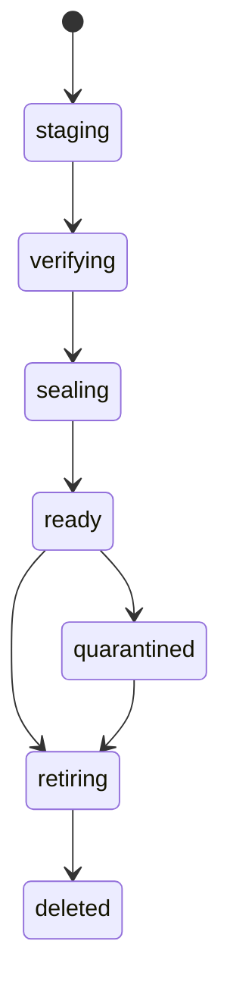

# Storage and capacity

Lilly provisions native ZFS datasets containing sparse raw guest drives. Guest
filesystems are distinct from host ZFS. Pool and dataset GUIDs establish identity;
matching names or mount paths are insufficient. Host root storage is a separate
installation concern.

| Quantity | Meaning |
| --- | --- |
| Virtual disk size | Guest-visible maximum; each VM disk is capped at 500 GiB |
| Physical usage | Observed allocated storage; sparse files may use less than their virtual size |
| Logical budget | None: retired under ADR-0159; virtual promises are uncapped and disk admission is physical |
| Reservation or hold | Durable capacity commitment for execution, startup, transfer or retained storage |
| Fresh observation | Time-bounded evidence from the current authenticated host |
| Unknown measurement | Unavailable evidence; never an implicit zero |

Admission combines current usage, policy budgets, configured overheads, holds,
image requirements, and freshness. CPU/RAM budgets are mutable policy; changing a
budget does not kill existing guests. IOPS remains unknown unless supported by an
explicit measurement source. Pool-level I/O is not per-VM I/O.

The source-built Lilly `zfs-io` NixOS check passed on 2026-10-13 with two
mirrored-pool observations, outside-dataset read/write traffic and malformed,
timeout and real export/import faults. Collector capacity remained usable while
independent `ZFSIO` rates became unavailable, then recovered; the control
capacity report carried no I/O field. The earlier probe failed on a decoded
protocol struct equality assertion before these cases ran. The
[prerequisite review](repo:docs/architecture/reviews/2026-10-13-antithesis-prerequisites.md)
records exact derivations and source identities. This disposable KVM result
does not measure physical IOPS or production pool behavior.

The experimental hosted Antithesis Lilly uses a separate compile-selected
`:controlled` pool identity only to negotiate Control. Its report carries
`capacity: nil`, unavailable pool observations and false execution readiness;
the controlled executor cannot turn a requested operation marker into disk,
guest or cleanup proof. The optional guest executor likewise refuses every
physical callback until independent process, overlay, boot and recovery
inventory are implemented. This fixture grants no admission credit and changes
no ordinary ZFS pool policy. See the [foundation review](repo:docs/architecture/reviews/2026-10-13-antithesis-harness-foundation.md).

The optional Antithesis inner host measures a fixed virtual ZFS member and
publishes its pool identity for reviewed enrollment before Lilly can become
ready. Its composed path remains unexecuted. A separate
[local storage-router TCG smoke](repo:antithesis/verification/storage-boot.md)
passed first creation of a real Linux ZFS mirror, origin-off HTTP/HTTPS cache
replay, QMP reset, retained pool/parent GUIDs and exact 41-byte marker, and
reapplication of Brady's 64 MiB quota/refquota. This direct emulator result
does not establish physical power-loss durability or production guest
attribution.
The [integrated-host boot record](repo:antithesis/verification/integrated-host-boot.json)
adds a local third-image TCG host that sampled a real ZFS dataset/pool GUID,
free/used/available bytes and kernel cgroup CPU/memory values. Two earlier
boots reported unavailable health. The passing sample has `connected: false`
and `execution_ready: false`, so it cannot grant Marshall capacity admission.
The later fourth private-service image repeated real ZFS/cgroup sampling and
completed runtime PKI preparation, but stayed disconnected and unready. The
default controlled container still reports unavailable pools and nil capacity.
A later local Compose diagnostic committed its cgroup-derived effective fields
(32 cores and 134558031872 memory bytes) in a fresh v4 host report while
execution readiness stayed false. Raw cgroup file values were not independently
compared; this report grants no physical storage or guest admission credit.

The storage parent must be an enrolled ZFS dataset with stable GUIDs. Do not create
foreign datasets beneath it, edit ownership properties, or reset its baseline to
bypass readiness. Native LZ4 compression and sparse allocation do not imply a
filesystem reservation or a guarantee that every advertised virtual byte can be
materialized simultaneously.

For storage pressure, inspect physical free space, active holds, managed allocation,
pending cleanup, and report freshness. Reduce new admission before exhaustion.
Use supported deletion, relocation, and cache reclamation paths. Never remove a
reservation because a host stopped reporting.
During dataset preparation, bounded whole-pool ZFS observation may refuse an
incoherent identity, policy or accounting sample before launch. Readiness diagnostics
carry only validated placement UUIDs and fixed stage/reason atoms. The catalogued
`vm.dataset_identity_probe_failed` distinguishes an identity bracket's rejection;
ordinary inspection, capacity observation and staging identity probes remain quiet.
All original guards, refusal results and retry bounds remain strict. No native
property, path, command output or capacity credit leaves this diagnostic boundary.
`parent_accounting` says safe parent policy shape passed while the original
usage-decomposition predicate failed; later mountpoint/root/pool/backing guards
have not run, so it proves neither healthy backing nor retry eligibility.
The historical four-way baseline failed two preparations and cleaned its run-owned
resources; its rejected predicate remains unproven. The failed Ubuntu capture
observed `identity_after`/`unconfirmed`, with no refined predicate yet established.
The subsequent complete diagnostic-source Ubuntu capture passed without an
identity-probe failure marker. That success cannot identify the earlier failed
predicate; no readiness/retry guard was changed. The focused privacy/refusal
regression and component gates passed; production activation remains separately
scoped in the
[browser launcher review](repo:docs/architecture/reviews/2026-10-10-browser-launcher.md).

Pure namespace planner properties now require every distinct exact target once
and refuse distinct-target and total-observation overflow. Generated inputs and
fixed 511/512/513 and 32,767/32,768/32,769 witnesses passed in the eight-check
Cargo capture; isolated omitted-target and early-cap mutants were detected.
These properties verify planner inputs, not native proc/descriptor scans or
unmount authority. See the [planner review](repo:docs/architecture/reviews/2026-10-02-namespace-plan-properties.md).

The recorded native descriptor-history extension varies one/two/four retained
empty namespaces, duplicate descriptors, original closure before cleanup and
hidden proc. Each generated disk is started, stopped normally to remove jail
bindings, then copied into retained namespaces. Every retained descriptor must show the exact root before deletion
and none afterward; complete descriptor identities and the unrelated guest must
remain unchanged. See the
[history review](repo:docs/architecture/reviews/2026-10-02-namespace-descriptor-histories.md).
The first generated case failed its exact-root precondition before deletion;
its mount list was not captured. A focused native diagnostic reproduced the
running guest’s canonical root plus jail bindings and confirmed only the root
remains after normal stop. The corrected full native run passed all six histories, original cases and
final busy-file refusal/retry in 1,986.83 seconds. This records bounded stopped-disk
namespace cleanup and neighboring process/data preservation.
During-sweep descriptor races, denied inventory
and changing aliases/descendants remain separate gaps.

Fenced guest deletion inventories both inhabited mount namespaces and process-held
mount-namespace descriptors. A descriptor can preserve a sandbox's ZFS mount after
its last process exits. Cleanup pins and rechecks these namespaces, unmounting only
the exact owned root at its canonical path. Aliases, live file holders, unreadable
or oversized inventories and races retain the fence and disk reservation.
Cleanup pins the host proc directory before entering a foreign namespace, then
opens that namespace's current self/mountinfo through it. A hidden or absent proc
mount cannot substitute stale host inventory; open or classification failure
still retains the fence. The new proc-less descriptor subtest reproduced refusal
before repair. The repaired full native check passed in 563 seconds including
build time, retaining busy-file refusal and the surviving guest/process snapshot.
After healthy `b9790a5c` activation, the original blocked Galileo source deletion
completed. Independent exact-two SQL/ZFS/systemd checks confirmed source and
target deletion, released reservation holds, absent datasets and inactive units;
see the [production review](repo:docs/architecture/reviews/2026-10-02-galileo-production.md).
This records observed recovery without arbitrary namespace churn. The
[native scenario](repo:nix/tests/machines/zfs-guest/namespace-cleanup.py) includes
an empty descriptor-held namespace, an active file holder and a surviving guest;
the native check passed on `5c623418`. After healthy production activation of
`99f13b26`, the original blocked deletion completed through its existing request.
Independent SQL/ZFS/systemd checks confirmed the six original acceptance VMs
were deleted, reservations released, datasets absent and units inactive. A fresh
post-repair three-guest campaign was also deleted; a second bounded proof covered
all nine exact fixtures. The
[acceptance review](repo:docs/architecture/reviews/2026-10-02-https-egress-production.md)
keeps this live evidence separate from native busy-file and neighbor preservation.

Multi-disk profiles move as one placement dataset stream. Every expected drive
must exist on adoption. A partial drive set cannot become a running destination.
Relocation and clone transfers use one owned source snapshot, `lilly-b`, taken
of a stopped disk and sent as one full stream; native policy admits only
`lilly-b` and `lilly-backup` snapshot names on guest datasets. Relocation holds
no temporary snapshot headroom because a stopped snapshot cannot diverge.
Transfer journals accept only the stopped-only schema: a journal in the removed
pre-copy shape (`baseline_guid`, incremental stream or a `lilly-a` slot) fails
closed. ADR-0159 removed the one-way startup migration after hosts were purged
of that state.
Backup consistency and relocation consistency are separate guarantees.

## Verified image templates

Each pool retains sealed image artifacts under independent
`template-<incarnation>` children; templates are unconditional (ADR-0159).
`services.lilly.imageTemplates.budgetBytes` is a positive per-pool budget
(default 32 GiB; 48 GiB on both fleet hosts since ADR-0171, so the 32 GiB
Windows template fits beside the Linux templates) that charges artifact lengths
conservatively; an image larger than the budget uses the fresh verified path,
and `ImageTemplate.cacheable?/2` answers that question from the staged sizes
alone, without hashing it. Physical observations
include template allocation and grant it no VM credit. Mutable, foreign, missing
or GUID-replaced confirmed templates withhold capacity until ownership is resolved. A withheld pool
snapshot names its stage once per change in `pool.snapshot_withheld`: the pool
lock, binding, native observation, or the failed allocation-ownership check
(a snapshot outliving its pool lock, active claims, snapshot expectations or
tags, owner set, mounts, templates or workloads);
`pool.snapshot_recovered` marks its return. A pool section that waits for or
holds the pool lock for 500 ms or more in total, and every acquisition that
returns busy, emits `lilly.pool_section` after release. The event carries only
the pool id, a fixed section kind (prepare, ready, delete, snapshot, a template
step, resize or other), the outcome and the wait and hold times.
That is the baseline ADR-0176 measures pool contention against.

Waiting for the pool lock is a queue, not polling. `Lilly.Host.PoolQueue`
grants one turn per pool at a time, with three priority classes served in
order (first come, first served within each):

1. capacity snapshots;
2. creation, deletion, transfer and other mutations;
3. upkeep.

A caller waits on a message for its turn and only then takes the native pool
lock. The native lock still excludes and still provides crash custody; the
queue only decides who goes next. The two pool sections of a create may wait
up to 30 s for their turn, so a burst of creates drains in arrival order
instead of returning `storage_busy` after one second and retrying on a later
tick. Creates waiting together are prepared together. The create that gets
the turn also takes up to 15 queued creates for the same pool. It prepares the
whole batch with one pool snapshot, one allocation audit and one re-read after
the batch's own mutations, and answers each waiting create with that create's
own result. A create's readiness check is batched the same way: one owner
listing, mount table, staged-import scan and identity observation for the
batch, then each create's own checks. One create failing does not fail the
others, but a failed shared read fails the whole batch. A crashed queue
loses only that ordering. A separate BEAM without the
queue, such as an operator `lilly eval` tool or a machine-test probe, contends
only on the native lock, polling it for at most two seconds. Preparation,
readiness and owned-identity checks grant no capacity credit, so their snapshots
use identity usage. They keep every identity, ownership, snapshot, policy and
accounting check, but usage counters that move between the two reads no longer
resample them. Only an exact snapshot (the capacity report and backups) returns
allocation credit. Usage counters moving between the
two exact reads are resampled up to three times, 25 ms apart, and the latest
coherent tree is then the observation, so ordinary guest writes never withhold
capacity; the pool lock is awaited 200 ms before the snapshot reports it held.
Real transient contention (the pool lock still held) is reported as `busy`:
Marshall keeps the previous numbers untouched and, while the last real
measurement is within a fifteen-second busy grace, extends their freshness;
past that the row ages out of the five-second capacity window like a late
report, and the grace plus the capacity window can never exceed host authority.
Every other withholding is `unavailable` and revokes capacity freshness at once
(ADR-0031, ADR-0163). Pool
accounting requires unique dataset GUIDs, and snapshot GUIDs unique within
their dataset: `zfs receive` preserves snapshot GUIDs, so a same-pool clone copy
legitimately repeats its source's `lilly-b` GUID. Requiring pool-wide snapshot
uniqueness had rejected every observation of a pool holding such a copy, so the
source could not pass restart readiness and the pool's capacity was withheld.
The compatible-reader release is healthy on both enrolled hosts and Marshall has
the additive `pool_id` audit column. Boot readiness was enabled on both hosts at
`c98a375c`, and the template-producer release enabled sealed templates (32 GiB
per pool) on both hosts after cross-host identical guest images were observed and
a templates-off baseline was taken; ADR-0159 then removed both switches. A
reader migration or one-off uncached SSH canary does not establish sealed
template publication on the deployed pools.

The staging intent records host, pool, image, nonce and incarnation before native
effects. Verification hashes the staged bytes, records nanosecond file identities
and the dataset GUID, and flushes before sealing read-only. Shared native reader
leases cover materialization; exclusive builders and retirement exclude readers.
Bulk copying and hashing run outside the pool mutation lock. Warm use checks
ownership, GUID, seal and exact file identities again. A quarantined incarnation
never becomes ready again: safe replacement requires confirmed retirement and a
fresh fully verified incarnation.

The Rust `lilly-image-copy` helper attempts whole-file `FICLONE`, then kernel
copy offload (`copy_file_range`), then sparse userspace copying (ADR-0143). Both
copies transfer only the source's data extents (`lseek` `SEEK_DATA`/`SEEK_HOLE`)
and size the destination afterwards, so holes stay holes: the 64 GiB Windows
disk with about 22 GB of data moves 22 GB (ADR-0173); a filesystem that cannot
report holes is one data extent, as before. Each copy and flush runs within the
pool's image I/O deadline (`services.lilly.imageIoTimeoutSeconds`, default
300 s) and fails closed when it expires; only the nested Windows test raises
it, because its shared store reports no holes. Only `image_copy` and `sync` may run
longer than the 600 s every other host utility is held to. They run through
the placement's own lock owner, under a shared lease on the image template,
so a long copy blocks only that placement and exclusive work on that
template. The pool lock covers only the claim and the final readiness step.
In production, burst latency comes from preparation that the pool lock
serializes, not from copies (ADR-0176). Each
fallback happens only for recognized unsupported errors raised before any byte
moves; a partial offload, short read or repeated interruption fails without
publishing. Permission, space and I/O failures remain failures. It refuses
overwrite and symlink sources/destinations, checks source identity, and flushes
the independent destination. VM datasets and boot bundles remain usable after
template retirement. `FICLONE` refuses sources on another mount, and production
images live under the separately mounted `/nix/store` of the same pool, so a
measured 2026-10-05 create used `copy` for 25.4 of 33.8 seconds. Offload lets
ZFS share blocks across datasets. The native image-copy test reproduces the
bind-mounted shape and records `offload` with all 8 MiB counted in the pool's
`bcloneused`. `offload` alone does not prove sharing, because the kernel may
copy, and an enabled block-cloning feature is not evidence either.

Same-host, same-pool clones always block-copy the disk set (ADR-0145); the
former `blockCloneCopies` host switch was removed (ADR-0159). Every other clone
streams through a receive. Adoption and discard follow the durable `copy.json`
journal the copy left behind.
- **Before any byte moves:** under the pool lock, the copy re-verifies the
  capture snapshot GUID. It then records the binding and snapshot GUID, creates
  the destination's own ordinary claim, and binds that claim's nonce and GUID
  into the journal.
- **The copy itself:** the snapshot is mounted read-only (`nodev,nosuid,noexec`)
  at a private `/run/lilly-clone-copies/<relocation>` path, never through
  `.zfs` automounts. The helper's `snapshot` mode copies each allowlisted file.
  It requires the exact owner uid, a single link and a read-only filesystem
  source. Each file's size and source identity is journaled.
- **Completion:** the snapshot is unmounted (only an exact-source mount at the
  exact path) and the GUID is re-verified.
- **Adoption:** requires a copied journal whose nonce and GUID equal the
  verified claim, plus every recorded file, before it publishes drives and
  marks the disk ready.
- **Discard:** retires the journal first, releases the private mount, removes
  only the fixed copy files and temporaries from the unpublished destination,
  then destroys the destination through fenced ownership deletion. A copy that
  Lilly already adopted but whose clone was cancelled before Marshall published
  it is retired and destroyed the same way, as an adopted import is. Prune
  releases a stale private mount before destroying source snapshots.
- **Independence:** destinations stay independent datasets (origin `-`). Shared
  blocks appear only in pool `bcloneused` accounting.

**Root disks are copied on demand (ADR-0177).** ADR-0146's pre-cloned standby
disks were retired on measured evidence. In a 26-create burst, 22 concurrent
block-clone copies from the sealed template took about 1 s each, outside the
pool lock, and creates finished sooner than with standbys. Every create
prepares an empty owned dataset and copies its root disk into it. A
`standby-*` dataset is no longer storage Lilly recognizes: accounting treats
it as an unknown child and withholds the pool.

**Lean pool-locked preparation (ADR-0152):**
- **One logical snapshot:** each preparation retains two consecutive native tree
  reads and identity checks under the pool lock. The `PoolSnapshot` holds their
  validated observation, one owner listing and one mount table.
- **Derived checks:** the absence proof, allocation audit and template audit all
  derive from that snapshot. The template audit
  joins observed mountpoint, seal and GUID rows. Template sealing and reader
  validation keep the exec, setuid and devices check.
- **After a mutation:** after its own create, `zfs set` or rename, a preparation
  re-reads only the affected child. It then re-verifies the whole pool exactly
  once.
- **Fencing:** a snapshot whose lock was released is refused.
- **Refusals:** all existing refusals are kept.
- **Measured effect:** the native trace halved the whole-pool listings for a
  claim, from 12 to 6. The production concurrency campaign is
  outstanding.

An interrupted native property change can leave an owned template unmounted.
Recovery remounts only after its owner matches the recorded template shape. Property changes, remount, rename and destruction use a 120-second native
bound; timeout preserves uncertainty rather than granting capacity. Terminal
metadata is removed from Lilly's private catalog without waiting for a
Collector ACK.

After an independent root copy is flushed and published, Lilly's catalogued
materialization event records the actual `reflink`/`offload`/`copy` method and a closed
`template`/`verified` source kind. A template source carries only the UUIDs
of its validated ready Ash record and native incarnation;
the uncached path carries neither. No image string, filesystem path or command
output enters the event.
Benchmark readers can correlate the record UUID with host/pool-bound lifecycle
diagnostic timestamps from the host-local reviewed event for staging-to-ready
construction cost. Those events emit after journal fsync and confirmed writer release to structured
logs and OpenTelemetry with resource, host/pool UUIDs, revision and persisted microsecond
time. Marshall receives no template history. Diagnostic custody never authorizes
a copy or establishes a native seal.

Each pool and image has at most one template build at a time
(`Lilly.Host.TemplateSteward`, ADR-0176). A create or prewarm that finds no
ready template asks the steward. The first request starts the build under the
image's exclusive lease, as before, and every concurrent request for the same
pool and image subscribes to that build's result instead of retrying
`storage_busy` once a second. A create waits at most two minutes, and prewarm
waits four times the pool's image I/O deadline. A caller that stops waiting
never cancels the build, and a later create finds the template ready.
Startup prewarming runs asynchronously with one builder. No-budget and oversized
images use fresh verification without caching. A smaller configured budget can
defer reclamation while readers are active or ownership is uncertain; it never
authorizes forced deletion. Up to sixteen unused LRU candidates are considered
per allocation. Catalog tombstones and interrupted empty publication directories
are retained, with a 4,096-directory limit; new images use the verified uncached
path once that bound is reached. Unknown content, foreign owners, or GUID changes
are never recursively destroyed.

An interrupted owned template create may leave its child unmounted. Recovery
remounts it under the exclusive image lease and pool lock before ordinary native
validation and build continuation. Startup first sweeps nondeleted template
incarnations whose images are no longer configured, re-reading each unchanged
record under those locks. It mounts an owned interrupted child and restores its
private root when needed before ordinary ownership-checked retirement; an
already-private sealed root needs no chmod. Configured templates
and independent VM disks are unaffected; one unconfirmed retirement does not
prevent attempts on the others. Unconfirmed ownership still cannot grant
capacity or forced deletion.

The prewarm process schedules another sweep ten minutes after each completed
sweep, retrying transient lease or pool-lock contention without a Lilly restart.
The same GenServer serializes these attempts; initial prewarming can delay a
queued sweep. The catalogued `lilly.template_sweep_finished` event reports only
the pool UUID, closed outcome and first failing stage (`bind`, `record`, `owner`,
`remount`, `retire`, `storage_busy` or `template_unconfirmed`; success uses `none`).
Partial retirement still attempts the other incarnations. Periodic contention
retry has no new recorded native or property execution at this checkpoint.

ZFS create, set, mount, unmount, rename, destroy, snapshot and receive-abort use a
120-second default native utility bound; explicit bounds take precedence and
other utilities retain three seconds. The new interrupted-create and
unconfigured-sweep machine subtests are present. Their source additions do not
extend the older recorded native execution below.

Hegel tests exercise the Rust boundary; the disposable `image-template` NixOS
test exercises production Ash journals, actual ZFS seals, leases, independent VM
disks, retirement, interrupted effects and the catalog bound. Its synthetic
artifacts do not establish guest boot or
fleet performance. The [execution review](repo:docs/architecture/reviews/2026-09-26-provisioning-fastpath.md)
records results and outstanding guest/deployment acceptance.
The extended disposable ZFS probe now checks that a validated warm callback
carries the ready record and incarnation UUIDs while the verified uncached
callback carries neither. The revised native `image-template` VM run passed
on reader revision `153db737` (205.65s script, 0.39s cleanup), including both
callbacks, independent disks, interrupted effects and bounded retirement.
It uses synthetic artifacts; no production template hit or real guest SSH
follows from this result.

Evidence: [capacity model](repo:docs/storage-capacity.md),
[admission budgets](repo:marshall/lib/marshall/compute/budget.ex),
[disk limit](repo:docs/architecture/decisions/0053-vm-disk-limit.md),
[multi-disk transfer](repo:docs/architecture/decisions/0072-multi-disk-workload-transfer.md).

## Native utility descendant custody

Every Lilly lease is held by `lilly-hostd` ([ADR-0176](repo:docs/architecture/decisions/0176-host-concurrency-single-writers-and-effects.md)
decision 4), which replaced one `lilly-host-lock` process per held lock. hostd grants
waiters for a lock inode in arrival order and holds the `flock` itself; other
processes still contend on the same inode. Each utility under a lease inherits that
descriptor and runs in its own child of hostd's delegated cgroup. A reply, a release
or the end of Lilly's session follows `cgroup.kill` and a confirmed empty cgroup, so
no descendant survives, however it detached, and no successor is granted while one
might still run. Lease-less reads run in hostd as well, so Lilly spawns no host
utility itself. A BEAM without the production socket (evaluation tools, machine-test
probes, unit tests) starts a private hostd with process-group custody instead.
Evidence: the [hostd tests](repo:lilly/native/hostd/src/tests.rs) (decoder and
lease-order properties, session-death custody) and the
[lock test](repo:lilly/test/host/lock_test.exs) (`holder-death-kills-leased-command`,
`waiters-granted-in-arrival-order`).

Transfer-stream and source-export helpers retain completion and lock custody until every
adopted child is reaped across process groups/sessions. Direct leader retirement
does not permit a reply or successor mutation. Native completion and failure
histories, scoped selector mutations and source identity after integration are
recorded in the [host-lock review](repo:docs/architecture/reviews/2026-10-05-host-lock-descendant-custody.md)
and [transfer review](repo:docs/architecture/reviews/2026-10-05-transfer-stream-adopted-children.md).
The wait remains blocking: explicit escaped-child death is part of these fixtures,
not proof of bounded cgroup confinement or physical ZFS/SSH recovery. Full Lilly
with the exact verified helpers passed506checks and forced test Dialyzer with
zero errors/skips. Integrated publication and physical/hosted acceptance remain pending.

The source exporter retains the direct sender PID with NOWAIT until private-group
signaling, then waits for adopted children across sessions. Uncertain reaping
returns EXIT_IO rather than confirming cleanup. Fresh integrated package checks
passed111seconds with two library properties and ten integration checks, including
escaped completion and seven failure paths; rustfmt/Clippy passed. See the
[source-export review](repo:docs/architecture/reviews/2026-10-05-source-export-adopted-children.md).
Explicit escaped-child death remains a fixture step; this does not establish
bounded native cgroup recovery, actual ZFS/SSH transfer or physical slot release.

## Admission observations and independent diagnostics

Lilly reports GUID-bound pool identity, physical used/quota accounting and
allocations for admission; logical-used/compression and native I/O stay in the
observability layer. Reduced version-4 reports do not change pool ownership or
native storage formats. A busy pool retains its last measured
capacity and original freshness; an unavailable pool clears credit. Historical
Marshall diagnostic columns remain retained but receive no active writes.
