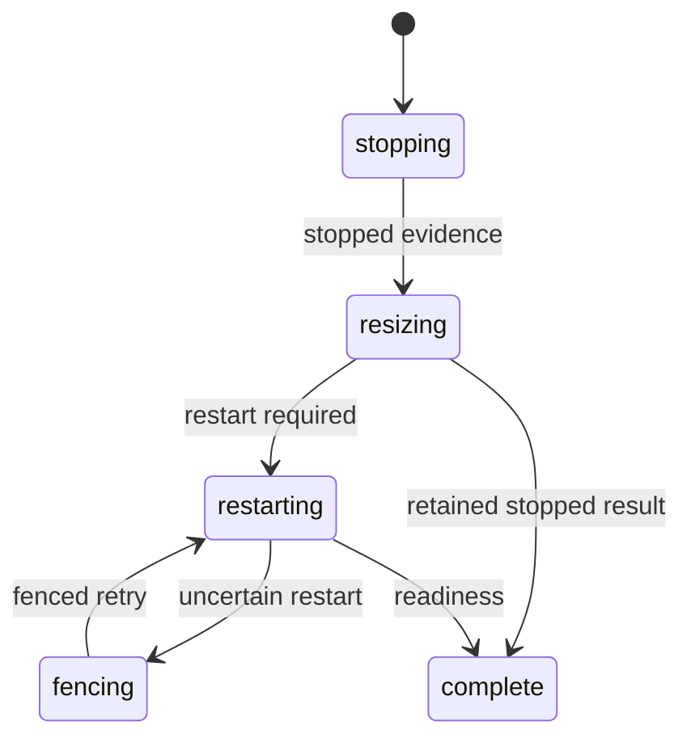
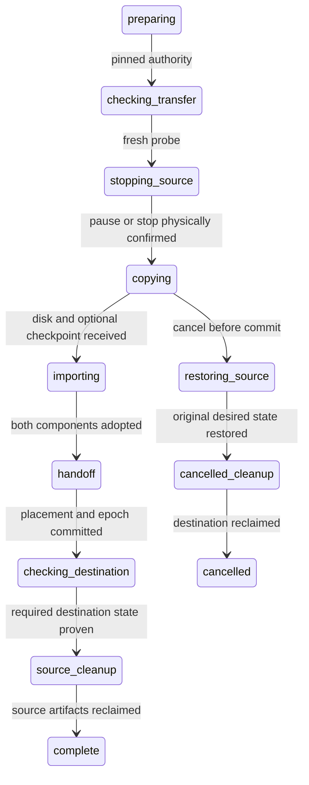

# Resize, clone, and relocation

An earlier instrumented native clone rerun failed before retry/cancellation at
the published copy's exact `transfer_busy` relocation refusal. Running guest
and retained-slot checks passed; the actual differing refusal was not recorded.
Finite refusal diagnostics now preserve that assertion. Earlier scoped retry
evidence remains valid; the full matrix and cancellation remain unproven.
The next run passed that refusal and retry replay in 9.11 seconds, then failed
the OSS copied guest's start; its console diagnostic failed before connection.
Closed terminal-stage labels and thirty early host boot-state snapshots now
distinguish those gates without exposing boot challenges or granting authority.
These diagnostic snapshots remain pending native execution.

After the boot-generation repair, native retry replay passed in 8.83 seconds,
and repeated public Start of the OSS copy passed with unchanged native process
identity, inherited guest markers and subsequent divergent writes. The run
failed later before cancellation at an incorrect stopped-state precondition:
an unpublished allocation has pending observed state and stopped desired state.
The corrected cancellation fixture uses a fixed 512 MiB incompressible guest
witness and requires occupied native stream custody, an offered unfinished copy,
no publication or destination Start, pending observed state and no running VMM.
Its public cancellation measurement and exact replay passed in 8.48 seconds;
source restoration, disk GUID, destination archival/dataset removal and transfer
slot release also passed. The full run failed later at ordinary cloned-guest
relocation with source_unavailable. A disposable read-only preflight now waits
for sixteen boolean source host/pool and reservation predicates before public
relocation and the initial faulted clone submission. One read-only database
snapshot and clock distinguish configured freshness from a stricter report-age
margin. Bounded polling inside the fixture avoids repeated release startup and
ages between separate reads. A failed earlier preflight showed only its tightened
freshness checks false; production staleness was not established. The atomic
extension changes no admission authority. The final complete native cloning-fleet
passed in 1539.61 seconds: repeated Start retained process identity; retry and
cancellation measurement replay passed in 15.46 and 8.40 seconds; physical cleanup,
both cloned-guest relocations and audit after source deletion passed. Earlier
failures retain their historical scopes. Relocation destination retry/cancellation
accounting and native foreign/corrupt boot refusal remain separate gaps.

Submit workflows through authorized machine controls or the workflow’s supported
Porsche command. Resize uses the browser controls. Keep the returned operation identity. Retry an uncertain submission with its original
idempotency key. Inspect both workflow progress and cleanup obligations.

## Administrator action continuation

ADR-0160 requires privileged browser submissions to retain the exact pending
action while inline passkey step-up completes. The continuation binds actor,
stored login, resource, action and canonical arguments, expires after five minutes, and can be
consumed once. No workflow, catalog intent or audit row is admitted merely by
opening the ceremony. Verification permits the same action to retry with fresh
login, role, fifteen-minute receipt, Cedar and workflow-generation checks.

If a new administrator has no key, the sign-in section of the account page
(`/settings#security`) first requires fresh email authentication for enrollment. The user returns to the original page and
explicitly submits the action again; setup retains only an allowlisted return
path, never administrative arguments or a pending continuation.
Cancelled, expired, replayed or substituted continuations, stale targets and
withdrawn authority leave no mutation. New input requires a new explicit action.
Already committed durable workflows retain their own recovery authority after
elevation expires or the requester is demoted. Customer owner-only refusals
remain effective during retry. This accepted continuation is not established by
the historical workflow checks below. Focused receipt properties and packaged
account-action browser evidence are recorded in [scenario coverage](#coverage);
broader native workflow continuation and timed-expiry acceptance remain gaps.

## Resize

Resize records the requested shape and expected generation. The workflow stops the
guest, applies supported resource changes, and restarts when required. Disk growth
must preserve the owned drive and filesystem; this is not a general shrink tool.
Concurrent incompatible operations are rejected or reconciled by the coordinator.

Open Settings → Resize as the current owner or manager (the Settings page shows
the current resources to everyone with machine access). CPU and memory may
increase or decrease; disk may only grow up to 500 GiB. Draft URLs retain their
original generation and request identity across polling and reload. A stale draft
requires an explicit review of current state; that review retains its size inputs
but does not itself request work. Exact authorized replays return the original
request. Manager revocation also blocks previously accepted request replays.
The page shows the confirmed resources, the form's current → requested sizes and
the stages the request will pass through (stop, apply, restart or remain stopped,
confirm). While a request is active the form is replaced by a stage ladder marking
the recorded phase (a fencing phase displays as restarting), the original → target
sizes, and, when the request needs attention, a retry control that resumes from
the recorded phase. The ladder never marks a stage done ahead of the record.

Confirmed, pending and form disk values preserve every supported 4096-byte-aligned
fractional GiB value. The machine's identity, image, placement, addresses and data
remain unchanged. A running request holds target CPU/RAM before stopping; unknown
physical effects retain holds. Matching target-size evidence commits growth.
A measured capacity shortfall can leave the resized machine stopped, and an
uncertain restart must be fenced before retry. A capacity report that is merely
late is not a shortfall. The request keeps its holds with the disk change
confirmed, and the host's next accepted report decides the restart (ADR-0140).
Provisioner lock contention during the disk step is retried, never reported as an
identity conflict. Originally stopped machines remain stopped without
compute admission. Disk shrinking stays outside the accepted interface.

Resize is also scriptable and cancellable (ADR-0166). Porsche
`resize MACHINE [--cpu N] [--memory MIB] [--disk GIB]` resolves only the
machine and delegates sizes, generation fencing, holds and manage
authorization to the domain; an omitted option keeps the current size and a
request with no size option is refused. Its receipt pins the resize request and
follows the phases (complete succeeds; a cancel receipt succeeds and the
original is superseded; a finished failure fails; a retryable failure keeps the
receipt accepted), and `request retry` / `request cancel` act on it. Every
refused resize, retry or cancel is logged as `vm.resize_refused` with its closed
reason. A stop receipt that confirms the guest down without its disk is
recorded on the request as `physical_state_unconfirmed` with every hold
retained, not refused as an invalid outcome. While the request is still
stopping and not fenced, the owner may cancel: the original holds are restored
at once, the pending stop is awaited in a cancelling phase, an originally
running machine restarts through an ordinary start with its unchanged sizes and
the request finishes as cancelled when it runs (`vm.resize_cancelled`); an
originally stopped machine finishes as cancelled on the stop receipt. Once sizes
are being applied, cancellation is refused and retry remains the only path; the
page offers the control only while stopping and shows the cancelling stages.

Generated coordinator histories and the native browser/guest journey are described
in the [resize verification review](repo:docs/architecture/reviews/2026-09-25-resize-verification.md).
Synthetic receipt tests do not establish filesystem preservation. Native evidence
retains its exact platform and execution scope in [scenario coverage](#coverage).

The diagram summarizes progress. Retry and failure metadata do not bypass physical
evidence or release holds.

## Clone

Clones queue per source. Distinct requests create distinct private machines and
independent disks. Capture may stop the source; restoration and destination cleanup
remain separate obligations when copying fails or the request is cancelled.

```mermaid
stateDiagram-v2
  queued --> queued: deferred (transfer busy, source cleanup pending)
  queued --> preparing
  preparing --> stopping: running source
  preparing --> capturing: already stopped
  stopping --> capturing
  stopping --> stopping: source stop failed; retry or cancel
  capturing --> copying
  copying --> publishing
  publishing --> cleaning: slots release on both revocations
  cleaning --> complete: prune confirmed
  cleaning --> complete: deadline, prune still offered
```

Inspect failure and cancellation status before resubmitting with a new identity.
An already published destination must not be mistaken for a failed submission.

Transfer slots release at stream quiescence (ADR-0162): once both endpoint
revocation receipts are on record a clone no longer occupies its hosts, exactly
as a relocation does, and a host is clone-busy only while an active request has
not published its destination. Source restoration, pruning and destination
settlement never need the slot. A published, restored, settled and quiescent
request whose source prune is still unconfirmed at its cleanup deadline
(`MARSHALL_CLONE_CLEANUP_DEADLINE_MS`, default five minutes after publication)
completes: the copy is an ordinary machine and the per-source queue moves on,
while the source temporary disk hold, the source's exclusion from deletion,
relocation and another copy, and the prune offer are all retained until the
prune receipt lands and settles them. No deadline releases a physical resource.
A queued head refused because the host's slot is busy or the previous copy's
snapshot is still held is deferred with that reason and re-scheduled when the
condition clears; other refusals fail with their real reason, and a refusal in
an active phase is recorded on the request. Finishing or settling a request
schedules the next queued request of the source immediately. A source stop
that completes in another state or is cancelled records `source_stop_failed`;
retry issues one new stop while the source generation is unchanged, and
cancellation hands the source back to its ordinary lifecycle. Lilly waits up to
two seconds for the placement and pool locks before reporting a prune as
unconfirmed. Relocation admission still refuses `transfer_busy` while a stream
can start or resume.

The [competing activation property](repo:marshall/test/marshall/compute/clone_restoration_history_test.exs)
checks queued identity, one/two/four allocation-free activation refusals, explicit
retry, successful activation after verified cleanup and unchanged original release
timestamps. Its reviewed combined suite passed 14 checks in a SQL rollback sandbox.
Synthetic outcomes establish database authority, not native source restoration;
independent-process, uncertain-transport and relocation competitor histories remain
open. See the [review](repo:docs/architecture/reviews/2026-10-02-clone-competing-activation.md).

The [relocation competitor property](repo:marshall/test/marshall/compute/relocation_competing_history_test.exs)
now exercises actual admission before and after both authenticated endpoint stream
revocation receipts. One receipt retains occupancy; two permit release while source
restoration and disk cleanup remain pending. It checks retained original slot IDs,
first-release timestamps and complete competitor allocations under duplicate replay.
The combined focused run passed two properties (seed281508,49.7seconds); full
batch gates remain pending. Native stream cessation and
independent-process races remain separate gaps in the
[history review](repo:docs/architecture/reviews/2026-10-02-relocation-and-workflow-backlog-histories.md).

The [clone matrix review](repo:docs/architecture/reviews/2026-09-26-clone-matrix.md)
records the completed profile and shape matrix. OSS and Customer sources clone
through the same coordinator with the destination row and offered workload
descriptor equal to the source's captured architecture, image, profile and
requested sizes; a clone after a completed growth captures the grown disk. An
image disabled or rotated after creation refuses fresh admission but never
blocks an existing workload's clone, which reads its placement-local boot
bundle instead of the catalog. Non-inception clones stay independent of the
configured inception image; reclassifying an existing machine's image into
that configuration fails closed at activation without a copy. A physically
unconfirmed copy keeps its retained snapshot and commitments until an explicit
retry re-offers the same intent; a destination that fails after publication
closes clone retry and cancellation and moves to ordinary lifecycle recovery.
A stopped source natively stays stopped through the whole clone journey, and
its disk keeps its native identity.

The native OSS clone fixture derives a CPU shape exceeding half the uniformly
observed host core count. A real source restart hold then makes a same-host copy
inadmissible; fresh measured headroom must admit the shape on both hosts before
creation. This preserves the cross-host assertion without fabricated capacity.
The corrected expanded cloning check remains pending.

Clone and relocation exports send compressed ZFS streams (`zfs send -c`), with the
snapshot name last so resumed exports bind the same snapshot. Same-host clone
streams use `services.lilly.localTransferBytesPerSecond` (default 1 GiB/s), while
peer transfers keep `transferBytesPerSecond` (default 64 MiB/s). On the
destination and for same-host clones, lilly-hostd runs the stream from typed
fields, since the BEAM holds no ZFS permission: a local send or resume, or an
SSH pull, into a policy-fixed receive
([ADR-0183](repo:docs/architecture/decisions/0183-guest-dataset-streams-in-hostd.md)).
The source host's root export worker keeps its own sender. Receive-side
lineage, nonce and ownership verification is unchanged. Before this change, a
measured same-host clone spent 46.9 of 71 seconds sending about 3 GB of
uncompressed logical data at 64 MiB/s. Lilly reports newly offered clone effects on
an immediate follow-up exchange instead of the next one-second poll, while
deliberately re-offered capture renewals keep the one-second cadence; the
prepare, probe and connect steps stay ordered because later commands carry the
destination key from `prepare`. Native and post-deploy timings are pending.

Unconfirmed clone effects are diagnosed, not swallowed. Lilly maps each internal
failure to one closed wire reason and logs `lilly.clone_effect_unconfirmed` (or
`lilly.clone_effect_contended` for pool-lock and placement-lock contention) once
per effect and reason change, never once per one-second retry. Marshall stores
the reason on the effect (`unconfirmed_reason`, attempt count and time), records
the request failure as `<effect>_<reason>` (for example `prune_storage_busy`),
logs `clone.effect_unconfirmed` once per reason change and
`clone.effect_confirmed` when a receipt ends a run of unconfirmed attempts, and
`clone.failed` carries the real reason and effect instead of a folded
`activation_failed`. The clone card and `request show` present the step and
reason. Admission distinguishes a busy transfer slot (`transfer_busy`) and a
previous copy's retained snapshot (`source_cleanup_pending`) from a source that
cannot be cloned (`source_unavailable`). This was motivated by a production
request whose prune step failed silently every second for ninety minutes while
holding the host's transfer slot.

The Lilly events also carry the internal `stage` atom of the check that
refused (for example `zfs_snapshot_source_unconfirmed` beside the wire reason
`source_unconfirmed`), and snapshot cleanup passes that closed atom through
instead of folding every refusal into one. The first reasoned production
diagnostic showed why that prune never confirmed: the source had been
restarted after capture with a start command carrying a repository workspace
source, and the claim comparison pinned the full spec struct against the claim
its stopped predecessor journaled without one. Claim, snapshot-source and
adoption checks now compare the spec's persisted storage shape
(`Lilly.VM.Spec.storage/1`), which never includes the guest-delivery source.

Restart readiness preserves `storage_busy` from native usage observations as well
as pool-lock contention. Same-pool incoming storage defers readiness only while
its stream may still be writing: an active private import journal, native owner
nonce/GUID and destination identity match, with no ordinary placement claim, and
the receive has not finished. A finished, unadopted import is validated as a
staged child under receive policy (read-only, `noauto`, unmounted, with its
journal-fixed snapshots), so a neighbour such as a clone's source restarts before
the copy is adopted; if counters are still settling, restart defers. A validated unbound receiving intent
also defers while its dataset and mountpoint are absent, before its stream starts;
a missing previously bound dataset does not qualify. Adoption ends this deferral. The target
bundle, disk metadata, native ownership and mounts must validate first; unknown
imports do not become retryable. Full snapshot/accounting validation still runs
before launch. This grants no transfer authority or capacity credit.
The import deferral probe checks parent identity, policy and healthy backing
independently of usage decomposition, which may be inconsistent during receive.
All normal pool inspection and accounting still require coherent counters.

The existing actor reconciles under the same placement,
epoch and generation; no VMM launch attempt is recorded until disk and bundle
validation succeeds. Missing disks, invalid ownership and malformed bundles remain
terminal. `vm.disk_readiness_failed` identifies the placement and a bounded stage:
dataset identity/ownership, snapshot ownership, accounting, mounts, disk metadata
or boot bundle. Transient contention does not emit that failure event.

For a Porsche-submitted clone, use its original `request retry` after resolving a
terminal source failure; browser clone controls use the same authorized Ash retry
action. Porsche requires an existing SSH receipt and cannot address a clone merely
by its domain request key. Verify current source generation and storage identity first. Recovery
retains the published destination and immutable snapshot, refuses to overwrite
newer source intent, and releases slots only after restoration, transfer revocation
and quiescence, snapshot pruning and destination settlement. Deployment does not
automatically restart terminally failed workloads. The
[recovery review](repo:docs/architecture/reviews/2026-09-26-clone-restart-recovery.md)
separates the confirmed error propagation defect from the unproven historical
trigger and records scoped test and production evidence.

The final isolated native clone journey also passed the prepared-receive window
before dataset creation, malformed ownership/bundle refusals, same-generation
restart after adoption, independent writes and surviving-copy reads after source
deletion (854.79 seconds). Complete native and production execution scopes remain
separately recorded in the restart recovery review.

Current manage and provisioning authority are checked at submission and again at
activation. Manager withdrawal blocks queued copying and further user actions.
Already admitted restoration and cleanup continue after withdrawal. A cancelled
request key retains its original destination identity and cannot be retried into
a new copy; a new intentional request requires a new key.

Cancellation and publication serialize in PostgreSQL. Cancellation before
publication retains both transfer revocations, destination discard, snapshot prune
and source restoration as separate obligations. Unknown physical results retain
holds. An offered incomplete preparation, capture, copy, adoption or cleanup
effect may report an unconfirmed progress label and retry with its retained
identity and commitments. A successful matching receipt clears that label.
Cancellation can abandon forward copy/adoption, but still requires every cleanup
receipt and clears the final diagnostic. A completed capture receipt can coexist
with independently pending copy work; uncertainty cannot fabricate the snapshot
or authorize publication. Once restoration
completes, later clone work cannot overwrite subsequent
source start/stop intent. After publication, use ordinary destination lifecycle
controls. The [verification review](repo:docs/architecture/reviews/2026-09-25-clone-cancellation-verification.md)
records generated actual-action histories, observed three-replica schedules and
the exact native execution scope; synthetic receipts are not native disk evidence.

Retained-source restart preserves a verified ZFS usage race as retryable
`storage_busy` before launch. Invalid disk ownership or boot-bundle evidence
remains `disk_not_ready`; recovery never recreates existing storage or boot
artifacts. The fourth captured cancellation journey passed physical recovery,
but its subsequent automatic clone control failed after a source restart error.
The error classification regression is repaired; the failed capture's exact
native cause and fresh complete acceptance remain separate evidence gaps.
The fifth capture stopped on that nonterminal capture label before public
cancellation. Its oracle now waits within the original bound for the exact
successful receipt and native snapshot identity; complete acceptance is pending.
The sixth capture confirmed the snapshot but failed source restart before public
cancellation. That captured diagnostic candidate emitted
`vm.dataset_readiness_failed`; the integrated published recovery implementation
now supplies the `vm.disk_readiness_failed` stages described above. Ordinary busy
retries remain silent and terminal refusal remains enforced.
The seventh capture identified `pool_observation` with
`incoherent_zfs_observation` before cancellation. Deeper readiness-only
`vm.dataset_observation_failed` events distinguish identity reads, dataset reads,
property stability, rejected accounting samples and bounded resampling exhaustion.
These events preserve the same whole-pool validator and grant no capacity or
execution authority. The exact native rejection and its cause remain unresolved.
An accounting diagnostic describes a rejected sample; a later bounded sample may
recover. Coherent usage-only busy samples remain silent.

The disposable cancellation fixture adds an armed recorder around Lilly's exact
recursive public-property ZFS query. It forwards native bytes and exit status,
records no ownership/custom/token query, and retains a private bounded ring.
A clone-only release seam pairs readiness reads with the exact validated expected
snapshot GUID map under the same pool lock; missing or changed context is explicit.
Failed tests copy those samples before VM teardown to a private builder directory
outside Nix outputs; `--keep-failed` is required to retain that directory. Truncated
samples cannot establish a complete accounting predicate. The eighth native run
failed queued activation with `source_unavailable` before physical capture. Six
complete successful native reads were privately collected, all without readiness
context; exact-map readiness replay and complete cancellation acceptance remain
pending. Retained source reports were older than the five-second guard at failure
completion, but the exact activation-time conjunct is not established. The fixture
now waits after operator startup for actual new fresh host/pool receipts and settled
source operations, then calls the coordinator once. It preserves the accepted
request, production guards and every subsequent refusal; no blind retry is added.
The ninth capture timed out during initial host admission, before source creation
or this activation wait. Both hosts delivered some valid reports, while 31 execution
exchanges received `invalid_report`; retained accepted observations cannot identify
the rejected predicate. No guard or resource requirement has been changed.
Instrumentation changes timing, so these runs provide no performance acceptance.

The disposable fixture now instruments the actual authenticated report guards.
It preserves each predicate, ordering, short circuit, database clock and rollback,
while privately retaining a finite rejected stage and signed sample age. Malformed
shape has no age. Files survive transaction rollback; they describe a guard
rejection, never a committed outcome. Each replica retains only its first rejection
per stage during admission or cloning. This is not a host-attributed timeline.
Dedicated synthetic exchange and sink checks pass; native execution is pending.
The diagnostic cannot retrospectively classify the ninth failed capture.

## Relocation

Relocation uses one full disk copy, with a separate sealed memory/device
checkpoint for a running or paused source
([ADR-0199](repo:docs/architecture/decisions/0199-memory-suspension-and-demand-wake.md)).
Fresh destination connectivity precedes source quiescence. A running machine is
paused, its coherent disk and memory state are copied, and the destination resumes
the same guest boot after committed handoff. An already paused machine remains
paused after an explicit move. A stopped machine remains a disk-only move.
There is no pre-copy: downtime includes full transfer and restore, but does not
include a guest reboot. The coordinator reserves destination disk, checkpoint
and required compute capacity plus endpoint transfer slots before handoff.

Cancellation is accepted only before the handoff commit, from any phase up to
`handoff`, and restores the original running, paused or stopped source under fresh
authority. Deletion supersedes any unfinished phase through `deleting_copies`.

An ambiguous or failed memory restore retains its execution fence and storage
holds. It cannot replay the consumed checkpoint or use the former cold destination
boot retry. Historical retry receipts remain readable; new retry admission refuses.
Explicit Stop retires memory before an intentional later cold Start.

Transfer byte counters and stream diagnostics emit independently through
OpenTelemetry and structured logs. Relocation commands carry leased authority;
receive/import/readiness replies carry confirmed physical facts. Counters never
renew a lease, complete a request or release capacity. Marshall displays durable
workflow phase and receipt-based downtime; detailed transfer investigations use
Grafana/Tempo. Collector refusal does not stop transfer reconciliation.
Native fault synchronization reads the exact destination's local receiving
journal and the unique native transfer helper's ZFS child input count; it no
longer reads diagnostic SQL progress. The adapted fixture is present, with
passing native execution still required for this new synchronization boundary.

The source endpoint uses a dedicated SSH listener, pinned Ed25519 identity, and
permit-derived keys. Transfer credentials do not grant an interactive host shell.
Both stream quiescence and key fencing matter when releasing transfer slots.
Relocation reserves one slot on each endpoint host. Concurrent opposite-direction
requests therefore serialize or refuse busy admission; they do not promise two
simultaneous transfers. A retained slot on either member of a two-host fleet can
block both movement directions. A generated local PostgreSQL property checks
clone-owned and relocation-owned claims on either endpoint, repeated contention,
paired relocation rollback, one active owner per host, and release followed by
acquisition by the other owner. It does not exercise independent Marshall
processes or prove that physical streams have ceased before release.
Cancellation before handoff restores the source under fresh authority; after
handoff, follow the recorded destination recovery state. Do not start both copies.

## Host evacuation

The Control room's Lilly node page provides an advisory destination preview.
Preview records no campaign, reservation or job. Starting evacuation requires a
current administrator with a stored login and recent passkey elevation. It fixes
the current workload/placement/epoch cohort and excludes new admissions to that
host while keeping existing serving enabled. Maintenance drain instead stops
guests in place; it retains their disks on the host.

Pause prevents new moves. Accepted moves and their source restoration/cleanup
retain campaign authority even if the requesting administrator is later demoted.
Continue and subsequent controls require fresh user authority. Every running
workload requires its own placement/epoch downtime approval, because every move
stops it for the full copy; stopped workloads need none.
Replanning rotates that workload's revision and clears prior downtime consent.
Old browser revisions cannot approve or replan the replacement revision.

User controls lock their host, campaign and relevant VM records before retaining
the current actor User through audit commit. This preserves the VM-before-User
order used by personal guest identity allocation; the actor lock permits ordinary
foreign-key references while excluding authority changes. Overlapping elevation
lock or sign-out therefore either follows an accepted control or causes refusal
after the control waits. Durable workers do not reacquire requester elevation.

Ready requires fresh execution-ready host and pool reports, no current workloads,
no retained holds and no unfinished relocation. Completed jobs or old ready
timestamps are insufficient. Restore admission rechecks physical emptiness and
does not move guests back. Retirement additionally revokes host credentials.

Generated control/readiness histories and independent-process ordering checks
cover these control-plane boundaries. The bounded native browser/two-Lilly campaign
passed preview/refusal, elevated request/pause/continue, running/stopped moves,
source cleanup, retained data/ingress identity and fresh-elevation admission resume.
It uses real pinned SSH transfer endpoints and ordinary guests. Native full-stop
consent, cancellation/replan permutations, independent hosts and broader recovery
acceptance remain tracked in [scenario coverage](#coverage).

Evidence: [resize](repo:marshall/lib/marshall/compute/resize_request.ex),
[clone](repo:marshall/lib/marshall/compute/clone_request.ex),
[relocation](repo:marshall/lib/marshall/compute/relocation.ex),
[evacuation](repo:marshall/lib/marshall/compute/evacuation.ex).

The [2026-09-25 production acceptance](repo:docs/architecture/reviews/2026-09-25-production-clone-relocation.md)
passed creation and guest access but encountered this retained-slot condition.
Those attempts did not establish clone independence or physical movement. The
next-day recovery review records supported recovery of a fresh clone, independent
contents and both relocation directions. The original older clone disappeared
externally before recovery; acceptance of the additional readiness fix remains
separate from that historical evidence.

## Native utility descendant custody

Host-lock, transfer-stream (under its hostd lease, ADR-0183) and source-export
helpers retain completion custody until every
adopted child is reaped across process groups/sessions. Direct leader retirement
does not permit a reply or successor mutation. Native completion and failure
histories, scoped selector mutations and source identity after integration are
recorded in the [host-lock review](repo:docs/architecture/reviews/2026-10-05-host-lock-descendant-custody.md)
and [transfer review](repo:docs/architecture/reviews/2026-10-05-transfer-stream-adopted-children.md).
The wait remains blocking: explicit escaped-child death is part of these fixtures,
not proof of bounded cgroup confinement or physical ZFS/SSH recovery. Full Lilly
with the exact verified helpers passed506checks and forced test Dialyzer with
zero errors/skips. Integrated publication and physical/hosted acceptance remain pending.

Source-export completion and seven failure histories now also require observed
all-child reaping across sessions before confirmed completion. The fresh native
package passed111seconds; actual ZFS/authenticated SSH and physical workflow slot
release remain separate acceptance gaps in the
[source-export review](repo:docs/architecture/reviews/2026-10-05-source-export-adopted-children.md).
## User thread provisioning

`Marshall.Threads` records a pending thread, its typed machine specification and
the Oban provisioning job in one transaction. After commit, the worker calls
Compute admission with a durable machine key and records the admitted VM
identity before waiting for an observed running state. It binds the registered
agent root/thread, applies the selected mode and submits the initial objective
with a stable request key before reporting ready. Duplicate jobs reuse the same
admission and initial turn; every worker write checks the current machine key
so a retired attempt cannot overwrite a reopened thread.

A crash or capacity refusal leaves a pending/failed thread with a recovery path.
Retry retains the admission key while the same machine is recoverable; replacement
admission requires completed physical cleanup before a fresh key is assigned.
Archive/delete requests record deleting intent and use Compute's lifecycle
coordinator. The thread remains deleting until retained VM history reports
physical archival; a desired deleted state alone is insufficient. An authorized
reopen clears the retired binding, retains the original create request key,
assigns a fresh machine key and queues admission atomically. Durable
`ThreadGeneration` rows retain each machine/root/thread identity. PaperTrail and
generation rows preserve the old identities; authorized archived transcript
reads can select an earlier generation through the read-only workspace selector.
The selected generation repeats root, owner and thread checks and cannot prompt,
open a terminal or mutate a machine.
Archiving also cancels any pending human planning question with an `archived`
reason before deletion intent or retained archival is committed.

Thread sharing has its own durable grant and immutable request result. Sharing
serializes on the thread and then its bound VM, with current authority checked
under the locks. Grant changes retain their replay result after revocation;
reusing a request with changed recipient or role refuses. The thread's canonical
grant survives archive and reopen, so a replacement machine consumes the same
current sharing source without copying grants. Binding and generation changes
still use the thread lock and remove the retired machine from that source.
Machine/team grants remain independent; thread revocation cannot erase them.

ADR-0178/0179 extend the accepted thread workflow with immutable context
preparation, compaction and planning. Admission captures the selected mode,
reasoning, directory, configuration owner and skill identities. Guest collection
runs outside the database transaction; only complete digest-verified content
under the current executor fence becomes an attached snapshot. A changed source
retries collection twice, then fails explicitly. Runtime and native evidence
are tracked in the [context review](repo:docs/architecture/reviews/2026-10-16-agent-context-and-planning.md).

Compaction is durable model work with its own completion validation. Publication
compares the context generation and eligible event frontier; failure leaves the
prior checkpoint. A root Plan turn may wait on persisted human questions, and
one current authorized answer resumes its existing turn. A completed proposal
can admit one exact Work turn without changing the thread's machine. Archival,
cancellation and authority loss invalidate unanswered requests. These states
are execution progress, not proof of VM physical readiness.

Managed skill configuration changes affect later snapshots. Guest operations
publish pinned immutable revisions and report their original operation identity;
an uncertain reply is resolved by a status read. Failed updates keep the active
revision, admitted turns retain their referenced versions, and reopening
restores recorded commits/digests instead of following branch heads. The
restoration coordinator uses a bounded round-robin cursor so one blocked thread
cannot monopolize the scan. Active receipts continue through their existing
turn, terminal failures are not replayed automatically for the same machine
generation, and rejected restorations emit a bounded reason event before the
scan advances. A fresh machine key makes the pinned revision eligible again.

Both hosts converged healthy on the machine-key expansion at
`d5e03c080204a33a11b8c136e983593630e4fccf` on 2026-10-15. That expansion left the
column nullable. The dependent contraction backfills any late null keys, enforces
`NOT NULL`, and requires the explicit machine key in the resource and workers,
removing the temporary row-key fallback under
[ADR-0159](repo:docs/architecture/decisions/0159-remove-legacy-compatibility.md).
Provisioning and archive jobs must carry the matching key; malformed unkeyed jobs
are cancelled, and authorized public retry queues a current keyed job. Create,
replacement retry and reopen always write the required key. Both hosts subsequently
converged healthy on contraction revision
`32624e1bf80df120beb69b923eee4362427aee23`; read-only SQL confirmed the column
requires a value and no null keys remain. See the
[thread review](repo:docs/architecture/reviews/2026-10-15-user-threads.md) for the
separate expansion, contraction and database observations. This rollout does not
establish native archive/reopen or worker-loss recovery.

## Historical thread redaction

Marshall stores a text-only redaction profile and runs bounded Oban scrubs over
inactive machine threads. A coordinator snapshots the profile, partitions work
into short batches, and updates prompts, model output and tool text only after
the scanner has completed outside the database transaction. Profile and content
generation fences make retries idempotent; active or running machines are
deferred to a later inactive sweep. Attachment bytes and image/PDF contents are
outside this scanner. Administrators use the redaction control-plane page to
queue and observe runs, while the existing administrative audit ledger records
operator requests and closed outcomes without content or secret values.
