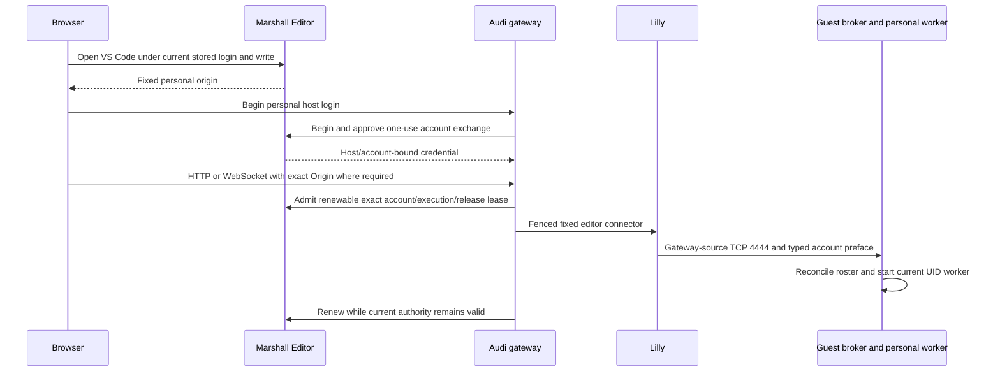
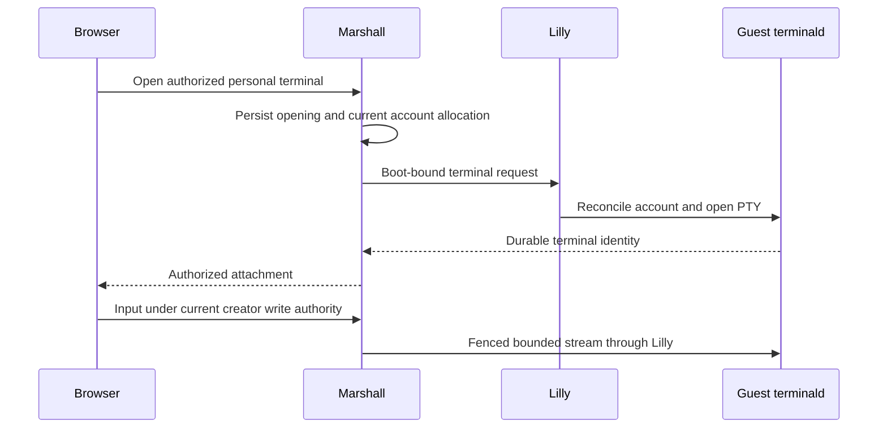

# Browser editors, terminals, SSH, and management

## Connecting to a suspended machine

The machine controls expose Pause and Resume. Resume retains guest memory and
may wait for compatible capacity. A stopped machine still needs Start. Opening
a browser terminal rechecks current Cedar access and the image's terminal
capability before joining wake demand. Pending wake grants neither guest
controls nor terminal tickets. Boot-log viewing, passive viewer checks and
server refresh timers do not wake a machine. A fresh authorized connection or
explicit terminal open may admit demand.

Relocation retires old-placement terminal authority. Reconnection is required;
PTY reattachment across a move is not promised. Authorized SSH, published web
applications and editor requests can wait through resume and automatic relocation
while renewing their authentication and publication/account authority. Snapshot
transport reset does not preserve established sockets.

## Language and text direction

[ADR-0201](repo:docs/architecture/decisions/0201-localized-human-surfaces.md) accepts a saved account language override with session/browser negotiation and English fallback. The supported catalog list includes Japanese, Hindi, Filipino, Estonian, Finnish, Swedish and Brazilian/European Portuguese. Arabic and Urdu use right-to-left document direction; other supported locales are left-to-right. Human browser, email, documentation and interactive Porsche prose are localization targets. Machine JSON, protocol identifiers, diagnostic events and terminal bytes remain unchanged. Implementation and recorded browser/native evidence remain partial.

## Inline privileged browser actions

The accepted ADR-0160 flow keeps a requested administrator mutation on its current
page while an inline passkey ceremony completes. Ordinary signed-in reads stay
available without elevation. The prompt identifies the pending action; it
retains only its exact server-bound actor/login/resource/action/arguments and
never replays an arbitrary browser event after verification. A successful step-up
creates a fixed fifteen-minute receipt and retries once after fresh admission.

No-key administrators are sent to the sign-in section of the account page
(`/settings#security`) for fresh-email first enrollment, then return to the
original page and explicitly retry the action. Cancel,
ceremony failure, continuation expiry, another
tab's input, stale resource state or loss of login/role/key authority refuse the
mutation and keep the page usable for permitted reads. Passkey changes require
verification of an existing key; Customer guest access still requires its exact
owner. Terminal, editor, SSH and service authority do not inherit this browser
continuation. Marshall implements the enrolled-key modal, socket-local retry and
no-key Security return path. Final merged packaged browser checks passed ordinary
access, no-key return/explicit retry, continuation/cancellation/focus restoration
and colocated cross-replica revocation. Native machine-page recovery and timed
receipt expiry remain unexecuted. See
[access](#access), [security](#security) and [scenario coverage](#coverage).

If a mounted machine or terminal depended on an administrator override and that
verification ends, the operation is refused and the UI returns to Fleet workloads
with an expiry explanation. Selecting the machine there opens a fresh passkey
step-up. Resize keeps its draft URL, removes mutation controls and offers a
Fleet workloads recovery link. Current owner and sharing permissions continue
normally. Foreign Customer access remains refused without a verification hint.

## Personal browser editor

New editor windows default to no startup editor
(`workbench.startupEditor = none`), and installing an extension does not open its
walkthrough automatically (`workbench.welcomePage.walkthroughs.openOnInstall = false`).
Users can override both preferences in Settings. These ordinary defaults are
separate from the permanently disabled bundled AI policy. Existing saved editors
follow upstream session restoration. The new package and a separate fresh-profile
manual browser smoke passed; the latter awaited actual workbench restoration and
observed no Getting Started panel or startup Welcome/Get Started/Walkthrough tab.
It does not establish saved-editor removal, actual extension-install walkthrough
behavior or user override execution.

On a running machine with a matching immutable editor capability, **Open VS Code**
opens the personal browser workbench in a new tab on the shared `/workspace`
folder (the worker passes upstream `--default-folder`); a `?folder=` query
selects another folder. The initial redirect enters a
one-use login flow; signing in preserves only the fixed local approval path.
Marshall derives the canonical HTTPS origin from the complete machine and
GuestAccount UUIDs, rather than forwarded headers. Two writers on one machine
have separate origins, cookies and browser storage. Customer permits only the
machine's exact owner; ordinary write grants apply to Standard and OSS.
The guest account has immutable UID/name/home `u<uid>` and `/home/u<uid>`;
all same-User email changes preserve its origin, cookie and renewable lease.
Retirement and current login/write/execution refusals remain authoritative.
Pre-cutover leases closed during the breaking database migration; this continuity
rule applies to subsequent generated-identity admissions.

The editor-bearing capability is currently limited to the reviewed version-4
Linux image contract. Windows `windows-v1` and native FreeBSD/OmniOS
(`freebsd-v1` and `illumos-v1`) rows are refused before this flow because their
protocol capabilities set `editor: false`; their terminal, SSH, readiness or
agent receipts do not widen that boundary. The Linux package and authority
checks also do not constitute a current-revision browser journey: no current
NixOS or Ubuntu sign-in, edit/save/readback and recovery receipt is recorded in
this status review, and the captured Alma/Arch receipts retain their earlier
image and source scope.

Windows has a reviewed native Code OSS bundle and a separately unselected
candidate image; `windows-v1` retains `editor: false`. The portable model and
Win32 launcher bind workers to MMDS boot identity, descriptor, placement, epoch,
GuestAccount/UID, local SAM SID and origin, with SYSTEM-only jobs, profile-backed
paths, exact process and named-pipe custody, and refusal of foreign or incomplete
recovery. The candidate installer completed and a separate 2-vCPU/4096-MiB
Firecracker boot reached Windows Server build 26100 SAC. These narrow results do
not establish current readiness, image admission, browser sign-in,
edit/save/readback, PTY, personal-worker or restart recovery. Exact identities
and evidence digests remain in the
[cross-platform review](repo:docs/architecture/reviews/2026-10-18-cross-platform-editor-status.md).

Every machine page (Terminal, Access, Settings, Agents, Resize and the Boot log view)
shares one header. A bordered heading box carries the machine name, then an
operating-system label that is the registered display name of the machine's
immutable image (`[NixOS]`, `[Ubuntu 26.04 LTS]`, `[Windows Server 2025]`), then
its state label (`[Running]`, `[Stopping]`, …); a machine whose image row is
missing shows no operating-system label rather than a placeholder. Every status
label is one bracketed word on the character grid whose text names the state;
severity is weight, style or inverse video, never colour: `[Pinned]` and the
operating system are secondary-colour metadata, `[Stopped]` is plain text,
`[Running]` is bold, transitions (`[Starting]`, `[Stopping]`, `[Deleting]`,
`[Pending]`, `[Unknown]`) are italic, and `[Failed]` is a bold inverse-video
block one row tall with a one-cell margin inside the block. The label carries
the observed state in `data-state` and the severity in `data-tone` (`danger`,
`success`, `pending`, `muted`, or none for neutral states) on the Overview,
the Machines list and the machine header alike; the tone is decided in the
same order as the text, so a failed machine with delete intent reads
`[Deleting]` as a transition rather than `[Failed]`. Beneath them
sit the resource facts (vCPU, memory, disk, profile) and the machine ID with a
one-line **Copy** control; the authorized power actions and **Open VS Code**
stay on the right and wrap under the summary on phone widths. The "Connect from
your computer" box follows, collapsed to its heading while it holds commands
(an unavailable explanation starts open, and the viewer's open or closed
choice survives live updates). Expanded, it shows one explanation and two steps, "Install and
connect" lists the Linux / macOS and Windows installer commands side by side,
each with a platform label and **Copy** button, and "Already installed" shows a
single `ssh HOST` command for every platform, replacing the former Linux/macOS
`ssh HOST` and Windows `overalls ssh HOST` pair (see "Windows workstations").
Copying any
command or the machine ID writes only the displayed text to the user's own
clipboard and reports "Machine ID copied." or "Command copied." in the status
line; a refused clipboard write tells the user to select the text manually. The
same image name appears as an **Operating system** row in Settings → Resources,
beneath the machine name in the Machines list (the table gains no column, so it
still fits the main column) and before the state label in the Overview preview. The view projection exposes only the image's display name:
manifests, placements and reservations stay private, and the label is shown
only to principals who can already read the machine.

The machine page offers **Open VS Code** only when desired and observed state are
both running, its immutable image has the current editor capability, and the
current write/profile and Customer owner policy allows it. Valid older or
noncurrent images show that a new machine using the current image is required;
missing or corrupt image/configuration reports temporary unavailability. Host
deployment, restarting, resizing or cloning that old machine does not upgrade its
retained image. Keep the original machine while copying and verifying selected
files in a new one; see [operations](#operations).

The Overview machine preview, Machines list and ready Threads workspace reuse one
eligibility-gated projection for the same **Open VS Code** action alongside
their terminal actions. The Machines
table groups both controls in one **Connect** column. An eligible running machine
opens the personal workbench in a new browser tab. Stopped,
unsupported-image and temporarily unavailable machines show a disabled action
with the reason; unsupported images direct users to create a new machine using
the current image. Users without editor authority do not receive the control. These
list views are read-only projections, and opening the link still performs fresh
Editor admission under the current login, write grant, account and execution.
The displayed eligibility is a bounded authorized view, not a grant. Opening
still performs fresh Editor admission, and disabling an image for future launches
does not revoke an already running machine's matching editor capability.
Editor admission selects the approved tuple from the validated image target:
Linux/x86_64 kernel images use `linux-x64`; the separate Windows/x86_64
firmware `windows-editor-v1` candidate uses `win32-x64`. Approval of a tuple for
the other target grants no capability. DNS publication requires manifest4 for
Linux or candidate manifest7 for Windows and the exact target's commit, release
and protocol. Current route publication and each gateway asset receipt must
agree with the VM's current execution and host session. Every advertised gateway
also needs current receipts for the entire configured release set; expiry of
either release withdraws its editor and neutral webview discovery. These records
remain discovery only and do not authorize editor access.
SSH `ls`/`show` keep their existing machine response fields; the workspace status
is not added to their public command protocol.

Admission binds the current stored login, write grant, account incarnation,
live host session, gateway identity, placement, execution epoch/generation,
release and origin. Renewal rechecks all of them except the provisioner's control
session: a Lilly restart opens a new session while the execution and the
detached bridge stay current, so a renewal while Lilly reconnects is answered
`unavailable` (Audi retries within the unchanged lease) and succeeds once the new
session reports
([ADR-0192](repo:docs/architecture/decisions/0192-staged-detached-ingress.md)).
A stale report on a live session still refuses. Unsafe HTTP and WebSocket requests require the exact origin;
same-site sibling origins cannot use the credential. Missing/mismatched capability,
retired accounts, stale logins, changed execution and expired leases refuse without
fallback. Generic guest-web visibility or port settings cannot grant editor access.
An upgraded editor or guest-web WebSocket ends with its lease, either peer's close
or 60 s without a browser frame; the gateway listener's 5 s HTTP read timeout does
not apply to it, so a client with a 5 s keepalive is not cut off
([regression test](repo:audi/test/http_proxy_test.exs)).

HTTP forwarding failures emit `audi.http_proxy_failed` with a fixed forwarding
phase, timeout/closed/protocol/other category, response state and bounded event
count. Errors, URLs, headers and request or response bytes never enter that
event. Failure before response headers returns 502; an interrupted response
still terminates the stream without a successful final chunk. These categories
locate a failed hop; they do not prove the guest's cause or retry a request.

Lilly's leg runs in a detached ingress bridge
([ADR-0192](repo:docs/architecture/decisions/0192-staged-detached-ingress.md)).
Lilly derives the typed account preface and the exact ready frame it requires
from the guest broker; lilly-hostd writes the one and compares the other
before it starts `lilly-ingress-bridge` in its own scope, then splices Audi's
connection straight to the guest. A live editor WebSocket therefore survives a
lilly-hostd or Lilly restart. Lilly still ends the bridge when the execution
loses authority, and Audi's sign-out revocation still closes the WebSocket,
which ends the bridge. Its first machine run failed: the bridges survived, but
Marshall refused the next renewal because the lease was pinned to Lilly's
replaced control session, so Audi revoked the stream. Renewal no longer pins
that session. The later Alma and Arch suites both passed this exact restart
survival stage. Alma completed all twelve stages. Arch's first capture later
failed folder navigation after broker restart; its same-image diagnostic replay
passed all twelve stages, without establishing the original 502's cause. See the separate
[family execution review](repo:docs/architecture/reviews/2026-10-18-foreign-linux-browser-editor.md).

The exact admitted GET/HEAD of the packaged extension-worker iframe at the grant's
source commit permits same-origin framing for the upstream browser extension host.
Other editor responses deny framing. Foreign commits, unversioned paths and
suffix paths cannot inherit that exception.

The browser-fleet fixture retries focus custody before submitting a palette
command and stops its fixture-owned personal worker after the policy probe. Those
actions prevent stale Chromium focus and worker processes from contaminating a
later fixture, but they add no product authority, transport or editor evidence.

An expired/revoked personal cookie or its stored login requires authentication
again and redirects a safe browser visit into the fixed approval/sign-in flow.
A fresh real sign-in can replace that host cookie; it never revives the old cookie
or lease. Current write/account/Customer denial returns forbidden. Missing route or
execution or unanswered stored-login lookup remains unavailable, preserving the
difference between lost browser identity and infrastructure authority.

Built-in formatting, language diagnostics, search, Git, Markdown preview and PTYs
run through the native guest extension host. Open VSX gallery VSIXs are checked
against the packaged Ed25519 keys before extraction, including dependency and
WEB-targeted installs. User settings cannot disable that gate. An explicitly
imported local VSIX remains a user trust decision. Webviews use separate hash
origins and immutable Audi-served bootstrap files, without a CDN fallback.

The bundled editor permanently disables built-in AI, Copilot and Chat through
product policy and service guards. User, workspace and synchronized settings
cannot enable them. Generic completion APIs and separately installed extension
webviews remain available; users control those extensions independently.

Every folder in the guest is trusted automatically, including folders outside the
personal home. The worker uses upstream `--disable-workspace-trust`; Restricted
Mode and its prompts are disabled. This does not grant Marshall write authority
or approve an `.envrc`. Only open projects whose extension execution you accept.

ElixirLS, EditorConfig, rust-analyzer and vscode-direnv ship as signed, hash-pinned
immutable builtins. Each personal account may disable them globally or per
workspace. A newer personal version overrides the baseline; equal or older
versions retain the system copy. The baseline cannot be uninstalled, while
ordinary personal extensions remain installable and removable.
Only these four third-party IDs enter the typed immutable personal-update roster;
the upstream forced-auto-update roster stays empty. Ordinary user update settings,
pinning, delay and consent apply, while core builtin update guards remain.
Fresh imports below the System version refuse. To revert an effective personal
User builtin override, use the existing CLI `--uninstall-extension ID --force`;
the workbench's builtin Uninstall control remains unavailable and System removal
still refuses even with --force.
Disable state follows upstream browser-profile storage on the account's separate
editor origin; it does not imply cross-device synchronization. Installed
extensions and server data remain in account-owned guest directories, while
shared builtin payloads remain immutable.
The standalone control fixture retains a separate private Chromium profile for
each exact origin and uses VS Code's **Developer: Reload Window** action to await
normal storage flushing. Browser-profile evidence does not establish backend or
cross-device disable-state persistence. The later full family scripts pass their
personal control assertions; the final-package complete standalone subsequently
passed its version/language, personal-control and recovery stages.
The final release 7d2415 package and matching image builds passed. A strict scratch
fixture also passed 36 actual Workbench update-preference decisions and bounded
forced-install filtering, using finite mocked collaborators. Constructor scheduling,
real metadata/core selection, gallery installation and full UI remain separate.
The first final standalone run reached the correct lower-version refusal but
failed its stderr-capture oracle. The corrected immutable full rerun passed in
342 seconds total build/execution. Historical lower/equal on-disk scanner state
remains separate from fresh lower refusal and actual newer installation/reversion.

Language runtimes, compilers and servers come from the project's devenv environment.
The ordinary defaults select `rust-analyzer` from project PATH and a small Elixir
adapter directory delegating to project `elixir`, `elixir-ls` and
`elixir-debug-adapter`. Users can override these defaults. Missing Elixir adapter
commands return fixed stderr and exit127; missing `rust-analyzer` retains the
direct spawn's ENOENT error. Neither falls back to bundled server installers.
Fresh extension presence
alone does not establish working language support. Approve direnv explicitly,
wait for its environment to apply, then restart the language server or reload the
window; concurrent initial extension activation does not guarantee this ordering.
Compiled policy and 19 maintenance checks have recorded developer execution,
including actual source-bundled signature/engine validation and generated
archive/pagination histories. The same 19 tests and Ruff/ty also passed through the
Nix check using the final package's installed validator. Native trust,
independent extension controls and
real language responses for this specialized package remain separate acceptance.
Its final standalone attempt passed first-terminal proof, then failed
the Native Policy stage. Replay observed the policy marker and expected
EditorConfig result with no visible AI UI; the exact failed browser assertion
remains unknown. The corrected per-action run later passed the cold browser
journey and Alice's outside-HOME policy checks, then failed because Bob's HOME
NativePolicy command was absent from the palette for 30 seconds. This is a
separate observed failure, not an explanation of the earlier assertion. Full
personal controls, real language responses and a complete passing rerun remain
required.

The full merged Marshall component gate passed, including forced typing. Both
fresh Firecracker guest-family checks at `058f13d8` then failed. Their precise
execution records show that both initial cold editor/terminal/custody journeys
passed before the real-guest policy phase failed. They remain separate from the
earlier complete passing NixOS journeys below. At that revision the specialization's
complete native acceptance remained open.

The corrected startup-release snapshot now passes both complete Firecracker
family scripts, with actual Marshall/Audi/Lilly login and browser tools, native
policy/personal controls, broker/worker recovery, saved-data restart and exact
current physical readiness. NixOS took 805 seconds and Ubuntu 829 seconds total
build plus native execution. The final foreign-Origin/sign-out stages also
passed. These results apply to their frozen pre-template snapshot and do not
establish periodic sweeps or production browser execution.

The fresh standalone startup-package attempt passed both accounts' trust/default
and explicit direnv stages, then refused a fresh lower EditorConfig installation
before version/language/recovery completion. Lower/equal precedence requires
bounded historical personal profile state. The narrow newer personal permission
correction passed the final release 7d2415 package and 344 compiled membership
decisions, followed by complete native install/reversion and core/System refusal
acceptance. Actual Workbench full UI/gallery behavior remains separate from the
36 passing scratch method cases. A scoped writable-settings
Bob probe passed HOME/outside/direnv/disable/override controls on an older package.
Both initial actual Rust and Elixir diagnostic attempts failed. A later scratch
Elixir stage passed with a fixture-only immutable Hex/MIX_HOME closure while Rust
still failed Cargo arguments. A subsequent strict both-language scratch run
passed in 36.61 seconds on old startup package 3zz, including actual rustc E0308.
The final-package complete standalone then passed both actual language stages,
their personal marker custody and Elixir installer-cache absence. Its fixture
authorizer/relay establish no final Firecracker family or production runtime.
Project-server activation and
static extension presence must not be presented as working language support.
Their exact failures and remaining meaningful fixture checks are recorded in the
[review](repo:docs/architecture/reviews/2026-10-10-browser-editor.md).

Revocation hints prompt renewal; a thirty-second lease bounds communication if a
hint is lost. A closed relay cannot revive on later grant restoration. Guest
processes follow native worker lifetime, not the browser lease. Broker restart
preserves systemd-owned workers and sockets; upstream extension-host activity,
its five-minute idle timer and 1500-second reconnection grace govern shutdown.
Personal homes prevent automatic inheritance while existing sudo writers still
hold root capability. See [recovery](#recovery) and [security boundaries](#security).

The [scoped review](repo:docs/architecture/reviews/2026-10-10-browser-editor.md)
records passing local authority/protocol checks and the 60-second standalone
native fixture with synthetic gateway/roster authority. The complete NixOS
Marshall→Audi→Lilly→Firecracker journey also passed actual login, personal editing,
preview/terminal tools, worker recovery, saved-data stop/start, unsafe Origin
refusal and sign-out/WebSocket closure with fresh sign-in recovery. The corrected
merged NixOS snapshot passed again with current physical readiness; its exact
revision is recorded separately from the earlier run. Corrected Ubuntu
provisioned and reached the correct origin but reproduced initial workbench
visibility failure. Later source inspection identified closure-path/root-custody
defects and corrected assembly. The later startup-release full Ubuntu pass above
supplies its browser/control/recovery scope without retroactively explaining every
earlier failure. A bad-gateway document observation alone does not prove
broker/worker health or validate the correction.
Two-writer native separation, broader fault histories and production remain gaps in
[scenario coverage](#coverage).

On base `63a1443c` plus the durable feature before main integration, the
durable-identity application gate and focused editor checks passed
email continuity through approval, exchange, credential reuse and renewal. The
NixOS native run completed canonical personal editor/terminal, policy,
broker restart and worker recovery, then failed an edit assertion after physical
stop/start. Ubuntu failed guest startup before personal editor login. Earlier
editor package/family snapshots do not establish this feature or explain these
failures. The later incoming `d4499c4c` merged Marshall gate passed 1,429 checks,
including application editor authority, with zero-error forced Dialyzer. That
gate and both merged lifecycle passes do not establish native editor acceptance
or later browser-launcher/shared-observability integration. Complete
current editor recovery and native email continuity remain open in the
[durable identity review](repo:docs/architecture/reviews/2026-10-10-durable-guest-identities.md).

Porsche integration and team lists return an object with `items` and
`next_cursor`; `team show` returns `members`. Pass a non-null cursor through
`--after` to continue after the preceding page. Empty pages retain object shape.
`integration add NAME --peer --peer-vm MACHINE` treats `--peer` as a boolean flag.
Generated API/parser checks and the production failure history are recorded in
the [integration review](repo:docs/architecture/reviews/2026-10-02-galileo-production.md).

Integration submissions replace all write-only password inputs on success and
refusal. Empty server-side form values alone do not clear a browser-local value
when LiveView has no changed value to patch. Each attempt advances the input
identity; production Chromium verification checks the actual input value as well
as redacted HTML.

The machine workspace opens personal terminals. Marshall owns authorization and
creation receipts; guest terminald owns PTYs and bounded streams. A browser is an
attachment, not the terminal process. Reconnection must not replay input whose
receipt is uncertain.

The session list labels each terminal with a generated `adjective-noun` name
derived from a hash of the session id (`MarshallWeb.TerminalNames`), so every
browser shows the same label without storing anything. **New** opens a
terminal immediately under that name; renaming it replaces the label in that
browser only, and the guest's own title and user appear in the detail line
beneath the label.

Terminal opening progresses from pending to ready, or through cancellation to
failure. Session termination separately records pending, confirmed, or retired
kill authority. A disconnected socket is not proof that the PTY exited. Geometry
changes require a writable acknowledged attachment. Only the session creator with
current VM write access can attach writable; explicitly shared operators remain
read-only. Tickets bind one actor, session and issued mode for thirty seconds and
are consumed once. Input and resize recheck stored login and current session,
Cedar and execution authority before dispatch. Idle and output-only attachments
recheck every second; revocation does not promise instantaneous output cutoff.
A committed revocation also emits a control hint (ADR-0141) through
PostgreSQL to every Marshall node. Examples are a grant or team change, a
token, passkey, MFA or administrator change, a terminal session share or kill,
or a machine transition. Each attached viewer subscribed to its user or
machine rechecks at once. The one-second poll remains the backstop for a lost
hint, and a notifier reconnect makes every viewer recheck.
A failed recheck closes the attachment at once while the database answers. If
the recheck fails because this Marshall cannot reach the database (a `SELECT 1`
probe also fails), it is inconclusive (ADR-0140): the last confirmed authority
holds for at most 30 seconds, then the attachment closes as
`authority_unconfirmed`. Revocation latency is therefore up to 30 seconds only
while that node has lost its database.
The terminal page applies the same rule: while the database does not answer,
it never reports the machine as missing, and a server error page retries
itself every three seconds until the database returns. A reconnecting page
waits up to 40 seconds for the database before mounting (the browser's join
timeout is 60 seconds), so it keeps its open terminals instead of reloading.
A login recheck that fails only because the database does not answer neither
signs the user out nor leaves the page; the triggering action is dropped or
retried a second later. Login and terminal-session lookups distinguish a
definite answer (missing, revoked, expired or foreign) from a lookup that
failed: only the former refuses, so a pool timeout on an otherwise reachable
database is still inconclusive.
The browser bounds only the WebSocket handshake of a terminal attachment;
after the socket opens, the server's own five-second attach limit decides,
so a slow page that has not yet handled the attached frame keeps its socket
instead of restarting scrollback replay. Attached terminal sockets also
outlive LiveView disconnects: a reconnecting page only pauses ticket requests,
because the server authorizes and rechecks each attachment on its own.
Restored authority permits an explicit fresh attachment and cannot revive a closed
socket. Pending kill or a changed execution invalidates the old registry session.
The [attachment-history review](repo:docs/architecture/reviews/2026-09-26-terminal-attachment-verification.md)
records generated real WebSock processes against SQL-backed authority and synthetic
relay dispatch; the native guest results below retain their original scope.
Generated [terminald byte histories](repo:nix/domains/artifacts/terminald/src/property_tests.rs)
check exact raw scrollback retention through append, resize and cursor replay,
including default 1 MiB and maximum 8 MiB rings. Growing capacity cannot recover
previously discarded bytes. Stream histories preserve frame order across split
and coalesced input; partial headers remain incomplete and complete invalid or
oversized headers refuse before payload arrival. The sandboxed native gate passed
Clippy and 43 tests, including five properties. These pure checks do not prove
vsock authentication, PTY backpressure or the shared 64 MiB session budget; see the
[recorded scope](repo:docs/architecture/reviews/2026-10-03-terminald-byte-histories.md).

Guest output remains bytes; terminal escape sequences do not authorize browser
actions.
The host stream ignores repeated output sequence numbers. If an output frame
skips the next expected sequence, it closes that viewer channel and signals the
viewer to reattach with a scrollback cursor; it does not leave the channel
silently stalled. Generated local frame histories check this boundary, while
native interruption and browser reattachment remain separate evidence.
Generated [mailbox pressure histories](repo:marshall/test/marshall/terminal/host_stream_test.exs)
fill one stalled viewer to the 64-message output bound and shed only that
channel. One to three other channels continue advancing after the close. This
local host-stream test does not cover peer forwarding, browser WebSockets or
production load.

Generated [Lilly channel histories](repo:lilly/test/terminal/channel_history_test.exs)
exercise real local sockets and Stream callbacks: replay/live bytes retain exact
order, byte and frame credit block excess output, duplicate input has no socket
effect, exact cumulative ACKs release credit, malformed receipts fence channels,
and EOF drains only after consumption. Transport loss stops channels synchronously;
a new attachment rejects old process output/ACKs even with the same channel ID.
Guest managers are retained, but these tests do not establish native PTY lifetime
or authenticate a reconnect. Each new attachment resets its local sequence space;
uncertain input must not be replayed into that new incarnation.

Incoming and outgoing peer sockets share a process-owned local admission budget.
Generated [owner-death histories](repo:marshall/test/marshall/terminal/peer_budget_test.exs)
saturate limits of two to eight slots, kill owners without explicit release and
verify exact reclamation and replacement admission. This checks local monitor
accounting; it does not exercise distributed sockets or partitions.

Lilly's host stream and the Marshall peer hop now use the shared active-once
WebSocket connection (ADR-0142); neither polls its socket. The terminal codec,
hello and credits are unchanged. Lilly opens the stream outside its process, so
a hung dial never delays channel output or the five-second progress deadline.
The peer hop pings every five seconds. Either side ends after fifteen seconds of
silence, so a lost Marshall node releases its viewer's channel instead of
holding output credit and the shared terminal pump. A [liveness
test](repo:marshall/test/marshall/terminal/peer_liveness_test.exs) covers both
deadlines; native evidence comes from `terminal-fleet`.
An attached viewer rechecks its authority at once on a user or VM hint and
every five seconds as the backstop; input and resize still recheck on every
frame. The browser's own terminal socket gets the same liveness: an attached viewer
sends a heartbeat control frame every five seconds, and the page reconnects
after fifteen seconds without any frame. A page whose Marshall died behind a
half-open proxy connection therefore fetches a ticket from a surviving node
within about fifteen seconds instead of waiting for the proxy to give up.
The boot-log view pulls further chunks only while it is visible and resumes
from its cursor when shown again, so a page remounted on another node does not
replay a whole boot log into a hidden screen-reader emulator and stall.
It holds one correlated request or emulator write at a time. EOF and temporary
refusals retry after two seconds while the selected page remains visible and
connected; hiding the document, switching panes or disconnecting pauses reads
and discards stale replies. Reconnecting resumes at the retained cursor. Each
decoded chunk is at most 16 KiB and must advance that cursor by its byte length;
a rewind resets the emulator and refetches from zero. Disposing the page removes
its timers and visibility listener.

Creating a terminal selects its pane once. Switching to another pane is retained
across session-list refreshes. A delayed ticket reply can attach only the currently
selected pane while LiveView is connected; switching away cannot create a hidden
attachment. Malformed replies preserve the pending request for retry. The
native browser journey also checks the settled selected pane owns the only open
or connecting attachment; closing sockets do not count. A workspace keeps at most four
live emulators: the selected pane and the most recently selected others. A
pane builds its emulator only when first selected; a less recent pane without a
socket or pending writes disposes its emulator and, when selected again,
replays the retained window from cursor zero. Fifty shells on one page therefore
cost four emulators, not fifty screen-reader trees. Panes use xterm's DOM
renderer: no pane holds a WebGL context, so a page cannot exhaust the browser's
context limit and no renderer canvas can paint above the share or new-terminal
dialogs. A pane without an open attachment reports `connecting`,
never a stale `live`, and the selected detached pane keeps requesting a ticket
until it attaches: a request deferred by draining writes or a still-closing
socket retries instead of stranding the pane. Complete NixOS and Ubuntu
journeys on base `3f679eff`, captured tree `e710ef1e`, passed these checks through
graphics, replay and whole-Marshall recovery. The terminal and boot log fill the responsive
workspace panel. The boot log is the guest's read-only serial console: both NixOS
and Ubuntu guests disable the getty generator (`systemd.getty_auto=0`) and mask
the serial and console getty units, so no login prompt is offered there. The
console carries the fixed line `lilly-guest boot complete`, then the bounded boot
report (ADR-0154), which ends with the fixed line `lilly-boot-report: end`; an
autoscrolled pane therefore shows the report's end, not the boot-complete line.
Lilly reads the log as its service user: the root boot-log writer hands the
private file to that uid. Reading that host file has its own authority path:
current Cedar VM read, a fresh authenticated protocol-2 host stream and the
exact current runnable placement/execution. It does not require the image's
guest terminal capability or a ready/running guest outcome. A pending or failed
boot can expose retained diagnostics while guest session operations remain
disabled. Each response holds at most 16 KiB plus a cursor; it returns no guest
socket path or boot challenge and never dials the guest. A newer command or
changed boot/log incarnation refuses the read. Sparse serial output remains
observation, not proof of the failed guest stage.
The machine navigation has no Boot log tab. A machine whose image has no
guest agents, whose only console is host diagnostics, links `Boot log` from
its connection explanation; the link opens
`/machines/:id/terminals?view=boot-log` directly, and that URL stays
available for every machine reader. This diagnostic view selects
the read-only serial pane and skips guest-session listing and automatic shell
creation, so pending and failed boots do not depend on a guest terminal.
A local browser fixture passed desktop/mobile and both themes, grid, contrast,
origin-only resources, repeated EOF polling, disconnect/reconnect and
hide/destroy lifecycle. It exercises the actual browser view against a local
WebSocket fixture; a complete NixOS journey through a pending/failed native
guest and real Lilly log authority remains unrecorded. The
[diagnostic review](repo:docs/architecture/reviews/2026-10-17-host-boot-log-authorization.md)
keeps those scopes separate.
Interactive access
remains the vsock terminal and Audi-fenced SSH. Personal opening requires compatible guest account helpers and
terminald; activating a host release does not upgrade an existing guest disk.
Windows guests with the `windows-v1` agent set run the same terminald source
under ConPTY with an identical wire protocol, so this terminal path is
unchanged for them; their identity mapping and fidelity difference are
described under [Guests](#guests).

Before the machine is running, the workspace waits without querying guest
sessions. Failed boots remain visible; stopped machines require Start. Temporary
terminal-service failures show preparation during initial opening or reconnection
for an existing workspace. Definitive opening failures remain visible until a
retry or a new execution. An unsuccessful listing never proves a shell exited.
Automatic opening runs in a supervised task, so the workspace never blocks on
guest shell creation. A guest-account refusal is usually roster lag after boot
or a grant change. It shows "Preparing your guest account…" and retries up to
five times per execution before it becomes a definitive failure.

Control requests expire after five seconds. Their reply addresses expire when
the request completes, so late replies cannot crash the workspace or satisfy
another request. Caller identity still governs peer ownership. Retries reuse the
durable opening identity and cannot automatically resurrect a closed shell.
The [startup recovery review](repo:docs/architecture/reviews/2026-09-25-terminal-startup-recovery.md)
records generated reply-order and opening-history tests, connected workspace
regressions, and loopback TLS peer checks; native deployment acceptance is separate.

The pinned xterm renderer carries a reviewed local accessibility layout correction.
Row text and dimensions update together, natural widths are measured without
intervening writes, then each row is scaled to its logical columns. Screen reader
text, selection mapping, resize and announcement scheduling remain enabled. The
actual vendor-method regressions pass for mixed-width/blank text, partial refresh
and resizing. Both complete native guest journeys passed fifty shells, 10,000
images (310,000 bytes), accessible completion within 120 seconds, reconnect,
retained shell and mixed-width accessible selection before graphics and after
replay. Whole-Marshall recovery retained the shell effect and met the existing
database and restored-live bounds. Sharing, foreign refusal, operator view-only
input refusal and grant/login revocation passed. Earlier recovery failures retain
their captured scope in the review. These tests exercise the accessible DOM and
xterm selection; separate assistive-technology integration remains unverified.
See the [scoped execution record](repo:docs/architecture/reviews/2026-09-25-terminal-workspace-verification.md).

## Pinned machines in the lists

The Machines page and the Overview order each user's pinned machines first
([ADR-0193](repo:docs/architecture/decisions/0193-per-user-machine-pins.md)).
The pinned section is a separate bounded read (at most twenty rows, newest pin
first) that applies the same per-row Cedar read decision and projection as the
keyset page; the page then excludes those ids, so a machine appears once and
paging neither repeats nor skips. The pinned section is shown on the first page
only. The Overview fills its six preview slots with pinned machines first; each
preview lists vCPU, memory, disk size and whether the machine is personal or shared.

Every row, preview and machine header carries a text `Pin`/`Unpin` control
(`#pin-<machine>`, `aria-pressed`) and a `[Pinned]` label that leads the status
labels (`[Pinned] [Running]`); the control sends the
server-selected machine id and the displayed state, and the Access coordinator
decides. On the Settings tab the owner's own pin disables Delete with "Unpin to
delete"; a forged delete event is still refused by the domain with a fixed flash.
A shared manager's Delete stays enabled and receives the same refusal, and Fleet
workloads names the owner's pin in its flash. Refusals show fixed messages
(`pin_limit`, `vm_deleted`, otherwise a generic retry); the browser never learns
other users' pins. The SSH `ls`/`show` wire views omit the pin flag so the
Porsche JSON contract is unchanged. LiveView evidence is in
[machine_pins_live_test.exs](repo:marshall/test/marshall_web/machine_pins_live_test.exs);
the browser probe checks the toggle's presentation on both themes.
Wrapped machine-list actions use half-line vertical spacing and one-character
horizontal spacing. The pin integration exposed accumulated vertical drift from
using character units on both axes; the correction preserves the existing grid
tolerance, controls and authority. Its browser results and remaining responsive
coverage gap are recorded in the matrix review.
Thread layouts also suppress element-empty workspace boxes, retain grid-owned
activity field widths and use an inset terminal frame without shifting its
iframe viewport. Command-palette patches restore accessibility/query/focus
state even when the dialog remains open. The original local synthetic browser
probe passed both themes/mobile,32 thread and36 collaborator combinations,
sharing/revocation/refusals and153 screenshots after these corrections; actual
guest execution and packaged-browser coverage remain separate.

## Time zones and local time

[ADR-0195](repo:docs/architecture/decisions/0195-user-time-zones.md) gives each
account a display time zone. Storage, ledger comparisons, the usage CSV export
and SSH JSON stay unchanged; `ls`/`show` omit the additional machine-owner
fields, and `share show`/`team show` omit saved zones from owner, grant and
member records. Conversion happens only when a page renders. The viewer's zone resolves as the saved zone, else a valid browser zone
sent in the LiveView connect params (`timezone`, from the Intl API), else UTC.
The dead render trusts only the saved zone. `MarshallWeb.LiveUserAuth` assigns
`time_zone`, `time_zone_source` (`saved`, `browser`, `utc`) and `now`, and a
one-minute tick refreshes `now` only after fresh-login validation on required
and security views. Optional and public views retain their existing behavior.

The signed-in sidebar groups Overview through Teams under "Your workspace";
Account, AI usage and Browser extension under "Your account"; and Field notes,
HLDD and Source code under a separate "Reference" section. In the Control room
the sidebar shows only the administration tree; neither "Your account" nor
"Reference" is rendered there. Each SSH key on the
account page carries an inline Description field with Rename.

The profile section of the account page (`/settings#profile`, reached from the
single Account entry at the top of "Your account" and from the account menu's
clock; [ADR-0196](repo:docs/architecture/decisions/0196-single-account-settings-page.md)
merged the former Profile, Security and SSH keys pages into this one LiveView
with a numbered section index) shows the email read-only, a `<select>` of about 160 curated zones
labelled `(GMT+09:30) Adelaide` from the offset in force now (so daylight saving
is reflected), Save and Clear, a status line naming the source, and the viewer's
live local clock. A detected browser zone outside the curated list is added to
the picker so it can be saved. The account menu in the sidebar shows the same
clock under the email. Saving an unknown identifier is refused with a fixed
message and the saved zone is unchanged.

Timestamps on the overview, machines, threads, git, usage, SSH-key and
Control room pages render through `<.timestamp>` or equivalent semantic markup: the text is the viewer's local
time with its zone abbreviation (`2026-10-18 19:42 ACDT`) and the element keeps
the UTC instant in `datetime` and in the hover title. This includes the two-line
thread activity time and ingress route/certificate expirations. The thread activity
filters (today, week, month) compare calendar days in the viewer's zone. The JS
relative-activity labels stay relative.

Wherever a person appears, `<.person>` renders the email and, only when that
person has saved a zone, `3:42 PM ACDT local time · 2h 30m ahead of you`
relative to the viewer: team members and pending transfers, the machine Access
tab owner and grants, the owner of a shared machine in the machines list, thread
owner and grants in the sharing panel, and the Control room users (local time
only), access and workloads pages. A person without a saved zone shows the
email alone; the browser zone is never shown to others. Lines inside LiveView
streams (machine and thread grants) refresh when the list is re-read, not on the
minute tick. Terminal viewers show Linux guest names, not accounts, and are
unchanged. Evidence is in
[account_live_test.exs](repo:marshall/test/marshall_web/account_live_test.exs),
[time_components_test.exs](repo:marshall/test/marshall_web/time_components_test.exs)
and the Hegel properties in
[time_zones_property_test.exs](repo:marshall/test/marshall/accounts/time_zones_property_test.exs);
the browser probe saves Adelaide on the profile page and checks an overview
timestamp ends in ACST/ACDT in both themes. No packaged-browser journey exists.

## Developer SSH

Use the machine's installation instructions to install the `overalls` CLI and
configure local SSH. The installer and direct CLI setup fetch deployment-bound
SSH CA policy through verified HTTPS, then install scoped `@cert-authority`
entries. One dedicated CA authenticates Porsche, Audi and new NixOS/Ubuntu guests
with native OpenSSH certificates. Conflicting managed CA trust and explicit
revocation require reconciliation; host-key checking remains strict.

Audi's certificate principal contains the SHA256 digest of its current published
key. The proxy derives that alias from the exact route's HTTPS lookup and carries
known-host revocations into its isolated SSH process. System public trust may use
configuration symlinks; managed user trust and private key reads reject symlinks.
All these reads are bounded and require regular files. Guest certificates contain
only the authoritative VM hostname. Host certificates never grant user access.

The focused Linux [installer journey](repo:nix/verification/tests/machines/installer-trust/driver.py)
checks HTTPS artifact delivery, CA trust and account configuration with the actual
Marshall, Porsche and Lyra packages. Trust refusal preserves prior client and SSH
state. Generated pre-existing local SSH configuration properties check
byte-exact preservation of unmanaged content, exactly-one-marker refusal and
temp-file-free interruption boundaries. Full NixOS and Ubuntu guest connections
are covered by the fleet journey. Native macOS installation remains a separate
acceptance requirement.
state. The same journey records an account-key revocation refused after trust
installation — trust setup precedes account proof, so a first-contact account
refusal leaves CA trust installed while the executable, managed SSH block, proved
identity and CLI configuration stay absent or byte-identical — and owner-scoped
re-registration restoring the completing install. It also records four-way digest
agreement across the installed bytes, checksum endpoint, manifest and a fresh
download, an appended-byte artifact upgrade replacing the executable only after
configuration success, served-digest-mismatch refusal before replacement
(distinguished only by the stderr line, with a shared exit status), and
PATH-shimmed unsupported-platform, Darwin artifact selection and shasum-fallback
probes; native macOS runtime acceptance remains external. The fleet user SSH
journey records a revoke→probe→re-register cycle closing guest SSH and Porsche
account proof on both guest distributions. Full NixOS and Ubuntu guest
connections are covered by the fleet journey. Native macOS installation and
arbitrary pre-existing SSH configuration remain separate acceptance requirements.

Audi handles the guest SSH connection. It resolves the current placement, checks
Cedar and the registered key, and connects under a fresh execution binding. The
Unix login is the account's guest name, not a shared root account. Old disks can
lack the required reconciler or listener; inspect image provenance before treating
that failure as a key-registration problem.

Account discovery returns Marshall's immutable allocated `u<uid>` guest name;
do not reconstruct it from email. Same-User email changes preserve the login,
home and managed SSH profile. Rerun installer setup after the development
cutover or a fresh registration to discover its current identity.
First authenticated `whoami` may allocate the identity and records the
authenticated user in its audit version; repeated discovery preserves it. Browser
personal terminals use the same username and home without requiring an SSH key.

Direct Audi connections provide setup guidance, not a host shell. Key recognition
reports only whether the offered proved key is registered; it grants no guest
authority. Diagnostic channels cannot become relay channels. Proxy failures write
guidance to stderr and return nonzero, leaving stdout for guest protocol bytes.
Set `services.audi.publicOrigin` to the public Marshall HTTPS origin for setup
instructions. The private control endpoint is not a user-facing address.

Approve a new key through Porsche's interactive browser flow while keeping that
SSH connection open. Closing it invalidates the approval link. A one-shot command
must be retried interactively; browser identity alone does not prove key custody.
Approval and manual key addition hold current account admission through the outer
commit. If account retirement wins, the registration is refused without consuming
approval or adding a key. A fresh identity explicitly registers a released key
after old-account cleanup; old sessions retain their original registration ID.

### Windows workstations

A Windows 10, 11 or Server user installs the CLI from the machine page's
Windows row under "Install and connect"
([ADR-0172](repo:docs/architecture/decisions/0172-windows-workstation-client.md)).
The command runs [`/bin/install.ps1`](repo:marshall/priv/overalls-install.ps1),
templated with the same deployment trust as `install.sh` and refused (503)
without it, under Windows PowerShell 5.1 or PowerShell 7. It validates the
origin, zone and host against the issued values. It then requires an OpenSSH
client with hostname protection (9.6 or newer), because the in-box Win32-OpenSSH
9.5 lacks it: when the administrator-owned `%ProgramFiles%\OpenSSH` lacks a
9.6+ client it installs `Microsoft.OpenSSH.Preview` with winget without asking
(the MSI requests administrator approval itself), and stops with the manual
step only when no verified client exists afterwards. Because Windows searches
the machine PATH, where the in-box `%SystemRoot%\System32\OpenSSH` lives,
before the user PATH, the installer then asks once for administrator approval
and, in that elevated process, places `%ProgramFiles%\OpenSSH` immediately
before the in-box entry in the machine PATH (resolved inside the elevated
process, never a user-writable or caller-supplied directory) and broadcasts the
environment change. Plain `ssh HOST` in new terminals then runs the verified
client, so the machine page shows one reconnect command for every platform.
Declined or failed elevation leaves the machine PATH unchanged and prints
`overalls ssh HOST`, which always uses the recorded client.
It downloads `/bin/windows-amd64`, verifies the SHA-256 digest from
`/bin/sha256/windows-amd64`, runs `config-ssh --staged-installer` with the
downloaded binary before installing it as
`%LOCALAPPDATA%\Overalls\bin\overalls.exe`, adds that directory to the user PATH
and connects with `overalls ssh <host>`, which uses the recorded client.

The SSH profile is the Unix block in `%USERPROFILE%\.ssh\config` with one
difference: Win32-OpenSSH starts ProxyCommand without a shell, so the
executable is one double-quoted absolute path. Configuration lives in
`%APPDATA%\Overalls` and state and logs in `%LOCALAPPDATA%\Overalls\state`.
Updates use the same digest manifest; because Windows cannot replace a running
executable, activation renames it aside to `overalls.old`, moves the verified
binary into place with a write-through rename and continues in it. From
Windows, the user reaches Linux and Windows guests alike through Audi as their
`u<uid>` roster account.

### Open a repository from the terminal

`overalls open URL [-- COMMAND]`, for a supported GitHub, GitLab, Codeberg or Bitbucket link,
validates the URL locally with the shared closed grammar, then runs Porsche
`new --source URL --profile oss --request-id overalls-open-HEX --timeout 600 --json`
with the configured origin host and strict CA-pinned host keys. When the result is
`succeeded` with outcome `running`, it connects to the reported `ssh_host` through
the managed Audi ProxyCommand. A fixed remote script waits for
`/run/overalls-workspace/status` to become `done`, then changes into
`/workspace/REPO` and starts a login shell or the given command. An invalid URL
makes no SSH call; a failed or timed-out clone exits nonzero without opening a
shell in a partial tree. See [repository launch workspaces](#guests).

### Install and use the browser launcher

The public `/docs/browser-extension` guide is linked as **Browser extension** in
both the public header and signed-in reference navigation. Overview's **Open
repositories from your browser** card links to the same guide. The public
documentation catalog exposes its HTML and Markdown pages and includes it in
`/llms.txt`; the guide explains installation, explicit server configuration and
the supported GitHub, GitLab, Codeberg and Bitbucket pages.

Download the unsigned developer archive from `/bin/chrome.zip` or `/bin/firefox.xpi`.
For Chrome, extract the ZIP and select **Load unpacked** in Developer mode at
`chrome://extensions`. For Firefox, load the XPI temporarily through
`about:debugging` → **This Firefox** → **Load Temporary Add-on**. Permanent Firefox
installation requires signing or managed policy; no store publication is provided.
The guide remains public when the operator disables downloads with
`services.marshall.marvinPackage = null`; archive routes then return
`404 Unavailable`. The guide states this deployment-controlled availability.

Right-click the toolbar and choose **Configure Overalls server…**. Set the HTTPS
server origin explicitly; HTTP is accepted only for loopback development. The
setting uses the browser's synced extension storage. There is no default server.
The settings page links to this guide on the configured server after a valid
origin is saved; before configuration it uses the reviewed source guide without
guessing a server.
Clicking a supported public HTTPS provider page opens that server's capture page
with only provider origin/path in the source fragment; query/fragment fields are
discarded before transmission and URL user information refuses. An unconfigured
click opens options. The toolbar checks
provider host support, while Marshall checks the complete repository route. Known
unsupported pages disable it. When the browser withholds the URL, the action stays
available so the explicit click can grant activeTab; the observed URL is then
validated before any transmission. The extension sends no page content,
credentials or telemetry. An unsupported explicit click displays a grey `!` badge
and fixed **Unsupported page** title for three seconds, then clears the badge and
refreshes the current tab state; the feedback contains no page URL.
The toolbar icon is the monochrome overalls mark generated at build time. It is
rendered as an opaque dark mark on supported pages and as a grey outlined mark
on unsupported pages. The settings page follows the Monospace Web presentation
with system monospace fonts, the four colour tokens in light and dark schemes
and no external resources.

After the user saves an origin, the extension requests optional browser access
to that exact normalized origin and registers its packaged detector there. The
detector marks the current Overalls document with a local installed attribute.
Marshall observes that attribute only to hide setup prompts on the home page; it
does not establish login, machine, thread, terminal, editor or launch authority.
Missing configuration, denied or withdrawn site access, registration failure and
detector unavailability keep setup visible. Registration is reconciled on startup
and origin changes, while a failed change retains the last working configuration.

The capture page stages bounded input without creating a machine. Complete
ordinary sign-in before automatic OSS admission. A same-browser magic-link tab
resumes the signed-cookie pending launch. Invalid/expired input and unavailable
source-capable images refuse; successful creation clears only the matching intent.
See [access](#access), [guest workspaces](#guests) and
[ADR-0156](repo:docs/architecture/decisions/0156-browser-launcher-distribution.md).

## Porsche

Porsche is the SSH machine-management interface. Lyra supplies the local client
and SSH integration. Management commands call Marshall's authorized domains;
Porsche does not acquire independent scheduling or ownership authority.
Its source-owned candidate SSH dispatch SLI counts eligible terminal command
results and fixed duration buckets; invalid and forbidden requests stay out
of the denominator. An accepted asynchronous command measures dispatch only,
not physical VM completion.
An execution host reconnect clears its capacity freshness until a new native
report arrives. A refused restart preserves the explicit `host_unavailable`
error and its request ID; callers can retry after readiness returns. Porsche
never resubmits a mutation implicitly. Capacity and other closed conflict reasons
share the transport's command-exit classification.

Required operator settings and private credential/host-key custody are validated
before Porsche starts its supervisor or serving children. Generated local OTP
histories pass 171 refusals across 57 cases, including control/public origin,
listener bounds, paths, config/credential/key custody and CA defects. Refusals
preserve recursive fixture bytes, types, permissions, ownership and link counts,
and diagnostics exclude original/mutated credentials, host-key/CA bytes and
fixture paths. The unset control starts exactly five live named base children
without listener or status startup. These are test-build checks. Baseline
synthetic host-key bytes establish loader custody acceptance only; configured
SSH/host-certificate startup, packaged refusal, file-replacement races, native
isolation and hosted config faults remain open for this property.

`pin MACHINE` and `unpin MACHINE` are non-physical mutations: they resolve the
machine like `rm`, call the Access pin coordinator as the SSH actor, answer
`{id, name, pinned}` synchronously and replay by request id. `rm` on a machine
its owner has pinned answers the closed `machine_pinned` reason; Porsche refines
`machine_pinned` and `pin_limit` into named conflict exits and prints a fixed
hint ("unpin it first: unpin MACHINE"). `ls` gains no pinned column. The
[SSH command tests](repo:marshall/test/marshall/ssh/commands_test.exs) cover
pin, unpin, the refused `rm` and the admitted `rm` after unpin; no native Porsche
journey has run them.

Use the command reference in [verification and reference](#reference). Supply
secret values only through supported stdin/private-file interfaces. A management
SSH listener cannot be used as an administrative host shell. Fleet OpenSSH and
the restricted transfer endpoint have separate ports and trust purposes.

Evidence: [personal workspace](repo:docs/architecture/decisions/0117-personal-terminal-machine-workspace.md),
[terminal opening](repo:marshall/lib/marshall/terminal/opening.ex),
[terminal sessions](repo:marshall/lib/marshall/terminal/session.ex),
[installer trust](repo:docs/architecture/decisions/0124-unified-ssh-host-ca.md),
[SSH guidance](repo:docs/architecture/decisions/0120-ssh-onboarding-guidance.md),
[Porsche operations](repo:docs/operations/porsche-operations.md).

### Local host-certificate startup evidence

Native guest SSH refusal checks distinguish recognized users denied by VM or
membership policy from missing identity. Foreign users, Customer members and
withdrawn members require fresh Audi `forbidden` control evidence, recognized-key
guidance and unchanged ingress/guest-login receipts. A generic SSH transport
failure does not establish an authorization refusal.

Porsche's default Proof callback validates a current, correctly signed,
single-principal host certificate matching its private leaf key before the
listener calls the SSH daemon. A new local property records 54 fresh OTP
first-child refusals across 18 real key/certificate mutations. It checks the
exact listener failure, expected supervisor/listener attempts, no daemon/status/
observability starts or surviving service state, preserved private fixture
custody and material/path-safe output. Signed invalid type/options/principal
cases retain valid cryptographic signatures.

A separate configured control starts the real default-callback loopback daemon,
checks seven direct children, readiness, private status socket and an actual SSH
banner, then stops the application and removes its owned socket. This establishes
local startup only. Certificate negotiation/client CA trust, account proof and
authorized Marshall management, production release/systemd startup, native
isolation, concurrent file replacement and hosted faults remain separate.
The server's embedded-CA signature check does not choose which CA a client may
trust. Evidence: [boot properties](repo:porsche/test/host_certificate_boot_property_test.exs)
and [execution review](repo:docs/architecture/reviews/2026-09-29-antithesis-property-audit.md).

### Local strict certificate negotiation

The real default Proof callback now has local OpenSSH property evidence beyond
the startup banner. Three shuffled four-case histories use a disposable real
Ed25519 CA, host certificate and user key. Strict certificate-only verification
accepts the trusted CA with the matching hostname; signed user proof submits
one session with the canonical user key and returns a scripted pending approval.
A foreign CA, hostname outside the signed principal, or absent trust exits 255
before any backend request. Client fallback to a plain host key is disabled.

This checks real local certificate negotiation and user signature proof, not
Marshall account ownership, browser approval, HTTPS transport or authorized
management. The pending response remains scripted. Packaged/native journeys,
production trust rotation and hosted faults remain separate. Evidence:
[negotiation property](repo:porsche/test/host_certificate_negotiation_property_test.exs)
and [execution review](repo:docs/architecture/reviews/2026-09-29-antithesis-property-audit.md).

### Local host-session takeover histories

Three generated two-takeover histories keep real local Bandit host WebSockets
and channels live while PostgreSQL replaces the host connection session and
epoch. Both explicit renewal before successor registration and successor
registration before renewal end the old WebSock process. A socket upgraded
before takeover cannot publish its delayed matching old hello afterward;
the successor retains its directory nonce and sends usable output. Old directory
nonces cannot renew or identify a local stream after replacement.

This verifies the renewal decision and local process lifetime. Renewal is
delivered explicitly; the test does not establish a five-second scheduler bound
or instantaneous per-frame database fencing. Host connection epoch is distinct
from VM execution generation. HTTPS transport and guest replies are synthetic;
native Lilly, remote peer authentication, partitions and hosted faults retain
their separate evidence and gaps. Evidence:
[takeover property](repo:marshall/test/marshall/terminal/host_takeover_history_test.exs)
and [execution review](repo:docs/architecture/reviews/2026-09-29-antithesis-property-audit.md).

## Explicit terminal kill under withheld credit

Withheld viewer credit pauses ordinary live PTY delivery. An authorized explicit
kill cancels that delivery obligation: terminald aborts registered viewer queues,
shuts down their sockets and kills the owned process group before retirement can
reap its leader. A bounded PTY readiness wait observes cancellation even when an
independent owner holds a quiet slave. Session/ring and viewer permits return
without peer disconnection. Natural shell EOF still drains queued bytes.

Generated local Linux PTY/socket histories and fixed configured-watermark and
quiet-slave cases exercise this boundary. They do not prove authenticated vsock,
Firecracker/browser composition, aggregate 64 MiB admission or escaped descendant
cleanup. See the [review](repo:docs/architecture/reviews/2026-10-03-terminald-credit-retirement.md).

## Shared terminal scrollback admission

Generated [shared-ring histories](repo:nix/domains/artifacts/terminald/src/budget_property_tests.rs)
create actual Linux PTYs at the configured 64 MiB aggregate reservation boundary.
Fixed 1 MiB/8 MiB and generated 2/4/8 MiB initial capacities isolate memory
admission from the session-count limit. Contending final reservations refuse
without changing survivors; explicit retirement returns exact capacity for
replacement sessions. Complete retirement returns the counter to zero.
The [recorded native scope](repo:docs/architecture/reviews/2026-10-03-terminald-shared-ring-budget.md)
passed all 47 tests and Clippy. This is local admission/retirement evidence:
dynamic growth, interleaved create/retirement, child-exit/idle release,
authenticated vsock, aggregate growth/admission with mixed viewer pressure and VM/browser composition remain
separate. Reservation capacity is not measured resident memory or throughput.

## Neighboring terminal under viewer pressure

A terminal waiting for viewer credit cannot retain the shared drain mutex and
block a distinct session. Generated [neighbor histories](repo:nix/domains/artifacts/terminald/src/neighbor_property_tests.rs)
require observed live queue pressure, successive fresh executed output from
another PTY and further progress after explicit retirement of the stalled owner.
Octal command encoding prevents echoed input from satisfying the output oracle.
Both clients remain open through exact survivor identity and permit checks.
Configured witnesses cover zero credit and default watermark minus one, exact
and plus one, with generated pump-read boundaries. The refined native47-test/Clippy gate passed4.66seconds;
its [execution review](repo:docs/architecture/reviews/2026-10-03-terminald-neighbor-pressure.md)
records the exact local scope and preserves the narrower initial result. These local observations do not prove
continuous pressure between checkpoints, complete byte fidelity, throughput or
authenticated vsock/VM/browser composition.

## Retired terminal scrollback

Natural EOF drops the retired ring backing before returning its reservation, even while a stalled viewer retains the session. Independent queued output remains intact and drains when the peer resumes. Generated local Linux PTY/socket histories require zero backing allocation, exact finite NUL drain counts and final viewer permit release. The [native repair review](repo:docs/architecture/reviews/2026-10-05-terminald-retired-ring.md) records the pre-fix1MiB retention failure and passing47-test/Clippy and static factory checks. Initial1/8MiB rings remain fixed; this does not establish dynamic growth, aggregate mixed-pressure admission, RSS, authenticated vsock or VM/browser composition.

## Full ring overwrite allocation

Overwriting a full scrollback ring evicts the oldest byte before appending, reusing sufficient backing without capacity growth. The [native Ring review](repo:docs/architecture/reviews/2026-10-05-terminald-ring-overwrite.md) records the backing-bound failure and passing47-test/Clippy repair with an independent exact newest-byte/base/tail model. Fresh positive ring limits remain fixed in that property. Resize/growth, actual PTY aggregate backing, viewer-stream ordering and VM/hosted composition remain separate.

## Actual scrollback growth

The pump reserves each retention-limit increase before changing the ring. Real
Linux PTY histories grow initial 1 MiB rings to 2/4/8 MiB maxima and fill the
64 MiB aggregate reservation. Two complete output phases establish growth and
full final retention despite intermediate read-boundary truncation. Independent
backing snapshots, survivor IDs and exact output counts verify memory refusal,
retirement and replacement growth with peers still connected. The
[growth review](repo:docs/architecture/reviews/2026-10-05-terminald-growth-backing.md)
records 51 passing native tests and a control exposing 128 MiB backing against
64 MiB reserved. This standalone history serializes output across sessions;
the following scenario adds mixed stalled/healthy growth and admission. RSS,
authenticated guest authority and VM/browser/hosted composition remain open.

## Mixed growth and admission under viewer pressure

Session admission and scrollback growth share the aggregate ring reservation.
A stalled viewer must permit fresh output and memory refusal in another session.
Local Linux PTY histories race growth against creates, accepting either legal
schedule while checking exact survivor IDs, quota and actual backing. Every draw
includes the default64MiB budget,8MiB maximum and1MiB viewer watermark. Retiring
one grown session permits exact healthy growth and replacement admission while
the blocked peer remains connected. The
[mixed growth review](repo:docs/architecture/reviews/2026-10-05-terminald-mixed-growth.md)
records52passing native tests, full Marshall/forced-Dialyzer verification and
the smaller growth-limit counterexample.
Pressure is verified at explicit checkpoints; authenticated vsock, VM/browser,
RSS, sustained many-viewer throughput and hosted faults remain open.
## Threads workspace

Authenticated users can open `/threads`, create work at `/threads/new`, and
return to `/threads/:id` from any device. The new-thread page centers an objective
composer with a mode selector and a short mode explanation. Machine settings sit
inside a closed disclosure, summarize the selected machine size and use the
configured defaults unless changed. The thread index lists titles, status, mode,
updated date and an objective preview. Search matches titles and objectives
without case sensitivity, and a status selector shows all, active or archived
threads. These filters apply to the current authorized keyset page of 50
threads; First page and Next page controls walk older authorized results, and
active includes every state except archived. A detail page keeps recent
threads in a secondary rail on wide screens; narrow screens return to the list
through the Threads tab.

The conversation is the main working area. User and agent messages have distinct
role labels; tool and turn events use compact, readable status lines. Queued
tools show their names, and tool results show the recorded outcome when available.
The saved objective remains visible before transcript events arrive. When the
workspace is ready and the actor can write, the reply composer appears above the
transcript. Events show newest first, with the oldest at the bottom. A ready thread
offers Open terminal to writers,
which navigates to the bound machine's terminal page; the terminal is not embedded
in the conversation. Open VS Code appears alongside it when a fresh authorized
machine projection reports the editor available, and opens the existing machine
editor route in a new tab. That route rechecks current editor authority.
Managers receive Archive and Delete in the Actions disclosure and Reopen on
archived threads. Managers can archive or delete pending, provisioning, ready
and failed threads; a viewer receives a read-only notice. Semantic markup, text
status labels and streamed thread, activity and transcript collections use the existing monospace themes
and character grid. List, detail and transcript failures show explicit
unavailable states instead of appearing empty; missing or unavailable thread
detail refuses prompt and lifecycle events. The composer submits to the bound
machine-scoped agent thread; it never creates an independent control-plane
execution path. Pending provisioning shows preparation progress; failed
provisioning offers Retry to current managers. Polling refreshes asynchronous
provisioning state. A thread becomes ready
only after Compute reports its VM running and the initial objective is accepted.
The activity view shows dated rows with a status description and a status filter;
it summarizes the latest thread state rather than a complete event history. Each
committed event on the current bound agent thread advances the enclosing thread's
durable activity clock after the event transaction commits, so agent work moves
the row even when no user-thread attribute changed. Archived and deleting threads
are not touched, and a stale or mismatched agent binding cannot advance a row.
Project filtering remains separate work. The manager-only Share
disclosure lists the protected owner and a page of at most 50 grants, with controls
to grant, replace or revoke a registered account's viewer/operator/manager role.
It loads those details only while open, preserves its request key across failures
and clears grant controls if the read fails or management authority is lost.
Thread access also applies to its current machine; independent machine grants
and team access keep their separate lifetime. See [access control](#access).

Archived threads retain their objective and current transcript while their machine
is gone; these reads recheck current creator/team/grant visibility and the bound
agent identities, and prompt or
terminal mutations remain unavailable. Current thread managers can reopen
an archived thread. Reopen provisions a fresh machine and agent binding while
PaperTrail retains the retired identities. The workspace currently reads only
the current transcript binding by default. Authorized readers can select a
retained generation from the detail URL and read its transcript through the
generation's immutable machine/root/agent binding. Retired generations remain
read-only and do not expose prompt, terminal or editor controls. Native
archive/reopen continuity and cross-node recovery remain unverified.

One reported failed production thread recovered through its authorized retry and
remained ready after required-key deployment, with the same running VM and one
completed initial objective turn. The final inspection was read-only and submitted
no further prompt. This observation establishes that recovery and continuity;
native archive/reopen, fault recovery and cross-device acceptance remain separate
from the focused tests and synthetic browser observations recorded in the
[thread review](repo:docs/architecture/reviews/2026-10-15-user-threads.md).

## Thread commands and planning controls

The accepted [context and planning decision](repo:docs/architecture/decisions/0178-durable-agent-context-and-planning.md)
adds a Commands control to the top composer, composer-scoped Ctrl/Cmd+K and slash
completion. Implementation and browser acceptance are tracked separately in
the [context review](repo:docs/architecture/reviews/2026-10-16-agent-context-and-planning.md).

| Command | Requested operation |
| --- | --- |
| `/plan [task]` | Select Plan and optionally submit the task atomically. |
| `/work [task]` | Select Work and optionally submit the task atomically. |
| `/compact` | Compact active model context while retaining the transcript. |
| `/skills` | Browse, select and, for managers, manage installed skills. |
| `/context` | Inspect working directory, loaded sources, usage and Reload. |
| `/terminal` | Open the current bound machine's terminal when authorized. |
| `/code` | Open its eligible personal browser editor. |
| `/share` | Open manager-only thread sharing. |
| `/help` | Show command help. |

Arrow keys move the selection, Enter activates it, Tab completes it and Escape
dismisses the palette and restores focus. Touch interaction and IME composition
remain supported. Unknown commands preserve the draft and display a refusal;
a leading space submits slash-looking text literally. New-thread mode selection
does not create the machine. Plan/Work and reasoning are separate controls, and
changing collaboration mode preserves reasoning.

Structured planning questions remain visible after reconnect. Current writers
can answer the active request; viewers cannot. A completed plan is rendered as
a sanitized card with Implement plan and Revise, while partial output cannot
be implemented. The server rechecks authority and the exact proposal identity
before admitting a Work turn on the same machine. The composer stays above the
newest-first transcript throughout these interactions.

## Git settings

The authenticated `/settings#git-settings` section edits Git username, Git email
and optional agent commit trailers for the current account. It is the fourth
section of the single Account page, behind the same fresh-login gate as profile,
passkey and SSH key controls. The old settings URLs remain removed. Git email is
separate from sign-in email. Invalid or foreign-account changes refuse. Identity
changes apply to newly created machines.

Public documentation applies validated browser language negotiation without a login or session cookie. Its standalone HTML declares the negotiated `lang` and explicit `dir`, including RTL for Arabic and Urdu. Controller regression coverage checks English, Arabic, Urdu and Japanese; this does not establish visual bidi correctness or translation completeness.
