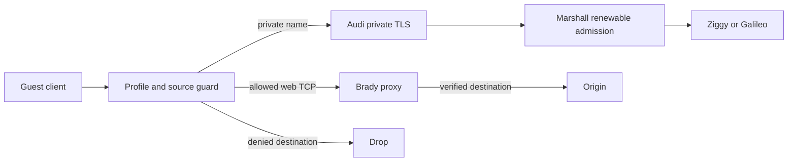

# Networking, ingress, and certificates

## Experimental Antithesis guest transport boundary

The optional TCG guest TAP runs directly in its inner Lilly host's network
namespace. In the authored private-service variant, Audi can see an actual
pre-NAT guest peer and Lilly's exact current-boot proof. The base Compose
fixture has not admitted a nested guest; its connected controlled host has no
report. This harness does not exercise production namespace/nft anti-spoof
policy or adversarial guest packet isolation. A cooperative terminal or
private-service exchange would retain that limitation even if it later passes.

## Dedicated editor path

The personal editor uses a flat
`e-<machine-uuid-base32>-<guest-account-uuid-base32>.<zone>` hostname under the
existing wildcard TLS custody. Each UUID uses complete canonical lowercase
RFC4648 base32. Webview origins instead use the upstream JavaScript base32 hash
encoding and expose only immutable `/code-assets/<release>/.../pre/` bootstrap
files. Separate origins are browser-state boundaries, not additional guest UIDs.

Marshall publishes editor VM owners and the neutral webview owner only through
healthy gateways with a live five-second asset receipt matching service generation,
host session and the approved package. Before each receipt, Audi validates all
fixed asset files and requires a fresh verified TLS HEAD through its configured
local IPv4 HTTPS listener, with operator roots, exact hash SNI/Host and the current
release path. The bounded proof refuses suspended acceptors and wrong trust,
release or immutable response headers. A stale/missing receipt withholds discovery; DNS never grants
editor authority. Current signed-in write and exact release/execution leases still
govern every connection. Customer's exact-owner fixed editor is the sole new
ingress exception; ordinary guest web remains refused even for its owner.

TCP 4444 is reserved for the editor. Ordinary primary/alternate web and peer
connectors refuse it, and PostgreSQL refuses any endpoint row that names it. Only the dedicated Lilly
editor packet mark admits a connection, using the profile's derived gateway source.
The guest broker additionally binds the exact boot IPv4 and eth0 and checks source,
typed preface, account and immutable release before starting the worker. Guest
headers cannot replace this identity. Native packet-mark and full Firecracker
acceptance remain separate from the local protocol/network properties in
[scenario coverage](#coverage).

Lilly owns profile networks, TAP guards, NAT, and guest isolation. It rejects
protected destinations and guest lateral traffic. Additional public infrastructure
ranges belong in `services.lilly.protectedCidrs`. IPv6 and unrestricted UDP are
not implied by an IPv4 guest address. DNS is admitted through configured paths.

| Profile | Control pool | Capabilities |
| --- | --- | --- |
| Customer | 10.10.0.0/16 | Owner SSH, serial terminal and exact-owner personal editor; no general egress/sharing/web |
| Standard | 10.20.0.0/16 | Egress, sharing, web, SSH and terminal; agent child creation refused |
| OSS | 10.30.0.0/16 | Egress, sharing, web, SSH and terminal; child agents permitted |
| Inception | 10.40.0.0/16 | Existing nested-development permissions and paired 10.41/16 Audi address |

The Standard spelling is shared by the protocol, CLI and empty-database schema.
Its address and permission algorithms are unchanged. This revision targets fresh
installations; existing databases and Lilly journals are not migrated and mixed
old/new releases are unsupported. Independent deployment planning is required.

Each guest profile's protocol address octet must match Lilly's gateway, MAC and
reserved UID band; the TAP guard enforces the derived MAC. A generated Lilly
property checks all four profiles over slot values, including a map permutation
that uniqueness alone would miss. It checks local derivation, while native guest
address and packet behavior retain their separate machine evidence.

A firmware-booted guest without agents ([ADR-0170](repo:docs/architecture/decisions/0170-lilly-firmware-guest-launch.md))
learns its address from Firecracker's MMDS instead of the kernel command line:
Lilly seeds `169.254.169.254/lilly` with the placement identity, the `/32`, the
gateway and the MAC before launch, and the guest's bootstrap task applies exactly
that address with an on-link gateway route. MMDS frames are answered inside the
VMM and never reach the tap, so the per-tap source guard and MAC check are
unchanged; a guest that configures any other address stays unreachable. The
bootstrap resolves public names through the same resolvers as Linux guests
(1.1.1.1, 9.9.9.9) and sends only `.internal` names to Lilly's private resolver
at 169.254.254.1, which it reaches through the gateway. Windows guest agents (`windows-v1`,
[ADR-0171](repo:docs/architecture/decisions/0171-windows-guest-agents.md)) talk
to Lilly over virtio-vsock through the virtio-win `viosock` driver, the same
jail-local endpoint and port protocols the Linux agents use; the firmware jail
adds the vsock device only for an agent set that speaks them, and the agentless
image keeps none.

Host firewall activation must preserve Lilly's owned nftables tables. Do not use
a global ruleset flush. The fleet perimeter separately declares public listeners
and allowed source networks. Review both provider firewall and host rules when
changing a listener.
The public listener refuses every `/api` path except the agent CLI routes and
known-host discovery before reading request bodies;
the fleet listener has no browser routes. Generated path, method and host-header
probes verify both local plug chains return uncached 404 without browser cookies
or redirects. Live TLS listener separation and purpose credentials require
separate transport evidence.
Since 2026-10-16 the shared source registry contains only the Overalls and
Dungarees fleet host addresses; every personal and office address was removed at
the user's request. Operators reach fleet listeners through the Tailscale overlay
(accepted on `tailscale0`). Anonymous reachability remains limited to the typed
public listeners (Audi, the proxy's HTTP-01 port and public Grafana). Network
reachability never replaces SSH or application authentication.

| Plane | Purpose |
| --- | --- |
| Marshall public HTTPS | Browser, CLI approval, and control entry points |
| Fleet overlay | Authenticated private service and host communication |
| Administrative SSH | Named fleet users and host operations |
| Lilly transfer SSH | Restricted snapshot export with permit-derived keys |
| Audi public DNS/ingress | Stable guest names, web traffic, and SSH routing |
| Audi private frontend | Guest inference and named integrations under current execution identity |

Audi's hot read paths take no locks (ADR-0140):
- **TLS selection.** The TLS store is the single writer of the validated fleet
  wildcard and publishes each accepted generation to a read view. Every
  handshake's SNI selection reads that view and never waits behind the store.
- **DNS answers.** The DNS directory publishes each accepted complete snapshot
  the same way, so queries never wait behind a publish. Every entry carries its
  own expiry deadline; a snapshot with any undated entry is refused whole.
- **Failing closed.** A restarted store or directory publishes nothing until it
  is refreshed. Handshakes are then unrecognized, and queries answer SERVFAIL.
- **Readiness.** The fleet worker's verified local handshake proves each
  installed generation once. Per-VM route readiness reuses that proof instead
  of repeating a handshake per VM per second, and still reports each route to
  Marshall.

The fleet certificate lifecycle is an explicit machine:
- **`ready`:** a validated, proven and acknowledged generation is serving.
- **`degraded`:** a later failed or slow refresh keeps the proven generation
  serving existing routes, instead of dropping every route and DNS record.
- **`unavailable`:** reached only when the generation expires or is no longer
  installed, or when an explicit HTTP 426 halts the worker (see the Audi
  control-version refusal under services). A halted worker resets
  the machine, so it serves no readiness until an operator restart.

Ordinary web and SSH stream grants last at most thirty seconds from control
request start and renew with Marshall. Nested Inception grants remain bounded
by five seconds and the parent environment publication's remaining lifetime.
Audi accepts the generic thirty-second lease envelope; Marshall's nested
issuer and nested response each apply the shorter bound.
- **Definite refusal:** a denial or a changed binding revokes the stream at once.
- **Inconclusive failure:** a transport error, a non-2xx response or a grant
  that arrived after its own deadline keeps the current lease and retries. The
  stream's guard still ends it at the deadline, so revocation latency is
  unchanged.
- **Push revocation:** Marshall-pushed revocation with a longer backstop remains
  future work.

OTP supervisor progress reports, two per TLS connection, are dropped at the
source. Crash and supervisor-failure reports remain.

Brady intercepts guest TCP 80/443 with nftables tproxy inside Lilly's router
namespace: a mark selects a local-delivery table so Brady's transparent sockets
receive the connection. The namespace keeps strict reverse-path filtering and
pins `src_valid_mark=0` itself. A host value of 1 (Tailscale exit nodes set it)
would make the reverse-path check follow the tproxy mark into that local table
and silently drop every intercepted SYN, leaving OSS guests without web egress.
The Brady fleet journey runs with the host setting enabled to cover this.
For HTTPS, Brady pins the original IP and verifies the upstream certificate for
the handshake SNI there; it does not require its own DNS answer for that name to
equal the guest's, because rotating names such as github.com resolve differently
through different public resolvers. Plain HTTP `Host` and operator TLS-exception
tunnels, which Brady cannot verify, still must resolve to the original address.

The [live egress workflow](repo:docs/egress-acceptance.md) creates only recorded
disposable NixOS, Ubuntu and Customer fixtures through Porsche. It verifies
ordinary guest trust, the Brady signer chain, redirect and Git clone traffic,
public bytes/cache hits and protected-address refusals, then repeats after
stop/start. Mutations require exact create receipts and current ownership;
SSH failure is never a successful refusal. Deliberate outages and storage
pressure belong in isolated NixOS tests, not on the shared production host.
Timeouts stop the local SSH/proxy attempt without cancelling admitted lifecycle
work; reconciliation keeps the original request ID. The Customer refusal uses
an IPv4 destination independently verified reachable immediately before probing.
Fresh probes after healthy activation verify the deployed revision separately
from publication. SSH or management transport failures remain failed evidence;
later successful probe stages do not establish uninterrupted transport stability
or the earlier failure's cause. Resume admitted cleanup with its original request.

The [2026-10-02 review](repo:docs/architecture/reviews/2026-10-02-https-egress-production.md)
records passing one-host production acceptance and native HTTPS full/range cache
recovery after proxy restart with the origin stopped. Ordinary system roots
verified the production signer on both guest distributions. A first Ubuntu
provisioning request failed on an incoherent ZFS observation and recovered through
a separate start; its failure remains recorded. These results do not establish
independent-host relocation, universal provisioning recovery or every HTTP input.
A fresh three-guest campaign on healthy `99f13b26` also passed the complete
HTTPS/cache/refusal matrix after the namespace-cleanup repair. Earlier unexplained
SSH closures remain failed evidence; a later passing campaign does not close
that transport-stability gap.

Large public downloads stream in bounded 64 KiB payload chunks. Known lengths
reserve upfront; chunked bodies reserve additional bytes before each append.
Cache failure preserves admitted proxy streaming where possible. Only complete,
synchronized bodies publish atomically; interruption, malformed framing and any
trailers discard temporary storage. Cached hits reconstruct Content-Length from
stored payload size, including empty objects, and retain encoding and validators.

[ADR-0135](repo:docs/architecture/decisions/0135-streaming-public-artifact-cache.md)
carries forward interception, attribution and pressure policy and adds automatic
anonymous full-commit GitHub archive reuse. Verified HTTPS codeload paths under
any canonical owner/repository qualify without configuration. Credential/cookie,
query, branch-name, private/no-store and ambiguous variant cases still refuse.
Missing archive freshness is bounded to one hour; compatible shorter explicit
freshness is honored. Authorization Vary can be removed only when Authorization
is absent; Accept-Encoding remains part of variant identity.

Stale native capacity samples pause cache writes without evicting completed
objects or stopping their readers when independent current boot and local mount
checks confirm unchanged custody. Stale samples cannot initialize a cache or
authorize writes. Invalid or changed mount custody stops the optional cache
subtree. Fresh observations resume writes. Only headroom below the 15 percent
floor (or unsafe guest-parent headroom) evicts objects. A late observation, or
the 15-20 percent band while writes are paused, only pauses writes and keeps every
complete object (ADR-0140). The pressure publisher has a bounded
one-CPU budget; the three-second freshness deadline remains unchanged.

Write admission/publication diagnostics use the reviewed Brady Events catalog.
Completed request events distinguish published, abandoned and unattempted writes,
with existing authoritative owner/VM/generation bindings. No per-chunk logging or
URLs, headers, payloads or credentials are added. Deployments and VM lifecycle
mutations retain their existing management audit path. Native/property execution
and live isolated-store nixpkgs acceptance are recorded separately in the
[large-cache review](repo:docs/architecture/reviews/2026-10-02-large-egress-cache.md).
Its live phases passed real independent-store pinned nixpkgs fetches and exact
318,532,502-byte LLVM reuse across NixOS and Ubuntu. Nix uses `/tar.gz/`, while
the legacy curl archive uses `/legacy.tar.gz/`; their references remain separate.
Bounded private guest jobs retain completion receipts across interrupted test
transports. Earlier SSH and unresolved-attribution failures remain documented
availability gaps; they are not presumed fixed by cache or runner changes.

Audi DNS publishes current placement routes. Public gateways acquire leases and
verify local Lilly execution before forwarding. Stable names do not permit the
retired source to serve after relocation. Browser authentication, WebSocket
forwarding, SSH, and private services retain separate authorization checks.
Generated local snapshot histories now compare accepted route and proof
withdrawals, stale and conflicting revisions, expired publication attempts,
independently expired routes and invalid snapshots with exact real UDP and TCP
A/TXT payloads and authority flags from one Audi replica. They check local publication authority; live
replica expiry, cross-host refresh and deployed delegation remain separate gaps.

Private guest web accepts the VM owner, direct web/viewer/operator/manager grants,
and current members/admins of the machine's team when its profile permits web.
Customer guest web refuses even its owner. Browser approval and one-use exchange
recheck stored login and current Cedar membership. Audi cookies bind the exact
application host; alternate ports 3000–9999 remain private even when the primary
endpoint is public. Platform cookies are removed before the guest request.

An active web request retains exact execution, endpoint policy revision and app
port. Ordinary web and SSH stream grants last at most thirty seconds from each
control request start; nested streams remain bounded by their five-second
environment publication. A delayed reply cannot restart the deadline. Catalog
and DNS snapshots last at most five seconds. Loss of current login or sharing,
a changed policy/execution, expiry or control failure closes traffic. A refused
Marshall renewal need not immediately mark the durable row closed; the gateway
closes its transport and the previous lease still has its bounded deadline.
Re-addition may authorize a fresh request. Closed or expired streams never revive.
Generated Audi guard checks permute seven independent local TCP streams, echo
bytes before each lease fence, then verify owner death and socket closure for
expiry, delayed expired renewal, changed binding, revocation, guard loss and
suspension. A second generated history retains one live TCP owner across an
accepted renewal and reordered stale renewal, obsolete expiry and later
accepted renewal, checks its deadline and continued echo, then closes the same
socket after revocation, expired reply or changed binding. These checks do not
exercise owner survival past the former deadline after renewal, the SSH
channel's frame gates or a partitioned Marshall renewal.
The [private browser verification](repo:docs/architecture/reviews/2026-09-25-private-web-verification.md)
records generated histories and the execution status of the dedicated native
team withdrawal journey. Existing public-policy, browser-code, SSH, outage and
integration renewal evidence retains its original scope.

Marshall's public proxy terminates TLS and verifies backend TLS identities. ACME
supports HTTP-01 peer routing and optional Route 53 DNS-01. All frontends sharing
a public name must route challenges correctly. Explicitly select the CA and accept
its terms before issuance. Never use staging roots as production public trust.
The fleet perimeter normally hides the proxy's HTTP-01 ingress from the public
CA. A host opts in with `services.marshallProxy.acme.http01.publicIngress`
(ADR-0181), which admits only TCP 80 on the proxy address, sharing the proxy's
single `marshall-proxy` public entry with Grafana's port. Overalls opts in so
`ghuntley.dev` renews unattended; HTTPS on 443 stays source-restricted. Without
a valid certificate the publication validator keeps HAProxy stopped, so failed
issuance takes the browser origin down rather than serving an untrusted name.

Public Audi wildcard keys and ACME state are encrypted in Marshall's database;
gateways receive authorized runtime material. Private-service names must match
certificate SANs. Brady has separate offline recovery authority and a distinct
encrypted signer per Lilly host. Public trust roots may enter images or boot
bundles; private signing keys may not.

Each guest request to an Audi private service holds one authenticated
subscription to Lilly for its source address (ADR-0140).
- Lilly grants the binding from its execution view: the live proof for
  services, or the boot proof for SSH roster bootstrap.
- Lilly sends a revocation frame, or closes the connection, as soon as the proof
  ends: a withdrawn or superseded row, a disconnected runtime, the exit watcher,
  or the proof's deadline.
- Audi's guard kills the request on that event (`audi.private_request_fenced`).
  There is no polling and no fixed time window, so a slow host no longer
  severs healthy requests.
- Lilly accepts at most 1024 concurrent subscriptions.

After a gateway service credential rotates, a fresh acknowledgement of the same
active wildcard may replace the installation row only for a newer generation of
that same service and exact fingerprint. The previous credential cannot rebind
it. Generated ingress and focused certificate tests pass this database path;
native gateway rotation and live route restoration remain unverified.

Generated certificate histories call production activation with delayed issued
jobs and newer pending, failed or issued generations. Stale jobs preserve the
active row, encrypted chain, timestamps and audit inventory; active-job replay
is unchanged. Only the latest issued generation activates. The focused file
passed seven checks, including one property. Independent-worker races, hosted
issuer faults and recovery from a failed newer generation remain open.

Audi rejects invalid gateway, DNS and private-service startup configuration
before its named supervisor or reviewed listener startup entry points are
called. Generated local OTP histories cover 126 refusals across 42 role/case
pairs, with a catalogued rejection, unchanged fixture hashes/modes/link counts
and no credential, private-key or fixture-path diagnostics. Unset configuration
starts only the no-listener supervisor/proof registry. The focused suite passed
two checks, including one property. Packaged startup, successful configured
serving, file-replacement races, native networking and hosted faults remain open.

Ziggy's generated local boot histories cover 87 refusals across 29 invalid
file/schema/origin/path/provider/credential cases. They require exact startup
rejection and its catalogued event before the named supervisor or reviewed
serving/provider workers start. Fixture hashes/modes/link counts stay unchanged,
and original/mutated credentials and fixture paths do not enter diagnostics.
Unset configuration starts an empty supervisor without a serving call. Twenty
generated immutable spool paths are checked through the read-only loader without
worker startup outside fixture custody. The revised focused suite passed three
checks, including two properties. Packaged startup,
configured serving, file-replacement races, native isolation and hosted faults
remain open.

Galileo's generated local boot histories cover 90 refusals across 30 invalid
file/schema/origin/path/credential cases, including each missing required field.
They require exact rejection and its catalogued event before the named supervisor
or reviewed Galileo Finch/Bandit/SLO starts. Fixture hashes/modes/link counts
stay unchanged, and original/mutated credentials and fixture paths are excluded
from diagnostics. Unset configuration starts an empty supervisor without
serving calls; immutable socket paths are checked through the read-only loader
without startup outside fixture custody. The focused suite passed three checks,
including two properties. Packaged startup, configured serving, native isolation,
file-replacement races and hosted faults remain open.

Brady validates operator schema before supervision, emitting the catalogued
configuration rejection for invalid input. Signer material is validated later
by the first supervised child; invalid private certificate/key files stop that
child before cache or listener startup. Generated local properties pass 120
schema refusals across 40 cases and 51 signer-child refusals across 17 cases.
Twenty immutable-store issuer-key paths receive loader-only checks, with no
outside-fixture signer startup. Recursive fixture bytes, modes, ownership,
types and link counts remain unchanged, and diagnostics exclude original and
mutated signer material and fixture paths. Unset starts only Metrics, with fleet
monitor exports disabled in the disposable process. These are test-build checks;
packaged invalid startup, configured serving, native interception/trust/isolation,
concurrent file replacement and hosted config faults remain open for this property.

Marshall checks every configured authoritative DNS replica for the exact live
ACME TXT proof before acknowledging a challenge. A negative check retains a
closed cause class (`invalid_request`, `transport`, `absent`, `malformed_reply`,
`ttl_out_of_window`, `value_mismatch` or `local_defect`) in the catalogued
`ingress.fleet_certificate_propagation_waiting` event, without the DNS packet,
name or proof. The selected issuer still retries the challenging generation;
the event does not itself quarantine or escalate it. Generated loopback TCP
properties cover the local checker and two-replica refusal, not production
delegation or minute-tick issuer progress.

For certificate failure, inspect the selected name, trust roots, validity, current
certificate generation, challenge routing, and service readiness. Restore overlap
before removing an old root. Do not disable certificate verification to recover
connectivity.

The first production coding-client canary after `8930a70f` activation timed out
before inference admission. Separate offline validation of the captured public
chain with pinned WebPKI rejects its legacy extra `*.internal` SAN under the
constrained issuer, while the requested `llm.internal` name itself passes.
ADR-0111's same-root exact-name replacement has verified preparation and
independent encrypted replacement proofs; commit/push and live acceptance remain
separate. These facts do not
recover the timed-out guest's missing TLS stderr or explain the older native
template failures. See the [coding CLI review](repo:docs/architecture/reviews/2026-10-13-native-guest-coding-clis.md).

Evidence: [Lilly policy](repo:lilly/lib/lilly/network/policy.ex),
[fleet network](repo:docs/fleet-network.md), [Audi operations](repo:docs/audi.md),
[private names](repo:docs/architecture/decisions/0111-private-service-tls-names.md),
[ACME module](repo:nix/modules/acme/default.nix).

## Streaming cache history verification

The integrated Brady precommit passed 80 checks (29 properties, 51 tests), seed
`219616`, in 117.4 seconds; forced Dialyzer passed with zero errors, skips or
unnecessary skips in 6.14 seconds. Six new local properties cover:

- Overlapping unknown-length owners: independent reservation sums, object/quota
  and synthetic pool/parent headroom boundaries, foreign-owner refusal and exact
  surviving bytes, including an empty object.
- Owner/Store process loss after begin, prefix and completed commit: exact
  recovered bytes, retained neighbor, cleared incomplete leases and stale refs.
- Actual loopback Proxy/Stream/Cache/Store composition: exact forwarded framing
  and payload, cache reuse and origin counts for complete, trailer, truncated,
  malformed, private and append-overflow histories.
- Repeated synthetic stale/fresh custody observations: exact pending/used costs,
  pinned reads, refused-write cleanup, resumed bytes and changed/missing shutdown.
- Pinned archive policy combinations: independent freshness/Vary menus, fixed
  privacy/ambiguity refusals, canonical path limits and exact variant identity.
- Unconfirmed removal under injected IO/local permission refusal: exact charged
  reservations across repeated aborts, unchanged neighbor, one-time reclamation
  and resumed publication. The focused fixture passed under UID 1000.

The existing parser property now varies initial buffers and socket writes,
checks exact decoded payload/count and trailer cardinality, and synchronizes
sender readiness. TCP write boundaries do not imply recv boundaries. The
pressure helper rename and fully-buffered listener race repairs changed fixtures
only; failed runs and precise evidence remain in the
[history review](repo:docs/architecture/reviews/2026-10-02-large-egress-cache.md).

Fifteen generated/fixed native full-commit archive histories use actual upstream
TLS on port 443, packaged proxy/ZFS storage and two veth clients. Independent
payload digests and origin counts distinguish complete anonymous reuse from
private, trailer and truncated refusal. Fixed small truncation witnesses require
terminal omission. The first native run failed in the inherited 64 MiB reuse
matrix before these histories. The final native capture
`1790971037510-767403-0.jsonl` passed the full test in 300.02 seconds,
including all fifteen archive histories, restart, concurrent readers and reduced
quota. Earlier intermittent abandonments remain unexplained and retained as
failed evidence. This fixture establishes packaged TLS/ZFS and veth scope only.

Architecture impact is verification evidence under ADR-0135 only. Accepted
rationale, decision status, production behavior and authority are unchanged.
Local properties do not establish native custody, interception, TLS, ZFS failure,
Firecracker attribution or hosted faults. Mid-sync/rename interruption, client
disconnect, eventual custody recovery and native storage failures remain open.
Pinned all-file static checks and evaluated Nix HLDD passed; evidence
summary corrections were followed by another passing all-file check. Existing native/live acceptance
records retain their original revisions and scopes.

The multi-GiB acceptance extension adds native fixed/chunked sizes through 4 GiB
plus one byte, offline ranges at signed/unsigned 32-bit boundaries and four
4 GiB concurrent readers with existing RSS bounds. Wide accounting properties
and bounded live checkpoint jobs retain exact capacity and current-owner proof.
No cache configuration or provider exception is added. The final native check
passed through 4 GiB + 1 byte in 1768 seconds. Baseline live NixOS/Ubuntu
acceptance reused a 7,487,562,572-byte public checkpoint with exact independent
SHA-256 and current-owner/generation hit records, documented in the [extension review](repo:docs/architecture/reviews/2026-10-03-multi-gib-egress-cache.md); smaller historical passes do not establish this scope.

Append-refusal diagnostics now use the reviewed `brady.cache_write_refused`
catalog event: a finite cause and bounded freshness durations, with no paths,
payloads or raw errors. This adds diagnosis without changing capacity or privacy
authority. Acceptance GETs retry transient failures at most three times; TLS
certificate refusal remains immediate, all attempts are retained and trust
validation is unchanged. These retries do not establish backend availability.

Multi-GiB acceptance retains the original per-guest request window on replay.
Completed bounded receipts must match the script fingerprint and resume only
owned-path cleanup, with at most five unconfirmed-channel retries. Missing legacy
fingerprints fail closed; forwarding, transport failure and later unrelated hits
do not establish success. Production readiness failures and an earlier unexplained
native fill abandonment remain separate gaps.

Post-deployment acceptance at `b7e29b8f` also passed the 7,487,562,572-byte
checkpoint: NixOS published a miss then reused it, and Ubuntu reused it twice.
Both guests matched unchanged independent pre/post SHA-256 references with
current-owner/generation completions. An earlier concurrent rollout interrupted
a second Ubuntu transfer; that stage remains failed. In-flight connection survival
across proxy restart remains outside this acceptance.

Fresh post-deployment pinned nixpkgs archive and independent-store flake checks
also passed, as did ordinary and protected/Customer refusals on all profiles.
The campaign deleted all three owned fixtures through durable Porsche requests;
independent checks confirmed released reservations, absent placement datasets
and inactive VM units. No direct storage or database correction was used.
