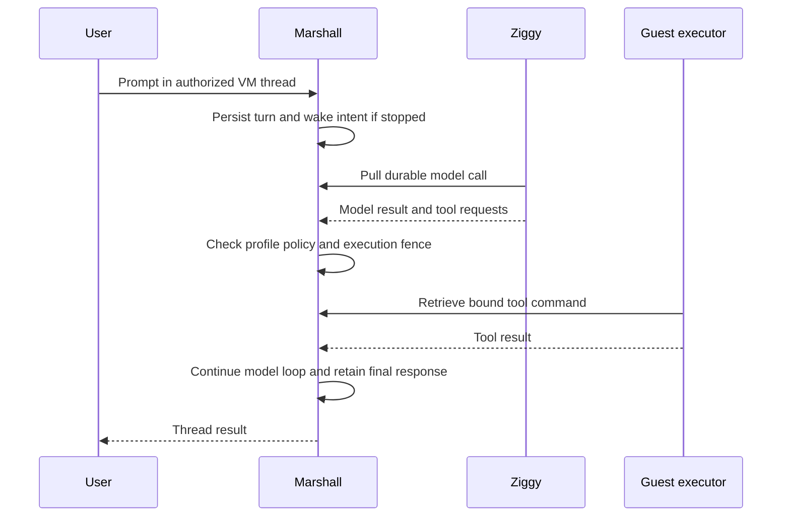

# Agent threads and tools

## Native guest agent boundary

FreeBSD and illumos guests have a closed Lyra protocol shape for readiness,
trust, terminal, workspace, flush, SSH and agent execution. The protocol's
`freebsd-v1` and `illumos-v1` rows currently disable every user-facing
capability, retaining only the host-only transport declaration. If a later
reviewed rollout enables a row, Lilly must bind host CID 2 to guest CID 3 and
each daemon must validate the current boot challenge before responding.
Credentials, terminal bytes, command arguments and Git output stay outside
diagnostics. Native adapters and image assembly are under implementation; no
nested-KVM or Marshall fleet result is implied by the capability table.

## Native agent sets and kernel identity

FreeBSD and OmniOS (`illumos` on the wire) use the explicit v6/v3 native image
contract from [ADR-0190](repo:docs/architecture/decisions/0190-native-kernel-provenance-and-admission.md).
Their bundle carries kernel provenance and the native guest package names the
kernel probe, agent, flush, readiness, trust, workspace and SSH helper
daemons, plus a separately packaged native terminal daemon. Lilly sends no
credentials and does not publish readiness until the
jail-local probe returns an `attested` response matching the current placement,
execution epoch, boot challenge, native OS and kernel digest. The response is
boot-bound and bounded; stale, malformed, placeholder or mismatched evidence
refuses, as does readiness with a different boot ID. The probe binds its
listener, reads the executing transport's read-only build-input token and
compares `/etc/overalls/kernel-build-id` before hashing the configured kernel
file. The expected token must be bounded, root-owned and not a symlink.
FreeBSD embeds the token in the static kernel; illumos checks matching socket
and transport module tokens. This separates loaded build identity from file
bytes, but native boot evidence must still establish the installed kernel/module
set and accepted host-CID path.

The image-facing `native-kernels` receipts retain `artifact.available = false`.
The image builders therefore refuse before copying a stock kernel or root disk.
The FreeBSD and illumos builds link eighteen Lyra production helpers, including
root-only MMDS/network bootstrap, and both native terminal daemons. A separate
output packages two target-specific test transport probes. The complete Linux/Windows/native tests and native
Clippy build passed in 297 seconds. Their manifests
validate bounded ELF64 AMD64 executables with the target guest's interpreter,
reviewed shared libraries and a non-executable stack; each records exact output
digests and pinned Rust/compiler/linker/SDK inputs. The illumos SDK is a
userland linker sysroot, not a kernel-module linker or runtime attestation.
Readiness additionally requires live supervisor PID markers for every daemon,
including terminald, sshd and the roster/certificate refresh worker, plus a fresh
volatile SSH-ready marker; marker presence alone cannot grant readiness.

Complete integrated acceptance remains pending. A scoped FreeBSD nested-KVM
service gate passed eight bootstrap/network, current-boot identity, withheld
readiness, trust, flush, workspace-refusal and terminal HELLO/PING checks in
197 seconds. It used a historical candidate before the final kernel/account
payload, and does not establish checkout, SSH, execution, PTY, isolation or
recovery acceptance. A separate FreeBSD transport gate passed with
token/CID/credit-window and ABI refusal assertions. A stock
OmniOS probe passed native PTY shell/controlling-terminal,
resize and inherited-descriptor checks; it does not execute the full terminal
session protocol. The capability table remains contract surface only: no accepted native terminal,
workspace, SSH, trust, readiness, boot or fleet result is implied. See the
[native kernel attestation review](repo:docs/architecture/reviews/2026-10-17-native-kernel-attestation.md).

The separately installed `codex` and `claude` commands are user-run guest
processes with native client sessions and guest-local files. Their Ziggy settings
do not attach their history, approvals or tool execution to this Marshall-owned
loop. Guest permissions and private inference admission continue governing them;
see [guest defaults](#guests) and [service boundaries](#services).

Marshall owns per-VM thread history, prompts, model calls, child-agent joins, and
recovery. A user with write access can prompt a stopped VM; the request starts it
through the normal admission path. Deleted or unrunnable machines return an
unavailable result.



Profiles constrain tools at both model and execution boundaries. Guest execution
uses the VM's network and filesystem permissions. `web_fetch` runs inside the
guest, so it reaches local services and Brady through the existing policy.
After a terminal tool result is accepted, Lyra may send fixed, unlabeled
OpenTelemetry counters, a duration histogram and a fixed-name trace through Audi.
One observer thread owns the bounded TLS uploads; the executor only attempts
nonblocking admission to a 16-entry queue after the terminal ACK. Full queues,
failed observer startup and unavailable receivers drop best-effort diagnostics
without delaying the next tool. Later cumulative snapshots include counts from
queue refusals, while individual spans have no durable delivery guarantee. A
guest-controlled process can make the same claim, so these metrics do not enter
fleet SLO arithmetic.
`web_search` is Marshall-owned, uses a configured Serper credential, shared cache,
and credit receipts. Neither path grants general host access.

Global **Threads** is the primary task entry point; the machine navigation no
longer includes an Agents tab. The machine-scoped routes
`/machines/:id/threads` and `/machines/:id/threads/:thread_id` remain available
directly for selecting the root thread, creating a child or submitting a prompt
under existing machine authority. The CLI supports one browser-approved invocation:

```sh
overalls agent --machine MACHINE_UUID
overalls agent --machine MACHINE_UUID --thread THREAD_UUID
```

Enter UTF-8 text interactively or on stdin. Open the printed approval URL, verify
the machine and request code, and approve. Approval lasts one hour, is scoped to
one machine, and is requested for each invocation. The CLI keeps its secret in
memory and transmits it only over HTTPS.

The browser's approval GET changes no authority. Only the explicit form binds
the invocation's digest to the signed-in user and selected machine. Every CLI
request rechecks current account and machine write access; a digest URL cannot
serve as an API bearer. Browser sign-out revokes that browser login. An already
approved CLI invocation has its own one-hour lifetime, still bounded by current
account, sharing and machine state. A different machine or thread, withdrawn
write permission, retired account, deleted machine or expired session refuses
subsequent CLI use. Repeating an identical prompt request key retains its original
turn; changing its payload refuses.

A generated SQL-backed [prompt history](repo:marshall/test/marshall/agents/prompt_test.exs)
starts a stopped synthetic VM, repeats the same prompt key, then submits changed
text under that key. It retains one turn, prompt event, admission and wake audit
receipt, and one agent start operation. Concurrent same-key submissions, lost
replies and physical guest wake are not established by this property.

A generated [model claim history](repo:marshall/test/marshall/agents/model_calls_test.exs)
checks repeated host polls and claims aged on either side of the ten-minute
expiry threshold. A live claim keeps its identity and completes once; an
expired claim becomes uncertain, fails its turn and refuses a late completion.
The test uses local PostgreSQL and a synthetic provider response. Concurrent
claimants, lost network replies and actual provider effects remain unverified.

The [CLI verification review](repo:docs/architecture/reviews/2026-09-25-agent-cli-verification.md)
distinguishes generated HTTP/LiveView histories, existing synthetic HTTPS CLI
coverage and the dedicated ordinary-browser/packaged-CLI/guest journey. The
captured native journey passed explicit consent, exact guest tool completion,
Standard capability refusal and stale approval after sharing withdrawal.
An earlier executor interruption remains unexplained; the passing capture
predates the later Underclass package pin. Deterministic fixture model responses
do not establish live-provider availability or production capacity.

The [lifetime generator repair](repo:docs/architecture/reviews/2026-09-26-cli-history-generator.md)
retains expiry, machine deletion and account retirement in every generated and
shrunk lifetime history. The reproduced duplicate-exhaustion failure occurred
while generating a history, before its authority assertions. These remain
HTTP/LiveView and SQL-backed properties with synthetic execution fixtures;
native execution evidence retains its earlier captured scope.

Generated [approval and expiry histories](repo:marshall/test/marshall/agents/agent_revocation_history_test.exs)
also compare exact CLI session and refusal receipts for repeated, fresh and
owner/member digests after sharing withdrawal. They check that expiry removes
only old sessions with one receipt each and that a second sweep is idempotent.
These are SQL-backed checks, not browser or native CLI transport acceptance.

If a turn stalls, inspect machine readiness, durable turn/model state, Ziggy
readiness, profile capability policy, and the guest executor. Do not replay a tool
by editing receipt rows. A provider timeout can leave an uncertain remote effect;
recovery follows the recorded command identity.
Ziggy's model poller fences after a classified control-version refusal. Its
backed-off probe may recover a response-level refusal on a live socket; upgrade426
and close4001 leave the owning shared client stopped until replacement or update. A generated
[poll history](repo:ziggy/test/version_refusal_test.exs) varies transient errors
before that refusal and verifies that later poll messages start no model task.
The local test does not prove a hosted version-skew rollout or the fate of an
already-active provider task.

Evidence: [agent workflows](repo:docs/development/agent-threads.md),
[pulled model work](repo:docs/architecture/decisions/0100-pulled-agent-work-over-ziggy-control.md),
[profile capability policy](repo:docs/architecture/decisions/0103-profile-scoped-agent-capabilities.md),
[search](repo:docs/architecture/decisions/0107-marshall-owned-agent-web-search.md).

## Executor loss and explicit retry

Replacing an executor invalidates its old lease and retires claimed commands as
cancelled. A started command becomes uncertain and its turn fails with
`tool_uncertain`; it is not dispatched again. A never-started cancellation enters
the normal model tool-result path. Lease expiry refuses old calls; subsequent
registration supplies command retirement and a new fence.

An identical prompt request key retains the original turn. A user who chooses to
retry must submit a new invocation/request identity with current write access.
An old approved CLI session cannot bypass withdrawn sharing. Inspect effects in
the guest before choosing to retry an uncertain operation.

The [executor-loss review](repo:docs/architecture/reviews/2026-09-26-executor-loss-histories.md)
distinguishes generated SQL dispatch histories from the native started-effect
fixture. The native fixture requires real effect, durable start, exact process
loss, actual re-registration and ordinary browser-approved retry. The captured
strict fixture passed once in 675 seconds on the staged branch tree; native
pre-start loss and the earlier unexplained interruption remain explicit gaps.
This fixture does not change the production tool timeout.
## User-level thread modes

The existing agent loop remains the execution authority for user threads. The
high-level thread stores one closed mode (`low`, `medium`, `high`, or `ultra`);
the loop resolves that mode to validated model/reasoning configuration when it
queues each model call. PostgreSQL agent turns, model calls and execution
fences remain authoritative, so a LiveView process or thread URL cannot bypass
the machine's current authority.

## Context, compaction and collaboration

[ADR-0178](repo:docs/architecture/decisions/0178-durable-agent-context-and-planning.md)
accepts the following context and collaboration behavior. Its implementation
and execution evidence are being completed in the
[context review](repo:docs/architecture/reviews/2026-10-16-agent-context-and-planning.md);
this section does not establish deployed availability.

Active model context is separate from retained transcript history. An immutable
snapshot identifies applied instructions, their source digests, selected skill
versions, working directory, configuration owner, collaboration mode and
reasoning. A checkpoint summarizes covered eligible work; reconstruction adds
accepted continuation exactly once. Coverage includes the active turn's event
frontier as well as turn eligibility, because a later queued prompt can be
recorded before an active turn's tool result. Tool calls and their results stay
together. Transcript visibility and retention do not change when context is
compacted.

Reconstruction admits at most 4,096 eligible events before requiring an existing
checkpoint. Exceeding that bound returns `context_history_too_large`; it never
silently keeps only the latest events. This is an explicit implementation bound,
not a retention limit on the transcript.

Automatic compaction evaluates the complete projected request before inference
and between tool iterations. It begins at 90% of a configured model input
allowance or 75% of the byte/item limits. The known-limit estimate rounds encoded
request bytes divided by four upward; it is not a provider tokenizer count.
Unknown token limits remain visibly
unknown and use the byte/item limits. `/compact` requests compaction explicitly.
Historical context can be folded through bounded batches; current required
instructions and input that cannot fit return an explicit size refusal.
Compaction consumes ordinary billed model usage. Current context estimates and
cumulative usage describe different quantities.

The default compactor produces a tool-free summary with progress, decisions,
constraints, remaining work and references. The summary has generated-context
provenance and cannot replace trusted application policy. Provider-native
compaction is enabled only for separately verified provider/model capability.
The deployment allowlist is `MARSHALL_AGENT_NATIVE_COMPACTION_CAPABILITIES`, a
JSON array of exact `{provider, model, evidence_digest}` records. Marshall
currently accepts only the `openai` provider, validates model syntax and a
lowercase SHA-256 evidence digest, and matches the complete provider/model pair
at queue and claim time. The legacy global boolean is refused when enabled;
omitting the allowlist leaves native compaction disabled. A digest records the
operator's evidence receipt but does not claim live provider acceptance by
itself, so the decision remains partial until that evidence exists.
Both maintenance request forms disable tools and tool choice, so compaction
cannot execute an ordinary side effect while producing continuation state.
Both paths use durable model calls through the existing Ziggy pull and accounting
route. A complete validated result is published only if its context generation
and frontier still match. Failures, cancellation and stale results leave the
previous checkpoint intact. Ambiguous claimed provider work is never replayed
automatically.

**Plan** and **Work** are collaboration modes; new threads default to Work. The
existing low/medium/high/ultra choices remain reasoning settings. Plan instructs
the agent to explore, clarify and prepare a decision-complete proposal. It is
not a read-only execution sandbox. A repository file, skill or summary cannot
change the persisted mode. Each admitted turn captures it, children inherit it,
and running or unanswered work prevents changing it.

Root planning turns may ask one to three structured questions. Questions and
answers persist across browser reconnect and Marshall restart. Answering
rechecks current write authority and accepts one result for the active request;
identical retries replay the receipt, and competing answers cannot overwrite it.
Cancellation, archival and authority loss invalidate the question request.
A completed proposal presents Implement plan and Revise. Implementation binds
the exact latest completed proposal and admits a Work turn on the same machine;
partial output offers no implementation action.

## Guest instructions and skills

[ADR-0179](repo:docs/architecture/decisions/0179-guest-instructions-and-managed-skills.md)
accepts guest instruction collection and managed skills. Native Linux and
Windows behavior, provider continuation and restart acceptance remain separate
delivery evidence in the context review.

The thread has an explicit working directory, initially a verified source
checkout or otherwise the guest workspace. `/context` reports the directory,
source identities, warnings and usage and offers Reload. Changing working
directory refreshes applicable guidance at a safe boundary. The creator's
durable guest account supplies personal configuration, including Windows
profile lookup; a collaborator does not replace that owner.

Instruction collection reads machine guidance, creator guidance and then
project guidance from repository root to the working directory. Machine
configuration lives in `/etc/overalls` on Linux and `C:\ProgramData\Overalls` on
Windows; creator guidance lives in `.overalls` beneath the resolved guest home.
Global guidance selects the first nonempty `AGENTS.override.md` or `AGENTS.md`.
Project discovery selects the first existing override, standard or configured
fallback file, so an empty selected project file suppresses later candidates.
Fallback filenames are supplied by the creator's bounded `.overalls/config.json`
configuration or typed inventory parameters. The JSON setting
`project_instruction_fallback_filenames` is an array of at most 16 safe filenames;
configuration is limited to 16 KiB and contributes to snapshot provenance.
An explicit nonempty inventory list overrides those defaults. Unknown keys,
malformed JSON and unsafe names return `invalid_configuration`; a changed
configuration changes the inventory digest. Configuration content is provenance,
not an instruction body.
Worktree roots are supported.
Project guidance has a 32 KiB budget with a visible truncation warning. Guidance
below the selected directory must still be inspected before work in that
subtree. Typed bounded inventory and paginated reads run inside the guest
through the current executor binding; Marshall's own filesystem is not a source.
New turns, Reload and working-directory changes collect fresh sources. Changed
file collection retries twice, then returns `context_changed`. Recorded content
is verified, but collection is not an atomic filesystem snapshot.

The skill catalog combines repository `.agents/skills`, creator `.agents/skills`
and `.overalls/skills`, machine defaults and managed installations. Bounded
traversal detects cycles and retains distinct canonical identities for duplicate
names. Linked instruction paths are rejected; linked skill directories are
skipped with an explicit warning. `SKILL.md` frontmatter supplies name,
description and supported invocation metadata, including `agents/overalls.yaml`.
The catalog admits at most 100 entries and 64 KiB of metadata. Local skill
frontmatter is bounded at 32 KiB; managed installation frontmatter has a 4 KiB
bound to fit the current operation envelope. `/skills` opens the catalog,
and `$` completion selects an exact identity without submitting a prompt.
Explicit selections load before inference; implicit invocation follows the
description and metadata. Catalog metadata is bounded, while selected bodies
load completely through paginated reads. Supporting files resolve relative to
the skill directory. Required content that does not fit returns a refusal
instead of silently shortening the skill. Guidance cannot grant tools or
install unsupported connector dependencies.

Only current thread managers install, update, enable, disable or remove managed
skills; operators may invoke enabled skills. Installation accepts public
GitHub, GitLab, Codeberg and Bitbucket repositories, an optional revision and a
skill subdirectory. The guest resolves a full commit and records its content
digest. It performs bounded credential-free fetching with validated paths and
without hooks, filters, submodules or install scripts. Immutable revisions live
outside repository discovery paths. A failed update keeps the active version;
locally edited files are preserved. Ambiguous results are reconciled through the
original operation's status rather than blindly executing again. Reopen restores
the pinned commit/digest, and admitted turns retain their selected revision.
Managed removal leaves repository and personal files intact.

Managed guest files live under `/workspace/.overalls/skills/<thread>/<installation>`
on Linux and `C:\workspace\.overalls\skills\<thread>\<installation>` on Windows.
Immutable content lives in `revisions/<content-digest>`; bounded operation
receipts live in `operations/<operation-id>.json`. The receipt stores request
fingerprints, identifiers, digests, paths and closed outcomes, not source URLs,
command arguments, provider bodies or Git streams. Status rereads verify current
content; `local_changes` preserves an edited revision. A pending receipt is an
uncertain operation and does not authorize repeating installation.

Every completed installation invocation explicitly releases its local file lock,
including error returns. A process that inherited the same open file description
cannot retain that completed invocation's lock. A deterministic descriptor-lifetime
regression verifies active-owner refusal, subsequent acquisition while the old
duplicate remains open, and continued refusal while the new owner holds its lock.
All twelve focused managed-skill tests passed; this establishes local lock
lifetime and does not establish native Git installation or physical recovery.

Installation extracts ordinary Git blobs without checkout. It rejects symbolic
links, submodules, reparse points, hardlinks, traversal, reserved Windows names
and case collisions. The bounded content set admits at most 512 files and
16 MiB total, with a 1 MiB skill-body bound and 8 MiB supporting-file bound.
The Git scratch area has a monitored 64 MiB limit and a 120-second command-tree deadline;
lease loss terminates the command tree. These are guest-operation bounds, not
kernel disk quotas or claims that a hostile guest administrator is confined by
instruction discovery. Managed paths use portable ASCII names to avoid Windows
alias and case-fold ambiguity. Linux syncs files and directories before
publication; Windows uses synced files and write-through replacement. Neither
mechanism alone establishes native power-loss acceptance.

Incompatible executors return an explicit upgrade-required state. Roll out
compatible consumers and guest executors before enabling operations; use the
existing Linux updater and rebuilt Windows images. No additional listener,
service, private Git credential flow or plugin marketplace is introduced.
