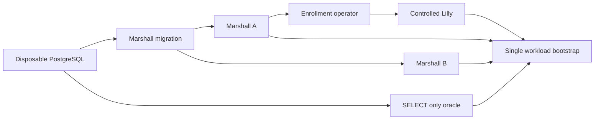

# Verification and reference

The multi-OS guest contract keeps native FreeBSD and OmniOS/illumos image
identities explicit while their capability rows fail closed. Their current
artifacts are agentless firmware images: Lilly omits vsock and native manifests
cannot declare a workspace source until a reviewed guest daemon and machine
evidence exist. Arch and AlmaLinux use the generic Linux runtime closure, with
offline evaluation assertions for the packaged Lyra, terminal, trust and SSH
services; those checks do not establish a native boot.

ADR-0179's managed-skill restoration coordinator is implemented in Marshall's
existing agent loop. It advances a bounded round-robin cursor across replacement
machine generations, suppresses duplicate active or terminal restoration
receipts, and emits catalogued failure outcomes before continuing the scan.
Focused authority and restoration scheduling cases pass; native guest restart,
physical reopen and independent-host recovery remain separate acceptance gaps.

The [browser launcher review](repo:docs/architecture/reviews/2026-10-10-browser-launcher.md)
records Weaver source comparison, current source2/manifest4 and authentication
resume evidence. The replacement minimized immutable browser package/check passed in 10 seconds,
including strict typing, all ten Node tests, deterministic archives, Mozilla lint
and real Chromium four-provider actions with query/hash sentinels removed and
unsupported-click refusal when its URL was initially withheld. A fresh pinned developer build matched archives and
manifest byte for byte. Pinned Firefox 155.0.1 temporarily installed the exact final
immutable XPI and passed settings, metadata and four actual toolbar actions on
fixed local TLS pages with query/hash sentinels and browser certificate bypass.
All launches contained only provider origin/path. ADR-0156 is implemented;
public provider network, permanent signing, Android and production activation
remain outside recorded acceptance. The final privacy correction removes source
query/fragment fields before extension transmission or capture storage/POST and
refuses URL user information. Four pure capture security tests and both source
and test strict TypeScript checks passed. The four regressions are now enforced
by `workspace.check`, whose final test/type invocation passed separately after the
full component gate.
The final check-only removal of an unnecessary HOME override passed a fresh
sandbox check in 9 seconds, preserving the same immutable release and archive
bytes. The exact release's five HTTP/host tests passed again, seed 735823,
including public metadata/byte equality and unsafe-file refusal. These checks
do not establish deployed public HTTPS.

The final focused Marshall source/snapshot/editor set passed 39 checks
(3 properties, 36 tests). Pinned protocol precommit passed 260 checks; the corrected
Lilly full gate passed 549 checks, seed 582375, after the readiness handoff fix.
Both forced Dialyzer runs reported zero errors. Observability precommit passed
11 checks and its current finite schema check passed without regeneration. Rust
passed 123 tests and all-target Clippy. These component results retain their
captured scope; final Marshall full validation is separately recorded.
Marshall full precommit passed 1,454 checks (239 properties, 1,215 tests), seed
80297, with four excluded; forced Dialyzer reported zero errors in 34.61 seconds.
Its verification-only capture-test gate addition was directly run and passed.
The later diagnostic-only ZFS refinement passed 21 focused checks (7 properties,
14 tests), seed 523473, then full Lilly 549 checks, seed 643895, and forced Dialyzer
with zero errors/skips in 13.12 seconds. Observability passed 11 tests, seed 765622,
forced Dialyzer with zero errors/skips in 5.74 seconds and its trace-schema check.
The new identity-bracket event preserves all storage guards and retry behavior;
its missing-path regression establishes fixed metadata/privacy and equal refusal,
not parent-accounting or native healthy-backing proof. Native event evidence must
identify the actual failed predicate before any causal conclusion.

The authorized merge combines prior main `f39d509a` with browser feature
`a3d2b69c`, retaining stopped-only relocation, personal bundled-editor updates and
the canonical shared observability formatter. The exact merged finite vocabulary
was regenerated to restore the diagnostic `pool_identity` atom. Focused merged
Lilly checks passed 34 checks (11 properties, 23 tests), its 104-event logging gate
and structural contracts; Observability passed its schema check and ten formatter/
shared-library tests, seed 957221. Marshall's 164-event logging gate and all
nineteen contract regression tests also passed. These are scoped integration
checks. Browser native captures below retain their immutable feature-source scope;
merged-main native and full component acceptance are separate.

The earlier corrected Ubuntu native capture passed cross-tab sign-in/required MFA,
four exact initial GitHub checkouts and retained stop/start without re-clone.
Ten additional GitHub/GitLab/Codeberg revision cases passed before Codeberg change
stalled at clone status `cloning`; the run failed after 1,703 seconds. Bitbucket,
public downloads and CLI were not reached;
historical ADR-0128 GitHub results retain their old schema/revision. The corrected
runtime capture predates final frontend privacy and provider/ADR module-comment
corrections.
An exact dnsmasq 2.93/production-code musl probe isolated the fixture DNS failure:
A succeeded but AAAA returned REFUSED; authoritative local-domain configuration
returned an empty NOERROR AAAA answer and API resolution succeeded with the same
captured Ubuntu CA bundle plus a fresh fixture root. All four fixture domains now
answer locally, and fixed guest TLS/schema/fork diagnostics preserve private
terminal bytes. This focused repair is separate from complete guest acceptance.
The repaired NixOS family completed all twelve subtests, exit 0 in 1,352 seconds
(854.61-second test script): all twenty provider/revision combinations, exact
guest-owned HEAD/shallow/done assertions, installed-CA provider API probes,
cross-tab sign-in/required MFA, retained restart, public immutable HTTPS downloads
and packaged CLI/working directory passed. These are fixed local provider fixtures
on the colocated native fleet. The earlier frozen-source Ubuntu run passed browser
sign-in/MFA/dedupe in 23.04 seconds, then failed initial guest startup before any
checkout assertion, exit 1 after 266.734 seconds. Its exact failed predicate remains
unproven. The final complete feature `a3d2b69c` Ubuntu capture passed all twelve
subtests, exit 0 in 1,713 seconds total build/execution, script 1,422.20 seconds:
cross-tab resume/MFA/dedupe in 31.21 seconds, initial four actual checkouts in
22.10 seconds, retained restart in 47.85 seconds and sixteen additional matrix
cases in 964.11 seconds, twenty total. Installed-CA Codeberg/Bitbucket API/fork
assertions, public immutable downloads in 0.36 seconds and real packaged CLI/
command/workdir in 24.28 seconds passed. No identity-probe failure marker occurred;
no readiness or retry behavior changed. ADR-0157 is implemented. NixOS predates
the diagnostic-only addition; neither capture reran merged main. Its scoped
component/schema/contracts/logging checks and Nix HLDD gate passed separately,
the latter in seven seconds. Live
provider network, production activation, Brady interception and installed-extension
authentication/guest composition remain separate validation limits. Normal fragment
capture composed through the final frontend, while browser assertions of sentinel
removal and capture storage/POST contents remain separately unrecorded.
The source2-era NixOS handbook renderer passed all 22
sections, Ash/topology diagrams, navigation/hook removal, themes and revoked-reader
refusal in 388 seconds, before the final documentation and editor SQL corrections.
Editor DNS publication and its native fixture require the same manifest4 as the shared
decoder; exact editor release and current publication authority remain required.

[The browser editor review](repo:docs/architecture/reviews/2026-10-10-browser-editor.md)
records the official/OpenVSCode source comparison and retained historical failures
under [ADR-0153](repo:docs/architecture/decisions/0153-official-source-browser-editor.md).
The corrected startup-release snapshot passed complete NixOS and Ubuntu
Firecracker family scripts in 805 and 829 seconds total build/execution, including
current physical readiness, policy/controls, recovery and Origin/sign-out refusal.
The later final package `7fdh`/release `7d2415` passed complete standalone native
acceptance in 342 seconds, driver 323.30 seconds, including personal install/
reversion, core/System refusal, actual Rust/Elixir and broker/worker recovery.
Its authorizer and TLS relay are fixture adapters. Family results retain earlier
release `73ad` and their pre-template snapshot; final-release family and this
browser-launcher merge's native integration are separately unrecorded. The
`63a1443c`/release `73ad` host activation establishes installed identity rather
than a production browser journey. Periodic template sweeps, production editor
acceptance and recurring browser history remain separate.
Synthetic package bridge/roster evidence cannot be promoted to full service
authentication or guest isolation. Native veth packet-mark acceptance retains its
Linux network scope. Recurring probe declaration does not prove production
credentials, completed browser journeys or seven-day history.

## Evidence levels

| Evidence | Establishes | Does not establish |
| --- | --- | --- |
| Accepted ADR | Intended architecture and rationale | Implementation or deployment |
| Unit/property tests | Tested invariants over their fixture/model scope | Native isolation or provider acceptance |
| Nix evaluation/build | Configuration validity and build reproducibility | Running-service readiness |
| Native machine tests | The specific exercised kernel, storage and network scenarios | Independent physical failure domains or fleet capacity |
| Deployment acceptance | Observed behavior of an identified deployed revision | Untested recovery, load or future revisions |

Consult current ADRs and their linked reviews for feature-specific acceptance.
Several decisions remain partial. Known boundaries include historical database
reconciliation, pre-existing guest image migrations, provider-specific behavior,
physical failure domains, and unmeasured scale. A newer test count is not a broader
guarantee. This handbook's own checks validate documentation and presentation.

The [user-operation verification campaign](repo:docs/history/ledgers/verification-campaign.md)
tracks incremental property and native machine improvements, missing capabilities,
and external acceptance boundaries. Queue entries are planned work; only explicit
execution records establish passing evidence for their named revision and scope.

### Antithesis harness retirement

The [2026-10-13 reset review](repo:docs/architecture/reviews/2026-10-13-antithesis-reset.md)
records removal of the old `antithesis/` tree before a fresh whole-repository
rebuild. Historical harness, research and local mutation artifacts remain linked
at the full captured baseline revision. Their recorded execution and limits are
preserved; they are not current setup instructions or fresh hosted acceptance.
Lilly's existing generated actor and fake-command properties retain their test
paths and assertion names, using an ordinary test-support fixture. The scenario
ledger therefore retains its bounded property evidence and native gaps.
Fresh research, setup, workload execution, hosted baselines and mutation results
must acquire their own source/build identities and execution records. Emulated
guest journeys, hosted user-space services and native Firecracker/ZFS checks
retain separate verification scopes.

The [native prerequisite review](repo:docs/architecture/reviews/2026-10-13-antithesis-prerequisites.md)
records passing source-built Galileo and Enrico release payload checks and a
separate disposable NixOS ZFS I/O run after its failed probe attempt. It also
records two failed expanded service-role attempts: the first at the cookie
pipeline, the retry after Marshall cookie checks when Lilly startup failed and
its owner file did not appear. The runtime-secret fixture has no passing
role-machine capture. The updater replay assertion and five-second ingress catalog decoder
boundary are source/test changes without new execution evidence in this review.
These are prerequisite checks, not a current hosted harness or guest lifecycle
acceptance. The ledger binds passing and failed attempts to their exact
derivations and source hashes.

### Experimental Antithesis foundation

The [foundation review](repo:docs/architecture/reviews/2026-10-13-antithesis-harness-foundation.md)
describes an isolated control fixture. The graph below is its proposed Compose
layout, not the deployed fleet or evidence that all containers have started.
The hosted campaign admits up to 32 active attempts so every selected Compose profile and its replicas can run concurrently; this operational limit does not establish a production deployment or a passing property result.



Runtime secrets stay in private fixture volumes; only the operator enrolls
Lilly through Marshall's reviewed CLI. Bootstrap checks both TLS endpoints,
migration and a fresh authenticated host report before one setup signal.
The SQL witness requires a positive report sequence, a report timestamp within
60 seconds and a durable session matching the host's current session ID, host
ID and epoch. It does not read the retired host `protocol_version` column or
infer a wire version from SQL. Production Execution and the real Control
probes enforce wire v4 separately. Historical local boot captures predate this
current-schema witness; local readiness alone does not establish hosted SDK
ingestion or native effects.
The optional `repository-origin` profile adds a second gate before the same
single setup signal: the operator-issued repository manifest must match the
independent fixture ID, the origin fixture must answer an authenticated state
read, the SELECT-only oracle must find the registration row and a
`pending`/`refreshing`/`ready` phase, and Enrico must answer an authenticated
status read for a never-issued attempt. Marshall commits GitHub sources in
canonical lowercase, so the operator publishes `github/fixture/demo` exactly as
registered and the origin fixture serves that path; an earlier mixed-case
manifest and served path never matched the committed row, and Marshall's own
refresh failed against the origin, so setup stayed incomplete. The probe now
reports each distinct unmet prerequisite once per process by condition token,
observation state, HTTP status or phase, never by credential or payload.
The optional `recorder-host` profile selects the TCG NixOS recorder VM and the
three recorder commands. The workload waits for the VM health check, then its
own read-only probe requires a fresh all-active unit sample, producer and spool
identities in their reviewed cgroups, a distinct 32–64 MiB archive device, a
checkpoint whose pending admissions name only the current producer PID and
start ticks, a readable SQLite archive and writable request and ledger volumes.
Missing or stale evidence leaves setup incomplete. The profile is selectable,
but no local or hosted run is recorded; its evidence is emulated, not native.
The optional `admission-stub` profile runs the atomic-allocation and key-replay
admission commands on a harness **stub** storage substrate, which is not ZFS.
Only in that profile does the controlled Lilly release report configured stub
pool totals for its enrolled pool identity, measured cgroup CPU and memory
headroom, and a tiny non-bootable image it digest-verifies before advertising;
the enrollment operator registers that image through Marshall's catalog action.
A fully stub-backed report advertises placement readiness, so Marshall's real
admission transaction commits VM, placement, reservation and dispatch rows,
but the controlled executor never launches a guest and a delete never
completes. Setup requires those committed report, pool and image rows in SQL.
The results are admission-logic evidence only, never ZFS, physical-capacity,
KVM or isolation evidence; the measured-capacity command stays in a separate,
unselected template for the measured host graph.
The optional `guest-lifecycle` profile selects the guest lifecycle command with
the guest VMM overlay. Its container Lilly is a separate STUB-storage release:
it reports a fixed synthetic pool with no ZFS and compute headroom for one free
guest-vmm slot, capped by measured cgroup limits, and sets execution readiness
only after a guest-vmm health check and a verified advertised image. The
enrollment operator registers that image manifest through the catalog action.
Bootstrap adds a third gate: the guest-vmm image identity, read through the
read-only witness bridge, and a Marshall catalog offering that image with known
capacity for its shape. The stub admits one emulated QEMU TCG guest only; it is
not native ZFS, KVM, Firecracker, isolation or capacity evidence, and no local
or hosted run of this profile is recorded.
In every other profile the host report has unavailable pool capacity and false
execution readiness, so a successful Control connection cannot authorize a
guest placement. The
controlled executor records requests without claiming physical effects; its
default guest callbacks remain unavailable. An optional integrated TCG adapter
is authored with a measured inner ZFS host and emulated guest observation, but
has no recorded composed journey. Its recovery inventory permits only the
fixed `lilly.service` and `lilly-guest-emulator.service` cgroups plus exact
tracked VM units when systemd creates them; unknown or malformed native
inventory fences recovery, while the emulator inventory independently checks
tracked placements. The optional TCG guest context
has a [recorded local boot](repo:antithesis/verification/guest-boot.md): exact
port 1024 readiness on three q35-adapted NixOS guest boots, with one restart
on a retained qcow2 overlay and matching offline machine-id bytes. The
storage-router VM separately passed a
[local direct-run smoke](repo:antithesis/verification/storage-boot.md) with
real ZFS/Brady, origin-off cache replay and retained marker/quota across QMP
reset. The four selected control-context exports
passed at their captured derivations. A later local base Compose project also
emitted setup and passed six serial Control commands; the selected manifest
has four stale runtime-dependency hashes, so no frozen hosted baseline follows.

The static researched catalog contains 104 primary properties. The current
literal scanner finds 162 SDK callsites, 30 matching primary messages and 74
missing primaries, with no duplicate callsite or kind mismatch; none
of the 104 properties is complete as a workload plus independent oracle and
hosted result. The default `control-core` selection now stages 13 commands in
seven templates, six of them one-command terminal singletons: credential
revalidation, dispatch, legacy request, SQL reply loss, host-session successor
and host rotation. Its cross-service dispatch primary binds only a Lilly socket
and counts foreign effect tables; its legacy-document primary observes
Marshall's durable host session, not Lilly's Store or Journal; its 4001
refusal primary drives the shared client against a loopback peer for a bounded
quiet window. None has a hosted run. Local SDK writer probes and unit tests show bounded JSONL
behavior, including short-write refusal across helper restart, but they do not
prove hosted ingestion. BEAM fallback assertions provide no BEAM branch
coverage. Python catalog scanning provides no source coverage; the C helper is
assertion transport, not SUT instrumentation. Native Rust coverage remains
pending. A local control-core setup completed on diagnostic4 image bytes, but
the selected manifest's four stale dependency hashes prevent a frozen local
or remote baseline claim for that image.

Optional Compose overlays declare separate origin/SMTP fixtures, satellite
roles, a guest VMM, a measured Lilly/ZFS TCG host and a recorder host. Closed
operator requests and witness paths are source-defined; the workload has
authored browser, Control peer, admission, terminal and recovery callsites.
Their presence does not establish that selected images, migration, credentials,
health, independent oracles and one setup owner ran together. The local guest
and router TCG records each have their own artifact identity and never count as
the default control graph's hosted baseline.

| Profile | Overlays after the base | Selected commands | Setup gate beyond the base | Reachable claim |
| --- | --- | --- | --- | --- |
| `backup-restic` | `compose.backup.yaml` | five `backup` commands | production backup operator and pinned Restic present; private fixture volume; a probe Restic file repository initializes and enumerates empty | production prune, inspect, backup and restore against disposable encrypted file repositories, checked by raw Restic and restored hashes; no ZFS capture, S3 or recovery target |
| `satellite-standin` | `compose.origin.yaml`, `compose.satellites.yaml`, `compose.satellite-standin.yaml` | four `satellite` commands | origin fixture state; private-Audi root; guest stand-in receipt of a verified TLS handshake to private Audi | private Audi forwards nothing for a forged request from a source Lilly never bound; VM-dependent commands record unexercised |

The `backup-restic` repository uses Restic's local file backend because the
production operator reports one failure status for an unavailable repository
and for a validator refusal; a network backend would let a fault read as a
refusal. The `satellite-standin` **guest stand-in** is a labelled harness process
from the workload image that shares only `lilly-a`'s network namespace and
speaks the guest-side TLS protocol to `169.254.254.1`. It is not a guest: it has
no VM, boot, tap, placement or execution authority and mounts no secret. Its
assertions test only private Audi's transport-only attribution with the origin
fixture as effect witness; they say nothing about guest routing or isolation.
The overlay also corrects the private Audi start script, which omitted the
required `connector_uid` and so could not load its configuration. Ziggy
completion, Galileo named origin and the editor login-code race need a current
running VM; the controlled Lilly pool reports unavailable capacity and no Audi
editor gateway, editor release or wildcard is configured, so their primary and
`Sometimes` assertions stay unevaluated. Both profiles have rendered Compose
graphs that pass the selection validators and unit tests; neither has a local
`compose up` or hosted run.
The [integrated-host record](repo:antithesis/verification/integrated-host-boot.json)
captures two unavailable-health TCG boots and one corrected third-image boot
with actual ZFS and cgroup sampling. A fourth built private-service image
repeated the measurements, completed runtime PKI preparation and produced a
workspace-source-v2 guest image witness. Both measured samples remain
disconnected and execution-unready. A private 9p witness identified the first three images;
focused crash-actuator tests passed nine checks without a QEMU crash. A
boot-bound guest-trust receipt adapter passed twelve tests and forced Dialyzer,
but the full integrated-mode suite failed at 7/559 and private service roles
have no runtime credential or terminal acceptance.
The earlier local base Compose diagnostic passed migration, Marshall A/B, enrollment,
three synthetic account/passkey creations and Lilly health. Read-only SQL
confirmed exactly three users and three account passkeys; the enrollment
operator had no listening socket. The v4 host was connected, but
`report_sequence` was 0 and `reported_at` absent, so setup did not fire in that
project. Diagnostic4 subsequently logged `INFO Antithesis setup complete` after
a fresh v4 report at sequence 44. Six serial commands produced 13 true SDK
assertion records and the final SQL observation found fresh sequence 392;
the [foundation review](repo:docs/architecture/reviews/2026-10-13-antithesis-harness-foundation.md)
records local image IDs and the stale selected-manifest hashes. The controlled
container committed cgroup-derived effective fields while preserving nil pool
capacity and false execution readiness. Raw cgroup files were not independently
compared, and hosted ingestion remains unverified.

The `database-recovery` machine check uses the real release Repo on a separate
machine from PostgreSQL. It requires three observed lock waiters before client
loss, then checks the existing holder and connection reclamation deadlines.
The old settings and a polling-only candidate both missed the 35-second bound.
A captured candidate with one-second active disconnect polling and a 15-second
TCP acknowledgement limit reclaimed all ten connections in 27.719 seconds; its
healthy 20-second query also passed. Its exact captured-source scope and inspected
executable equivalence are retained. Both complete integrated NixOS and Ubuntu
terminal journeys separately passed browser recovery, retained shell effects,
sharing and revocation; their VM-script timers were 702.42 and 683.84 seconds.
Neither result establishes physical/provider recovery or production load. See the
[execution scope](repo:docs/architecture/reviews/2026-09-25-terminal-workspace-verification.md).

The `log-store` machine check exercises classified journald export through
verified TLS and path-scoped credentials, plus Grafana's provisioned read-only
VictoriaLogs datasource. The retired Marshall `/admin/logs`, `/admin/slos` and
fleet history routes return 404. Their pre-cutover browser/client evidence remains
historical; it does not establish current Grafana acceptance. The
[observability decoupling review](repo:docs/architecture/reviews/2026-10-09-observability-decoupling.md)
records native provisioning/query execution and remaining deployment gaps.

Provisioning benchmarks read bounded catalogued host-local transition events over
strict authenticated administrative SSH. Template cost requires one staging and
one ready event for the same host, pool and native record, with ordered timestamps.
Missing, duplicate or mismatched evidence refuses a warm sample. Diagnostic phase
files explicitly report incomplete coverage and never authorize VM cleanup.

## Developer verification

GitHub Actions runs on privileged, cached Namespace runners so Nix builds keep
their sandbox. Every job installs single-user Nix and the devenv revision pinned
by `devenv.lock`, and publishes what it builds to the `overalls` Cachix cache.
`publish-cache.yml` runs on trunk pushes and pull requests: repository gates,
`mix precommit` for each Elixir project, and every enabled non-machine flake
check. `nixos-machine-tests.yml` runs daily or on dispatch and fans out one job
per NixOS machine test selected from `meta.ci` (Inception is excluded); its
discovery evaluates only that metadata, and each matrix job builds its test.
`nix-upgrades.yml` updates `devenv.lock` weekly and pins the flake's
`buildNixpkgs` to the same nixpkgs. A run is execution evidence only for the
commit it ran; a selected matrix entry is not a passing result, and nested-KVM
availability on the hosted runners is unverified.

`elixir/request_accounting/` is the shared typed request-accounting library.
`Overalls.RequestAccounting.Producer` performs private quality-marker and local
Unix RPC I/O for durable admission custody. `Aggregate` provides the immutable
counter/histogram model and validates snapshot construction; each application
retains eligibility, classification, concurrency, persistence and publication.
The library remains independent of best-effort diagnostics. Protocol measurement
types and codecs remain pure; ADR-0142 confines outbound control WebSocket I/O
to `Control.Client` and `WebSocket.Connection`, with application-owned credentials
and trust. Protocol stores no durable credentials or domain authority.
An unsupported control version is terminal for that client instance: pending
requests settle as unproven, further requests remain disconnected, and recovery
requires a replacement client after the incompatible version is corrected.
The original client's delayed reconnect was reproduced after60.3seconds. The
stopped-phase repair passed the five-check client file in167.3seconds before
the queued-connect and HTTP426 extension. The expanded six-check client
file subsequently passed in288.0seconds. Its generated loopback history
retains a61000ms observation and does not prove arbitrary future absence or
native fleet rollout. The refined queued-connect wire oracle subsequently
passed the six-check file in318.9seconds and caught the targeted retry mutant.
The heartbeat ownership review reproduced early replacement-socket traffic in
10.4seconds. The timer-reference repair passed its focused reconnect property
in47.8seconds before integration. Retired-reference redelivery passed the
integrated property in45.9seconds and caught a ref-matching mutant in6.2seconds.
Protocol249, Lilly503, Marshall1466 and Galileo31-check gates passed with
zero-error forced Dialyzer; the Protocol gate predates the extended test and
is reused only for unchanged production source. Incoming-main integration,
verified TLS reconnect histories and native fleet acceptance remain open.
The loopback test's100ms transit allowance is not a production latency guarantee.
Marshall, Audi, Brady, Porsche, Galileo and Enrico package the explicit
local library inputs. Run its pinned `mix precommit` and each changed consumer's
gate. The native `otel-request-recorder` fixture separately exercises the actual
BEAM producer and Rust recorder; unit/type checks do not establish application
transport acceptance or production history.

```sh
devenv shell
elixir scripts/check_adrs.exs
elixir scripts/check_hldd.exs
elixir scripts/hldd_options.exs --check
cd marshall
mix precommit
```

Run the corresponding application gates for changed consumers and the protocol
library. Shared governance changes also run Marshall's validator tests. Select
native checks from the maintained test catalog; do not run destructive harnesses
against production resources.

Run `mix precommit` in the independent `elixir/diagnostics/` project when reviewed
event catalogs, runtime instrumentation or the SDK change. Its read-only
`mix schema.check` compares production literals with the generated finite trace
vocabulary without starting services or rewriting files. Review vocabulary
changes before regeneration; a synchronized artifact alone does not establish
delivery to the native spool or Tempo.
Schema generation orders object keys explicitly. A fresh-VM regression verifies
that opposing atom-loading orders produce the same reviewed artifact, so the
gate can distinguish source drift from serialization order.

The opt-in [HTTPS egress acceptance](repo:docs/acceptance/egress-acceptance.md) uses three
receipt-bound disposable guests on Overalls and records private command, request
and updater evidence. Its pinned public destination has a positive reachability
control before Customer refusal. Seven runner safety tests cover ownership,
replay, failed responses, approval redaction and local SSH/proxy timeout cleanup;
they cannot establish native isolation. A local timeout does not cancel admitted
VM work: reconcile the original request.
Customer refusal requires connection failure or timeout against the independently
reachable pinned public address; TLS handshake or receive errors fail the probe.
The `brady-network` and
`brady-native-storage` machine checks keep shared-service outages and pressure
faults isolated, including HTTPS full/range recovery with the origin stopped.

### Committed database fixtures

Tests using independent Marshall nodes commit real fixture rows. Public VM
provisioning also creates agent roots, initial threads and audit versions. Raw
job deletion retains redacted job history, and lifecycle records intentionally
outlive their resources. Disposable fixture teardown captures its own VM, root,
thread and job IDs and deletes dependent history in foreign-key order after all
callers finish or stop. Shared image ownership is captured before creation; prior
unreferenced catalog rows and versions survive. Serial job cleanup captures exact
new IDs and preserves completed jobs of the same worker. Catalog registration,
credential and team retirement fixtures dispose their worker jobs by the same
exact returned IDs, and each distributed authority test asserts the complete
public-table inventory around its own execution. Production archival and retained history are unchanged.

Generated cleanup histories compare complete public-table row digests before and
after both successful and deliberately failed assertions, while preserving an
unrelated fixture's automatic histories and unused image catalog entries.
Failures report changed tables and row hashes without payloads. If teardown also
fails, the original
failure remains reported. Historical rows in older verification partitions and
baseline reproduction rows remain available; a clean fixture restores the prior
inventory rather than assuming the database began empty. The
[fixture review](repo:docs/architecture/reviews/2026-09-26-committed-fixture-history.md)
records exact execution and remaining scope; the
[authority fixture review](repo:docs/architecture/reviews/2026-09-26-authority-fixture-history.md)
reproduces and repairs the retained catalog/retirement job histories. This is
test database hygiene, with
no new native isolation or user-scenario acceptance claim.

### Browser helper type gates

NixOS test drivers and separately launched browser helpers have distinct type
checks. Teams, Control room, handbook, MFA login, administration, Git mirrors,
job history, Inception and the fleet's default OSS, resize, account lifecycle,
team resources, terminal, maintenance evacuation, agent CLI, private web, clone
and executor-loss journeys execute copied helper artifacts only after pinned
`ty` passes against their actual Python/Playwright runtime; the fleet client
likewise executes typed Audi and Porsche browser artifacts. The repository's ordinary Python source discovery does not
include machine helpers. Installer trust has no standalone browser script and
retains composed driver typing. Every composed fleet variant driver passes the
framework's `ty` check and ruff lint; no variant skips type checking.

The [artifact review](repo:docs/architecture/reviews/2026-09-25-browser-type-gates.md)
and the [sweep review](repo:docs/architecture/reviews/2026-09-26-browser-typing-sweep.md)
record checker execution separately from historical native runs. Those runs keep
their original source and assertions; this build gate creates no new property,
physical isolation or browser-runtime evidence. Commands for building the
artifacts without machines are in the [test catalog](repo:nix/verification/tests/README.md).

The browser launcher change passed pinned all-files ruff-format, Ruff and ty.
Import sorting explicitly classifies the copied native `browser` helper as local,
keeping checkout and packaged configurations consistent when launcher dependencies
contain vendored Python. This classification and import ordering preserve helper
behavior and provide no new native editor execution evidence.

## Command reference

The management reference below is generated at compilation from the same catalog
as the SSH parser. `--help` and the command grammar remain authoritative for the
invocation being used. Commands operate under current authorization; examples
never supply credentials as arguments.

{{COMMAND_REFERENCE}}

## Native guest protocol reference

FreeBSD and illumos (the OmniOS downstream image) use version-6 image manifests
and version-3 firmware bundles. Their closed agent rows are `freebsd-v1` and
`illumos-v1`; each enables readiness, trust, terminal, workspace, flush, SSH and
agent execution over the existing vsock framing, while editor and Inception stay
disabled. A row is a capability contract only: Lilly and Marshall still require
a validated image ID, current boot binding and a guest response. The image
builder may set `workspace_source_version` to 2 only when the matching native
workspace service is present. See [ADR-0180](repo:docs/architecture/decisions/0180-multi-os-guest-image-contract.md).

## Keeping this handbook current

`/hldd` lists sections. Each `/hldd/SECTION` page loads one chapter; previous and
next links follow handbook order. The contents page sends no chapter bodies, and
section changes remove previous diagrams. Direct section links require the same
current login as the contents page.

Changes to implementation, configuration, protocols, architecture, operations or
verification must use the repository's `hldd-maintenance` skill. Update affected
chapters and diagrams in the same change. When no reader-visible fact changes,
record the specific reason. Never mark a review complete by refreshing hashes
without inspecting the source change.

Describe only mechanisms that exist. When ADR-0159 removes a compatibility path,
the same change deletes its handbook text and scenario evidence rather than
marking it historical; the [removal review](repo:docs/architecture/reviews/2026-10-11-legacy-compatibility-removal.md)
keeps the per-push record and export digests.

The blocking gate compares source inventories and chapter digests against reviewed
receipts. It catches edits, additions, deletions, missing chapters and invalid
references. The Nix check also compares the evaluated option reference. Passing
these checks establishes currency and structure, not factual correctness.
Generated build caches and `.nixos-test-history` are excluded consistently from
Git and packaged-source inventories. Execution claims need an explicit reviewed
record; the generated history file is not an acceptance receipt.

Property evidence recognizes Rust Hegel's bare `#[hegel::test]` and configured
`#[hegel::test(test_cases = 8)]` attributes, including multiline formatting and
nested settings calls. This is lexical runner recognition: the Rust compiler,
property assertions and scoped execution record establish separate facts. The
checker still requires a local evidence path and the named assertion; recorded
results require their cited text. Recognition does not upgrade a test to native
coverage or a passing execution.

Evidence: [command catalog](repo:protocol/lib/overalls_protocol/ssh_command.ex),
[test catalog](repo:nix/verification/tests/README.md),
[architecture index](repo:docs/architecture/decisions/README.md),
[maintenance skill](repo:.agents/skills/hldd-maintenance/SKILL.md).

Certificate-specific verification includes
`nix build .#checks.x86_64-linux.ssh-host-certificates`, the NixOS and Ubuntu
`user-ssh-journey` fleet checks, protocol certificate properties and Marshall
issuance tests. The current decision is
[unified host CA](repo:docs/architecture/decisions/0124-unified-ssh-host-ca.md);
[operations](repo:docs/operations/porsche-operations.md) describes trust and renewal.
