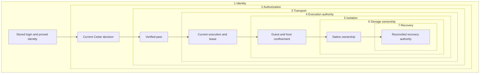

# Security boundaries and sensitive operations

## Agent context and guidance boundaries

[ADR-0178](repo:docs/architecture/decisions/0178-durable-agent-context-and-planning.md)
and [ADR-0179](repo:docs/architecture/decisions/0179-guest-instructions-and-managed-skills.md)
add context checkpoints, collaboration controls and guest guidance. The table
states accepted requirements; final source and executed evidence remain tracked
in the [context review](repo:docs/architecture/reviews/2026-10-16-agent-context-and-planning.md).

| Layer | Allowed operation and expected refusal |
| --- | --- |
| Identity | Current login and account identify the actor; the immutable creator guest identity selects personal configuration. A collaborator cannot switch the thread's configuration owner. |
| Authorization | Current write authority gates mode changes, compaction, question answers and exact proposal implementation. Current management authority gates managed skill configuration. Viewers, stale pages and revoked actors cannot mutate these resources. |
| Transport | Existing authenticated Ziggy and executor paths carry bounded typed operations. Files on the Marshall host and guest-supplied identity claims are not context authority. |
| Execution | Current placement, epoch, lease and executor fence bind guest reads and installations. Generation/frontier comparison rejects stale checkpoint results. Claimed ambiguous provider work is not replayed automatically. |
| Isolation | Plan is an instructional workflow, not a read-only sandbox. Project text, skills and summaries cannot grant tools or bypass VM/profile restrictions. Public fetching has no credentials, hooks, filters, submodules or install scripts. |
| Storage | Agents retains immutable snapshots/checkpoints separately from transcript events. Applied file content, prompts, summaries and skill bodies stay out of diagnostics and accounting. Revisions referenced by admitted work remain retained. |
| Recovery | Restart preserves pending questions and accepted answers. One current answer wins; cancelled, archived or authority-invalid requests refuse. Failed compaction/update preserves the prior checkpoint/revision; pinned restoration and status reconciliation avoid branch drift and blind installation replay. |

Native Linux/Windows path handling, authenticated continuation, live revocation
and independent-host recovery need their own execution evidence. A parser test,
synthetic provider result or browser fixture cannot establish those boundaries.

## Thread sharing and current machine authority

[ADR-0175](repo:docs/architecture/decisions/0175-thread-sharing-and-bound-machine-authority.md)
adds durable task grants that contribute to the currently bound machine's ACL.
Sharing changes must preserve every layer below. No native execution of this new
sharing journey has yet been recorded; focused and historical results retain the
scope in the [sharing review](repo:docs/architecture/reviews/2026-10-16-thread-sharing.md).

| Layer | Authority and required refusal |
| --- | --- |
| Identity | Current stored login and registered, non-retired user identity. Complete case-insensitive email lookup follows thread management authorization; stale login, foreign actor and protected-owner edits refuse. |
| Authorization | Current Cedar viewer/operator/manager thread roles. Only the current binding contributes machine grants. A VM-only recipient cannot read the task; viewers cannot prompt or write, and operators cannot manage thread sharing/lifecycle. VM profile restrictions still apply. |
| Transport | Existing browser TLS, LiveView login hooks and current editor/terminal/SSH/web-ingress admission remain authoritative. A visible link, cached projection or client-supplied role grants no access. |
| Execution | Thread and VM locks serialize sharing with the current binding; machine operations retain execution and host-session fences. An old binding, stale page or retired generation cannot inherit a new share. |
| Isolation | A machine role does not grant another person's terminal session or guest identity. Personal account, editor and shell boundaries remain; sudo-capable writers retain existing guest powers, with no new confidentiality claim inside that VM. |
| Storage | Canonical thread grants and immutable request results are persisted by Threads; VM grants remain separate. Replayed requests cannot restore revoked access, changed inputs conflict, and retired grant/binding history remains retained. |
| Recovery | Grants survive pending/archive/reopen and contribute to a replacement only through its current binding. Revocation removes the thread source; independent VM/team access can remain. Hints accelerate refresh but are not authority or proof of transport closure. |

Thread managers intentionally receive existing VM-management powers, including
creating independent machine grants. Revoking the original thread share does not
revoke those separate grants. Native revocation across active terminal/editor/SSH/web
sessions, cross-node races and physical archive/reopen continuity remain gaps.

The existing terminal viewer rechecks on user/VM hints, input/resize and a
five-second backstop. Editor and SSH renewal use current write authority and
existing thirty-second leases; expiry remains a backstop when hints are lost.
These are source-reviewed revocation paths, not a recorded native closure result
for thread sharing.

## User-run guest coding CLI layers

Codex and Claude Code are ordinary guest processes, separate from Marshall's
platform executor. System provider settings choose Ziggy and verified public CA
trust. Their native approval prompts and command sandboxes are deliberately
disabled for this isolated guest-image use; the guest OS/VM/network/Marshall
boundaries remain the authority boundary. A client configuration or nonsecret
sentinel is not inference authority.
Guest writers retain existing sudo/root capability. The pinned offline image
closure contains no provider secret and opens no additional listener.

| Layer | Authority and required refusal |
| --- | --- |
| Identity | Lilly derives the current VM binding from the pre-NAT guest connection; guest identity/authentication headers and client sentinel cannot fabricate it. Native terminal/SSH entry still requires the existing personal account authority. |
| Authorization | Marshall admits and renews private inference for the current VM. Customer refuses private inference despite installed commands; a model choice cannot enable disabled Anthropic. |
| Transport | Audi terminates verified `llm.internal` TLS and forwards the derived binding privately. Clients use the current guest CA bundle; wrong roots or hostname must fail instead of disabling verification. Ziggy validates exactly empty queries or `beta=true` on native Anthropic Messages/token counting; malformed aliases or OpenAI beta queries refuse before effects. |
| Execution | Current placement, execution epoch and connection authority remain mandatory. Client startup or session restoration cannot revive stale guest authority; interrupted model requests are not automatically replayed by Ziggy. |
| Isolation | Clients run with their guest user's permissions and ordinary local session state. They gain no host provider credential, listener, Marshall tool fence or Customer network exception. No confidentiality from another sudo-capable guest writer is claimed. |
| Storage | Both pinned clients assemble offline. Ubuntu registers the complete runtime closure and retains it through a GC root; image minima absorb growth. Native sessions remain guest-local and new image publication does not rewrite retained disks. Ziggy's bounded metadata spool/accounting remains separate from client sessions. |
| Recovery | A client restart follows native session behavior; Ziggy recovers receipts without replaying inference. Disabled Anthropic returns `provider_unavailable` before admission or provider effects. Updating a bundled client requires a reviewed image input/rebuild rather than a first-boot download or automatic updater. |

The [coding CLI review](repo:docs/architecture/reviews/2026-10-13-native-guest-coding-clis.md)
and [scenario ledger](#coverage) distinguish route properties, packaged guest
execution and isolated fixture inference from production provider acceptance,
sustained load and physical-host fault behavior. Installing the tools alone
establishes none of those runtime boundaries.

Both hosts activated the published coding-client images, but the first NixOS
production canary timed out without inference admission and was fully cleaned
up; Ubuntu creation was not issued. Separate strict public-chain validation and
isolated client tests expose the legacy leaf's rejected extra SAN. Same-root
preparation and independent encrypted replacements preserve offline issuer
custody and all nonleaf host values; they do not establish commit/push,
live replacement or renewed client
acceptance. TLS verification and native client configuration remain unchanged.

## Experimental Antithesis fixture custody

The default control fixture generates synthetic TLS, database, signing,
encryption and host credentials only after container startup into private
runtime volumes. PostgreSQL migration uses the real release; the operator
uses Marshall's reviewed enrollment and rotation CLI for the fixed Lilly
identity. The workload receives a CA, a nonsecret fixture, a read-only Control
credential copy and a SELECT-only PostgreSQL role. Its SQL oracle uses verified
TLS, bound parameters and bounded reads. Missing, malformed or unavailable
oracle replies never count as empty authority state or successful setup.

The identity layer is the generated host identity and enrolled credential;
the authorization layer is Marshall's committed host/session state and the
SELECT-only oracle role. Verified TLS protects Marshall and PostgreSQL reads.
Current v4 Control and fresh report sequence fence the bootstrap claim.
Isolation stops at the controlled container boundary: synthetic pool identities
provide no ZFS ownership or physical capacity, and both controlled and guest
executors refuse unobserved guest and cleanup outcomes. Retained volumes keep
state for restart tests but grant no recovery proof. Setup refuses missing
secrets, failed migration, unavailable endpoint, stale host report, absent
credential or uncertain native effect. The local base control-core setup and
six serial Control commands exercised these fixture layers, with 13 true SDK
assertion records. The stale selected manifest and absence of hosted ingestion
limit that result; native effect refusal and recovery still need separate
evidence in the [foundation review](repo:docs/architecture/reviews/2026-10-13-antithesis-harness-foundation.md).

Optional measured-host enrollment uses a private request and the reviewed
Marshall CLI, binds the issued host/pool identity to the inner ZFS measurement,
and leaves an ambiguous reissue uncertain. Its TCG-specific Lilly ownership
retains root, machine-ID, reserved-UID, global lock and durable host/pool fences
while omitting the native KVM probe. This is source-reviewed only: no composed
Control/guest acceptance follows. The separate router smoke uses a boot-private
release cookie and local ZFS/Brady effects; its loose fixture source filtering
and synthetic peers do not prove production packet attribution.
The private host/guest variant retains no signing key for its public bootstrap
CA; real private roots require same-boot GuestTrust delivery and an exact
durable receipt before private channels can become ready. This is source and
focused adapter-test evidence only. The current measured host sample is
disconnected and execution-unready, with no admitted guest, terminal accounts
or QEMU crash recovery result.
Physical host readiness is measured before private role credentials are issued;
private Ziggy/Audi readiness is checked immediately before a new guest
launch/restart effect. Missing private readiness refuses that effect. Only an
exact matching boot with positive current process proof may be re-observed
without reopening the private readiness gate. This source-reviewed ordering
does not establish a connected private host or a running guest.
The non-serving fixture operator retains the Endpoint only with `server: false`
for WebAuthn origin/RP identity and opened no listener in the recorded diagnostic.
It established three synthetic account/passkey pairs through reviewed Ash
actions; a durable bootstrap marker refuses ambiguous reissue. These credentials
remain private to the fixture and grant no live deployment authority. The
controlled collector reads only its own validated unified cgroup subtree and
ancestors; an unavailable or ambiguous observation withholds the entire report.
The earlier connected host session with zero report sequence could not establish
successful setup. A later project committed a fresh report and emitted setup,
but its nil pool capacity and false execution readiness still refuse guest
admission. The committed effective CPU/memory fields were collector-derived;
raw cgroup file values were not independently compared.

## Privileged administrator continuation layers

ADR-0160 accepts fixed fifteen-minute administrator step-up and exact inline
action continuation for enrolled administrators. No-key administrators visit
Security for first enrollment, return, and explicitly retry. Marshall implements
the fifteen-minute receipt, enrolled-key modal and setup return path. Final
merged packaged checks passed ordinary access, no-key return/explicit retry,
continuation/cancellation/focus restoration and colocated cross-replica revocation.
Native timed expiry and machine-page recovery remain unexecuted. Older tests retain their prior
five-minute/redirect scope. Ordinary signed-in reads remain independent of privileged
authority.

| Layer | Authority and required refusal |
| --- | --- |
| Identity | Current stored login and actor UUID authorize ordinary reads without a passkey. A single-use UV-required ceremony binds login, credential and MFA generation for elevation. Revoked, retired, expired, wrong-session or replayed proof cannot elevate or resume. No-key first enrollment requires email authentication completed within five minutes and grants no administrative action. |
| Authorization | Current persisted administrator role, fixed database-time fifteen-minute receipt and fresh Cedar action after locks. Ordinary users, demoted actors, expired receipts and elevated foreign Customer administrators refuse. Passkey changes require verification of an existing credential; owner-managed SSH keys retain current login and owner checks. |
| Transport | Verified browser TLS, CSRF-protected action capture and fixed ceremony origin/RP. The continuation accepts a canonical server action rather than a caller-supplied event or authority flag; foreign origin, substituted arguments or another tab's continuation cannot authorize it. |
| Execution | One exact actor/login/resource/action/arguments continuation, five-minute expiry and one-use removal before admission; current resource and workflow fences are rechecked. Navigation or reconnect discards it. No-key setup retains only an allowlisted return path; enrollment does not execute the original administrator action. |
| Isolation | Elevation affects only Cedar administrative actions. Customer exact-owner, guest profile, VM placement/boot and host-service separation remain mandatory. Browser step-up never becomes SSH or internal-system authority. |
| Storage | Existing PostgreSQL login, role, credential/account locks and mutation/audit transaction remain authoritative. A pending continuation grants no storage ownership, guest identity or durable-workflow receipt. |
| Recovery | Cancelled, failed, expired or stale continuation refuses without mutation; a new action can begin a new ceremony. An expired non-Customer VM override returns to Fleet workloads with an explanation; resize removes controls and retains its URL draft. Normal owner/sharing access and foreign Customer refusal stay separate. Already committed durable work keeps its existing recovery authority after requester expiry or demotion. Proving-key removal/reset/revocation ends live elevation. |

The [step-up review](repo:docs/architecture/reviews/2026-10-11-privileged-administrator-step-up.md)
records the current evidence boundaries and preferred real-action property plus
NixOS browser acceptance. Hardware authenticators, physical-host separation and
production cutover remain separate. Historical Control room, credential and
Customer tests cannot close the remaining final-snapshot gaps in [coverage](#coverage).

## Personal browser editor layers

The bundled editor permanently refuses built-in AI/Chat capability even under
conflicting settings or direct service calls. All guest folders are trusted by
the worker; users must accept project extension execution before opening them.
Automatic trust does not approve direnv, change egress or grant Marshall access.
The immutable Open VSX baseline is verified and hash-pinned before extraction;
the maintenance updater shares the packaged signature and upstream engine
validators. Failures before lock replacement preserve old bytes; after replacement,
a parent synchronization failure reports durability uncertainty with a complete
new lock potentially visible. It cannot claim rollback or crash durability.
Nineteen recorded developer tests cover artifacts, generated paths/pagination,
closed outputs and this publication boundary with actual source-bundled
signature/engine validation. Native extension execution remains a named gap.
The Nix maintenance gate additionally ran these 19 tests against the final
installed validator and passed Ruff/ty; it still does not prove native isolation.
Per-user controls and separately installed extensions retain their
existing authority. Static package defaults produce no invented audit events.

| Layer | Authority and refusal |
| --- | --- |
| Identity | Current completed stored login and permanent GuestAccount UUID. One-use exchange, host-only cookie and separate personal origins refuse cross-account/replayed proof; retirement loses old authority. Same-User email changes preserve the guest UUID/UID/name/home and editor origin. |
| Authorization | Current Cedar write, plus exact owner for Customer. Viewer/web/revoked roles and elevated foreign administrators cannot open Customer editors. Generic web/public/peer port authority never grants TCP 4444. |
| Transport | Audi public TLS, service-authenticated control, exact unsafe HTTP/WebSocket Origin and fixed callback host. Same-site sibling origins and caller-supplied identity headers refuse before guest contact. Gallery VSIX authenticity uses packaged Ed25519 keys before extraction; local imports remain a separate user decision. |
| Execution | Thirty-second leases bind service generation, host connection session, VM placement/epoch/generation, account, UID/name, release and origin. Expired/closed or changed bindings cannot revive. Lilly binds the dedicated marked gateway path and writes the typed preface. |
| Isolation | Broker binds exact boot IPv4/eth0 and admits only the derived gateway. Worker runs reconciled personal UID on its owner-only Unix socket; no root fallback. Separate browser/webview origins prevent automatic browser-state sharing. Passwordless sudo writers still hold root capability, so no cross-writer OS confidentiality is claimed. |
| Storage | Current manifest v4 binds exact immutable editor package and declared source capability; obsolete/mismatched images refuse. Ubuntu registers and GC-roots the offline closure. Personal home/server/extensions data is never automatically inherited by another account incarnation. Disable state uses upstream browser-profile storage on the separate account origin, without a cross-device synchronization promise; shared builtins remain immutable. |
| Recovery | Broker restart retains independent systemd workers and sockets. Authority loss closes communication without claiming process death. Fresh admission can start a lost worker but cannot revive an old lease; upstream native activity governs idle shutdown. |

Machine-page editor eligibility reuses the validated image/release authority
check and exposes only a finite status after current VM read authorization. A
hidden button or upgrade explanation is presentation; direct opening still
requires fresh stored-login/write/account/execution authority. The active link
requires both desired and observed running state. Valid legacy/noncurrent images
show current-image guidance; missing, malformed or wrong-identity data and invalid
release configuration show temporary unavailability and refuse opening. Catalog
disabling prevents new launches without adding revocation of an already running
matching image.
Creating another machine and copying chosen files preserves the original data;
this operation does not rewrite an old disk's immutable image identity.

SQL-backed Marshall properties/fixed histories and protocol/Lilly/Audi component
checks have scoped evidence in the
[editor review](repo:docs/architecture/reviews/2026-10-10-browser-editor.md).
The NixOS browser fixture uses the real package/broker and synthetic roster/bridge.
Its complete Linux UID/socket/refusal/restart and real browser-tool assertions
passed in 60 seconds, including a positive fresh worker PID after loss and changed
origin replacement preserving files. That
record does not establish full service authentication, packet-mark, boot-trust,
Firecracker or Ubuntu execution.
The complete NixOS journey separately passed real service authentication,
Firecracker tools/custody/recovery, unsafe Origin refusal and sign-out closing
established WebSockets with fresh sign-in recovery. The corrected merged NixOS
snapshot passed these stages again with exact current physical readiness;
historical results retain their original revision. Corrected Ubuntu provisioned
and reached the expected origin but reproduced workbench visibility failure
before those assertions, with runtime cause unproved.
Two-writer native separation, multi-gateway failover and physical host faults
remain explicit gaps in [scenario coverage](#coverage).

The full fleet startup fixture extracts only the current Audi service's immutable
configuration path through its privileged wrapper and rechecks the service PID.
The Audi UID validates that bounded canonical path and both real configuration
and listener entrypoints inside the service's mount namespace. The one-label
refusal clone remains private; diagnostics expose only fixed stage names.
This fixture custody preserves product authority. Both gateways passed this
preflight in the complete NixOS run; no broader production claim follows.

Failed browser journeys may emit only closed document categories and validated
bootstrap/error/connection booleans. Browser messages, URLs, headers, cookies,
document text and WebSocket payloads remain private. The native fixture may
additionally observe fixed broker/worker/socket/refusal booleans after proving
the authenticated current boot and executed root UID, sharing one 30-second
console deadline. Native unit metadata, journal bodies, worker arguments and
terminal bytes are withheld; the only personal Node execution is `--version`.
These read-only observations do not launch editors or retry assertions, and
diagnostic refusal preserves the original failed acceptance. Their source
presence does not prove runtime execution or identify the Ubuntu cause.

Recurring probes hold real operator browser storage only through private runtime
credentials. Their closed fixture must identify a reviewed Markdown probe file
because the journey edits/saves it. The current helper positively checks the
server's unconditional trust-disabled bootstrap without trust-storage injection
or a UI approval action; native extension acceptance separately checks
`workspace.isTrusted`. Fixture review selects disposable content and confers no
Marshall authority or direnv approval. Source supervisor, durable recorder, numeric
reader/exporter and collector intake are separate UIDs/groups. Private browser
output is suppressed; no cookie, URL, path, account ID or fixture field becomes a
metric label. Lost recorder/collector coverage and missing credentials withhold
health, while an owned sixty-second deadline and Linux subreaper cleanup kill and
reap browser descendants and forbid late success. Targets come only from owned
child groups and kernel child lists. A native detached-leaf subprocess regression
passed; production credentials and actual NixOS/Firecracker recurring browser
failure/revocation and recorder/collector faults require separate acceptance.

Chromium configuration/cache lives in private writable temporary directories.
The shared native/recurring helper preserves HOME and inherited data paths,
including the native tester's actual NSS certificate trust. Pinned headless fonts
establish reproducible browser startup, not authentication. The separate Nix
package startup fixture uses its own temporary trust bypass; its passing installed
workbench check does not establish verified native TLS or a Marshall login.

## Continuing physical boot adoption

The public Start action retains Marshall authorization and logical generation
fencing. Lilly must own the placement and prove native VMM confinement before
advancing an existing boot journal to the exact current running intent. Placement
and execution epoch must match, generation cannot regress, and the boot challenge
is preserved. Missing or corrupt evidence cannot mint a boot proof. Current
generation trust/readiness and roster checks remain mandatory. Isolated journal
properties and native repeated-start process continuity passed. The latter does
not establish native foreign/corrupt ownership refusal. Native clone cancellation
with occupied transfer custody and an unpublished destination passed accounting,
restoration and cleanup. The full clone matrix later refused ordinary relocation
with source_unavailable; the observational source preflight grants no authority.
The final complete native clone matrix passed in 1539.61 seconds after the
atomic snapshot and RPC-margin fixture corrections. Earlier refusals remain
historical evidence; native foreign/corrupt boot refusal remains open.

## Native execution proof and observation

Lilly's current verified VMM binding governs execution proof; an observer or
diagnostic event cannot grant authority. Negative observations withdraw proof
without suppressing the existing watcher's genuine exit report. Retaining that
watcher does not renew proof. The longer deadline requires the same armed native
target, and a replacement boot target grants roster-only authority until running
readiness is proved. Unavailable target evidence and delayed old-port messages
cannot extend stale authority. See the [lifecycle boundary](#lifecycle) and
[scoped verification](#coverage); actor fixtures alone do not establish pidfd,
kernel isolation or production acceptance.

The readiness-only ZFS identity event accepts a validated placement UUID and fixed
before/after/rejection atoms. Paths, dataset names, native output and commands are
withheld; ordinary identity/capacity/staging probes stay quiet. A
`parent_accounting` reason follows parent policy-shape success and strict policy
rejection, before later mountpoint/root/pool/backing guards. It supplies no healthy
backing proof, retry classification, ownership, readiness or capacity credit.
Original storage success/refusal checks and attempt bounds remain unchanged.

## Host-effects engine boundary

`lilly-hostd` is the privileged executor of every utility Lilly runs under a lease
([ADR-0176](repo:docs/architecture/decisions/0176-host-concurrency-single-writers-and-effects.md)
decision 4). Its boundary:

- **Peers.** The socket is root-only (`0600` in a `0700` runtime directory). A session
  needs `SO_PEERCRED` uid 0 and a peer process in `/system.slice/lilly.service`, then
  a `Hello` with the exact protocol version. Anything else is closed before any lease
  or command.
- **Closed utilities.** Lilly names a utility by its index in a fixed table. hostd
  resolves each executable once, from its own PATH (Lilly's PATH), runs it with a
  cleared environment and closed stdin, and refuses a mutating utility without a
  lease. Arguments are still Lilly's; typed commands come with the native effects.
- **Paths.** Lock inodes are opened with `openat2(RESOLVE_BENEATH | RESOLVE_NO_SYMLINKS)`
  beneath Lilly's runtime, state and pool roots only. Non-regular, linked,
  wrong-owner or group/world-writable inodes are refused.
- **Diagnostics.** hostd writes no log stream; replies carry closed codes only. Lilly
  emits `lilly.utility_unconfirmed` with the utility, reason, duration and lease id,
  never arguments or output.

- **Unit hardening.** `lilly-hostd.service` and `lilly.service` drop unused
  capabilities from their bounding set (module loading, reboot, clock, syslog,
  audit, MAC, accounting, tty, leases, suspend, immutable files) and set
  `SystemCallArchitectures=native`, `LockPersonality` and `RestrictRealtime`.
  `RestrictSUIDSGID` is deliberately absent: its seccomp filter fails every
  `openat2` with ENOSYS, which refused every hostd lease and kept Lilly from
  starting on both hosts on 2026-10-16. Neither unit gets a mount namespace: hostd mounts guest
  datasets for the host, and with the pool recursively private (ADR-0144) a
  Lilly namespace would not see new guest mounts.

- **Unprivileged mode (off).** `services.lilly.unprivileged` runs the BEAM as
  `lilly` with no capabilities ([ADR-0182](repo:docs/architecture/decisions/0182-unprivileged-lilly-beam.md)).
  hostd then opens Firecracker API and vsock connections (only `api.sock` and
  `v.sock` beneath pool roots) and VM-namespace TCP connections for Lilly and
  passes the descriptors; ZFS delegation gives `lilly` send and receive on
  pool datasets only. It is not enabled on any host and has no native test.

Expected refusals: a wrong uid or cgroup, a version mismatch, an unknown utility, a
mutating utility without a lease, a second command on a busy lease, and a lease
another session holds. Untested gaps: the peer cgroup check reads `/proc/<pid>/cgroup`
after connect rather than through a pidfd, and Lilly and hostd both still run as
root until the privilege drop.

## Retained-state profile rewrite authority

ADR-0159 removed Lilly's one-way retained-profile rewrite after it completed on
both hosts. Lilly reads stored commands only under its live host lock after
persistent command-store host/version validation; a foreign store refuses
startup. No startup step rewrites private state, and the lifecycle envelope
loader validates schema, not all native Dataset bindings.

## Burn notification credentials and refusal

Optional central-host Alertmanager delivery requires an explicitly approved
runtime HTTPS destination. Systemd owns URL and bearer credential loading; private
source files stay outside the Nix store and unprivileged readers must be refused.
Routing requires the reviewed burn name, objective, window, provisional status
and warning severity together. Foreign or mismatched labels select an empty
receiver. Transport verifies system TLS trust, refuses HTTP startup and disables
redirects. Loopback-only HTTP is the local Prometheus-to-Alertmanager boundary;
no cluster listener or public firewall port is opened.

Delivery retries and resolves notifications after receiver recovery. Its custody
does not change guest execution fences, isolation or storage ownership. Upstream
output is suppressed to protect URLs; local metrics expose attempts/failures.
External receipt and survival of central-host failure remain acceptance gaps.
Production destination provisioning is pending; native synthetic fixtures never
become production defaults.

Measurement diagnostics expose only fixed roster identities, numeric counts,
ages and closed status codes. Grafana requires its own operator authentication;
Marshall retains current-session checks for control and security views. Diagnostic
routes and readers are retired from Marshall. Missing/stale source states precede
inactivity, and neither diagnostics nor guest claims authorize execution.
The loopback storage probe uses a separate read-only namespace with only the two
telemetry stores exposed under `/var/lib`; private runtime and configuration are
hidden. It exports aggregate sizes, never names, contents or credentials. Its
root read capability does not confer provider or measurement-writer authority.

Public Grafana at `https://ghuntley.dev:3443/` has a separate operator identity
and authentication boundary. The address-scoped firewall grants reachability;
Grafana login grants dashboard access. Marshall session or VM ownership is not
a Grafana credential. HAProxy requires the configured Host, terminates verified
public TLS, replaces forwarded headers and sends HTTP only over host loopback.
Anonymous dashboard reads and sign-up stay disabled; session cookies are secure.
Private credentials remain in Grafana state, and Prometheus/Tempo are never
exposed directly. Native TLS/login/firewall and production evidence are tracked
in the [public Grafana review](repo:docs/architecture/reviews/2026-10-03-public-grafana.md).

Magic-link email proves mailbox access only when its single-use token reaches
the authenticated POST action. The browser now posts automatically after the
link page connects and requests a remembered credential. A GET-only visitor
does not consume the token; an automated visitor that runs JavaScript may do so.
Stored login, MFA, remembered-login revocation and sign-out remain separate
authority checks. The automatic browser flow has focused HTTP and a recorded
three-replica native browser run; physical-host and real inbox behavior remain
separate acceptance.

Security is enforced in layers. Passing an outer check never substitutes for the
next one. A signed-in user is not automatically a VM owner; an authorized request
is not automatically current execution; a current placement is not proof that a
native disk or process belongs to it.

The nesting describes checks along a sensitive path, not a claim that all services
share one linear call chain. Recovery must reconstruct every relevant layer.
Administrative host root remains a trusted privileged boundary; the guest controls
neither that authority nor the control-plane database.

| Sensitive operation | Required authority and physical boundary | Verification and gap |
| --- | --- | --- |
| Open a magic link and remember this browser | The connected browser submits the single-use token through the CSRF-protected authentication POST; the stored login and remembered credential remain subject to revocation, with passkey proof required separately for privileged operations. Plain GET, invalid and replayed links confer no authority. | [HTTP flow tests](repo:marshall/test/marshall_web/magic_link_flow_test.exs) inspect token preservation, redirect and cookie issuance; the [updated native MFA browser journey](repo:docs/architecture/reviews/2026-10-02-automatic-magic-link.md) passed automatic navigation and remembered-cookie assertion across three colocated replicas under the historical login-MFA policy. Real inbox and JavaScript-capable mail scanners remain outside that run. |
| Deliver fleet diagnostic samples | Retired application ingestion: no route or bearer can grant sample authority, and Marshall keeps no monitor credential or host model (ADR-0159). | A generated [retirement property](repo:marshall/test/marshall_web/diagnostic_retirement_test.exs) asserts 404 without consuming the body. Independent exporter freshness/privacy/native checks are recorded in the [cutover review](repo:docs/architecture/reviews/2026-10-09-observability-decoupling.md); production activation remains separate. |
| Submit guest OpenTelemetry diagnostics | Eligible guest profile reaches Audi private TLS; Audi obtains current Lilly VM/placement/epoch binding and forwards only exact protobuf routes to a Unix socket; Rust receiver checks Audi UID, assigns outer provenance and strips claims before localhost collection. Lyra sends fixed tool counters, duration and an identity-free span only after terminal result acknowledgment. | Audi request-grammar properties, Rust binding/sanitization/chunk properties, Lyra payload properties and the [two-node NixOS test](repo:nix/tests/machines/otel-fleet/default.nix) cover bounded payload shape, socket UID, valid metric forwarding, forged outer-namespace refusal, authenticated collector tunnel, worker scrape loss and queued trace replay after a WireGuard outage. The recorded [real guest journey](repo:nix/tests/machines/fleet/scenarios/agent.py) adds Firecracker guest TLS, current Lilly binding, acknowledged tool result, collector export and an exact trace query at disposable local Tempo. Binding change during upload, customer-profile refusal, guest trace delivery across WireGuard and production collection remain untested. |
| Export Brady candidate SLI | Lilly-derived resolved attribution and validated HTTP admission gate source-owned terminal counters. Brady publishes a private fixed-schema snapshot; a Rust host process checks owner, mode, freshness, arithmetic and monotonicity before OTLP over a restricted local Unix socket. | Brady and Rust generated properties cover outcome arithmetic and file custody. The [NixOS collector fixture](repo:nix/tests/machines/otel-fleet/default.nix) passes exporter delivery, ordinary Brady UID socket refusal and exporter-group trace-queue refusal, but synthesizes the Brady snapshot. A scoped [native Firecracker journey](repo:nix/tests/machines/fleet/scenarios/brady.py) passed request-to-collector export, while its later restart subtest failed; the full gate and measured target remain open, so no fleet compliance rule consumes it. |
| Export Galileo candidate SLI | Marshall authorizes each integration attempt before Galileo counts it. The private Unix `/slo` route exposes fixed cumulative numeric outcomes and duration; a Rust exporter sends them through a Galileo-only collector socket with collector-owned service identity. | A generated [Galileo property](repo:galileo/test/slo_test.exs) checks closed outcome arithmetic and bucket totals. The [service machine test](repo:nix/tests/machines/galileo-service/driver.py) asserts packaged source-to-collector delivery and ordinary UID socket refusal. The full [Firecracker fleet test](repo:nix/tests/machines/fleet/scenarios/galileo.py) passed guest-to-collector export, unchanged denominator after a detached request, relocation and recovery. Failure classification under live revocation, production collection and measured targets remain open. |
| Export Enrico candidate SLI | Enrico counts only unique admitted terminal mirror refreshes in its manager; its owner-only Unix `/slo` route exposes fixed numeric outcomes and duration. A Rust exporter sends them through an Enrico-only collector socket with Nix-owned identity. | A generated [Enrico property](repo:enrico/test/slo_test.exs) checks closed arithmetic and buckets. The [service machine test](repo:nix/tests/machines/enrico-service/driver.py) passed local Git success, duplicate exclusion, outage failure, source-to-collector export and ordinary Enrico UID socket refusal. Cross-host Marshall scheduling, manager-crash accounting, production collection and measured targets remain open. |
| Export Porsche candidate SSH dispatch SLI | Porsche records only eligible terminal SSH command results; invalid and forbidden results are excluded. A mode-0600 private numeric snapshot is read by a Rust exporter and sent through a Porsche-only collector socket with Nix-owned identity. | A generated [Porsche property](repo:porsche/test/slo_test.exs) passed closed arithmetic and refusal exclusion; the [service fixture](repo:nix/tests/machines/porsche-service/default.nix) passed packaged startup, zero-valued snapshot custody, Rust exporter delivery and ordinary UID socket refusal. It has no authorized Marshall-backed command, so full command-to-collector delivery, process-crash accounting, production collection and measured targets remain open. |
| Export Ziggy candidate inference SLI | Durable spool completion is the source outcome; caller cancellations are excluded, and recovered interrupted admissions retain unknown duration. A private numeric snapshot feeds a Rust exporter through a Ziggy-only collector socket with Nix-owned identity. Owned private regular checkpoints preserve totals and source lifetime; invalid schema, arithmetic, custody or uncertain persistence refuses admission and ACKs. Checkpoint creation is unconditional. | Generated [spool histories](repo:ziggy/test/spool_test.exs) preserve acknowledged totals and prevent replay duplication; [checkpoint properties](repo:ziggy/test/slo_checkpoint_test.exs) reject malformed aggregate state. The [service machine fixture](repo:nix/tests/machines/ziggy-service/driver.py) asserts packaged provider responses, source-to-collector export, SIGKILL recovery without provider replay and Audi checkpoint refusal. Native Firecracker, power-loss, live collection and measured targets remain open. |
| Export Audi private candidate transport SLI | Current Lilly binding and TLS identity precede counting. Pre-binding denials and guest OTLP uploads stay outside the denominator. Only a fixed owner-only numeric snapshot enters a Rust exporter and Audi-private-only collector socket with Nix-owned identity. | A generated [Audi property](repo:audi/test/slo_test.exs) checks closed outcomes and fixed buckets; the [two-node fixture](repo:nix/tests/machines/otel-fleet/default.nix) checks exporter delivery and ordinary Audi UID socket refusal using synthetic outcomes. The full native [Galileo machine gate](repo:nix/tests/machines/fleet/scenarios/galileo.py) passed bound source-to-collector delivery, ordinary Audi UID refusal, relocation and recovery. Crash accounting, other private routes and production collection remain open. |
| Export Audi public DNS candidate SLI | Audi DNS alone counts ordinary well-formed in-zone questions after a socket send. Expected NXDOMAIN counts as a completed answer; stale SERVFAIL or send failure does not. The mode-0600 snapshot goes through a DNS-only Rust exporter and collector socket with Nix-owned identity. | Generated [DNS properties](repo:audi/test/dns_server_test.exs) check authoritative and excluded question classes. The [DNS service machine](repo:nix/tests/machines/audi-dns/default.nix) checks real UDP/TCP snapshot accounting and custody; the [two-node collector fixture](repo:nix/tests/machines/otel-fleet/default.nix) checks synthetic export and ordinary DNS UID refusal. Neither test establishes production DNS delivery, crash accounting or measured targets. |
| Export Audi guest SSH candidate SLI | A proved key and valid current Marshall grant precede counting. A failed Lilly connector or guard then counts failure; a connected guest socket and acknowledged SSH exec count success. The public Audi process writes a fixed mode-0640 snapshot for a separate Rust exporter with read-only source-group access and an SSH-only collector socket. | A generated [Audi property](repo:audi/test/slo_test.exs) checks fixed outcome arithmetic. The [two-node fixture](repo:nix/tests/machines/otel-fleet/default.nix) passed synthetic SSH export and ordinary Audi UID socket refusal. The local real-SSH test currently fails in listener setup before its source-boundary assertion. Native authorized guest-to-collector delivery, crash accounting, production collection and measured targets remain open. |
| Export Marshall browser candidate SLI | The browser endpoint counts only requests past privacy, health and early machine-API filters. Its dynamic UID owns a mode-0750 directory and publishes a mode-0640 cumulative snapshot; the static Rust exporter has group read access without directory write, and alone holds the Marshall-only collector group and Nix-supplied replica identity. | A generated [Marshall property and endpoint test](repo:marshall/test/marshall/slo_test.exs) check closed outcomes, private metadata exclusion, health refusal and completed 404 counting. The [two-node collector fixture](repo:nix/tests/machines/otel-fleet/default.nix) tests synthetic export and custody refusal. The [packaged Marshall check](repo:nix/tests/machines/otel-marshall/default.nix) passed a real HTTPS 404 through source snapshot, Rust exporter and collector. Signed-in browser traffic, crash accounting and live collection remain open. |
| Read fleet telemetry objectives | Grafana operator authentication protects Nix-provisioned objectives and burn panels. Prometheus enforces source lifetime, cadence and elapsed retained-history guards. Missing history remains unknown; diagnostics confer no control or accounting authority. Marshall's `/admin/slos` reader is retired. | The [Prometheus fixtures](repo:nix/tests/evaluation/otel-slo-rules.nix) check closed source arithmetic and coverage guards. [Retirement properties](repo:marshall/test/marshall_web/diagnostic_retirement_test.exs) refuse obsolete ingestion. Historical Marshall parser/browser evidence remains scoped to its archived revision; production targets and live dashboard acceptance remain open. |
| Read Grafana candidate dashboard | The Grafana backend binds Overalls loopback; the optional public HTTPS frontend retains a separate Grafana operator identity. Marshall login and guest headers grant no query authority. Candidate panels repeat trusted source/history guards before displaying recordings. | The [two-node NixOS fixture](repo:nix/tests/machines/otel-fleet/default.nix) checks configured operator admission, wrong-password refusal, worker-node loopback refusal and provisioned panels. The [Prometheus fixture](repo:nix/tests/evaluation/otel-slo-rules.nix) withholds a retained ratio during source warmup. External operator login and measured production compliance remain separate. |
| Read handbook sections | Current completed login; administrator membership is unnecessary | Generated chapter histories reject revoked, expired and deleted logins. The native fixture asserts the persisted reader remains ordinary and checks revoked mounted navigation and a fresh deep link; see [execution scope](#coverage). Cross-replica and hardware-authenticator acceptance remain separate. |
| Login, passkey enrollment, elevation, remembered browser resume/revocation | Current login; single-use, session-bound verified ceremony | Generated independent-login histories and signed ceremonies; recorded native virtual-WebAuthn subsequent magic-link and remembered login, administrator revocation across three colocated serving replicas, and copied-cookie refusal for enrolled and no-MFA accounts in the [subsequent-login review](repo:docs/architecture/reviews/2026-09-25-mfa-login-verification.md). Independent physical hosts, hardware authenticators and production rollout remain external acceptance |
| Read fleet metadata / change administration | Signed-in redacted read; separate current admin plus elevation for mutation | Generated current-role/session histories and a recorded native browser read/mutation journey; see the [verification review](repo:docs/architecture/reviews/2026-09-25-control-room-verification.md). Native session revocation across three colocated replicas is recorded in the [subsequent-login review](repo:docs/architecture/reviews/2026-09-25-mfa-login-verification.md); other mutation families and populated drill-down pages remain gaps |
| Change account role, reset MFA or revoke browser authority | Current elevated actor held through audit commit; installation latch, retirement fence and sorted actor/target User rows | Recorded independent histories and three-Marshall schedules cover all five account mutation families, both elevation-lock/sign-out orders, ungated completed revocation and sorted consumer liveness. A generated [Cedar owner-resource property](repo:marshall/test/marshall/authorization/cedar_test.exs) additionally checks that VM, team and integration actions refuse resources missing their owner attribute; it does not exercise database faults at Ash callers. Captured native reset and five stale mounted mutation refusals pass with verified TLS and virtual WebAuthn; see exact source attribution in the [account authority review](repo:docs/architecture/reviews/2026-09-25-admin-account-authority-verification.md). Physical authenticators, production rollout and mail delivery remain separate. |
| Read fleet diagnostic logs | Grafana authentication and reader-only `/select/*` credentials held by its systemd service; verified TLS to the fleet-network store. Restricted host audit, crash and guest classes remain outside this destination. | The [log-store machine test](repo:nix/tests/machines/log-store/default.nix) checks authenticated ingestion, scope refusal, queued backfill and provisioned Grafana reads. Marshall has no reader credential or log route. External Grafana login and CA rotation acceptance remain separate. |
| Inspect and retry background jobs | Signed-in redacted reads; current elevated administrator, actor account and raw-job locks, actor/request receipt | Generated exact history/refusal models and three independent BEAM schedules cover elevation lock, sign-out, demotion, raw transition and pruning. A generated [projection property](repo:marshall/test/marshall/administration/jobs_test.exs) checks exact safe keys and secret exclusion across mixed raw job states, then refuses a revoked ordinary reader. Captured native packaged SMTP/browser execution passed real failed-worker retry, exact receipt, current-authority refusals, retained pruning history and mounted/fresh reader revocation in 65.85 seconds; see the [job-history review](repo:docs/architecture/reviews/2026-09-25-job-history-verification.md). Other projection families, throughput, inbox delivery and production rollout remain separate. |
| Invite and retire accounts | Verified identity; current admin and passkey elevation; typed confirmation; old-UUID physical cleanup; permanent retired GuestAccount UUID/UID reservations | Complete current NixOS and Ubuntu generated-identity lifecycles passed retirement stream closure, fresh same-email/no inheritance, physical cleanup, shared storage/process retention and reserved-home/explicit sharing. Historical email-derived results retain their scope. Retained disks, restore reconciliation and deployment remain separately classified in [coverage](#coverage). SMTP delivery and team overlap retain their existing scopes. |
| Grant/revoke sharing, team transfer | Current Cedar action and persisted ownership/membership | Recorded generated team role/consent histories and NixOS browser transfer/removal reject owner replacement and stale page authority. Full public retirement has mutation-sensitive three-Marshall overlap checks. Recorded ordinary-account native shared SSH/integration transitions verify member use, management/foreign/Customer refusal, retained home after restart and removal/re-addition with exact unauthorized evidence. Terminal/agent-specific team journeys and existing SSH session termination remain separate; see [scenario evidence](#coverage). |
| Create or retry a team | Unique active name and current original-creator ownership | Recorded creation properties, three-node commits and native ordinary-account browser refusals; Recorded HTTP receipt histories also preserve archived identity without restoring membership; recorded packaged CLI execution covers permanent refusals and transfer/removal, while native archival and shared VM/integration access remain separate |
| Install CLI and management SSH trust | HTTPS-delivered operator pin, strict ED25519 management peer, registered-key account proof | Generated malformed/reordered trust properties and focused native Linux bootstrap; final guest connection and macOS remain separate |
| Discover and allocate a guest identity | Current stored User UUID and registered-key management session, or current browser/Cedar terminal authority; immutable guest UUID/UID, `u<uid>` login and `/home/u<uid>`; sorted User locks and permanent reservations | Recorded database/property and migration checks preserve allocation across email edits, retirement reservations and exhaustion refusals. Complete NixOS SSH, both lifecycle journeys and the Ubuntu email-continuity subtest passed canonical-account checks. Complete Ubuntu SSH, native editor continuity and retained-disk/restore acceptance remain separate in the [durable identity review](repo:docs/architecture/reviews/2026-10-10-durable-guest-identities.md). |
| Private guest browser web and team withdrawal | Current stored login, direct grant or team membership, exact host cookie, verified Audi/Lilly transport and current execution with request-start lease | Generated authority histories and a dedicated native original HTTP/WebSocket closure journey are tracked in the [private web review](repo:docs/architecture/reviews/2026-09-25-private-web-verification.md). The native journey observes original closure before re-addition, then checks fresh HTTP recovery and unchanged closed transport counters. Independent physical hosts, direct-grant native withdrawal and production rollout remain separate. |
| Guest SSH, terminal input, web ingress | Current grant plus key/account/boot/placement; terminal creator and issued mode, renewable authority where applicable. The ingress catalog parser refuses a snapshot TTL above five seconds; ordinary web/SSH leases have a separate thirty-second ceiling and nested grants remain publication-bound. | Native SSH, revocation, browser and ingress scenarios retain their captured scope. The catalog decoder has 5,000/5,001/30,000 ms boundary cases in source; its new consumer gates and live route withdrawal are unrecorded. Terminal [attachment histories](repo:docs/architecture/reviews/2026-09-26-terminal-attachment-verification.md) use real WebSock lifetimes and synthetic relay dispatch, with immediate input/resize checks and one-second idle authority checks. Personal-account and retained-disk rollout scope remains separate. |
| Register or approve an SSH key during retirement | Current account admission held through the outer registration/approval transaction; completed cleanup belongs to the retired UUID | Generated same-email histories and three independent local Marshall processes verify both orders, exact audit/approval/session state and explicit fresh fingerprint reuse. Existing native registration and retirement journeys do not establish this concurrent transport schedule; see the [credential review](repo:docs/architecture/reviews/2026-09-25-credential-lifecycle-verification.md). |
| Resize and retry | Current owner/manager, retained generation/request identity, matched physical shape evidence | Generated histories cover revoked manager replays, unknown effects and held allocations; the [browser/guest journey](repo:docs/architecture/reviews/2026-09-25-resize-verification.md) records exact runtime scope and remaining distribution/interruption limits |
| Clone, cancel and retry | Current requester manage/provision permission at admission; persisted physical recovery after admission; publication/cancellation serialization | Generated real-action histories and observed three-Marshall schedules cover stale manager actions, cancellation/retry identity and both commit orders. The [clone review](repo:docs/architecture/reviews/2026-09-25-clone-cancellation-verification.md) distinguishes synthetic receipts from native browser, guest and reclamation scope. Inception, arbitrary interruptions and independent physical failures remain separate. |
| Launch a repository workspace | Extension and capture discard source queries/fragments before transmission or browser storage/POST; URL user information refuses and raw manual authority/path remains strict backend input. Public CSRF capture grants no authority; current ordinary stored login or registered-key Porsche session, ordinary provision authority, source2 provider grammar, egress profile and manifest4 source2 capability precede allocation. Every new provision/start snapshot derives its source from the durable VM and matches its retained immutable image; supplied resize snapshots grant no source or image authority. Lilly delivery binds current placement/epoch/challenge/nonce | Missing/expired capture, revoked login, invalid source and absent/obsolete/mismatched image refuse. Completion clears only matching input after current owner/read check. Unavailable restart capability preserves valid physical proof and reports, releases confirmed compute and retains disk/address; confirmed resize completes with a fixed failure so cleanup remains possible. Incoming frozen browser-feature NixOS passed cross-tab sign-in/MFA under the historical login policy, all twenty local-provider checkout cases, retained restart, public downloads and packaged CLI; Ubuntu and latest combined source2/generated-identity acceptance remain separate in [scenario coverage](#coverage). Fixed installed-CA API diagnostics expose stages/indices/exit/status without terminal or response bytes and supplement authoritative guest done/HEAD assertions. Capture privacy sentinel/storage/POST browser assertions, live provider/Brady interception and production cutover remain separate. Drive-by one-OSS-VM-per-authorized-visit creation remains accepted under ADR-0157. |
| Download a browser launcher | Public fixed-name GET from the selected canonical immutable Nix-store package; real root/bin directories, bounded regular artifacts and matching digest/length metadata. Extension launch requires explicit configured server and toolbar click; only provider origin/path is sent after source query/fragment removal | Unknown names, arbitrary roots, symlink roots/parents/files, malformed metadata, length mismatches and unavailable files return404. Developer packages are unsigned; Firefox permanent installation and current guest/MFA/cross-tab runtime remain separate evidence. No credential, page content or diagnostic source URL is collected. |
| Start, move, delete | Authorized intent plus current fences, native ownership and receipts | State-history properties and native workflow tests; arbitrary interruption sequences and physical-host failures remain gaps |
| Customer traffic / agent tools | Profile policy at admission and execution; network and tool boundaries | Customer and tool-matrix properties plus native paths; combined hostile-tool/native profile matrix is incomplete |
| Recover a failed guest CLI candidate | Immutable seed, saved executable identity, verified staged digest and fresh current VM executor fence | Generated actual-supervisor processes restore prior bytes/inode after failed starts and registration. Synthetic ready receipts establish no transport or Marshall authority. The strict native NixOS journey passed invalid-format/registration-timeout recovery, fresh fences and real shared-operator tool work; direct candidate injection bypasses delivery. Private delivery retains historical NixOS/Ubuntu scope. Ubuntu failure/drain and power-loss/I/O remain gaps. Registration cannot attest guest integrity or authorize semantic rollback. |
| Browser-approved agent CLI | Explicit current-browser digest approval; independent one-hour secret, current account/VM write permission, exact machine/thread, bounded verified HTTPS, then real model/guest fences | Generated histories and a captured ordinary-browser/packaged-CLI/native guest journey passed with exact scope in the [CLI review](repo:docs/architecture/reviews/2026-09-25-agent-cli-verification.md). GET/digest/stale-form and withdrawn/retired/expired authority refuse. Browser sign-out alone does not revoke existing independent CLI authority. An earlier executor interruption remains unexplained; the capture predates the later Underclass pin. Physical hosts, Ubuntu and live providers remain separate. |
| Create with an omitted or explicit profile | Current user, pinned request inputs, persisted profile and native guest filtering | Generated default/retry/draft histories and the [native default-profile journey](repo:docs/architecture/reviews/2026-09-25-default-oss-verification.md) pass ordinary-user browser/Porsche creation, OSS sharing and egress controls, and explicit Customer refusals. Unauthorized admission, hostile tool execution and the broader packet matrix remain separate |
| Integration credentials / peer requests | Write-only secret custody; attachment policy; current provenance token | Native detach, peer and outage cases; external upstream behavior is outside fixture evidence |
| Register, refresh, remove or browse a Git mirror | Current admin/elevation held through catalog mutation; stored browser login and current registration for reads; exact current attempt for publication | Recorded generated public histories and six three-process schedules cover stale authority/results, retained head and removed handles. The captured packaged browser journey passed virtual passkey elevation, ordinary reads, source outage retention, anonymous/stale refusal, audit attribution and cache deletion. Physical tunnel, ZFS quota, cache pressure and physical authenticators remain separate. |
| Host enrollment / key rotation | Pinned administrative transport, authenticated identity, private output custody | Native custody and rotation suites; provider IAM and independent recovery-key custody need deployment drills |
| Unattended host candidate compatibility | Trusted root-owned configuration; retain database/cookie/token authority, active encryption key and every serving process's decryption keys | Recorded generated addition/reorder/refusal/corrected-retry histories run actual compatibility and preflight, including all-serving conjunction and inactive fallback. Closed local seams preserve fixture files but do not establish systemd discovery, staging, migration or activation; see the [updater review](repo:docs/architecture/reviews/2026-09-26-updater-compatibility-histories.md). Historical native update/rotation scopes remain separate. |
| Storage reclamation / backup restore | GUIDs, locks, journals, complete manifests, matching keyring and private empty restore targets | Historical native storage/restore checks retain their scope. The [operator review](repo:docs/architecture/reviews/2026-09-26-backup-operator-verification.md) separately records local encrypted Restic histories for retained-reference refusal, host locks, unsafe/nonempty targets and explicit recovery after partial output. Historical fleet authority reactivation lacks complete automated acceptance. |

Personal integration admission requires an explicit source attachment even for
the owner. Current owning-team membership remains an independent team path.
Neither bypasses owner/team liveness, Customer exclusion or execution fences.
Generated histories verify refused management leaves mutation audit and durable
state unchanged, and actual account retirement/removal withdraw prior admission.
The packaged HTTP/1 lease guardian interrupts blocked frontend I/O by closing
the native socket while preserving request-owner cleanup. Its isolated upload
fault test measures EOF/reset and no retries; production timing and broader
connect/response fault permutations remain distinct gaps.

The [scenario ledger](#coverage) names the exact test artifacts, inspected assertion,
evidence type, execution record where available, scope, and missing preferred tests.
A test's existence is not a passing result. A passing mock or unit test is not proof
that a kernel, TLS endpoint, native VM, or physical recovery boundary held.

The [verification campaign](repo:docs/verification-campaign.md) tracks a current
base-fleet fixture gap: seven catalog variants select images without an enabled
boot-trust receiver while Lilly requires a trust receipt. Historical passes keep
their original revision and scope; they do not establish current fixture
acceptance. The default-profile journey selects the existing complete private
service fixture. Shared NixOS and Ubuntu fixture repair is campaign 011.

For every changed sensitive operation, document the permitted path and the expected
refusal: unauthorized identity, stale grant, expired lease, wrong boot/generation,
foreign storage, or unavailable authority. Add or update NixOS machine integration
tests and property-based tests where feasible. If either is absent, state why and
name the required next test. Never replace an explicit security gap with “covered”
because nearby tests pass.

SSH host issuance authenticates service credentials or a physically bound guest
boot before signing an authoritative principal. A valid host certificate still
requires the user's proved registered key and current Cedar grant. The shared
CA private key never reaches Audi, Porsche, images or guests. Ephemeral per-boot
leaf keys prevent cloned disks from sharing host identity. Native transport tests
exercise certificate negotiation, rekey, principal rejection and CA revocation;
full installer, reboot, clone and relocation acceptance remains separately
tracked in the scenario ledger.

Integration renewals repeat current source ownership, membership and attachment
checks and return only a TTL. The [supporting services](#services) chapter
records generated/three-replica authority checks and captured native
live membership/attachment withdrawal with actual socket closure and no retry. A peer provenance token remains one-use metadata;
it never grants target ingress admission or routing authority.

Guest identity discovery may durably allocate before the user owns a VM. Repeated
discovery reuses that identity; it grants no VM access. Fresh UUIDs require new
credentials and explicit grants. A distinct username, UID and home prevents
automatic inheritance, while authorized guest writers retain passwordless sudo.
Historical homes are not confidential from newly authorized guest administrators.
Same-User email changes are labels at this boundary and preserve its guest
UUID/UID/name/home. Historical database restore remains unsupported until all
retained reservation and sequence state is reconciled; see [recovery](#recovery).

## Maintenance control authority

Evacuation user controls retain current administrator, login and passkey elevation
through the same transaction as the campaign/item change and redacted audit.
Host, campaign and relevant VM locks precede actor User retention. Already admitted
campaign moves survive later requester demotion; pause blocks new admissions only.
Generated and three-process checks distinguish overlapping revocation from fresh
requests begun after completed revocation. The bounded native browser campaign
also passes ordinary refusal, real passkey elevation, running/stopped movement,
physical source cleanup and fresh-elevation resume. Its capture and wider gaps
remain explicit in [scenario coverage](#coverage).

## Operator encrypted-document custody

Recovery membership authorizes every inventoried document; host membership is
scoped to selected documents. Login-only users and nonselected hosts have no
recipient authority. Rekey requires an explicitly supplied retained recovery
identity, keeps private conversion files outside the checkout/store and cleans
them up after ordinary success or failure. Runtime bundle preparation remains a
separate privileged systemd boundary.

The [recipient-history review](repo:docs/architecture/reviews/2026-09-26-secret-recipient-histories.md)
records independent actual decryption controls and exact refusal/retry inventories.
Bounded interruption may leave completed documents published; a reported possibly
updated document requires inspection and explicit retry. Native custody/rotation
records retain their original scope. These checks cannot revoke previously learned
plaintext or establish recovery-key availability after physical loss.

## Internal service TLS trust

Fleet clients, Porsche, Audi, Lilly and the public proxy verify Marshall's
backend at `ghuntley.dev` (ports 4443/5443) against
`/etc/overalls/service-ca.crt`; Marshall verifies local PostgreSQL (`localhost`)
against the same file. The file holds a single internal CA whose key exists
only in recovery-only custody (`service-ca-recovery`); it signs both leaves.
A client presenting any other name is refused, and nothing trusts the retired
`overalls` CA. Rotation replaces the CA, both leaves and the bundle in one
change, so a host still on the previous bundle cannot verify Marshall until it
activates. No automated test exercises the bundle; live validation is a verified
`openssl s_client` handshake and healthy updater activation on both hosts.

## Public HTTP-01 listener

Overalls admits TCP 80 on the proxy address from any source (ADR-0181) so the
public CA can validate `ghuntley.dev`. The listener answers only challenge
lookups for that host and permanent HTTPS redirects; other hosts and paths get
no Marshall route, and it holds no certificate key. HTTPS on 443 and all other
proxy, Porsche and administrative listeners stay limited to reviewed sources,
the tailnet or the fleet tunnel. Expected refusal: a request for any other
`Host` gets 421, and a non-GET challenge request gets 405. Evaluation cases in
`public-grafana-configuration` assert the opt-in rule and built successfully;
live issuance and HAProxy start were observed on 2026-10-16. No machine test
exercises public port 80 yet.

## Sealed image authority

Template-backed image verification relies on trusted host ownership, a local
creation nonce, exact dataset GUID, a read-only ZFS seal, native reader exclusion
and nanosecond artifact identities. File timestamps alone do not prove arbitrary
privileged tampering absent. Warm use refuses changed seals and identities; it
does not trust a path or image name alone. The Rust helper has no setuid bit or
capabilities and receives authority only from Lilly's existing native lock owner.
Lilly accepts its launch guard and boot-log writer only as separate trusted local
executables. Their Nix release links may span multiple packages; executable and
ancestor-directory links must be root-owned and bounded, and the final executable
must have trusted ownership, ancestry and mode. Missing or excessive links
refuse startup.
Template diagnostics leave the native postcommit boundary through the independent
observability plane. Validated host/pool/record identities support correlation;
no trace, timestamp or historical event can create a placement, prove current
readiness or release capacity commitments.

The [post-import cache fixture](repo:nix/tests/machines/zfs-guest/template-post-import.exs)
preserves exact sealed identity, including the native device field. A device-only
change must refuse reuse; supported fenced retirement and full hashing produce a
distinct ready incarnation rather than revive a quarantined one. Its cache action
grants no placement, intent, launch-attempt or boot authority and changes no
production recovery or terminal Executor refusal. Retained-state inspection
demonstrated this strict refusal after another import, but did not capture the
original failure instant. The complete corrected Ubuntu suite exercised exact
reuse in the new action; focused current NixOS also passed exact reuse and ordinary
neighbour cleanup in its current packaged prefix. Device-only replacement remains
unexecuted in both runs, as scoped in the
[native guest review](repo:docs/architecture/reviews/2026-10-13-native-guest-coding-clis.md).

## Agent loss and retry authority

Executor replacement fences old results before new work. A started command has
an uncertain outcome after loss and cannot be automatically replayed. Explicit
retry needs a new request identity and current account/VM write authority; a
previous CLI approval is insufficient after sharing withdrawal. The
[executor-loss review](repo:docs/architecture/reviews/2026-09-26-executor-loss-histories.md)
separates synthetic binding/expiry histories from actual guest effect and process
interruption. The captured native started-loss fixture passed once; pre-start
native interruption and the earlier unexplained CLI failure remain outside this
evidence.

### Clone observation diagnostic boundary

Only the disposable clone-cancellation fixture can interpose the ZFS observation
recorder. Its literal argv allowlist contains the public properties used by Lilly's
whole-pool observer and the fixed `zroot/lilly` root. Ownership properties, receive
tokens, other arguments and all mutation commands execute directly without capture.
It retains at most 128 completed samples per host, each with at most 64 KiB from
each stream, explicit byte counts and truncation flags. Files are private beneath
a mode-0700 root, with one bounded staging file during atomic replacement. Native
output and status reach Lilly unchanged; no sample enters application events.

On failure the driver disarms recording, synchronizes publication and copies rings
to private directories outside the Nix output before teardown. Failed-build retention
and private extraction are required to preserve them; successful runs discard rings.
The disposable executable checks cover exclusion, byte/status/signal preservation,
bounds and persistence failure. They do not establish native accounting behavior,
physical isolation or cancellation acceptance. Existing readiness, ownership,
capacity and pool-lock authority remain mandatory.

The recorder's native child inherits the pool lock descriptor and original process
group. A parent-death fence with a parent identity check, bounded signal/pipe-error
reaping and nonblocking persistence preserve custody. Partial arming also cleans
both hosts. A clone-only build seam privately captures the exact validated snapshot
GUID map passed to readiness, bounded to eight bindings and 4096 bytes. Its native
owner PID selects the context file; each sample distinguishes present, missing,
invalid and changed context. The unchanged observer runs once with the original
arguments and result, and `after` removes context. Replaying accounting requires
that exact map and frozen pool identity. The recorded instrumented run collected
six complete native reads before a queued activation refusal; every sample lacked
readiness context. It establishes bounded collection, not readiness-map pairing,
accounting replay or cancellation acceptance. After verified process shutdown,
offline analysis used private copies of the retained disposable database and left
the original image unchanged. Only finite failure and predicate projections leave
that boundary. The fixture's new activation wait observes real fresh receipts and
settled operations; it grants no authority and does not relax production guards.

The ninth native capture failed initial host admission before recording or clone
activation. Its private offline database copy retained three accepted reports,
correct host/storage identities and no VMs or clone requests. Rejected report
bodies and their validation clock were not retained; accepted sample timing does
not establish their failed predicate or overload causality. The original image
remains unchanged; admission and complete cancellation acceptance remain pending.

### Clone report rejection diagnostic boundary

Only the disposable clone-cancellation Marshall release contains the report-guard
instrumenter and private sink. Build-time hashes pin both the authenticated caller
and guarded source; production releases remain unchanged. Original conditions,
short circuits, one evaluation per predicate, database time, rollback and public
refusal results remain intact. The sink records only one of eleven fixed stages
and signed sample age; malformed shape has null age. No report body, host identity,
credential, raw state or committed-outcome event leaves the guard.

Each replica retains its first rejection per stage and armed interval, bounded to
eleven private 160-byte files plus eleven equally bounded staging files under a
mode-0700 runtime directory. The driver arms before admission and around cloning,
then disarms and drains publication before copying failure evidence outside Nix
outputs. This evidence survives rollback but provides neither a rejected-report
timeline nor host attribution. Disabled or failed persistence preserves validation
results. Synthetic authenticated-exchange and concurrent sink tests pass; native
admission, installed artifact qualification and complete cancellation remain pending.

## Foreign and native guest-family boundaries

Arch Linux and AlmaLinux remain Linux guests for authorization and isolation:
their catalog marker changes image identity, not the kernel guest agent, trust,
network guard, storage ownership or recovery boundary. The builder evaluation
does not establish runtime isolation or distribution-native security behavior.

The protocol's native FreeBSD and OmniOS rows (`freebsd-v1` and `illumos-v1`)
are contract declarations only. Preliminary image packages and catalog entries
exist, but the rolling FreeBSD source endpoint is retired and replaced by a
checksum-pinned archive capture; no successful native output has been recorded.
They currently expose the same capability flags as Windows
agents, but no native agent, boot, readiness, terminal, workspace, SSH, recovery
or fleet result exists. Lilly must select transport
from validated metadata, reject cross-OS agent sets and preserve the jailer,
seccomp, per-tap guard and ZFS boundaries. OmniOS's `illumos` wire name remains
unsettled and must not be treated as production support.

## Windows guest boundaries

The firmware-booted Windows image ([ADR-0169](repo:docs/architecture/decisions/0169-firmware-booted-windows-guests.md),
[ADR-0170](repo:docs/architecture/decisions/0170-lilly-firmware-guest-launch.md)) is a
launchable guest without agents, and that is the boundary to keep explicit.
Identity: the image carries a documented bootstrap Administrator password and
no account roster; nothing maps it onto GuestAccount identities. The placement
identity (placement, execution epoch, boot challenge, address, gateway, MAC)
reaches the guest through Firecracker's MMDS, seeded from a jail-local
root-owned file before launch; it is the same identity a Linux guest reads from
its kernel command line, so nothing new is exposed. Authorization: the protocol
admits exactly the eight-key version-5 manifest with the agent set `none` or
`windows-v1`; every surface reads one authority, the protocol's capability
table ([ADR-0171](repo:docs/architecture/decisions/0171-windows-guest-agents.md)),
through Marshall's per-capability image facts and Lilly's driver: for `none`
Marshall refuses terminals, agent turns, the agent executor, web search and SSH
connection details, refuses the Inception profile and measures only the
physical service level, and Lilly refuses readiness, terminals, workspace
sources and Inception and reports the VM running but never `guest_ready`; for
`windows-v1` the same gates open only for the capabilities the table grants
(never the editor or Inception), and readiness, trust, terminals and workspace
delivery still require the guest to answer the boot-bound vsock protocols, so a
guest without working agents earns nothing. A missing, corrupt or mismatched
manifest yields every capability false. Transport: through Lilly the guest runs
under the jailer, seccomp observation and the per-tap nftables guard like any
Linux guest; MMDS frames never leave the VMM; the vsock device exists in the
jail only for an agent set that speaks the protocols, and the guest side is the
virtio-win `viosock` driver whose address family the agents discover rather than
assume. The gate 1 probe runs as SYSTEM, carries no identity or credential
material and publishes only its own log. The gate 2 daemons run as SYSTEM
tasks: the readiness daemon answers only host CID 2 after live probes and
ingests nothing from the peer; the trust daemon installs only a host request
that names this exact boot and whose roots parse and match their digest, writes
the bundle whole before naming it current, and never acknowledges a failed
installation; both re-read MMDS with a fresh session token that is never logged
or persisted, and the per-boot UUID lives only in a volatile registry key. SSH
on a Windows guest (gate 3) is public-key only: the roster agent pulls the
writers' registered keys from Marshall through the private route and writes one
SYSTEM-owned key file per account that only that account can read, so a user's
key opens only that user's account; passwords are random and never recorded;
`sshd` starts only after the first applied roster and serves a per-boot host
certificate. Unlike Linux, acceptance is not bound to the live Audi session
(Win32-OpenSSH cannot ask per connection); Audi's ingress remains the only path
to port 22 and still authenticates the outer session. Login receipts come
from sshd's file log, matched by fingerprint to the pulled keys and reported to
the same Marshall authority as Linux logins; the bootstrap Administrator is
retired (random unrecorded password, disabled) once a roster account exists, so
the SAC serial login of ADR-0169 stops working on guests with agents. The
terminal daemon (gate 4) keeps the Linux terminald boundaries: host CID only,
a HELLO bound to this boot's challenge, placement and epoch (read from MMDS),
128-bit attach tokens and no terminal bytes in logs. Its `root` session is
LocalSystem, the Windows form of the host-admin PTY; every other session runs
under an S4U logon of an enabled roster account, and an unknown or disabled
name is refused rather than mapped to another identity. Each session's
processes live in a kill-on-close job, so kill and retirement end
descendants too. The operator launcher without those
boundaries remains a spike tool and is not Lilly's path. Execution
fencing and isolation: the VMM patches widen the vCPU seccomp filter by one
ioctl (`KVM_IOEVENTFD`) and add read-only devices and CPUID leaves; the Nix
sandbox keeps the installation offline. Storage: the raw GPT disk fills the
ordinary `rootfs.ext4` slot of a per-VM dataset through the verified copy
path. Recovery: restart adopts from the portable bundle without the image, as
for Linux guests; a broken guest is otherwise discarded.

Sensitive operations and expected refusals: the Special Administration Console
on COM1 accepts an interactive login, unlike the Linux `no-serial-login-shell`
contract. For the agentless image this remains a recorded gap; the `windows-v1`
roster agent rotates the bootstrap Administrator to a random unrecorded password
and disables it after the first activated roster account (ADR-0171 gate 3).
The guest bootstrap runs as SYSTEM, reads
only MMDS, validates every field (including the adapter MAC) and never logs the
session token or boot challenge. The evaluation-ISO build must never be pointed
at production media without the licence review in `iso.json`.

Untested gaps: Hyper-V synthetic timers are not emulated and timekeeping under
load is unobserved; `C:` growth after a host-side extension is only known to
leave a bootable guest. The host policy drops unmarked
traffic between the host and a Customer guest by design, so the machine test's
reachability probe is a test-only allowance for one address, never a product
path or a Marshall observation.

## Thread authorization boundary

Thread reads require current creator, team or canonical thread-grant authority. Creation checks
current team membership before Compute admission; prompting, terminal access,
archive and deletion recheck current machine/Cedar authority. A foreign thread
ID, removed team membership, stale mounted session, failed provisioning state or
archived machine must refuse prompt and terminal mutations. A current authorized
reader can still read an archived thread and its transcript;
the transcript helper validates that the retained agent thread belongs to the
bound root before reading events. Archive, delete and reopen require current
thread-management authority, including manager grants. Reopen clears the retired binding and
uses a fresh machine key; stale provision jobs cannot mutate that generation.
Previous transcript generations remain retained but lack a user-facing retrieval
path after reopen. Thread diagnostics contain only thread identifiers and closed
outcome atoms; objective text, model content,
terminal bytes, machine payloads and credentials remain in authorized data.
