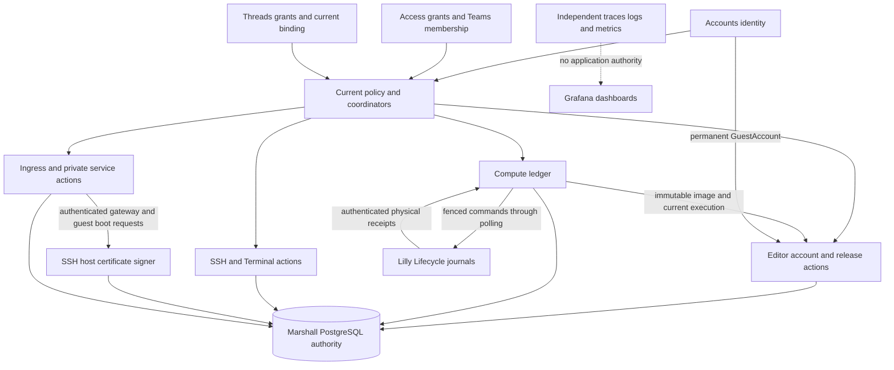
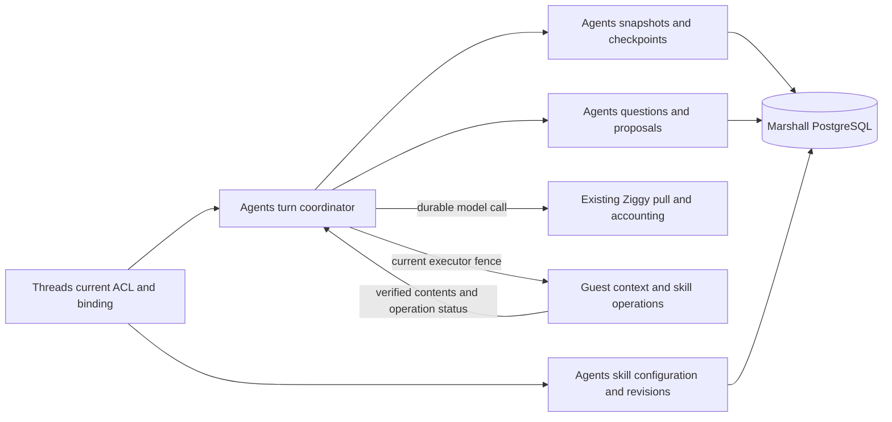
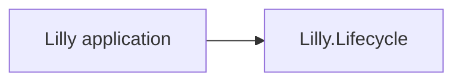
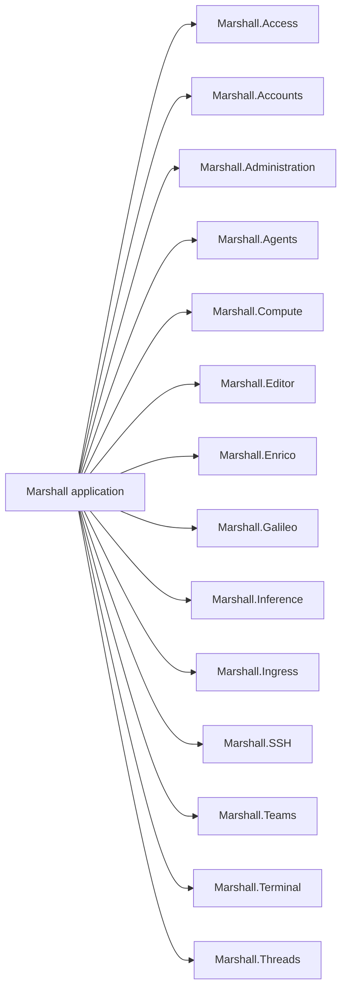

# Ash business domains

An Ash domain groups resource actions and their code interfaces. It is a business
boundary inside an application. It does not create a service, database or process.
The diagrams and resource inventory below are extracted from literal declarations.

Browser extension presence detection is outside Ash domain ownership. The browser
requests optional exact-origin access and emits a local document marker; Marshall
only uses that marker for setup presentation. It creates no resource, listener,
identity, machine grant or durable authority, so no new domain or resource enters
the ownership inventory.

## Responsibilities

| Domain | Responsibility and authority |
| --- | --- |
| `Marshall.Accounts` | User identity, login tokens, email verification, passkeys, account deletion and permanent GuestAccount UUID/UID reservations. Immutable `u<uid>` guest identity belongs to the User UUID independently of its email. Authentication identifies a caller; resource policy still decides access. |
| `Marshall.Access` | Persisted machine grants, grant changes and per-user machine pins. Cedar evaluates current ownership, direct VM sharing, team membership and canonical current-thread grants; a cached permission cannot authorize a later mutation. A pin confers no authority; the owner's pin is read by the lifecycle coordinator as a deletion fence (ADR-0193). |
| `Marshall.Administration` | Administrative job snapshots, retries and audit projections. Read access and elevated administrative mutations have separate checks. |
| `Marshall.Agents` | Agent roots, threads, turns, events, commands, model calls and executor leases. Active context snapshots/checkpoints, planning questions/proposals and managed skill configuration extend this same authority under ADR-0178/0179. Persisted leases and current authority fence execution. |
| `Marshall.Threads` | User-level objectives, titles, modes, durable provisioning, canonical sharing grants and immutable sharing results. The current thread-to-VM binding contributes grants to machine authority; the coordinator delegates admission, execution and teardown to the existing domains. |
| `Marshall.Compute` | Host enrollment, pools, reservations, VM intent, placements, operation receipts and lifecycle workflows. The ledger owns admission and durable execution authority, including immutable source2 provider/namespace/revision `WorkspaceSource` references pinned in provision/start commands. Current manifest4 image identity/capability gates source admission and new source-bearing command snapshots, including retained starts; the signed pending browser cookie owns no domain authority. |
| `Marshall.Editor` | Personal browser Login, Credential and Lease authority. Current stored login/write, permanent account and exact execution/release locks hold through the outer ledger commit; generic web/DNS visibility cannot authorize the editor. |
| `Marshall.Enrico` | Repository registration, refresh state and audit. The Enrico service holds the quota-bound mirror cache; the domain holds control-plane intent. |
| `Marshall.Galileo` | Integration definitions, encrypted header custody, attachments and peer tokens. Current attachment policy governs each authorized service interaction. |
| `Marshall.Inference` | Provider credentials, request admission and daily usage. Request authority and accounting remain distinct from provider-side execution. |
| `Marshall.Ingress` | Public services, publications, DNS, TLS custody, readiness and ingress sessions, including short-lived immutable EditorAssetsReceipt. Discovery binds current placement/assets but does not grant Editor authority. |
| `Marshall.SSH` | Account keys, browser approvals, gateway sessions, management requests, guest login and public host-certificate generations. Signing locks current service or boot authority through publication; the private CA remains outside PostgreSQL. Management authority does not grant host administrative SSH. |
| `Marshall.Teams` | Teams, membership and resource transfers. Mutations enter Compute's ledger commit scope so authority changes share its transaction boundary. |
| `Marshall.Terminal` | Grants, locations, openings, sessions, events and tickets. Exclusive writer leases and current execution fences govern terminal access. |
| `Lilly.Lifecycle` | OS-locked execution, dataset, snapshot, import, same-pool clone-copy, resize, trust, workspace-source delivery, provisioning, template and permit journals. Provisioning progress records readiness without granting launch or cleanup authority. A clone-copy journal (ADR-0145) binds a same-pool clone destination to its verified source snapshot and its own ordinary claim; it grants neither execution authority nor capacity credit. Host-local physical ownership does not depend on PostgreSQL availability. |

## Authority and interactions

Arrows identify authority inputs and coordination paths; they are not a complete
function call graph. The policy/coordinator box is not an Ash domain. Marshall
domains share PostgreSQL and may compose actions in one transaction. For example,
[team mutations](repo:marshall/lib/marshall/teams.ex) use
[Compute.Ledger](repo:marshall/lib/marshall/compute/ledger.ex).
[Authorization](repo:marshall/lib/marshall/authorization/cedar.ex) checks current facts;
process identity or a domain name alone grants no permission.

`Marshall.Threads` is a user-facing orchestration boundary above
`Marshall.Compute` and `Marshall.Agents`. A pending thread is durable before its
Oban provisioning worker runs; the thread mutation and job insert share a
transaction. The worker uses a machine admission key, records the admitted VM,
waits for an observed running state, binds the automatically registered agent
root and low-level thread, and submits the initial objective before reporting
ready. The machine key fences writes from stale provisioning attempts.
Thread reads and mutations recheck creator/team membership and current canonical
thread grants. The current binding contributes those roles to existing machine
Cedar authority without copying VM grants; machine-only grants do not expose the
task. Sharing locks the thread before its current VM, while independent VM/team
authority remains additive. Prompts and terminals retain their existing current
machine and personal-session checks. Archiving records
deleting and delegates teardown to Compute; retained physical archival history
permits the final archived state. Authorized archived transcript reads validate
the paired root/thread binding. Reopen retains the create request identity,
clears the retired binding and queues a fresh machine admission in one
transaction. PaperTrail and durable generation rows retain retired bindings;
authorized readers can browse previous transcript generations after reopen
through the read-only generation selector.

The accepted [context and guidance decisions](repo:docs/architecture/decisions/0178-durable-agent-context-and-planning.md)
add persisted model context, planning interaction and managed skill state to
Agents. These are resources within Marshall, not additional services. Thread
actions still resolve the current task binding and authorize the actor before
admission. Guest files are collected outside transactions, validated and then
attached as immutable snapshots under the current execution binding. Compaction
publishes a checkpoint only after matching the context generation and eligible
event frontier. Pending questions and exact proposal implementation share the
durable turn boundary. Implementation and verification remain scoped in the
[context review](repo:docs/architecture/reviews/2026-10-16-agent-context-and-planning.md).

The arrows describe the accepted interaction boundary. PostgreSQL owns admitted
context and selected revisions; the guest owns its filesystem and materialized
skill files. Ziggy owns provider execution/accounting within current admission,
not scheduling or checkpoint authority. A browser, PubSub hint or guest path
cannot independently authorize a context or configuration change.

[Lilly.Lifecycle](repo:lilly/lib/lilly/lifecycle.ex) uses host-local journals and
native locks. Delivery, observation and accepted control-plane outcome remain
separate states. Loss of a host report does not prove that its guest stopped.
See [lifecycle](#lifecycle), [workflows](#workflows) and [security boundaries](#security).

<!-- hldd:view:start -->
## Declared ownership

Arrows mean application ownership, not calls or deployment units. Resources below are literal declarations, deduplicated; extension-generated versions are excluded.

| Ash domain | Declared resources |
| --- | --- |
| [`Lilly.Lifecycle`](repo:lilly/lib/lilly/lifecycle.ex) | `Lilly.Lifecycle.BackupSnapshot`, `Lilly.Lifecycle.Checkpoint`, `Lilly.Lifecycle.CloneCopy`, `Lilly.Lifecycle.Dataset`, `Lilly.Lifecycle.Execution`, `Lilly.Lifecycle.GuestTrust`, `Lilly.Lifecycle.ImageTemplate`, `Lilly.Lifecycle.Import`, `Lilly.Lifecycle.Permit`, `Lilly.Lifecycle.Provisioning`, `Lilly.Lifecycle.Resize`, `Lilly.Lifecycle.SnapshotPointer`, `Lilly.Lifecycle.SnapshotSet`, `Lilly.Lifecycle.WorkspaceSource` |
| [`Marshall.Access`](repo:marshall/lib/marshall/access.ex) | `Marshall.Access.Change`, `Marshall.Access.Grant`, `Marshall.Access.Pin` |
| [`Marshall.Accounts`](repo:marshall/lib/marshall/accounts.ex) | `Marshall.Accounts.AdminBootstrap`, `Marshall.Accounts.AdminEvent`, `Marshall.Accounts.AuthEmail`, `Marshall.Accounts.GuestAccount`, `Marshall.Accounts.GuestAccount.Version`, `Marshall.Accounts.Passkey`, `Marshall.Accounts.PasskeyChallenge`, `Marshall.Accounts.Token`, `Marshall.Accounts.User`, `Marshall.Accounts.UserDeletion`, `Marshall.Accounts.Verification` |
| [`Marshall.Administration`](repo:marshall/lib/marshall/administration.ex) | `Marshall.Administration.AuditEvent`, `Marshall.Administration.JobEvent`, `Marshall.Administration.JobSnapshot` |
| [`Marshall.Agents`](repo:marshall/lib/marshall/agents.ex) | `Marshall.Agents.AuditEvent`, `Marshall.Agents.CLISession`, `Marshall.Agents.Command`, `Marshall.Agents.ContextCheckpoint`, `Marshall.Agents.ContextSnapshot`, `Marshall.Agents.Event`, `Marshall.Agents.Executor`, `Marshall.Agents.ModelCall`, `Marshall.Agents.PlanProposal`, `Marshall.Agents.PlanningQuestion`, `Marshall.Agents.Root`, `Marshall.Agents.SearchCache`, `Marshall.Agents.SearchUsage`, `Marshall.Agents.SkillInstallation`, `Marshall.Agents.SkillOperation`, `Marshall.Agents.SkillRevision`, `Marshall.Agents.Thread`, `Marshall.Agents.Turn` |
| [`Marshall.Compute`](repo:marshall/lib/marshall/compute.ex) | `Marshall.Compute.CleanupRequest`, `Marshall.Compute.CloneEffect`, `Marshall.Compute.CloneRequest`, `Marshall.Compute.EnrollmentOperation`, `Marshall.Compute.Evacuation`, `Marshall.Compute.EvacuationItem`, `Marshall.Compute.Host`, `Marshall.Compute.HostCredential`, `Marshall.Compute.HostDrain`, `Marshall.Compute.HostSession`, `Marshall.Compute.Image`, `Marshall.Compute.LifecycleEvent`, `Marshall.Compute.NetworkAddress`, `Marshall.Compute.Operation`, `Marshall.Compute.PhysicalOutcome`, `Marshall.Compute.ProbeRequest`, `Marshall.Compute.ReadinessRequest`, `Marshall.Compute.Relocation`, `Marshall.Compute.RelocationRetry`, `Marshall.Compute.Reservation`, `Marshall.Compute.ResizeRequest`, `Marshall.Compute.ServiceLevelAttempt`, `Marshall.Compute.ServiceLevelTotal`, `Marshall.Compute.SourcePermitRequest`, `Marshall.Compute.StoragePool`, `Marshall.Compute.TransferSlot`, `Marshall.Compute.VirtualMachine`, `Marshall.Compute.WakeRequest`, `Marshall.Compute.WakeRequestKey`, `Marshall.Compute.WorkflowServiceLevelAttempt`, `Marshall.Compute.WorkloadPlacement`, `Marshall.Compute.WorkspaceSource` |
| [`Marshall.Editor`](repo:marshall/lib/marshall/editor.ex) | `Marshall.Editor.Credential`, `Marshall.Editor.Lease`, `Marshall.Editor.Login` |
| [`Marshall.Enrico`](repo:marshall/lib/marshall/enrico.ex) | `Marshall.Enrico.AuditEvent`, `Marshall.Enrico.Repository` |
| [`Marshall.Galileo`](repo:marshall/lib/marshall/galileo.ex) | `Marshall.Galileo.Attachment`, `Marshall.Galileo.Credential`, `Marshall.Galileo.Integration`, `Marshall.Galileo.IntegrationHeader`, `Marshall.Galileo.PeerToken` |
| [`Marshall.Inference`](repo:marshall/lib/marshall/inference.ex) | `Marshall.Inference.Credential`, `Marshall.Inference.Daily`, `Marshall.Inference.Request` |
| [`Marshall.Ingress`](repo:marshall/lib/marshall/ingress.ex) | `Marshall.Ingress.EditorAssetsReceipt`, `Marshall.Ingress.Endpoint`, `Marshall.Ingress.Environment`, `Marshall.Ingress.EnvironmentPublication`, `Marshall.Ingress.EnvironmentStream`, `Marshall.Ingress.FleetCertificate`, `Marshall.Ingress.FleetCertificateAccount`, `Marshall.Ingress.FleetCertificateInstallation`, `Marshall.Ingress.Publication`, `Marshall.Ingress.Relay`, `Marshall.Ingress.Route`, `Marshall.Ingress.Service`, `Marshall.Ingress.Session`, `Marshall.Ingress.WebCredential`, `Marshall.Ingress.WebLogin`, `Marshall.Ingress.WebStream` |
| [`Marshall.SSH`](repo:marshall/lib/marshall/ssh.ex) | `Marshall.SSH.Approval`, `Marshall.SSH.Gateway`, `Marshall.SSH.GuestLogin`, `Marshall.SSH.HostCertificate`, `Marshall.SSH.Key`, `Marshall.SSH.Request`, `Marshall.SSH.Session` |
| [`Marshall.Teams`](repo:marshall/lib/marshall/teams.ex) | `Marshall.Teams.Team`, `Marshall.Teams.TeamMember`, `Marshall.Teams.Transfer` |
| [`Marshall.Terminal`](repo:marshall/lib/marshall/terminal.ex) | `Marshall.Terminal.Event`, `Marshall.Terminal.Grant`, `Marshall.Terminal.Location`, `Marshall.Terminal.Opening`, `Marshall.Terminal.Session`, `Marshall.Terminal.Ticket` |
| [`Marshall.Threads`](repo:marshall/lib/marshall/threads.ex) | `Marshall.Threads.AccessChange`, `Marshall.Threads.Generation`, `Marshall.Threads.Grant`, `Marshall.Threads.Thread` |
<!-- hldd:view:end -->

## Verification and gaps

Compute additionally owns `ServiceLevelAttempt`, `WorkflowServiceLevelAttempt`
and `ServiceLevelTotal` under
[ADR-0133](repo:docs/architecture/decisions/0133-durable-physical-service-level-accounting.md).
Admissions commit with operations or accepted operation-linked SSH receipts.
Their immutable deadline results and permanent numeric aggregates are reliability
evidence only. The reconciler reads retained physical and exact-execution
readiness evidence, and never changes execution, reservations or receipt status.
Timers can classify a measurement failure while the guest continues to run.
Workflow attempts commit with their canonical SSH mutation receipts. They retain
clone sequence and retry operation binding, terminal exclusions for cancelled or
superseded original intents, and independent cancellation-command outcomes.
These measurements provide no workflow, reservation or execution authority.

[View properties and units](repo:marshall/test/architecture/hldd_views_test.exs)
check source drift, domain/resource ownership and missing explanations. The
[NixOS browser scenario](repo:nix/verification/tests/machines/hldd/browser.py) checks the release's
authenticated section delivery and rendered diagrams. Neither establishes that a
resource policy is correct.

Use NixOS machine integration tests for native effects and property tests for
authority/state histories. The [scenario ledger](#coverage) records exact evidence
and remaining gaps for sharing, execution, ingress, private services and recovery.
[Enrollment histories](repo:marshall/test/marshall/compute/enrollment_history_test.exs)
cover the Compute enrollment/credential/drain/retire ownership boundary against a
pure model; the [replacement journey](repo:nix/verification/tests/machines/fleet/scenarios/host-replacement.py)
repeats it on the real topology with fresh physical identities.
The [fleet lifecycle scenario](repo:nix/verification/tests/machines/fleet/scenarios/lifecycle.py)
exercises real guests, but is not exhaustive coverage of every action in this
inventory. There is no complete generated cross-domain authorization matrix;
add stale/foreign-authority histories and a native allowed/refused journey when
changing a sensitive action. Extension-generated resource versions are not
enumerated by this source view; inspect their retention and redaction separately.
