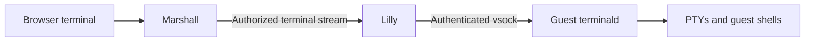

# Lilly terminald

`lilly-terminald` is the Rust terminal multiplexer inside Overalls guests. It
creates shells on PTYs, retains bounded scrollback and keeps sessions alive
across browser disconnections, accepting authenticated control and attachments
from Lilly over vsock for the current guest boot.

See the [terminal handbook](../../../marshall/priv/hldd/08-interactive.md) and
[multiplexer decision](../../../docs/architecture/decisions/0082-guest-terminal-multiplexer.md).
