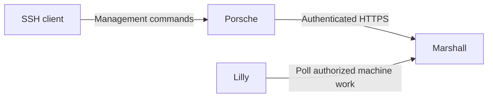

# Porsche

Porsche is Overalls' Elixir SSH management gateway. It turns interactive and
one-shot management commands into authenticated Marshall API requests, keeping
account authority and machine operations in Marshall.

See [Porsche operations](../docs/porsche-operations.md) and the
[SSH management decision](../docs/architecture/decisions/0046-porsche-ssh-management.md).
