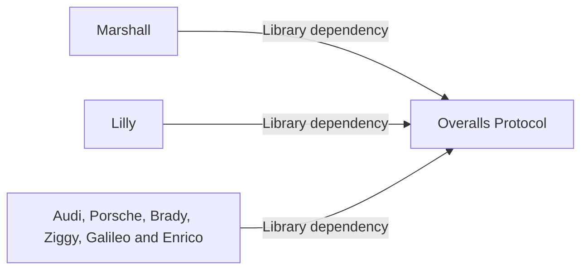

# Overalls Protocol

Overalls Protocol is the shared Elixir library for bounded wire validation,
versioned schemas and management command grammar. It lets independent services
agree on their interfaces without sharing application runtimes, database access
or host operations.

See the [transport guide](../docs/operations/provisioner-transport.md) and
[protocol contracts](CONTRACTS).
