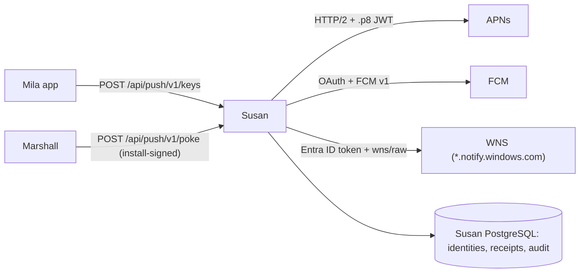

# Susan

Susan is the content-free push relay for Mila notifications (ADR-0224).
Marshall pokes Susan with an end-to-end ciphertext and an opaque push key that
only Susan can open; Susan forwards the ciphertext to APNs, FCM or WNS
(ADR-0236). Susan never
sees message content, and Marshall never sees provider tokens.

- Endpoints: `POST /api/push/v1/keys`, `POST /api/push/v1/poke`, `GET /healthz`.
- WNS tokens are channel URIs, accepted only as `https` on port 443 to a host
  under `.notify.windows.com` (`susan-wns-channel-shape`), checked at issuance
  and before every send. WNS is off until `services.susan.wnsAppIds` is set.
- Operator commands: `susan-operator 'Susan.Operator.audit_verify()'` and the
  other functions in `Susan.Operator` (audit tail/export, deny-list, block).
- Deployment: `services.susan` (NixOS) or `packages.x86_64-linux.image-susan`
  (OCI). Secrets are documented in [secrets/README.md](../secrets/README.md#susan-push-relay).
